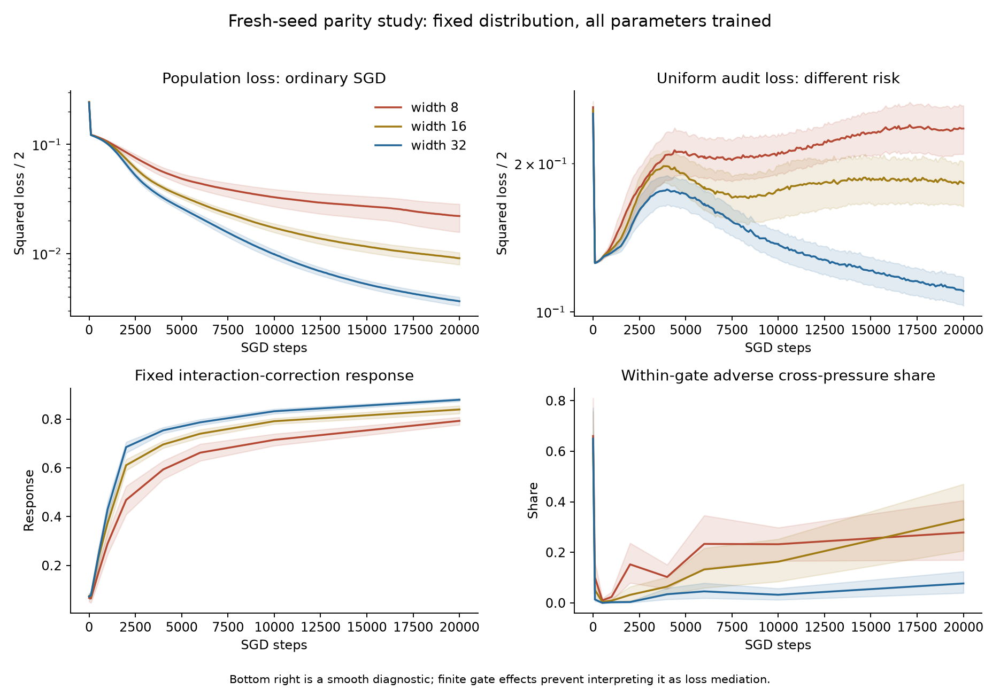
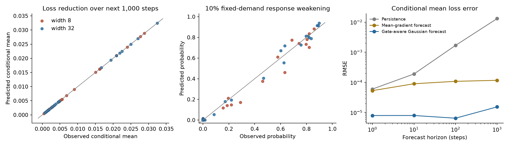

# Frequency pressure on unequal-frequency parity

**Research status:** this exploratory branch did not establish the desired
extension of option competition. Its conditional SGD simulator is outside the
current target. The [reserve-led bridge](../../../../docs/evidence/reserve_bridge/README.md) is the
current positive extension; these results and failures are preserved unchanged.

31 October 2026. [Derivations and interpretation](../../model/frequency_pressure.md),
[dataset](../../../../docs/parity_dataset.md), [complete compact analysis](analysis.json).

## What the experiment establishes

Ordinary fixed-distribution minibatch training has a substantial, replicated
width effect on population loss. Pressures associated with different factors
can have opposing effects on neural margins and correction response. However,
the simple explanation that width helps by monotonically preventing
common-pressure destruction does **not** survive these tests. Gate changes,
response creation, shared gradient noise, and changing residual demands matter.

The new conditional Gaussian pressure model predicts future ordinary-SGD loss
well while retaining all gates and shared gradient correlations. It is a
computational baseline for a reduced theory, not a closed initial-state loss
law or proof that competition mediates the entire width gap.

## Training and controls

The main task has eight independent bits, q_i=.4/i, and ordinary odd-parity
labels. Inputs are raw bits plus an intercept. The shallow network is
c+mean_j a_j ReLU(w_j^T[x,1]), with the existing optimizer metric
M_w=M_a=mI, M_c=1. This metric and normalization are declared, not Euclidean SGD
in the same physical parameters. Gaussian initialization has scale .3. Widths
8/16/32 share nested initialization banks and identical minibatch streams.
Every parameter is updated on every ordinary training step, with batch 128 and
rate .05. There are no frozen gates, pressure knockouts, distributions changed
during training, curricula, or neuron interventions.

The complete 256-input population gives exact population loss and response
diagnostics. The same inputs with uniform weights give a different audit risk,
not novel-support generalization. Width eight has an exact representational
witness, but ordinary optimization need not find it.

Development used 32 seeds; confirmation used 32 fresh seeds. At 20,000 steps:

| Cohort | Width 8 loss | Width 16 loss | Width 32 loss | Paired 8-minus-32 gain, 95% seed-bootstrap interval |
|---|---:|---:|---:|---|
| Development | .021897 | .007722 | .003741 | .018156 [.014611, .022130] |
| Fresh confirmation | .022123 | .009090 | .003671 | .018452 [.013067, .025467] |

Width 32 has lower endpoint population loss in all 32 pairs in each cohort.
This does not make feature-frequency heterogeneity the cause of the width gap:
the equal-frequency controls also show a width effect.

| Development control, 32 seeds each | Width 8 loss | Width 16 loss | Width 32 loss |
|---|---:|---:|---:|
| Centered input | .016136 | .006244 | .002959 |
| Flatter power profile, alpha=.5 | .052577 | .020320 | .007813 |
| Geometric profile, same endpoints | .035198 | .010827 | .004793 |
| Equal frequencies, matched total activity | .028518 | .010138 | .005208 |
| Equal frequencies, matched label balance | .040413 | .013921 | .006186 |
| Uniform initialization, matched scale | .022570 | .007591 | .003679 |
| Small initialization, scale .05 | .018659 | .008200 | .004322 |
| All q_i=.5 | .093938 | .058583 | .028938 |

All rows use 20,000 steps. Halving the rate and doubling the step budget gives
.022156/.007482/.003754, close to the main development endpoints; it processes
twice as many examples and is not a matched-example comparison. At the original
rate, extending the development cohort to 100,000 steps gives
.009737/.002216/.000814. Deficits persist over that finite budget but are not
proven permanent. The control cohorts share seed banks; they are not additional
independent replications.

At loss .04, all 16 diagnostically audited confirmation seeds at each width
have a crossing bracket. Interpolated within-gate adverse cross-pressure shares
are .218/.068/.030 at widths 8/16/32. This retains the descriptive width contrast
at matched progress, with different training steps. Interpolation is between
sparse diagnostic checkpoints, not an event forecast. At loss .02 only 12/16
audited narrow seeds have a bracket; conditional comparisons must retain that
selection. Full 32-seed time-to-loss records include right-censoring counts.



Top-panel bands are 1.96 standard errors of seed means. Bottom-panel bands are
95% seed-bootstrap intervals. Population response uses the fixed population
measure within each frequency condition; no cross-condition eigenmode alignment
or direct cross-q response comparison is claimed.

## What competition measurements do and do not show

The residual is decomposed in the exact product-distribution ANOVA basis.
Interactions are allocated equally to participating factors for the compact
factor-pressure view; the full unallocated modal ledger is also computed.
These are current residuals, not assigned neuron roles or hidden target subtasks.

At step 10,000 in the 16-seed confirmation audit, the mean share of negative
off-diagonal factor-to-singleton smooth response transport is .232 at width 8
versus .032 at width 32. Negative cross-term fractions are .328 versus .056.
Those differential effects replicate, but smooth transport alone fails badly
on actual finite updates. Gradient cancellation also has both signs; substantial
early cooperation rejects a generic suppression law.

Finite continuation audits use 64 fresh, ordinary SGD minibatches per state at
steps 6,000 and 10,000, widths 8/32, and 16 original seeds. Exact straight-path
pressure attribution includes gate jumps and sums to the actual kernel change
to about 1e-13. At step 10,000, the factor pressures have both positive and
negative margin contributions on roughly 90%/87% of the weighted gate crossings
at widths 8/32. This is direct evidence of opposing pressures in the coupled
neurons during real SGD updates.

But the finite-path adverse cross-pressure shares are .453 [.353,.544] and
.464 [.351,.587]. The clean narrow/wide ordering from the smooth diagnostic
does not carry over. Shares are attribution-dependent and can have large
cancellations near boundaries. They are not promoted into a width-loss law.
Opposing pressures and local response weakening have been established;
unique causal mediation of long-budget loss harm has not.

This is not confined to probes with no declared demand. At step 10,000, finite
factor allocations contain adverse contributions to the checkpoint's current
residual response in all 16 audited states at each width. Opposing positive and
negative factor contributions occur in 14/16 narrow and 6/16 wide states. The
adverse share is nevertheless larger at width 32, another reason not to equate
one negative-share statistic with the width loss penalty. These statements use
the declared path allocation; they do not establish unique mediation.

The common fixed interaction-correction response strengthens more at larger
width. In contrast, response to a model's own moving residual can fall as easy
components are fitted. The derivation separates transport from residual sorting
and includes an exact endpoint version covering all gate changes.

## Prospective conditional forecasts

The Gaussian approximation matches the full conditional mean and covariance of
the minibatch gradient. It refreshes all residuals, gates, and moments at every
forecast step. Gaussian gradient weights occur only in the prediction model;
all validation paths use ordinary nonnegative-probability minibatch sampling.

Development used 36 checkpoint states from six original seeds, two widths, and
three checkpoints, with 64 prediction and independent validation particles per
state. Fresh confirmation used 48 states from eight new original seeds and 128
particles. Every forecast for a cohort was saved before any validation outcome
was generated. There are no fitted parameters. Particles, widths and checkpoints
are clustered by original initialization seed for uncertainty.

| Horizon in SGD steps | Persistence mean-loss RMSE | Mean-gradient forecast RMSE | Gate-aware Gaussian forecast RMSE |
|---|---:|---:|---:|
| 1 | 6.00e-5 | 5.33e-5 | 7.94e-6 |
| 10 | 1.90e-4 | 9.01e-5 | 7.96e-6 |
| 100 | 1.69e-3 | 1.08e-4 | 6.47e-6 |
| 1,000 | 1.31e-2 | 1.17e-4 | 1.54e-5 |

The 1,000-step Gaussian RMSE has a seed-bootstrap interval [1.08e-5,1.93e-5].
Validation Monte Carlo standard error has RMS 1.06e-5, so this is close to the
resolution of this conditional-mean test. The mean-gradient baseline also
predicts the broad loss trend well; noise improves conditional accuracy and
probabilistic response predictions. These are numerical forecasts conditioned
on checkpoints, not initial-state analytic predictions of the whole 20,000-step
curve. Forecasting 128 full parameter trajectories is computationally substantial.



For a 10% decline in instantaneous kernel response to the **fixed initial
residual of that checkpoint**, confirmation predicts a 1,000-step event rate
.359 versus observed .370; state-level calibration MAE is .032. This is
practical weakening, not structural closure or a spectral option count.

The width ordering of this own-demand event reverses across seed cohorts:
development observes .410/.254 at widths 8/32; confirmation observes .344/.396.
The predictor follows this change, but a universal width-protection claim fails.
Different widths' own residuals are different requests. The common interaction
probe and loss curves provide separate, more comparable measurements.

Small transfer checks at geometric and equal-activity frequencies use four seeds,
eight states and 64 particles. Their 1,000-step loss RMSEs are 4.19e-5 and 2.42e-5.
Geometric-profile response-event calibration MAE worsens to .092, so event
calibration is not claimed uniformly across frequency profiles.

## Failed approximations and remaining boundaries

- Smooth local first/second-order loss expansions, including coefficient-feature
  coupling and noise curvature, fail on this discrete dataset. On confirmation,
  the transported second-order 100-step loss RMSE is .310 versus .00166 for
  persistence. At 1,000 steps it is about 31.9. The equations are local Taylor
  expansions; these are explicit failures of their applicability, not negative
  empirical losses that were clipped away. Finite gate terms are needed.
- There is no evidence for independent neuron fates, a single coherent dominant
  direction, a frequency-only pressure coefficient, or a universal width exponent.
- Exact inactive-unit protected reserve can be vacuous because the pressure
  components cover the full support. An approximate reserve needs new premises.
- Full gradient moments are known exactly only because this task is enumerable.
  Estimation, larger feature sets, dependent latent factors, other architectures,
  and other batch sizes have not been validated here.
- Local adverse pressure and longer-run loss association do not establish a
  causal share of the natural-width loss gap. No isolated-pressure training
  intervention is presented as ordinary training evidence.

## Historical recommendation, superseded

This branch recommended **expected population-loss reduction over the next 1,000 ordinary SGD steps**,
as a function of checkpoint steps and width. Its prospective predictions and
independent outcomes are retained as exploratory results.
That recommendation is not adopted as the current priority. The
[current target](../../../../docs/model/reserve_relaxation.md) is aggregate option-response
weakening over learning phases, width dependence, then persistence and
consequential residual error. Finite gate transport and residual-demand sorting
remain useful diagnostics, rather than a new SGD-forecasting research objective.

## Reproduction and retained records

Run from the repository root. `protocol.json` in each archived run records all
arguments, frequency vector, source hashes, and executed-source snapshots.

```sh
VECLIB_MAXIMUM_THREADS=1 OPENBLAS_NUM_THREADS=1 .venv/bin/python scripts/studies/run_frequency_pressure.py --output runs/parity_pressure/confirmation --seed-bank 841100 --seeds 32 --diagnostic-seeds 16 --cohort confirmation
VECLIB_MAXIMUM_THREADS=1 OPENBLAS_NUM_THREADS=1 .venv/bin/python scripts/studies/probe_frequency_pressure.py --run runs/parity_pressure/confirmation --output runs/parity_pressure/confirmation_forecasts --seeds 8 --particles 128 --seed-bank 1057100
VECLIB_MAXIMUM_THREADS=1 OPENBLAS_NUM_THREADS=1 .venv/bin/python scripts/studies/audit_frequency_pressure.py --run runs/parity_pressure/confirmation --output runs/parity_pressure/finite_audit --samples 64
MPLCONFIGDIR=/tmp/parity_mpl VECLIB_MAXIMUM_THREADS=1 OPENBLAS_NUM_THREADS=1 .venv/bin/python scripts/studies/analyze_frequency_pressure.py --output docs/evidence/frequency_pressure
```

Choose new output directories when a protocol already exists; runners refuse
to overwrite cohorts. Full ignored checkpoints and trajectories are regenerable.
The maintained evidence keeps full seed-level curves for development and
confirmation; control curves are thinned to declared comparison checkpoints.
It also keeps protocols, sources, compact particle-level loss and fixed-response
forecast outcomes, finite-attribution summaries, and the failed smooth forecasts.
Per-particle conditional-loss and gate-mass arrays are regenerable from the
executed sources rather than duplicated in the compact archive. No observed
failure or reversal was removed from the analysis.
