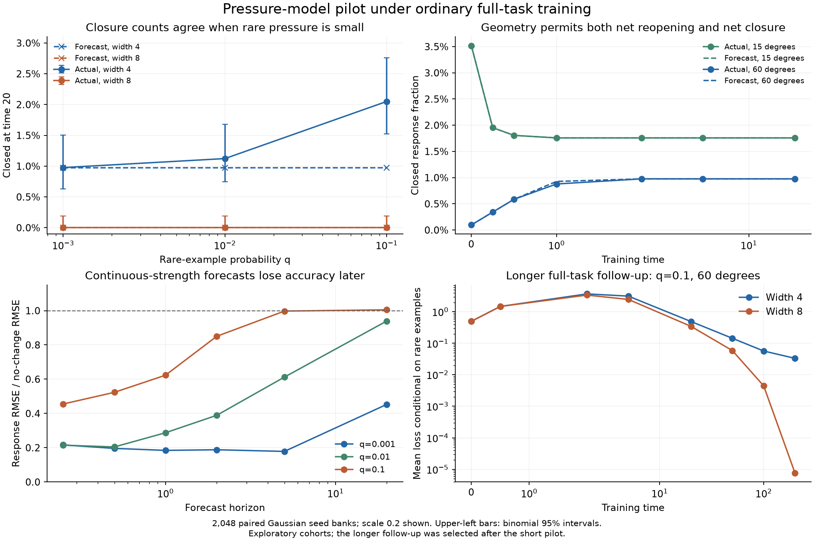

# Exploratory pressure-model test under ordinary full-task training

30 October 2026. This adds randomized network training to the earlier
[analytic consistency audit](../README.md). It tests a clock-bridged common-pressure
approximation, not a fitted closure rate or a universal final-loss law.

## Design and provenance

The task has inputs `(1,0)`, `(-cos(theta), sin(theta))`, and
`(-cos(theta), -sin(theta))`, targets `4, 1, -1`, and probabilities
`1-q, q/2, q/2`. The actual learner is the nonlinear mean-field ReLU network
with both layers and the output intercept trained, no hidden biases, and
`M_w=M_a=m, M_c=1`. All three examples contribute from the start. No gate
absorption or pressure restriction is imposed on full-task training.

The main cohort has 2,048 independent Gaussian seed banks, paired across:

- widths 4 and 8, both above a three-unit capacity witness;
- geometries 15 and 60 degrees;
- initialization scales .02 and .2;
- rare probabilities .001, .01, and .1.

There are 49,152 full-task setting/run combinations, not 49,152 independent
seeds. Euler step is .01; checkpoints are 0, .25, .5, 1, 2, 5, and 20.
Each setting also has a common-only control on the first 256 paired seeds.

For each initialization, the forecast integrates the scalar common-only clock
by RK4 and applies the existing exact feature transport. It uses no future
full-task measurements. All forecast files were written before any full-task
outcome. This retains dependence between the initial features and their clock;
it does not substitute a measured or mean clock into `b(u)^m`.

`protocol.json` and the executed producer snapshot were saved before outcomes.
`initial_bank.npz` and compressed per-seed checkpoint measurements support paired
analysis without retaining full parameter trajectories. `summary.json` contains
all settings; `analysis.json` collects numerical audits and follow-up results.

## Results

For scale .2 and the 60-degree geometry, endpoint complete unavailability at
time 20 is:

| Rare mass | Width 4 forecast / observed, out of 2,048 | Width 8 forecast / observed |
|---|---:|---:|
| .001 | 20 / 20 | 0 / 0 |
| .01 | 20 / 23 | 0 / 0 |
| .1 | 20 / 42 | 0 / 0 |

All the width-4 endpoint closures in this table arose in initially responsive
networks. Two other networks were initially unavailable and subsequently reopened.
At q=.001, the main-step endpoint labels match the forecast in every geometry,
scale, and width setting. In the 15-degree, scale-.2, width-4 case, the initially
closed count falls from 72 to 36; the model also captures net reopening.

Continuous response forecasts are less accurate than the closure counts suggest.
For scale .2, width 4, and 60 degrees, response RMSE / no-change RMSE is
.184/.287/.623 at time 1 for q=.001/.01/.1, and .453/.940/1.005 at time 20.
Even reconstructing response from the actual measured pressure does not repair
the late strong-rare-pressure errors. That reconstruction is retrospective;
it is not a forecast. The common-only numerical controls generally agree closely
with the scalar-clock reduction, with some boundary/step discrepancies.



### Longer follow-up

After inspecting the short pilot, q=.1, scale .2 was extended to time 200 on the
same 2,048 seed banks and both geometries and widths. This is an exploratory
follow-up, not independent confirmation. Its full records are in
[`../natural_training_long_followup_20261030/`](../natural_training_long_followup_20261030/protocol.json).

In the 60-degree case, all 42 width-4 networks satisfying the sufficient trap
conditions at time 20 remain closed at time 200, with total loss at least the
predicted .05 floor. By time 200, 75 width-4 networks are completely unavailable,
all newly lost since initialization; width 8 has zero such endpoints.
The additional 33 endpoints do not all meet the sufficient trap certificate.
The reduced model still predicts only 20 closures, materially underestimating
later full-task evolution.

Mean conditional rare-example loss at time 200 is .033279 versus .000007609
at widths 4/8. Total task loss is .00341065 versus .000000761. These are
descriptive width comparisons, not matched interventions proving mediation by
the measured response. Zero observed wide closures does not establish zero
probability: its two-sided Wilson 95% upper limit with 2,048 trials is .187%.

### Step-size audits

The same initial banks were rerun at step .005 for scale .2 and q=.01, then
q=.001. At time 20, all q=.01 endpoint labels agree between resolutions. At
q=.001, the 60-degree width-4 count changes from 20 to 21, while other checked
endpoint closure labels agree. See the
[q=.01 protocol](../natural_training_half_step_20261030/protocol.json) and
[q=.001 protocol](../natural_training_smallq_half_step_20261030/protocol.json).

The first 512 paired seeds of the q=.1 long follow-up were also checked at step
.005. All endpoint closure labels agree at times 20 and 200. Some individual
continuous response values remain step sensitive. `long_step_check.json` and
`long_step_check_source.py` retain this numerical audit.

## Interpretation and limits

The results support a useful common-pressure approximation in a genuinely
full-task, weak-rare-pressure regime, and random-initialization entry into the
previously constructed trap mechanism. They also expose the approximation's
failure as rare updates accumulate. They do not independently establish the
closed-form exponent at fixed training time, calibrate extremely rare width-8
tails, or transfer the model to SGD, continuous inputs, multiple common
directions, or realistic datasets. Closure frequencies and loss must remain
separate targets. The protocol grid precedes the main outcomes, but this is an
exploratory pilot with no independently held-out confirmation.

## Reproduction

Use fresh output directories; the producer refuses to overwrite protocols.

```sh
.venv/bin/python scripts/studies/probe_probabilistic_natural_training.py --output <new-main-directory>
.venv/bin/python scripts/studies/probe_probabilistic_natural_training.py --output <new-half-step-directory> --step .005 --scales .2 --rare-mass .01
.venv/bin/python scripts/studies/probe_probabilistic_natural_training.py --output <new-smallq-half-step-directory> --step .005 --scales .2 --rare-mass .001
.venv/bin/python scripts/studies/probe_probabilistic_natural_training.py --output <new-long-directory> --scales .2 --rare-mass .1 --control-count 64 --times 0 .5 2 5 20 50 100 200
.venv/bin/pytest -q tests/test_probabilistic_natural_training.py tests/test_probabilistic_option_transport.py
```

The analyzer expects the four cohort directory names used in this record under
its `--root`. Its optional `--long-step-check` performs the additional paired
512-seed refinement audit and refuses to overwrite that audit.
