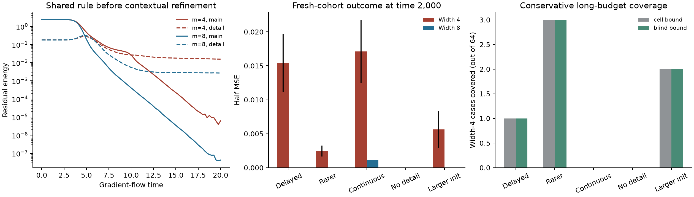
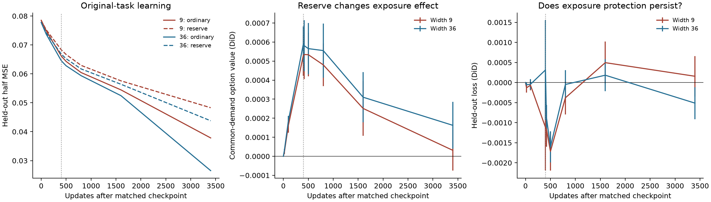

# Options under delayed demand: transport, implementation slack, and recovery

28 October 2026. This extends the GD-derived options framework. It does not
replace functional response modes with neuron roles or a new editing objective.
MNIST constrains claims made about MNIST; it does not determine the task
assumptions under which the competition hypothesis should work.

## Main finding

The useful refinement is **demand arriving late in the learning process, while
the implementations supporting it are already changing**. The demand need not
arrive late in the data: all labels and contexts can be present throughout.
Learning a frequent shared rule changes which residual directions remain
important. A capability that contributes little to early progress can become
essential to subsequent correction.

Keep the existing response operator as the measure of available capability.
Options are its nonzero spectral residual components together with their
responses and residual-weighted values, as defined in the
[spectral foundation](../../../docs/model/spectral_options.md#3-capability-modes-and-demanded-options).
Add a law, or a measured intervention, for its evolution under ordinary training.
Do not equate a broad spectrum, a large parameter nullspace, low gate turnover,
or many duplicate units with usable slack. The missing bridge is selective
preservation **or timely regeneration** of the responses needed after the shared
rule has been learned.

This iteration supplies three concrete advances and their limits:

1. A function- and full-kernel-matched intervention separates current option
   strength from subsequent response transport. Its initial smooth transport
   can be predicted exactly. On a local-calibration task, suppressing transport
   obstructs useful feature creation and worsens learning. Generic preservation
   is therefore not the right hypothesis for that task.
2. Fresh ordinary-training experiments on the existing contextual-calibration
   family verify the delayed-demand sequence. In the confirmation cohort,
   width 4 has 11/64 persistent discrete failures, width 8 has none. All 11
   narrow failures lose a residual-loaded response after initialization and
   before contextual error overtakes shared-rule error. Four neurons can
   represent every target exactly. Removing contextual refinement reduces the
   mean final width gap from .015469 to approximately 3.7e-9 half MSE.
3. A finite-budget recovery bound connects a missing functional distinction to
   actual remaining loss without assuming a frozen future kernel. It is a
   sufficient condition for gradient flow, not a complete forecast. Numerical
   coverage is conservative: at time 100 it covers only 1/11 of the confirmation
   base-task failures through time 2,000. Continuous variation produces real
   recovery and defeats an unconditional frozen-span floor.

The evidence supports a conditional mechanism in this toy family, not a general
claim that width primarily works by preserving options. A new timing
intervention is reported separately below; its small discrete rescue and adverse
continuous results do not uniquely establish mediation of the width gap.

## 1. What was preserved and verified

Read together with [GD residual options](../../../docs/model/spectral_options.md) and the
[research objectives](../../../OBJECTIVES.md). Earlier option-renewal,
polarization, and matched-loss studies are archived in commit `92b7904`.
The retained [historical audit](../evidence/option_transport_resilience/history_audit.json)
records the claims from those studies that constrain this model:

| Observation | Recomputed value | Consequence |
|---|---:|---|
| MNIST final train CE, 32 / 128 | .206068 / .179768 | A behavioral width benefit exists. |
| Late held-out-seed RMSE, baseline / scalar options | .001152 / .002577 | Do not revive the failed scalar forecast claim. |
| Own residual in weakest half, 32 / 128 | .920589 / .949378 | Remaining-error difficulty and supply differ. |
| Same width-difference demand, wide/narrow value | 1.20824 | Fixed-demand capability can favor width. |
| Fresh tangent RMSE, independent / known batches | .001407 / .0002058 | Conditional and unconditional forecasts differ. |
| Narrow ordinary / retained-tangent CE at 8,000 | .050581 / .067304 | Regeneration can be beneficial. |
| Base/near polarization errors | Two false failures, no missed failures | A restricted task-derived law already works. |
| Rare-context polarization errors | 26 false failures | Recruitment invalidates some fate-to-loss predictions. |

The audit's binary threshold summary for continuous polarization arrays is not
an extinction classifier: those endpoints include small within-cluster errors.
The matched-loss analysis and its interpolation code were inspected as well;
equal loss still does not match residuals. This is a selected raw-data audit,
not a rerun of all historical experiments.

## 2. Start from a task that actually creates delayed demands

Consider a shared calibration rule with a contextual adjustment:

\[
 Y=bZ+dRZ,\qquad R\sim\mathrm{Bernoulli}(q),\quad R\perp Z,
 \quad Z\overset d=-Z.
\]

An attribute has a common predictive meaning, but a less frequent context changes
its gain. Inputs contain a noisy context encoding and the attribute. A detector
useful on the common context can also affect the rare context; fitting its broad
use does not automatically preserve the context-specific adjustment.

Decompose the *task*, for explanatory purposes, as

\[
 Y=(b+qd)Z+d(R-q)Z.
\]

Their orthogonality follows from context independence and centering. It is not
an arbitrary choice of orthogonal network features. No units are assigned to
either term. At small initial output their loss energies are

\[
 E_{\rm shared}(0)=\tfrac12(b+qd)^2\mathbb E Z^2,
 \qquad E_{\rm detail}(0)=\tfrac12d^2q(1-q)\mathbb E Z^2.
\]

For b=d=2 and q=.1 these are 2.42 and .18. Early training can therefore be
dominated by the shared rule; after that rule is fitted, contextual detail
accounts for a much larger fraction of the remaining demand. Low energy alone
does not prove low parameter force: the derivative geometry also matters. The
prior polarization derivation gives a task-driven early force in this family;
the new trajectories directly test the temporal ordering rather than assuming
it from q alone.

The competition hypothesis requires additional network-level facts:

* shared-rule learning moves implementations that also support the refinement;
* that movement selectively weakens a correction still needed later;
* alternative implementations do not all disappear together, or can be recruited;
* narrow recovery is sufficiently incomplete over the remaining training budget.

Task rarity supplies a plausible ordering of pressures; it does not by itself
prove any of these facts. In particular, making a context rarer can interrupt
early destructive alignment by changing when feedback becomes important. A
monotone “rarer means more extinction” prediction is not justified.

The mechanism should be weak or absent when there is no contextual refinement,
the same representation easily serves both demands, the needed responses remain
well supported, the contexts are already separated by the representation, or
recovery completes well before evaluation. Continuous within-context variation
may expose recruitment signals missing from a prototype-only task. That is a
boundary of the mechanism, not a reason to change the hypothesis to fit MNIST.

## 3. Three refinements within the same options framework

### A. Response options with a task-conditioned transport law

Keep fixed output coordinates, data weights, and optimizer metric M. With
D=JM^(1/2), A=D^T H D/n, and a declared horizon tau, retain

\[
 C_\tau=\frac1nD(A+(2\tau)^{-1}I)^{-1}D^T.
\]

The operator's eigenspaces are capability modes. For a declared residual d,
an option is a nonzero projected correction q_E=Pi_E d, considered together
with its response beta_E. Its value is beta_E ||q_E||²/(2n); summing gives
d^T C_tau d/(2n). A demanded zero-response correction is a closed option;
zero demand is not closure. Degenerate modes are subspaces, and null or weak
responses are not automatically permanent. Demand and capability remain
separately measurable, but the option definition includes both. A fixed
arbitrary direction with no declared demand remains a capability probe.
No semantic or neuron roles enter this definition.

The extra object is the **response transition induced by actual training**:

\[
 \mathcal T_{\theta,h}^{A}=C_\tau(\theta-hM\nabla L_A)-C_\tau(\theta).
\]

L_A is the original loss on an observed exposure, with its sampling weights.
The expression is an audit of an ordinary update, not a new loss optimized by
the model. On a fixed demand d, d^T T d distinguishes weakening from creation.
Changing the residual while taking this difference would conflate demand removal
with loss of capability. For smooth networks and constant M, the infinitesimal
version is DC[-M grad L_A]; ReLU experiments must also include gate transitions.

For squared loss, K=DD^T/n and C=K(K+lambda I)^(-1), lambda=(2 tau)^(-1).
The exact derivative is particularly simple:

\[
 \dot C=\lambda(K+\lambda I)^{-1}\dot K(K+\lambda I)^{-1}.
\]

Thus the relevant sign is the signed transport on filtered task demands, not
the total number of crossings or a decrease in trace. Cross-exposure contrasts
can isolate effects of another context; net transport under full training is
not automatically harmful competition. For cross-entropy, changing output
curvature must be recorded or controlled separately.

**Slack and width.** The resource is alternative implementations whose useful
responses do not all weaken under the same training pressure. Width can help
by changing the distribution of these responses and their co-evolution. A
checkpoint C does not encode that distribution. Initializing independently
does not establish independent survival after joint training.

**Operational estimate.** JVP/VJP products, short paired continuations, and the
existing matrix-free C products suffice for selected demands and random probes.
The full transport tensor is unnecessary. This is feasible as a checkpoint
audit; it is not yet a cheap validated monitor for a large network.

**Status.** This is the minimal preferred extension. It identifies the missing
process while preserving the current option definition. A transport measurement
alone still does not predict long-term loss.

### B. Implementation resilience at matched current response

All first-order implementations of a correction solve Du=d; if feasible they
form u_min+ker(D). But ordinary GD moves in range(D^T), orthogonal to ker(D).
Counting null directions does not show that training can use them. Matched-cost
identical clones remain synchronized. Alternative routes become useful only
through subsequent nonlinear evolution or a specified symmetry-breaking source.

Define implementations as different (theta,M) states with the same initial
function and response operator. Their *resilience* is the distribution of
subsequent option responses under the same ordinary training exposures. This
defines a comparison, not an intrinsic integer route count. It allows overlapping
implementations without treating parameter blocks as independent.

A constructive matched-response intervention gives this proposal a sharp test.
Write one hidden layer as

\[
 f=c+\frac1m\sum_{j=1}^m a_j\sigma(w_j^Tx),
\]

including the bias in x. The original metric is M_a=M_w=mI, M_c=I. Replace
each unit by k copies with w_jr=w_j and a_jr=c_r a_j, where sum c_r=1.
Keep denominator m, and use the fixed metrics

\[
 M_{a,jr}=m/k,\qquad M_{w,jr}=m/S,
 \qquad S=\sum_r c_r^2.
\]

The function is unchanged. Readout-kernel contributions sum to their old value,
as do incoming contributions because sum c_r^2/S=1. Consequently the complete
initial kernel, all C_tau operators at matched curvature, and the initial loss
derivative are unchanged on **every input**, not only on one measured residual.

Within the initial gate cell, direct differentiation gives

\[
 \dot K_{\rm copies}=\frac1{kS}\dot K_{\rm original}.
\]

Uniform c_r=1/k gives kS=1 and exactly reproduces the original trajectory.
Concentrated c=(1,0,...,0) gives kS=k: smooth transport is slowed k-fold, while
the zero-readout copies can subsequently acquire readout signal. This changes
creation as well as destruction. Gate-mediated transport does **not** obey this
factor: the load-bearing original copy initially has its original gate velocity.

These are ordinary gradients of the original loss with a declared fixed metric.
They are Euclidean GD after a fixed linear change of coordinates, but they are
not ordinary widening at the original parameterization and learning rate. The
experiment isolates initial response from higher-order evolution; it does not
isolate extra parameters from every subsequent feature-learning speed effect.
Nor do copied incoming features supply new initial coverage.

**Absence conditions.** No benefit is expected when copies remain synchronized,
when they inherit an already blind set and receive no recruitment signal, or
when damping useful feature creation is more costly than preservation.

**Estimation.** Function/kernel matching, common-demand transport, and original
loss continuations directly test the operational definition. A later outcome
difference with exactly matched C proves that C alone is not a closed state;
it does not prove that the particular extra implementation was beneficial.

### C. Finite-budget accessibility and recovery

The definition of demanded options remains the same. The extension is a time-indexed claim about
when a weakened direction can become useful again. For squared loss in fixed
weighted coordinates, actual gradient flow obeys

\[
 \dot e_t=-K_t e_t,\quad e_T=U(T,t)e_t,
 \quad \partial_s U(s,t)=-K_s U(s,t),\quad U(t,t)=I.
\]

The trajectory-conditioned benefit operator is

\[
 B_{t,T}^{\rm path}=I-U(T,t)^TU(T,t),\qquad
 L_t-L_T=\tfrac12 e_t^TB_{t,T}^{\rm path}e_t.
\]

It is PSD because K_s is PSD and the residual flow is contractive. Its modes
are functional corrections retained and learned along that realized response
history. If K is fixed it reduces to the familiar exponential spectral filter.
When kernels do not commute, exp(-integral K) is not the correct propagator;
order, rotations, and recovery time matter. A two-projector check is included
in the tests.

This is an exact continuous-time account, **not a forecast without a law for
future K**. A different demand generally changes the kernel trajectory. Applying
the realized U to another demand is a conditional replay, not a claim that the
counterfactual neural network follows it. CE, SGD noise, momentum, and finite
steps need their respective dynamics; do not silently apply this square-loss
identity to them.

The prediction needed for slack is now explicit: extra width must change the
timing or extent of useful response exposure enough to improve actual loss,
after distinguishing initial coverage and optimizer scale. A recovered option
can still arrive too late; an early disappearance can also have no lasting cost.

The next section provides a sufficient lower bound on useful recovery time.
It supplies a rigorous bridge in one restricted regime instead of fitting an
endpoint-dependent survival score.

## 4. A finite-budget recovery bound

Let theta follow full-batch gradient flow with constant positive metric M.
Suppose a parameter region Omega containing theta_0 has a functional restriction
that enforces loss at least F. Let r be the distance from theta_0 to leaving
Omega, measured in the M^(-1) norm. Until the first exit,

\[
 \int_0^T\|\dot\theta_s\|_{M^{-1}}^2 ds=L(\theta_0)-L(\theta_T)
 \le L(\theta_0)-F.
\]

Cauchy–Schwarz and the required displacement r imply

\[
 \boxed{T_{\rm exit}\ \ge\ \frac{r^2}{L(\theta_0)-F}.}
\]

If attaining loss below F requires leaving Omega, this also lower-bounds that
correction's recovery time. When the surplus is zero and r>0, the flow cannot
exit. If r=0 or the floor is uninformative, the result supplies no obstruction.
The proof uses an upper bound on available dissipation before exit, not a
claim that total response strength must fall.

### Two teacher-free instances

**Fixed gate cell.** On a finite weighted input support, a shallow ReLU network
with fixed gates lies in the linear span of 1 and g_j(x)x_l. Project labels
onto this complete span to obtain F_cell. This relaxes bilinear parameter
constraints, so its minimum is a valid lower bound on loss in the cell.
The missing component is a functional response direction outside the span,
discovered by linear algebra on model gates and data, not by choosing a teacher
direction. With incoming metric mI,

\[
 r_{\rm cell}^2=\min_{j,i}\frac{(w_j^Tx_i)^2}{m\|x_i\|^2}.
\]

This controls the first crossing, even if that crossing is irrelevant. The
initial experiment showed that this makes the bound unnecessarily conservative.

**A model-discovered blind set.** Let B contain inputs on which every unit is
strictly inactive. Their prediction is the same intercept. Until some unit
activates on B, the unavoidable risk is

\[
 F_B=\tfrac12\sum_{i\in B}p_i(y_i-\bar y_B)^2,
 \qquad
 r_B^2=\min_{j,i\in B}\frac{(w_j^Tx_i)^2}{m\|x_i\|^2}.
\]

Other gates may cross freely without repairing this distinction. Thus the same
bound with (r_B,F_B) measures a necessary event for *useful* recovery. B is found
from the model, and the missing contrast is the residual within B; no chosen
exception or neuron role enters the measurement. This is a special structural
witness for an option obstruction, not a proposal to redefine all options as
dead-unit counts. Broad nonzero but weak responses require other bounds.

The bound makes a useful distinction: the loss trapped in an unavailable
correction is not itself available dissipation for crossing back to that
correction. What drives recovery is the remaining reducible loss while the
restriction holds. This explains why ongoing main-task error can recruit new
routes, whereas a settled predictor may fail to do so.

**Limits.** These bounds concern gradient flow. The experiments use Euler GD and
check a halved step; that is numerical evidence, not a discrete-time theorem.
With a valid descent constant c for discrete GD the argument gives c r²/(L-F)
in optimizer-time units, but c has not been certified for these neural paths.
SGD can accumulate movement from noise and does not obey this dissipation bound.
For continuous support, a finite panel only certifies its empirical measure;
it does not certify a population blind region. Smooth activations typically
have no exact zero-response cell. Tiny margins and loose floors make the bound
vacuous. Floating-point forecasts conservatively subtract
1e-10(1+initial target energy) from the calculated floor, and are not interval
arithmetic certificates.

## 5. Experiments: delayed demand under ordinary training

The task and optimizer follow the existing contextual-calibration studies:

* x=(C,Z,1), C=2(2R-1)+bounded jitter, Z=+/-1 plus bounded jitter;
* y=2Z+dRZ, q=.1 or .02; no targets or contexts are introduced later;
* f=c+mean_j a_j ReLU(w_j^T x), all parameters trained;
* neuron metric mI, intercept metric one, GD step .05 to time 2,000;
* Gaussian both-layer initialization scale .002; a .2 control;
* nested widths 4 and 8, 64 paired starts per case and independent seed bank;
* discrete inputs, or spread .15 with 3-by-3 quadrature per context/sign cluster;
  9-by-9 quadrature independently evaluates the continuous endpoints.

The exact four-unit representation on the entire bounded support is

\[
 2\sigma(Z)-2\sigma(-Z)
 +\tfrac d2\sigma(C+Z)-\tfrac d2\sigma(C-Z).
\]

The representation is audited and never used for training or selecting options.
Main/detail projections are used only to test the claimed ordering of task
demands. Options and forecasts use the complete optimizer kernel and
model-discovered function spans.

### Chronology and independent units

The first seed bank, 282940, tested the all-gates recovery bound. After inspecting
its low coverage, the blind-set refinement was derived. The unchanged refinement
was then forecast on new bank 282941 before its continuations. A .025-step repeat
uses the same bank and is not another independent cohort. Forecasts at times 20
and 100 precede the corresponding future training; no endpoint fits coefficients.
Different cases reuse the same random draws, and nested widths are paired.
Neither the many checkpoints nor the numerical refinement increases the number
of independent initializations.

### What happens before the residual needs the lost response

In the confirmation base task, mean width-4 shared/detail residual energies are
2.420/.180 initially, 1.621/.227 at time 4, and .0000062/.015756 at time 20.
The shared rule is learned first, while contextual demand becomes relatively
more important. Other residual components can exist during training: these
two energies must not be presented as an exact partition of total loss then.

At time 2,000, 11/64 width-4 runs have loss .09 and the others have numerical
zero loss. Width 8 has numerical zero in all 64 runs. All 11 failures had no
residual-loaded null mode at initialization, developed one during training,
and did so before the recorded main/detail energy crossover. The earlier
cohort had 10/64 narrow failures and 1/64 wide failure: 8 narrow failures lost
the response dynamically, while 2 already lacked it initially.

The first-null and crossover times are sampled at intervals .25 through time
20 and more sparsely thereafter; they are interval-censored event observations,
not exact crossing times. Numerical rank uses a declared scale-relative
tolerance. Continuous-task rank deficiencies include fine distinctions outside
the finite representation and must not be equated with discrete blind-half loss.

A further **retrospective** audit traces the same final residual direction back
through each of the 11 failed paths, rather than relying only on changing null
subspaces. All 11 final corrections initially have positive response strength
and become inaccessible between times 2.55 and 7.45. This uses future residuals
to identify what mattered; it is not a prospective forecast.

Local pulse controls temper the causal interpretation. At each closing step,
an update using only the current shared-rule residual closes the response in
3/11 cases; using the complementary residual alone closes it in 7/11; in the
remaining case neither isolated pulse closes it. The complementary residual
includes both contextual demand and other errors created by the current
predictor. Thus chronology does **not** establish that direct shared-rule
pressure caused every closing event. Mixed learning forces, earlier trajectory
changes, and bad implementation selection remain relevant. These pulses test
one step at retrospectively selected events, not long-run rescue or mediation.
See [the fixed-demand audit](../evidence/option_transport_resilience/retrospective_correction_trace.json).

Confirmation outcomes, half MSE:

| Task | Width 4 mean (SE) | Width 8 mean (SE) | What changes |
|---|---:|---:|---|
| Delayed contextual refinement | .015469 (.004278) | approximately 0 | Persistent coarse missing corrections |
| Rarer context, q=.02 | .002450 (.000817) | approximately 0 | Lower damage; different timing and recovery |
| Continuous variation | .017099 (.004667) | .001082 (.000008) | Coarse recovery plus slow within-region fitting |
| No refinement, d=0 | 3.69e-9 (1.90e-9) | 2.80e-12 | No meaningful contextual loss cost |
| Larger initialization, .2 | .005625 (.002745) | approximately 0 | Weaker early small-output approximation |

The initial target risk in the base case is 2.6. Its mean .015469 width gap is
about .595% of that original scale; it is not a large fraction of the original
task even though the individual .09 plateaus are clear. The common/detail
comparison is paired, and continuous cases are quadrature experiments. These
limits accompany the positive sequence evidence.

### Persistence forecasts: informative but incomplete

At time 100, the base-task local cell floor predicts the final .09 failures
correctly in all 11 affected narrow runs. **Without the recovery bound that
agreement is only a successful frozen-span forecast.** The conservative blind
clock exceeds the remaining 1,900 time units for just one of those 11 runs.
It covers 3/8 rarer-context failures and 2/4 larger-initialization failures.
There are no covered floor violations or observed early-exit violations.
For a shorter 100-time-unit budget it covers 3/11, 3/8, and 4/4 respectively.

The all-gates clock covers 1/11, 3/8, and 2/4 for the long budget at step .05.
At .025, its base coverage drops to zero while blind-set coverage stays one.
Ignoring irrelevant crossings is principled, but does not transform this into
a high-coverage predictor. Small inherited margins and the conservative
numerical floor allowance still dominate many clocks. We did not tune a
tolerance to make the coverage look better.

The continuous case supplies a direct failure of permanent-exhaustion reasoning.
At time 100 its cell floor overstates eventual loss on 10/64 narrow and 3/64
wide runs in confirmation; the corresponding blind floors also overstate those
outcomes. Neither bound certifies persistence there. The .025 repeat has 11/64
and 3/64 such narrow/wide recoveries and nearly identical mean endpoint losses.
A missing local response therefore need not be a lasting obstruction, even in
the task family chosen to create delayed demand.

The unchanged prior polarization law already predicts a width-dependent risk
from the task-driven fate distribution; the new experiments do not replace it
with a fitted probability. The extension here is the distinction between
early fate, functional response loss, and finite recovery. A general prediction
of the continuous acquisition process remains open.

## 6. Matched-response intervention: a useful negative control

Before focusing on delayed contextual demand, the study tested a sensor task
with three local calibration refinements. This reuses the task construction
from the workspace study with 12 fresh seed/task pairs, initially active
features, widths 9/36, and an exact nine-unit capacity witness. It does not
establish a delayed-demand ordering and is not treated as a decisive test of
that more specific hypothesis.

At step 200, compare ordinary models to the k=4 concentrated-copy construction.
The entire initial function and response kernel match. Each arm then receives
400 full-distribution updates or 400 updates on one seed-rotated input interval,
followed by 3,000 full-distribution updates. Original labels are used throughout;
there is no frozen-offset edit objective. A fixed common residual from the two
original-width checkpoints evaluates capability without conflating own residuals.

The independent autodiff audit verifies kernels, velocities, and the 1/4 smooth
transport identity. Maximum matching discrepancies are below 6e-17. Uniform
clones reproduce the baseline for 100 checked steps. The smooth forecast alone
does not capture finite gate effects: one-step common-strength forecast RMSE
is .000251 for both ordinary and reserve arms, despite the exact derivative law.

| Full-task arm at 3,400 updates after intervention | Width 9 held-out loss | Width 36 held-out loss |
|---|---:|---:|
| Ordinary | .037849 | .026540 |
| Concentrated copies, initially response matched | .048290 | .043780 |
| Double-rate narrow control | .020325 | — |

The reserve intervention is worse on all 12 pairs at each width. Its mean
penalties are .010441 (SE .001613) and .017240 (SE .000953).
Available response to the fixed common demand also grows less. Six paired
affine controls have tiny absolute effects: the final width gap is 2.95e-6.

The exposed-context comparison is especially instructive. At 400 updates,
reserve appears to protect common-demand option value in a
difference-in-differences comparison: +.000528 (SE .000106) at width 9,
and +.000588 (SE .000093) at width 36. Yet actual reserve option values after
exposure are slightly *lower* than ordinary values. The positive interaction
mainly reflects how much beneficial all-context creation was suppressed in
the control arm. It is not evidence of higher absolute retained capability.

After recovery, the corresponding loss interactions are only +.000157
(SE .000502) and -.000512 (SE .000398). Much of the initial exposure penalty
has disappeared. This is why an apparently favorable interaction score must be
reported with every branch's absolute loss and capability. Slowing both creation
and destruction can misleadingly resemble protection in a relative comparison.

### Timing the intervention on the delayed-demand task

A separate fresh bank, 282942, tests the matched-response construction directly
on the delayed task, continuous variant, and no-refinement control. Each uses
64 paired starts and original labels throughout. Compare ordinary training,
uniform clones at time 2, concentrated copies at time 2 or 20, and a doubled
ordinary rate from time 2. Forecasts are qualitative and saved before these
new branch outcomes. The design follows the preceding studies; it is not an
independent preregistration of the whole research program.

| Discrete task, loss at time 2,000 | Base width 4 | Base width 8 |
|---|---:|---:|
| Ordinary | .021094 | .001406 |
| Uniform clones at time 2 | .021094 | .001406 |
| Concentrated copies at time 2 | .019688 | approximately 0 |
| Concentrated copies at time 20 | .021094 | .001406 |
| Double ordinary rate from time 2 | .021094 | .001406 |

Early reserve rescues one of 15 narrow failures and the one wider failure;
late reserve and the rate control rescue none. Each early mean benefit is
.001406 with paired SE .001406: **one rescued initialization per width is weak
evidence**, not a robust explanation of the ordinary width gap. The early
intervention also misses routes already closed by time 2. Uniform cloning
matches all recorded losses to floating-point accuracy.

The continuous result is adverse: width-4 ordinary loss is .018795, early reserve
.023438, and late reserve .022349. The early penalty is .004643 (SE .003483).
Width-8 ordinary loss is .001090 versus .001137 with early reserve. The
no-refinement losses remain tiny (at most 4.7e-9 in the reported means).

The timing dependence is compatible with preserving a still-recruitable route,
but the small rescue and failed continuous transfer prevent treating it as
established mediation. Copying a blind implementation after the dominant phase
does not supply the missing distinction. Adding initially identical copies also
does not reproduce the effect of independently initialized extra width.

## 7. How to interpret width, demand, and alternatives

The preferred conditional account is:

> The data create a shared-rule learning phase before a refinement dominates
> residual demand. During that phase, training changes the implementations of
> functional responses. Extra width helps through option slack only if it
> changes selective survival or recruitment enough that the needed response
> is available within the later optimization budget.

This preserves the original chain and makes each arrow testable. It also
distinguishes three outcomes that should not be collapsed into a count:

* **Initial coverage:** width starts with a better response to the same demand.
  This can help without any harmful competition during learning.
* **Resilience:** learning a dominant use changes later capability differently,
  conditional on initial coverage. Matched-response branches can isolate this
  distinction locally; a broad effect still needs original-objective outcomes.
* **Recruitment:** a capability is created or recovered after the dominant phase.
  Response histories and recovery bounds distinguish delay from permanent loss.

Within a fixed width pair, compare both C operators against the same present
residual pattern, or a covariance constructed only from already observed
residuals under a declared policy. Average-width residuals are a symmetric
comparison, not a unique ground truth. Report original own-residual losses too.
Future residuals are useful for retrospective tracing but leak information
into a prospective forecast. Equal scalar loss is never a replacement for
matching the functional request.

The existing successful discrete task law remains the most explanatory ordinary
width law in the repository: task-induced early polarization determines which
correction families survive, and a blind distinction gives an explicit risk
cost. It is limited by initialization scale, representation encoding, and the
possibility of later recruitment. The new response-based formulation keeps its
task insight without making its coarse sign families the universal definition
of an option.

The current work does not estimate a mediated fraction of an ordinary MNIST
width gap, does not validate a cheap universal scalar predictor, and does not
prove that the matched-response intervention mimics natural overparameterization.
Those are substantive boundaries, not reasons to discard options.

## 8. Reproduction and next discriminating tests

All new records are in [../evidence/option_transport_resilience/](../evidence/option_transport_resilience/README.md).
Each producer refuses to overwrite a protocol, saves its executed source and
hash, and writes forecasts before their continuations. The analyzers can be
rerun. Scripts may receive formatting-only changes after execution; the saved
source snapshots identify the exact executed version.

The next tests should begin from delayed-demand task structure, not from a
requirement to explain MNIST:

1. Predict a demand transition from task statistics or past training alone.
   Check whether weakening precedes that transition on ordinary paths, using
   full response subspaces rather than preassigned units.
2. Compare independent width, synchronized copies, and matched-response
   implementation changes before versus after the transition. Record initial
   K, subsequent transport, original loss, and recovery time. A rate control
   must be interpreted separately from matching the entire current K.
3. Perturb within-context variation while holding coarse conditional rules
   fixed. A good extension should predict both persistence and regeneration;
   a law that calls every missing early span permanent fails this test.
4. Extend beyond exact zero responses only after deriving a finite-budget
   inequality for weak responses or a predictive recruitment law. Do not fit
   a scalar “effective reserve” to final losses.

Relevant established ingredients include the evolving-kernel hierarchy of
[Huang and Yau](https://proceedings.mlr.press/v119/huang20l.html) and the
curvature/plasticity analysis of
[Lyle et al.](https://proceedings.mlr.press/v202/lyle23b.html). They support
studying dynamics beyond a frozen kernel; neither establishes this delayed-demand
competition mechanism. The dissipation argument is elementary gradient-flow
geometry. No comprehensive novelty claim is made for these ingredients or the
new intervention construction.
