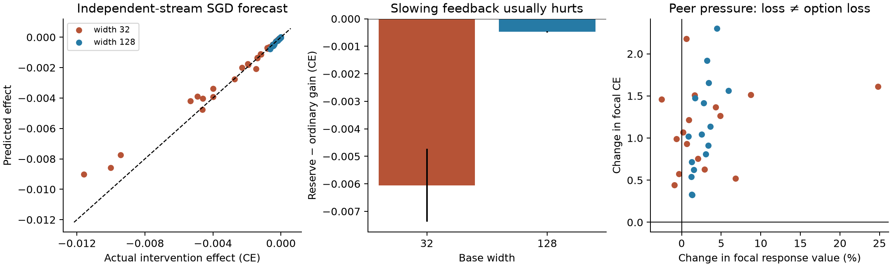
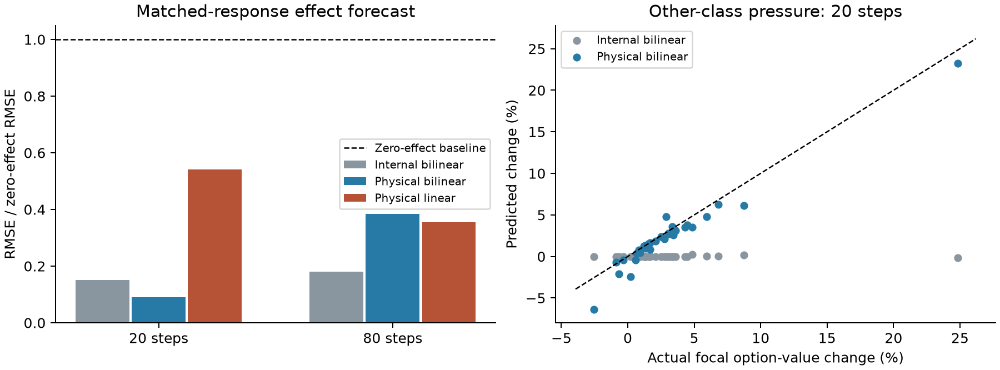

# A local model of learning-driven response changes

Continued on 29 October in [finite-budget competition and width](finite_budget_competition.md),
which adds one midpoint refresh and tests causal correction consequences.

28 October 2026. This continues the [spectral options framework](../../../docs/model/spectral_options.md)
and [response-matched interventions](delayed_demand_and_width.md).
[Protocols, raw forecasts, outcomes and source snapshots](../evidence/response_feedback/README.md)
are retained, including unsuccessful simplifications.

## Scope: one mechanism, with either sign

The phenomenon is **learning pressure changes useful correction responses through
shared trainable features**. Harmful competition is its negative case: a learning
pressure reduces a useful response relative to a declared counterfactual, and that
reduction impairs subsequent correction. Useful feature creation is the positive
case. Neither a loss increase nor a width advantage establishes the negative case.

Keep the existing spectral operator C_tau, its strengths, and its residual loading.
Eigenspaces describe capability modes; options are their nonzero declared-residual
components together with available responses and residual-weighted values.
Fixed-demand audits isolate capability change; zero response means option closure
only while the corresponding demand remains.
Add a local model of how its implementation changes. Do not add separate state
variables for saturation, extinction, noise, gate counts and recruitment. They
may matter in particular regimes; the model below tests what can be omitted over
a specified local horizon. It is a mechanistic approximation, not a scalar summary
or a computational shortcut: it retains parameters and response directions.

## The proposed approximation

For the existing shallow ReLU network,

\[
 f_\theta(x)=m^{-1/2}\sum_j a_j [z_j(x)]_+ +c,
 \quad z_j(x)=w_j^Tx+b_j,
\]

freeze only the activation masks G_j(x)=1{z_j(theta_0,x)>0} used to evolve the
parameters. Evolve both layers with the original loss and optimizer on

\[
 \widehat f(\delta,x)=f_0(x)+J_0(x)\delta
       +m^{-1/2}\sum_j\delta a_j G_j(x)\delta z_j(x).
\]

This is exactly the network within its initial activation cells. Its Jacobian
changes because both factors change. Removing the last term gives the frozen
linear-response baseline. A single scalar response rate discards the directions
of residual relaxation and fails in the retained pilot.

For physical predictions, **evaluate the original ReLU network and Jacobian at
the forecast parameters** theta_hat. This updates the observed activation masks
without feeding their evolution back into the approximate dynamics. Use
f(theta_hat), J(theta_hat), and the original C_tau definition. We also retain
internal fixed-mask predictions as an ablation. This distinction matters:
internal loss differences can be accurate through cancellation even when its
option-strength forecasts are poor.

For SGD, sample forecast minibatches from the declared training distribution.
Keep cross-entropy rather than accumulating instantaneous gradient signal as if
it were realized gain. No extra fitted noise correction is needed in this model.
Independent forecast streams test expected intervention effects; they do not
predict the realized random batch sequence. All capability audits here use the
full 8,192-image training measure, avoiding the previously demonstrated
small-panel self-response bias.

The retained ingredients are thus the full residual direction, coefficient–feature
coupling, and physical response evaluation. Curvature and sampling are supplied
by the actual loss and optimizer. The earlier exact finite-update ledger remains
a validation identity, not another dynamical state.

## Analytical connections

### A causal intervention with identical initial options

Replace each unit by k copies with identical incoming weights. Put its entire
output coefficient in the first copy and zero in the others. Keep the original
normalization; set each output-weight learning metric to 1/k and each incoming
metric to 1. The initial function and **entire optimizer response kernel** match:
the output derivatives contribute k/k copies and incoming derivatives contribute
only the active coefficient. Consequently C_tau matches for every demand and
curvature at the initial function. Uniform coefficients a/k with incoming metric
k instead give synchronized copies that reproduce the original trajectory;
this is the implementation control. This is an artificial optimizer-aware
intervention, not ordinary training of a randomly initialized network four times
as wide.

Let Delta a and Delta z be one ordinary step from the common initial state,
using the same batch. Then exactly, including activation crossings,

\[
 f_{\rm reserve}^{+}-f_{\rm ordinary}^{+}
 =-\frac{1-1/k}{\sqrt m}\sum_j
      \Delta a_j\big([z_j+\Delta z_j]_+-[z_j]_+\big).
\]

The branches have identical linear response; their difference isolates the
interaction between coefficient learning and feature change at this step.
Within fixed cells this becomes -(1-1/k) sum Delta a_j G_j Delta z_j/sqrt(m).
For a fixed demand d driving the update, define
q=average[d^T sum_j dot a_j G_j dot z_j/sqrt(m)]. Then the smooth derivative of
S(d)=||M^(1/2)J^T d/n||² is 4q; concentrated copies divide this derivative by k.
This identity does **not** assert that q is constant, that all demand directions
share its sign, or that all later transport is reduced by exactly k.

### Why paired effects can be easier than absolute trajectories

Write R_j=[z_j+Delta z_j]_+-[z_j]_+-G_j Delta z_j. The error in the one-step
paired functional forecast is exactly

\[
 -\frac{1-1/k}{\sqrt m}\sum_j\Delta a_j R_j.
\]

Suppose coefficient and preactivation updates are uniformly O(eta), and the data
measure satisfies P(|z_j| <= u) <= C_j u near zero. ReLU gives
|R_j| <= O(eta) 1{|z_j| <= O(eta)}. The mean paired error is O(eta³), whereas
an individual branch's leading omitted term sum a_j R_j is O(eta²).
Constants depend on width, norms and the margin bounds. This is a **local,
conditional result**, not an 80-step error guarantee. It explains a possible
cancellation mechanism, not an empirical proof of its assumptions.

It can fail for atoms at a boundary, large steps, large weight norms, or a long
interval over which the frozen cells become obsolete. The discrete toy's
persistent boundary behavior is a relevant counterexample. Continuous task
variation makes a margin condition plausible but does not guarantee it along
training; fixed finite MNIST data do not have a uniform anti-concentration
certificate. Existing dense-quadrature evidence remains in the
[finite-update study](learning_ledger.md).

### From predicted parameters to option changes

Hold demand d and reference curvature H_0 fixed to isolate capability. Put
D=JM^(1/2), g=D^T d/n, A=D^T H_0 D/n, alpha=1/(2 tau), and R=(A+alpha I)^(-1).
The audited value is V=.5 g^T R g. Along a differentiable trajectory,

\[
 \dot V=\dot g^T Rg-\tfrac12 g^T R\dot A Rg.
\]

Both terms can have either sign under pressure from another task component.
A feature can help a component's output while reducing a different response;
residual changes must not be substituted for this fixed-demand comparison.

If approximate physical evaluation gives errors ||g_hat-g|| <= epsilon_g and
||A_hat-A|| <= epsilon_A, positive semidefiniteness gives the deterministic bound

\[
 |\widehat V-V|\le
 \frac{\epsilon_g(2\|g\|+\epsilon_g)}{2\alpha}
 +\frac{\|g\|^2\epsilon_A}{2\alpha^2}.
\]

Proof: separate the change in the quadratic vector from the change in the
resolvent; use ||R||,||R_hat|| <= 1/alpha and the resolvent identity.
With bounded inputs, weights, demand and curvature, parameter error epsilon
bounds these two errors by constants times epsilon plus the measure of points
whose gates differ. A uniform margin condition makes that measure O(epsilon)
for fixed width. Thus physical response decoding can transfer a parameter
approximation to an option approximation. Keeping old gates instead does not
remove their mismatch even if the predicted parameters are exact. This bound
is conditional on trajectory accuracy; it does not prove that accuracy.

### When harmful competition is possible or absent

Even a bilinear shared feature permits harmful pressure without orthogonal
learned units. For f(x)=a(w_1 x_1+w_2 x_2), train only x=(1,0), target 1,
from a=1,w_1=-1,w_2=1 with half squared loss. Then dot a=-2, dot w_1=2,
dot w_2=0. The trained loss decreases at rate 8, while the second input's
instantaneous response kappa_2=a²+w_2² has derivative -4. This illustrates the
sign mechanism; it establishes neither a lasting trap nor a width law.

Conversely, disjoint implementations produce no cross-pressure change, and a
model affine in its trainable parameters, with fixed metric and reference
curvature, cannot change its capability operator. Its option values can still
change as residual demand is fitted. Shared implementations alone are insufficient: their signed interaction
must be harmful, its response loss must be loaded by useful demand, and recovery
must be too slow for the available budget. These are the conditions to test,
rather than assuming resource use always destroys alternatives.

## Experiments and boundaries

All models use the same shallow architecture as the retained MNIST study,
widths 32/128, 8,192 training images, 1,024 validation images, rate .05,
and ordinary SGD batch 128 where specified. Forecasts and branch continuations
use float64 from saved ordinary-training checkpoints. These are local branches from
existing checkpoints, not a new architecture benchmark. Four development seeds
selected the model; eight confirmation seeds and eight earlier-cohort seeds
supplied previously unobserved intervention outcomes. The three designs were
locked before their respective held-out branches.

### Controlled intervention predictions

The effect is reserve gain minus ordinary gain. A negative effect means that
slowing the interaction hurts learning. Primary settings are checkpoints 20/100
and forecast horizons 20/80; streams are averaged within each seed/state first.

| Test and forecast | RMSE / zero-effect RMSE | Sign accuracy | Initialization seeds |
|---|---:|---:|---:|
| Full-gradient intervention, internal bilinear | .188 | 64/64 states | 8 |
| Independent-stream SGD intervention, internal bilinear | .178 | 64/64 | Same 8 |
| SGD, physical bilinear readout, additional cohort | .343 | 64/64 | 8 others |
| SGD, physical linear readout, additional cohort | .403 | 64/64 | Same 8 others |
| Other-class pressure: physical bilinear option change | .218 | 30/32 | First 8 |
| Other-class pressure: internal bilinear option change | 1.001 | 15/32 | Same 8 |

The initial intervention error-ratio criterion, below .35, passes on full-gradient
and SGD tests. The unified physical-readout model narrowly meets its .35 criterion
and improves on physical linear dynamics **in the pooled point estimate**.
It is not uniformly better: at checkpoint 20/horizon 80 its ratio is .388 versus
.353 for the physical linear model. At checkpoint 20/horizon 20 the ratios are
.090 versus .542, and at checkpoint 100/horizon 80, .031 versus .471.
Pooling only the two 20-step settings gives .090 versus .542 (rounded).
Thus the more defensible scope is a short local approximation. This scope
restriction is a conclusion from these results, not a newly validated universal
horizon rule. The internal bilinear forecast's pooled ratio on the additional
cohort is .175; decoding is needed for options, not an automatic improvement to
every paired loss forecast.

Seed-bootstrap 95% intervals for pooled ratios are .125–.205 (initial SGD),
.137–.449 (physical bilinear intervention), and .111–.537 (physical option change).
All improve the zero baseline in each of eight seed aggregates, but these small
cohorts do not establish the .35 threshold with high confidence. Widths,
checkpoints, horizons and batch streams are repeated measurements, not extra
independent seeds. The focal class is seed modulo 10, so class and seed effects
are not independently replicated in the peer-pressure test.

The SGD effect at checkpoint 20 over 80 steps is -.00606 ± .00132 CE at width 32
and -.000477 ± .000027 at width 128 (mean ± seed SE). These are 1.18% and .107%
of ordinary branch gains. Useful feedback is stronger in this narrow model, but
this controlled effect is small compared with total learning. It does not mediate
the original width gap. A frozen linear model already predicts much ordinary
short-horizon progress; bilinear feedback improves ordinary-gain RMSE at checkpoint
20/horizon 80 from .02994 to .02489, but not at checkpoint 100/horizon 20
(.001167 versus .001206). Do not promote an accurate small intervention forecast
into an explanation of all MNIST progress.

### Does peer learning close a useful option?

At each checkpoint, select the focal class before branching. Train for 20 full
steps on the other nine classes, using their mean original CE; compare with
20 full-task steps from the same checkpoint. Then allow 80 full-task recovery
steps in both branches. This changes exposure and relative pressures, not labels.

To measure capability rather than residual inflation, fix the initial focal
residual d=1{y=focal}(onehot-p_0) and **initial full-task curvature** H_0. Compute
V_tau(d;J_t,H_0), tau=1, with a matrix-free solve on all training images.
This reference-curvature value isolates implementation change; it is not the
current model's own-residual value and does not separately enumerate the
spectral corrections required by that reference residual.
Solver relative residuals are below 1e-8 and an independent dense test checks
normalization and the optimizer metric.

All 32 held-out states suffer focal loss increases. Nevertheless, 28 increase
the focal response value relative to its initial value. Four weaken, all at width
32, by .35%–2.56%; the decoded model predicts the negative sign in all four,
with two additional false predictions of weakening elsewhere. Relative to full-task training,
11/32 have lower response value. This is a different counterfactual and must not
be replaced by the before/after count. The physical model predicts that contrast
with error ratio .216 and sign accuracy 31/32.

The mean focal response change is +2.98% ± .91 percentage points; fixed-mask
internal evaluation predicts approximately zero. Physical evaluation predicts
+2.34%, with 1.18-percentage-point RMSE versus 5.43 for no change. This is the
strongest reason to retain moving activation boundaries in the **observation**
model even when omitting their feedback in the local evolution model.

After 80 recovery steps the peer branch's mean full-loss gap is .00059 ± .00037
and its focal-loss gap is .01425 ± .00236. This is mostly reversible negative
transfer, with some weakened measured corrections. It neither proves universal
absence of competition nor establishes that response weakening caused the
remaining recovery deficit. No loss-rescue mediation test was conducted here.

### Failed simplifications and boundaries retained

- A scalar feedback coefficient, even with one residual-relaxation rate, is not
  a reliable closure. At initialization/horizon 20/rate .01, leading and relaxed
  forecast RMSEs are .00285 and .000162, versus .0000935 for zero effect.
- Freezing gates in the **measurement** model misses substantial option changes.
  A successful paired loss forecast does not validate its internal spectrum.
- Freezing gates in the **evolution** model works locally, not uniformly. On the
  full-gradient initialization boundary, intervention error ratios are .657/.535
  at 20/80 steps, worse than the post-early primary settings.
- Late SGD effects are tiny and need not have the early sign. At checkpoint 800,
  mean effects are +1.54e-6 at 20 steps and -5.42e-6 at 80. Corresponding held-out
  validation-loss effect ratios are .79/.93: little predictive advantage.
- No measured gate-margin certificate, permanent extinction law, MNIST failure
  predictor, or causal explanation of ordinary width advantage follows here.

## What changes in the framework

Use the bilinear local parameter model plus physical response readout as the
current candidate linking learning pressure to option change. Keep its linear
baseline and evaluate short-horizon **contrasts**, not just trajectory correlation.
Keep a common demand/curvature audit when the question is capability. Use actual
loss changes for progress. Do not introduce a global monotone depletion variable,
a fitted growth-rate scalar, or an irreversible closed/open label for MNIST.

The discrete and continuous toy results remain valid evidence in their declared
regimes. Their boundary-driven failures also delimit this approximation. The
next missing causal link is whether selectively preventing a **predicted harmful**
response change improves later correction at matched initial response, including
recovery and width. Generic preservation was already harmful in the ordinary
MNIST branches here. That narrower test is more informative than adding another
demand-independent capability summary.
