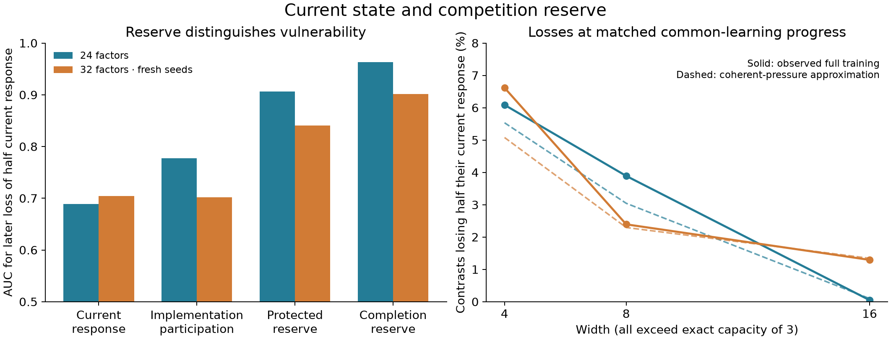

# Evidence: current reserve and tolerable common learning

29 October 2026. Theory and qualifications:
[protected reserve model](../../model/competition_reserve.md).

This study replaces fixed-step forecasting as the primary target with current
state descriptions and response retention at specified common-learning progress.
All event thresholds and state formulas are declared before measurement. There
is no fit to event frequencies. The evidence concerns response retention, not
complete functional span coverage, irreversible loss, or final learning harm.



An additional [initial-state-selected learning-curve example](learning_curve_example_20261030/README.md)
shows ordinary nonlinear loss curves alongside a reserve-based closure forecast
and a conditional trap floor. It is an illustrative pair, separate from the
cohort validation below; the full loss curves are observed, not reserve forecasts.

## Cohorts and assumptions

- `confirmation/`: 16 fresh banks starting at seed 210731, 24 factors, 768 states.
- `transfer32/`: 8 fresh banks starting at seed 221731, 32 factors, 384 states.
- `step_sensitivity/`: first four confirmation banks at half step size, 192 states.

Each bank includes Gaussian and variance-matched uniform parameters, scale .2,
nested widths 4/8/16, prototype and bounded-continuous tasks, rare mass .04/.15,
and two phases. The first phase learns half the current common residual. The
second starts at that actual learned state and learns half of the remainder.
Progress is measured at the canonical common context `u`, also in the continuous
variant; it is not the mean prediction over its finite sampled head cloud.
Every phase completed. Training uses the ordinary full squared-loss objective,
both layers, and physical ReLU gates; no closure or absorption rule is imposed
on the training dynamics. The analytic common-only flow uses the zero-at-zero
gate convention. The actual Euler optimizer can cross gate boundaries.

The rare rank law is `q_r ∝ r^-1.15`; four groups share geometry with correlation
parameter .5. Common/rare prototype directions oppose along the common axis.
Targets are one common hinge plus a shared linear refinement, with an exact
three-unit representation on both prototypes and the full continuous support.
This is a **stronger, narrower assumption** than the previous co-occurring-factor
family. There is no claim of independent nonlinear rules for all 24–32 factors.

The continuous task adds bounded amplitude variation, nuisance inputs, and
attribute jitter. Training has eight observations per prototype and validation
has 32 independent observations per prototype, with natural task weights.
The common support box is known analytically. The standardized capability audit
uses a uniform measure on the 49 or 65 original prototypes, in both variants.
Thus response scores are evaluated on a finite reference panel, not integrated
over the continuous population. `tau=20` is the fixed response filter budget;
it is not the number of training steps or a fitted parameter.

The event is `actual_response < 0.5 * current_response`. A low completion ratio
is a deterministic risk score. Protected fraction and current response are
different state scores; screened implementation participation is the inverse
concentration of per-unit derivative energy after resolvent screening.
The slope baseline extrapolates the initial derivative along coherent common
progress. No score is calibrated as a stochastic event probability.

The original exploratory cohort used seeds 800–823, width 4/8, Gaussian scale
.2, and a single 75%-completion phase at rare masses .005/.04/.15. It informed
the choice to test phase-level half-response loss. It is not included in
confirmation or confidence intervals. The retained confirmation protocol was
written before its outcomes, and per-state quantities were appended before each
measured phase. This is local prospective separation, not external preregistration.

## Results and adverse cases

| Score AUC | Confirmation | Transfer |
|---|---:|---:|
| Low current response | .6887 | .7042 |
| Low implementation participation | .7771 | .7022 |
| Low protected fraction | .9067 | .8405 |
| Low completion fraction | .9635 | .9018 |
| Initial slope extrapolation | .3241 | .4580 |

The initial derivative does poorly despite the known coherent direction. Rare
gate events and the evolving two-layer feedback are not encoded by that single
slope. Completion curves retain both. This comparison supports using integrated
functional progress rather than simply extending an instantaneous susceptibility.

Completion-rule precision/recall is .9193/.7955, then .9076/.7678 on transfer.
Predicted half-response-loss fractions are 2.8917% versus observed 3.3420%, and
2.9053% versus 3.4342%. Natural-frequency-weighted fractions are 2.6673% versus
3.2758%, and 2.2775% versus 2.9434%. The approximation underestimates loss.

Pooled AUC mixes widths and stages. `summary.json` also reports fixed-width and
fixed-stage strata. On confirmation width 4, protected/completion AUCs are
.854/.948 initially and .882/.973 at learned states; current response gives
.755/.430. On transfer, current response outranks completion for initial width
8 (.926 versus .855) and initial width 16 (.981 versus .978). Improvements are
not universal, and nearly event-free strata provide weak ranking evidence.

The protected operator is an exact floor under common-only updates. It is at
least half current response in 71.41% of confirmation probes and 59.68% of
transfer probes. Under **full** training, losses occur in .152% and .177% of those
subsets. These violations are preserved. Mean integrated non-common/common
update-norm ratios are .0738/.0783, with condition-specific ratios reaching about
.19 in later high-rare-mass phases. A small aggregate ratio does not bound
individual gate changes.

| Width | Observed loss, 24 factors | Completion approximation | Observed loss, 32 factors | Completion approximation |
|---|---:|---:|---:|---:|
| 4 | 6.087% | 5.534% | 6.616% | 5.078% |
| 8 | 3.890% | 3.044% | 2.393% | 2.295% |
| 16 | .049% | .098% | 1.294% | 1.343% |

Width-4 minus width-16 differences are 6.038 percentage points, paired 95%
seed-bank bootstrap interval [2.767, 9.619], and 5.322 [1.074, 10.034] on transfer.
The bootstrap resamples the 16 or 8 complete seed banks, preserving dependence
among refinements, stages, initializations, widths, and task variants. It does
not treat the thousands of contrast observations as independent. These intervals
describe the declared mixture of settings and do not establish mediation of a
width advantage in loss or universality across data distributions.

Halving the optimizer step from .005 to .0025 on 192 matched states gives mean
absolute endpoint-response difference .00004843, maximum .02762, and event-label
disagreement .0434%. Boundaries remain a source of individual error. Second-phase
comparisons inherit the slightly different first-phase endpoints.

`loss` in raw rows is ordinary validation loss at the phase endpoint; it is
retained for context but not used to claim a causal effect of reserve on later
rare-task learning. Further checks would need matched demand, recovery budget,
and intervention controls.

## Files and reproduction

Each cohort keeps `protocol.json`, executed `sources/` with SHA-256 hashes,
`state_descriptions.jsonl` written before outcomes, and compact `results.json`.
No checkpoints or stepwise trajectories are required. The state descriptions
and results duplicate some arrays intentionally to preserve their timing.
Executed snapshots are historical; later formatting or lifetime-edge-case fixes
in the working source do not change the recorded evidence.

The analyzer produces `summary.json`; the plotter produces PNG and editable SVG.
Run into **new directories**: the producer refuses to overwrite a recorded
protocol. For example:

```sh
OPENBLAS_NUM_THREADS=1 OMP_NUM_THREADS=1 VECLIB_MAXIMUM_THREADS=1 \
  .venv/bin/python scripts/studies/run_competition_reserve.py \
  --output /tmp/reserve-reproduction/confirmation
OPENBLAS_NUM_THREADS=1 OMP_NUM_THREADS=1 VECLIB_MAXIMUM_THREADS=1 \
  .venv/bin/python scripts/studies/run_competition_reserve.py \
  --output /tmp/reserve-reproduction/transfer32 --seeds 8 --seed-bank 221731 --factors 32
OPENBLAS_NUM_THREADS=1 OMP_NUM_THREADS=1 VECLIB_MAXIMUM_THREADS=1 \
  .venv/bin/python scripts/studies/run_competition_reserve.py \
  --output /tmp/reserve-reproduction/step_sensitivity --seeds 4 --rate .0025
.venv/bin/python scripts/studies/analyze_competition_reserve.py --root /tmp/reserve-reproduction
.venv/bin/python scripts/studies/plot_competition_reserve.py
.venv/bin/pytest -q tests/test_competition_reserve.py
```

The plotter reads the maintained evidence directory. Theory tests check the
protected-block invariant, the response lower bound, inversion of common
functional progress, analytic gate-crossing exposures, the joint last-alternative
law against actual spectral null events, and the exact capacity
witness. The earlier [broader-task evidence](../../../archive/docs/evidence/power_law_competition/README.md),
including response creation and frequent reopening, is retained unchanged.
