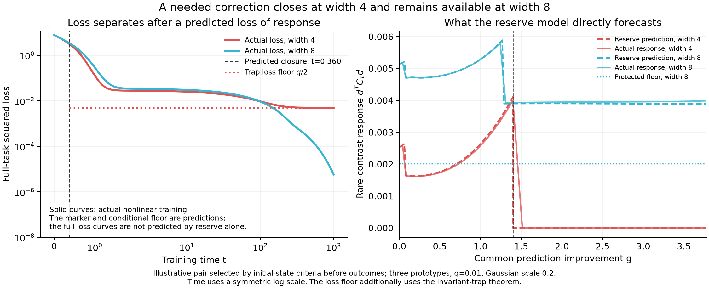

# Learning curves with reserve-based closure predictions

30 October 2026. This is one illustrative width pair, chosen using only its
initial state before computing training outcomes. It connects the reserve
model's response forecast to an observed loss separation. The loss floor uses
the additional invariant-trap theorem; reserve alone does not forecast the
entire loss trajectory.



## Task and selection

The inputs are `(1,0)`, `(-cos(pi/3), sin(pi/3))`, and
`(-cos(pi/3), -sin(pi/3))`. Targets are `4,1,-1`, with masses `.99,.005,.005`.
Both widths exceed the exact three-unit capacity witness. Actual training uses
the full squared-loss objective throughout, both trainable layers, the output
intercept, physical ReLU gates, and the declared mean-field optimizer metric.
There are no hidden biases, imposed gate freezes, or pressure knockouts.

A fresh Gaussian bank has seed 305731, 4,096 nested width-4/8 pairs, and scale
.2. We choose the first pair satisfying these initial-state conditions:

- narrow common projections and readouts are positive, placing it in the
  analytic monotone last-alternative sector;
- the narrow network initially responds to the rare contrast, but its predicted
  last route closes before 80% of the remaining common prediction error is fitted;
- the wider network has protected rare response greater than .001.

Bank entry 91 (zero based) is selected. No training loss outcome enters selection.
This conditional example is not an unconditional Gaussian failure-rate estimate,
an exactly function/kernel-matched width intervention, or proof of mediation.
`protocol.json`, the initial weights, and `forecast.json` were saved before
ordinary-training outcomes. Executed source is retained alongside them.

## Predictions and outcomes

| Quantity | Initial-state prediction | Actual full training, step .005 |
|---|---:|---:|
| Common gain at narrow closure | 1.399644 | 1.416915 |
| Time of narrow closure | .360043 | .365 |
| Conditional trap loss floor | .005 | Final narrow loss .00500000053 |
| Protected wide response at tau=20 | .002017 | Wide response never closes in the measured interval |

At step .01, narrow closure is at time .37 and common gain 1.436210.
The wider network remains responsive at both resolutions. At time 1,000,
wide loss is .000005713 at step .01 and .000005825 at step .005.
The narrow conditional rare loss is .500000053 at the finer resolution,
consistent with the permanently missing antisymmetric correction. Its weighted
contribution is q/2=.005.

The predicted gain comes from the exact last-alternative formula in the
positive-readout sector. Converting it to time additionally integrates the
common-only scalar clock. Actual full training includes rare pressure, so its
closure location is an approximate prediction. The trap theorem becomes an
exact gradient-flow statement once its conditions hold; all sampled subsequent
Euler states remain closed and above the floor. Time 1,000 is a measured finite
budget, not an empirical demonstration of infinite-time convergence.

The response panel compares reserve forecasts with actual full-training response
during the first 95% of the initial common correction. It does not include the
later rare-dominated phase, whose representation changes the common-only model
does not predict. Closure occurs well before the full loss curves separate
visibly: fitting the common component initially hides the missing rare response.

## Reproduction

Use a fresh output directory:

```sh
OPENBLAS_NUM_THREADS=1 OMP_NUM_THREADS=1 VECLIB_MAXIMUM_THREADS=1 MPLCONFIGDIR=/private/tmp/neural-reserve-curve-mpl .venv/bin/python scripts/studies/probe_reserve_learning_curves.py --output <new-directory>
```

`learning_and_reserve.svg` is the editable vector figure. Numerical predictions
and all plotted points are retained in `forecast.json` and `outcomes.json`.
