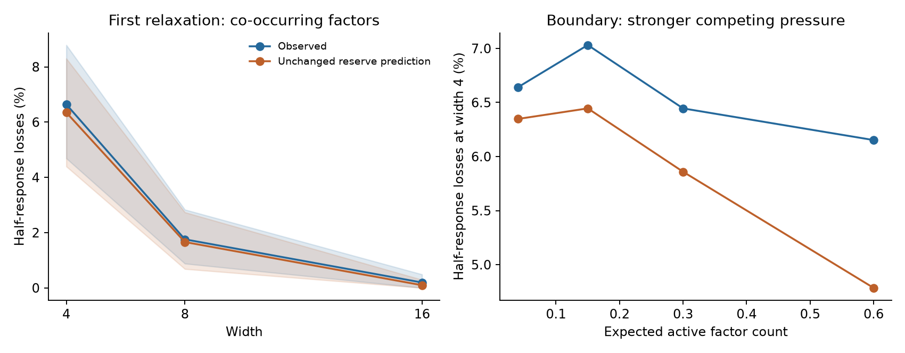

# First controlled extensions of completion reserve

31 October 2026. Current [research direction and derivation](../../model/reserve_relaxation.md).
[Compact analysis](analysis.json) retains fixed-width/phase results and seed-bank
uncertainty. These experiments reuse the existing reserve prediction without
refitting and do not forecast SGD trajectories.

## The controlled question

Does the successful response-weakening prediction survive when factors can
co-occur, with their marginal frequencies, target rule, observation geometry,
initialization, optimizer, and capability audit otherwise unchanged?

The four-factor exclusive endpoint exactly matches the earlier reserve task;
an independent regression test checks inputs, labels, weights, and the fixed
audit. Independent presence introduces co-occurrence. A subsequent associated
presence control shares a uniform random variable while preserving every q_i.
Signs conditional on presence remain independent. The same three-unit target
witness remains exact. Widths are 4/8/16, with nested Gaussian scale-.2 banks.

All training uses the full squared-loss objective, trainable incoming/outgoing
weights, physical ReLU gates, and the existing M_w=M_a=m, M_c=1 metric. There
are no frozen gates, isolated-pressure training branches, or curricula. Each
condition has one fixed distribution. Full-batch GD is sufficient for this
first controlled comparison; general minibatch-SGD transfer is not claimed.

The prediction is the **unchanged analytic completion-reserve curve** for half
the remaining correction on the dominant context. Two successive phases are
tested. The second starts at the actual trained state. Predictions are saved
before each phase's outcomes. A phase ends at the first ordinary step crossing
the criterion; there is no fractional step to force an exact match. In the
weak-pressure conditions, the two endpoints lie within roughly 51–153 steps
across the fresh narrow-width banks. These are learning-phase predictions, not
precise next-update predictions.

The primary audit remains the original uniform single-factor prototype panel.
A secondary population-weighted factor audit checks corrections across the
co-occurring contexts. Contrasts are capability probes, not intrinsic spectral
option counts. The population factor residuals retain at least 96% of their
target magnitude at phase starts in the weak co-occurrence and bounded-view
conditions, so meaningful correction demand remains.

## Independent confirmation

Development uses 64 banks at seed 170731. Confirmation uses 128 fresh banks at
seed 190731, four factors, and two phases: 1,024 factor-phase observations per
width. Uncertainty resamples complete banks, not factors or phases.

For independent co-occurrence at Q=sum_i q_i=.04:

| Width | Predicted half-response losses | Observed | Completion AUC | Current-response AUC |
|---|---:|---:|---:|---:|
| 4 | 65/1,024 = 6.35% | 68/1,024 = 6.64% | .988 | .577 |
| 8 | 17/1,024 = 1.66% | 18/1,024 = 1.76% | .944 | .692 |
| 16 | 1/1,024 = .10% | 2/1,024 = .20% | .991 | .510 |

The width-16 ranking has only two events and should not be treated as strong
evidence of ranking accuracy. At width 4, the event-rate seed-bootstrap interval
is [4.69%,8.69%]. The original exclusive endpoint has 68/18/2 observed events
versus 66/17/1 predicted. Thus this first co-occurrence relaxation preserves the
previous useful prediction and width dependence.

Independent overlap is only .051% of all examples at Q=.04. The fully associated
control provides a stronger overlap test: .931% of all examples, and **45.1% of
nonempty examples**, contain multiple factors, with exactly the same q_i.

| Associated presence | Width | Predicted losses | Observed | Completion AUC |
|---|---:|---:|---:|---:|
| Q=.04 | 4 | 66 | 69 | .987 |
| Q=.04 | 8 | 16 | 19 | .895 |
| Q=.04 | 16 | 1 | 2 | .991 |
| Q=.15 | 4 | 72 | 75 | .951 |
| Q=.15 | 8 | 18 | 22 | .931 |
| Q=.15 | 16 | 1 | 2 | .978 |

Each row has 1,024 factor-phase observations. These transfer conditions reuse
the confirmation banks for paired data-law comparisons; they are not extra
independent initialization cohorts. The model and its thresholds are unchanged.



## Further relaxations and the boundary

Bounded antithetic observation variation of size .1 preserves the target's
conditional factor means and the exact witness. At Q=.04, predicted event
counts are 69/19/4 versus observed 74/22/6, with width-4/8 AUCs .970/.947.

Increasing other pressure while preserving the same rule exposes the boundary:

| Independent presence, width 4 | Predicted losses | Observed | Completion AUC | Mean integrated other/head update ratio |
|---|---:|---:|---:|---:|
| Q=.04 | 65 | 68 | .988 | .031 |
| Q=.15 | 66 | 72 | .950 | .124 |
| Q=.30 | 60 | 66 | .847 | .267 |
| Q=.60 | 49 | 63 | .736 | .498 |

The ratio is a retrospective diagnostic, not a fitted forecast parameter. Its
instantaneous counterpart is saved before each phase for a future applicability
test. The strong-other-pressure cases are retained as boundaries, not used to
fit a new destruction coefficient.

Removing opposing geometry in a separate control gives zero observed and zero
predicted events at all three widths in this cohort. Unequal frequencies alone
do not require competition. This null is as informative as the positive cases.

A matched 64-bank step check halves the rate from .01 to .005 across the anchor,
co-occurrence, and bounded-view cases. Event labels disagree on 0/4,608 probes.
Mean absolute endpoint-response difference is .000279; the maximum is .0921.
Finite-strength accuracy is not uniform even though this event classification
is stable. The step cohorts use seed 180731, separate from fresh confirmation.

## What the parity experiment taught us

Using the implemented parity dataset and retained initial checkpoints:

- The most frequent empty input has probability .288 and target zero.
- It is already nearly correct at initialization. Its median gradient norm is
  only .66%/.58%/.31% of the full gradient norm at widths 8/16/32.
- In the raw-bit-plus-intercept encoding, its dot product with every input is
  +1. The earlier opposing-support geometry is absent.

The direct jump therefore removed dominant unlearned pressure and opposing
geometry while also changing target interaction structure. It was not a clean
test of replacing one common frequency with a frequency spectrum. The useful
lessons about finite gates, recovery, and residual demand are retained; the
full-covariance optimizer forecast is outside the current research target.

Standardized bipolar parity restores substantial initial empty-state pressure
and opposing geometry in the primary four-bit setting. It is a different target
and encoding, not a frequency-only relaxation. The later [parity study](../natural_parity/README.md)
finds useful gradient-direction alignment but substantial underprediction of
narrow-width response weakening, including when the known direction is used.

## What is still missing

The bridge still has an identifiable dominant component and a simple global
target. This is a controlled first step, not a completed realistic unsupervised
dataset or a theory of arbitrary simultaneous pressures. The next relaxation
is to identify pressure episodes from observable learning rather than a known
head annotation, then test several naturally changing sources.

These results concern half-response weakening at phase endpoints, not permanent
closure, first-passage lifetimes, or a causal loss penalty. Exact missing-factor
loss floors have a simple derivation, but global zero-response factor events
were absent in the development cohort, so that bound is not promoted as an
empirically useful loss predictor. Short ordinary-training follow-ups in the
development/step cohorts are retained as descriptive outcomes only.

The first macro measure is the expected fraction and frequency-weighted mass
of still-needed corrections losing response over a natural learning phase,
versus width. Next test persistence/recovery and corresponding residual error.

## Records and reproduction

The archive retains compressed per-state predictions and results, protocols,
source hashes, and executed sources. Each cohort refuses to overwrite an
existing protocol. Main commands, from the repository root:

```sh
VECLIB_MAXIMUM_THREADS=1 OPENBLAS_NUM_THREADS=1 .venv/bin/python scripts/studies/run_reserve_bridge.py --output runs/reserve_bridge/confirmation_v2 --seeds 128 --seed-bank 190731 --followup-steps 0 --settings anchor cooccurrence more_other_pressure boundary_30 boundary_60 bounded_observations remove_opposition
VECLIB_MAXIMUM_THREADS=1 OPENBLAS_NUM_THREADS=1 .venv/bin/python scripts/studies/run_reserve_bridge.py --output runs/reserve_bridge/association_transfer --seeds 128 --seed-bank 190731 --followup-steps 0 --settings associated_factors associated_more_pressure
MPLCONFIGDIR=/tmp/reserve_bridge_mpl VECLIB_MAXIMUM_THREADS=1 OPENBLAS_NUM_THREADS=1 .venv/bin/python scripts/studies/analyze_reserve_bridge.py --output docs/evidence/reserve_bridge
```

An earlier seed-180731 confirmation attempt stopped when one strong-pressure
completion phase exceeded an optional 2,000-step follow-up budget. It is not
treated as a completed cohort. Fresh phase-only confirmation retains all seven
conditions and all banks; none was selected by its outcome. The runner now
saves completed settings incrementally. The matched step check covers the three
declared weak-pressure conditions independently of that aborted attempt.
