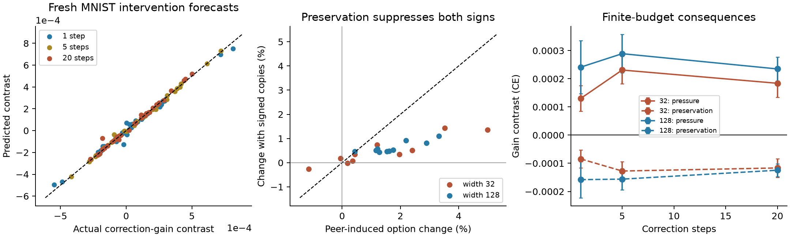
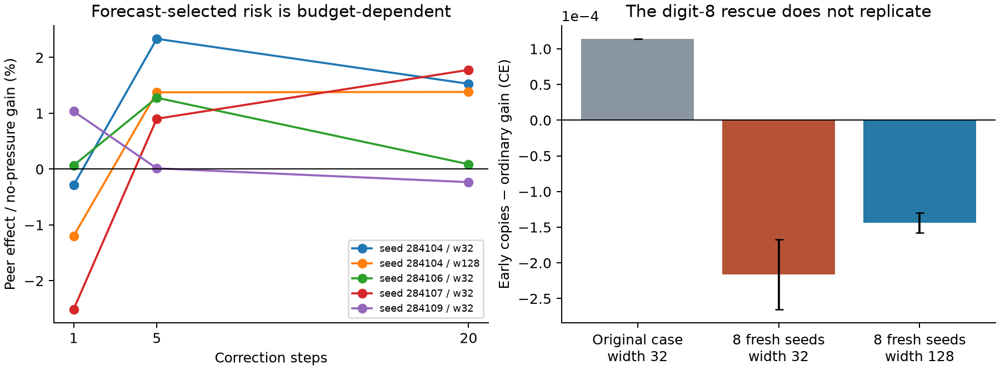

# Finite-budget competition and width: a minimal continuation

29 October 2026. Extends the [local response model](local_dynamics.md),
[GD-derived options](spectral_options.md), and
[delayed-demand account](delayed_demand_and_width.md).
The [evidence directory](../evidence/causal_response/README.md) preserves development cases,
locked fresh predictions, negative outcomes, and timing controls.

## The minimal change

Keep the existing response operator and the local coefficient–feature model.
Two corrections are justified:

1. **A correction budget must be explicit.** Reduced instantaneous response or
   discounted option value does not imply impaired correction at every horizon.
   Compare finite-horizon loss gains under common initial predictions and demand.
2. **Refresh the local expansion once when its activation cells become stale.**
   In the tested 20-step intervals, refresh masks at step 10 using only predicted
   parameters, and again at the declared change of training pressure. The loss,
   optimizer, bilinear coupling and physical response readout remain unchanged.

There is no new depletion state, recovery coefficient, neuron-role model, or
fitted noise parameter. This is still a parameter-level local surrogate, not a
low-dimensional closure or a computational shortcut. Refreshing every step would
recover the original dynamics; that limiting fact is tested, not advertised as
an independent predictive achievement. A single midpoint refresh is the actual
simplification validated here. Its interval is a declared numerical resolution,
not a biological or task-specific constant.

The phenomenon remains pressure on shared implementations changing useful
responses. **Harmful competition requires adverse response evolution to impair
the correction over the relevant budget.** Initial damage may disappear, and a
response that initially helps may become harmful later. This qualification is
necessary even on unmodified MNIST inputs.

## Budget-matched response and option values

Capability modes are spectral eigenspaces; options are nonzero projections of
a declared residual into those eigenspaces, together with their responses.
Changing the observation budget changes their response strengths and values,
without changing the derivation below. A fixed arbitrary direction remains a
capability probe when no residual demand is specified.

Use D=JM^(1/2), A=D^T H D/n and g=D^T d/n at a declared reference state.
For the frozen local quadratic model, h steps of gradient descent at rate eta
have gain

\[
 G_{h,\eta}(d)=\tfrac12 g^T\phi_{h,\eta}(A)g,
 \qquad \phi_{h,\eta}(a)=\frac{1-(1-\eta a)^{2h}}a,
 \quad\phi_{h,\eta}(0)=2h\eta.
\]

Thus B_(h,eta)=D phi_(h,eta)(A) D^T/n is another member of the same spectral
response family. Under the usual stability condition eta lambda_max(A) <= 2,
it is positive semidefinite. The continuous-time filter is
(1-exp(-2ta))/a; averaging its gain over an exponential horizon of mean tau
recovers the established resolvent C_tau. No new editing objective is introduced
by choosing a deterministic rather than discounted observation budget.

The gain identity follows by solving u_(k+1)=(I-eta A)u_k+eta g, u_0=0, in each
eigenspace and substituting into g^T u-.5 u^T A u. A dense autodiff/eigendecomposition
test independently verifies the matrix-free implementation and its normalization.

**Scalar order is insufficient.** Even in a fixed squared-loss model, with unit
residual loading on two modes, change their strengths from (1,.05) to (.5,.15).
V_(tau=1) decreases, and short-time gain decreases, but gain at time 5 increases.
One mode was weakened and another strengthened. A single scalar ordering cannot
order all spectral filters. Moreover, changing curvature and response geometry
can defeat even a correctly budget-matched frozen-quadratic forecast. The current
model therefore retains original cross-entropy and the evolving bilinear response.

## A causal probe that separates demand from capability

After a declared pressure history A, give each state a fixed additive output
function f_ref(x)-f_A(x). At the start of correction every branch then has logits
f_ref, probability p_ref, the same loss, demand, and curvature. The additive
function is held fixed; it has no trainable parameters and does not change J_A.
The initial correction rate is exactly the corresponding common-demand response,
up to the usual finite-step remainder.

For the MNIST test, f_ref is the pre-pressure checkpoint output. The correction
target is the original hard label on one focal digit and p_ref on all background
images. It asks for a focal correction while preserving background predictions,
using ordinary soft-target cross-entropy. All 8,192 training images are retained.
This is a **controlled correction task**, not an ordinary-MNIST endpoint or an
unmodified training intervention. A separate original-label recovery measures
what the same implementation change does on ordinary full-task training.

Define the pressure consequence at budget h as

\[
 \Delta G_h^A=G_h(\theta_A;f_{\rm ref},q)-G_h(\theta_0;f_{\rm ref},q).
\]

A negative value is causal impairment of this correction by the preceding
pressure. This includes response changes during correction; it does not assume
that the starting Jacobian stays frozen. A successful preservation intervention
must improve the relevant gain, not merely increase a spectral summary.

### Preserve feature movement at matched initial response

The earlier concentrated copies mostly slowed smooth coefficient–feature
feedback while the load-bearing gate retained its original velocity. That was
not enough to preserve the selected weakened responses.

Use the already established general copy construction with two coefficients
c=(2,-1), sum c=1, S=sum c²=5. Keep the original network normalization, use
output metric 1/2 and incoming metric 1/5. Initial predictions and the **entire
optimizer kernel on every input** are unchanged. Relative to an ordinary step,
the two incoming feature velocities are .4 and -.2 times the original, and each
output update is half the original. The smooth response-transport factor is
1/(kS)=.1; no such exact factor is assumed for gate-mediated transport.

All activation-boundary velocities are smaller in magnitude at the initial
state. Unlike positive uniform copies, these implementations do not remain
synchronized. This is an optimizer-aware construction with cancellation, not
ordinary randomly initialized widening; it isolates response evolution at fixed
initial capability. It can suppress beneficial learning just as readily as harm.
The full-kernel identity and velocity factors are checked by independent autodiff.

A late-only copy control is added **after** ordinary peer pressure. It matches
that post-pressure function and full kernel, then has the same parameter count
and metric as the early-copy branch. Early versus late copying tests the role
of the pressure history separately from merely altering correction dynamics.
It is not a unique mediation decomposition: future nonlinear trajectories still
depend on both implementations.

## Conditional seeds for a width explanation

The following assumptions describe a regime, not all real-world learning:

- A task has a supported corrective subspace S whose demand matters during a
  later finite budget. The initial response on S is at least kappa_* > 0.
- Inputs, per-unit weights, activations and training residuals remain bounded
  over the interval. The optimizer is the declared Euclidean metric with the
  existing 1/sqrt(m) output normalization.
- Activation margins are diffuse near zero: at the start of the interval,
  P(|z_j(x)| <= u) <= C u, uniformly over units and sufficiently small u.
- Unit-norm functions in S have a bounded pointwise norm U_S. For the loss
  guarantee below, the squared-loss residual stays in S during correction.

These assumptions allow overlapping learned features and nonorthogonal
implementations. They concern bounded shared features, data margins and useful
task directions, not assigned neurons or a finite list of prototypes. They can
be reasonable after useful features have formed, under modest subsequent pressure.
They can fail for unsupported refinements, atomic boundary mass, highly
concentrated units, large movements, rotating demand, or rapid regeneration.

### Width bounds the possible response drift in this regime

For f=m^(-1/2) sum_j a_j sigma(w_j^T x)+c, gradient flow gives

\[
 \|\dot a_j\|\le C_a/\sqrt m,\qquad
 \|\dot w_j\|\le C_w/\sqrt m.
\]

Biases can be included in x. The constants depend on the declared input,
activation, coefficient and residual bounds, not on m. For any bounded test
direction u, its loaded response is

\[
 \langle u,K_m u\rangle=
 \|\mathbb E u\|^2+\frac1m\sum_j\left(
 \|\mathbb E[u\sigma(z_j)]\|^2+
 \|\mathbb E[(a_j^T u)1_{z_j>0}x]\|^2\right),
\]

where the inner product uses the data probability measure. Parameter movement
is O(t/sqrt(m)). ReLU activations are Lipschitz; a changed gate must start within
O(t/sqrt(m)) of its boundary. The margin assumption bounds the measure of those
points by the same order. Bounded u and x then bound both per-unit expectation
changes by O(t/sqrt(m)); bounded squares and averaging over units preserve
that order. Uniformly over unit u in S,

\[
 \|P_S(K_m(t)-K_m(0))P_S\|\le C_S t/\sqrt m.
\]

This is a finite-dimensional compression bound derived from loaded responses;
it is not a claim about the full unbounded function-space operator norm.
The constants may be too large for a useful numerical certificate. Finite MNIST
samples do not supply a uniform small-margin certificate merely by having
continuous-valued pixels. Gaussian initializations also require high-probability
norm bounds, potentially growing with width, rather than a silent uniform bound.

After a pressure interval t_A, followed by a correction interval T, the bound
and invariant-subspace assumption imply

\[
 L_m(T)\le L_m(0)\exp\left[-2\kappa_*T+
       \frac{C_S(2t_A T+T^2)}{\sqrt m}\right].
\]

Proof: throughout correction, the restricted kernel is at least
kappa_*-C_S(t_A+t)/sqrt(m); apply the squared-loss energy identity and integrate.
A positive protected rate throughout follows if
sqrt(m)>C_S(t_A+T)/kappa_*. This is a **conditional preservation guarantee**,
not a proof that a particular wider trained network beats a particular narrow one.
It does not prove that the actual drift is harmful.

The width dependence is tied to normalization and optimizer geometry. It need
not hold under the toy's mean-field scaling, where per-unit movement can remain
O(1) as width increases. Initial capability can also vary with width. These
conditions must be separated experimentally before attributing an ordinary width
benefit to preserved responses. The relationship to stable tangent dynamics is
established prior work, not a new discovery here: see
[Jacot, Gabriel and Hongler](https://arxiv.org/abs/1806.07572) and
[Chizat, Oyallon and Bach](https://arxiv.org/abs/1812.07956). The latter's scaling
qualification is especially relevant to these interventions.

### When reduced drift actually relaxes competition

A stronger, transparent idealization makes the sign condition explicit. Suppose
one fixed corrective direction has common initial demand, and its response after
pressure differs from a no-pressure reference by -a_m h(t), with a_m decreasing
with width. Assume this direction remains an invariant mode. Then

\[
 \log\frac{L_m^A(T)}{L_m^0(T)}=2a_m\int_0^T h(t)\,dt.
\]

Consequently reduced susceptibility helps only when integrated damage is
positive over the correction window. If creation or recovery makes that integral
negative, preserving the old response hurts. A small initial weakening says
nothing about the sign of this integral. Stable directions and a common damage
shape across widths are additional assumptions; the norm bound above alone does
not establish them. This idealization clarifies a causal width mechanism without
claiming that a scalar closure fits MNIST's full dynamics.

The empirical model retains the whole local response precisely because those
simplifications can fail. In the toys, delayed demand and incomplete recovery
can create the required overlap between damage and a useful correction window.
In the MNIST tests below, most adverse changes are too transient to obstruct the
20-step correction. Evidence that many real tasks satisfy the persistent-damage
assumptions is still missing; it should not be inferred from these formulas.

## Empirical findings

All runs use the existing architecture, widths 32/128, rate .05, 8,192 MNIST
training images and 1,024 validation images. Fresh checkpoints use 100 ordinary
SGD steps, batch 128. Counterfactual pressure and correction use full gradients
in float64. The first cohort contains ten new initialization seeds, with focal
digits 0–9 assigned before outcomes. Widths are paired; each seed has only one
focal class, so seed and class effects are not independently replicated.

### Prediction: one refresh is enough for a substantial improvement

After 20 peer-only pressure steps, predict common-output correction gains at
1, 5 and 20 steps. Score two contrasts: peer minus no pressure, and early signed
copies minus ordinary peer pressure. Predictions are saved before the actual
branches. The locked comparison uses the original model and one midpoint refresh.

| Test | RMSE / zero-effect RMSE | Correct signs | Independent seeds |
|---|---:|---:|---:|
| Original local model, broad cohort | .237 | 115/120 | 10 |
| One midpoint refresh, same cohort | .091 | 118/120 | Same 10 |
| Refreshed model, focused fresh replication | .117 | 96/96 | 8 new |

For the broad cohort, seed-bootstrap 95% intervals are .140–.391 before refresh
and .058–.125 after it; the locked error-ratio target below .5 passes. Every seed
aggregate improves over the zero-effect baseline. The focused replication's
interval is .073–.156. These rows are repeated width/budget/contrast measurements,
not 120 or 96 independent training runs. The results concern finite local
counterfactuals from known states, not arbitrary future training outcomes.

Prediction errors after refresh are .112/.037/.050 for pressure effects at
1/5/20 steps, and .122/.079/.177 for preservation effects. There are no fitted
coefficients. The correction probe is deterministic full-gradient training;
these results do not replace the previous independent-minibatch SGD validation.

### Causal evidence: mostly brief impairment, not lasting obstruction

In the broad cohort, actual peer pressure harms first-step correction in 3/20
width/state pairs. The predictor selects four: three true impairments and one
false positive. Early signed copies improve first-step gain in all four selected
states. In the three true impairments, gain improvements are 3.72e-6, 7.19e-5,
and 4.83e-5 CE. They are partial rescues, not large task-level effects.

A late-only timing control was then run on all three selected seed/class pairs,
including both widths. Early copies outperform late copies in all four forecast-
selected first-step states, including the false-positive case. Their initial
post-pressure response differs, whereas late copies match ordinary post-pressure
response. This supports a history-dependent local effect. The timing audit was
chosen after broad validation, so it is a follow-up rather than part of the
original locked test.

By five correction steps, **none of the 20 states is impaired by peer pressure**.
At 20 steps one narrow state is impaired by 5.50e-5 CE, only .23% of its
no-pressure correction gain. Its early-copy benefit is 1.14e-4 CE, and the
model predicts both signs. It was initially helped by peer learning: impairment
appears later, rather than simply persisting from an initially adverse rate.

Preservation reduces absolute reference-option drift in 18/20 states, to
32%/36% of the ordinary mean absolute drift at widths 32/128. Yet it reduces
20-step correction gains in 19/20 states. On unmodified original-label recovery,
it increases mean final full-task CE by .000846 ± .000106 at width 32 and
.000071 ± .000043 at width 128 (mean ± seed SE). Preserved response is therefore
not automatically useful preserved response, and the controlled gain rescue
is not a rescue of ordinary full-task training.

### A targeted replication prevents a task-specific story

The only broad-cohort 20-step deficit was a narrow digit-8 case. This motivated
a locked focused replication with **eight new seeds**, both widths, focal digit 8.
All outcomes were retained; no case was selected for exhibiting harm.

There is **no 20-step pressure impairment in any of the 16 states**, and the
model predicts none. Preservation hurts all 16 at this budget. Thus digit 8
is not itself a reliable structural condition for competition. Three states
have immediate impairments, all predicted and improved by early copies; two
surpass the no-pressure first-step gain. All three also benefit relative to
late-only copying. Those effects disappear
by five steps. The timing model's error ratio on this independent cohort is .132,
with all 48 signs correct. No fixed semantic neuron roles or class-specific
rescue rule is added to the theory.

### Width evidence is suggestive, not a causal width law

The broad cohort has two narrow and one wide first-step impairment. Mean negative
parts of relative gain change are .280% ± .249% versus .120% ± .120% of baseline
first-step gain. The paired narrow-minus-wide damage difference is .160 percentage points, with
a seed-bootstrap 95% interval of -.273 to .753 points. These small samples do
not establish a robust width difference.
The focused cohort again has two narrow and one wide immediate impairment,
but no persistent impairment at either width.

Nor does ordinary width uniformly reduce transport: broad-cohort mean absolute
reference-value drift is 1.63% at width 32 and 1.74% at width 128. Initial responses,
loads and constants differ across trained widths. The matched-copy interventions
causally manipulate implementation evolution; the natural-width comparison does
not isolate that pathway from initial capability or other training differences.
The conditional width theorem states what additional assumptions would make the
pathway sufficient, rather than treating these counts as its validation.

### Which ingredients can safely be omitted?

A retrospective audit supplies the actual post-pressure state to three nested
recovery models on the selected development cases. Relative contrast errors are
.467 for frozen quadratic response, .268 for a frozen Jacobian with exact CE,
and .173 for bilinear evolution with exact CE and physical output evaluation.
These are explanatory ablations, not prospective forecasts. Changing curvature
accounts for part of the reversal, while changing responses is also needed.
The existing coupled model contains both; no separate recruitment variable is
necessary. A one-off V_tau measurement and a permanently frozen Jacobian omit
material effects in these cases.

The second figure shows all broad-cohort states forecast to be impaired at any
measured budget, not a random sample of runs. Its replication bars compare the
single motivating case with means ± seed SE for the eight new starts.

The next causal target is a task condition that predicts **adverse finite-budget
response evolution**, rather than a digit label, an instantaneous decrease, or
an arbitrary low-value threshold. Shared rules with less frequent refinements
remain plausible, but persistent obstruction must be demonstrated where it is
claimed. The current experiments improve the local predictive model and identify
real short-lived pressure effects; they do not show that persistent competition
is widespread across natural tasks or that it explains ordinary MNIST width gains.
