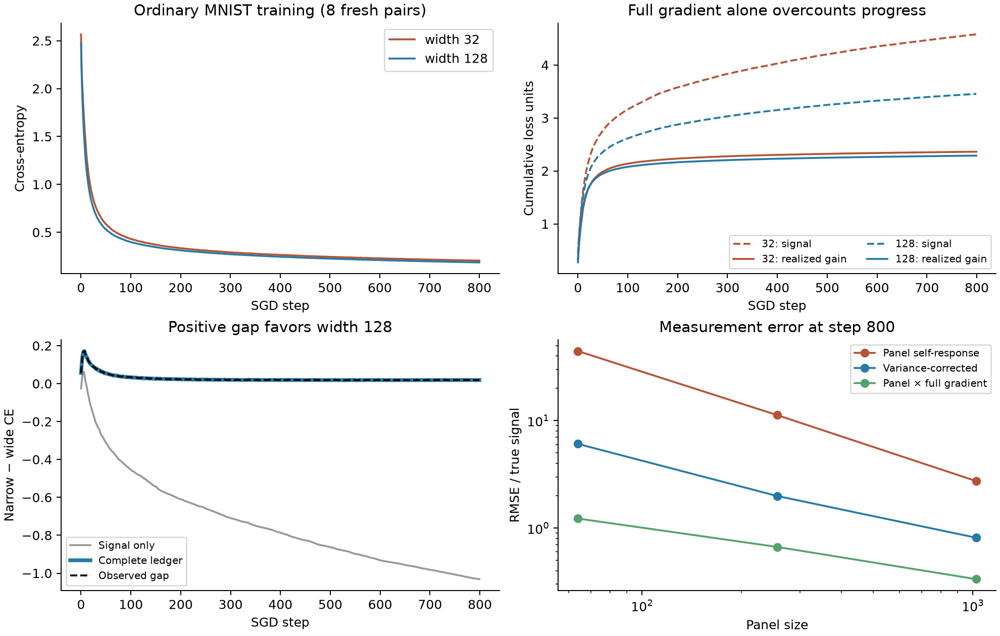
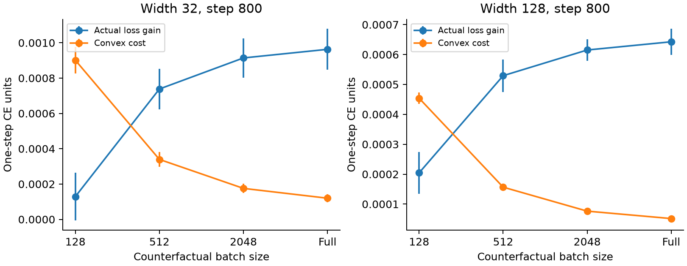
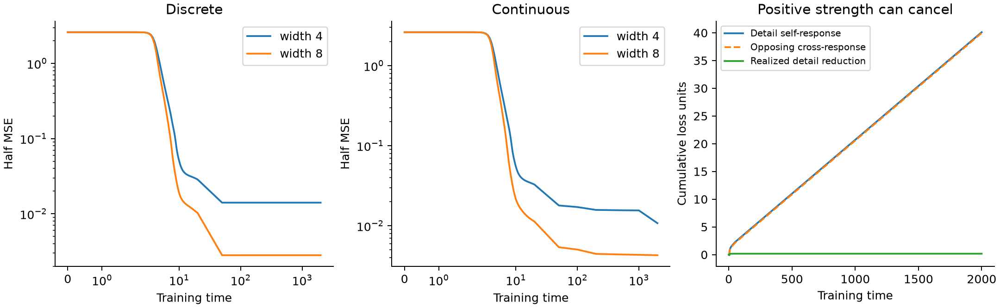

# Observed learning: response, sampling, and finite updates

28 October 2026. Continuation of [spectral options](spectral_options.md) and
the maintained toy/MNIST evidence. This study retains the
existing definition of options. It improves the connection between response
strength and **observed** progress, rather than fitting another outcome score.

## Findings and their status

- **Exact identities:** a finite-update ledger separates instantaneous response,
  realized sampling work, nonlinear prediction work, and convex loss cost.
  An independent finite-population identity quantifies small-panel self-response
  bias. Neither identity establishes harmful competition.
- **Descriptive evidence:** twelve fresh paired MNIST runs, with eight reserved
  for confirmation, show large sampling bias and substantial finite-step costs.
  Removing bias alone leaves a noisy measurement. Earlier forecast failures
  remain negative results.
- **Local causal evidence:** increasing minibatch size at identical checkpoints
  reduces convex cost and increases expected one-step training progress. This
  does not identify mediation of the long-run width benefit.
- **Numerical boundary:** full-distribution toy losses are stable under step
  refinement, but an uncorrected current-Jacobian ledger can remain inaccurate
  near discrete ReLU boundaries. A margin anti-concentration condition explains
  when that correction should vanish; denser continuous quadrature supports it.

Raw protocols, per-seed results, figures, executed source snapshots, and commands
are in [../evidence/observed_learning/README.md](../evidence/observed_learning/README.md).

## 1. An exact finite-update account

Let the evaluated loss be \(L(\theta)=\sum_i p_i\ell_i(f_i(\theta))\),
\(e_i=-\nabla_f\ell_i\), and \(g=\nabla_\theta L\). All quantities below
use the **same evaluated distribution**. For an actual update \(\delta\), put

\[
q=J\delta,\quad r=f(\theta+\delta)-f(\theta)-q,\quad
C=\sum_i p_i D_{\ell_i}(f_i(\theta+\delta),f_i(\theta)).
\]

Then, without freezing future geometry or expanding the loss to second order,

\[
\boxed{L(\theta)-L(\theta+\delta)=-g^T\delta+\langle e,r\rangle_p-C.}
\tag{1}
\]

Convexity in the outputs gives \(C\ge0\), even when the network loss is
nonconvex in its parameters. For squared loss, \(C=\|\Delta f\|_p^2/2\).
For cross-entropy, \(C=\mathbb E_i\operatorname{KL}(p_{\rm old}\Vert
p_{\rm new})\); the orientation is old to new. The nonlinear work
\(N=\langle e,r\rangle_p\) can have either sign.

For SGD \(\delta=-\eta M\widehat g+\epsilon\), with a declared fixed
positive metric \(M\),

\[
-g^T\delta=\eta\underbrace{g^TMg}_{S}
+\eta g^TM(\widehat g-g)-g^T\epsilon.
\tag{2}
\]

Here \(S\) is precisely the instantaneous joint residual-response strength
of the existing options framework. The sampling term has conditional mean zero
for unbiased batches; it need not sum to zero on a realized trajectory. The
last term records arithmetic/update discrepancies, not unexplained noise.
Summing (1)-(2) telescopes to actual loss reduction. Width-gap accounting must
also retain the initial loss gap. These are retrospective accounts, not
prospective forecasts.

For positive losses, the exact fractional account is
\(\log[L_0/L_T]=\sum_t-\log(1-G_t/L_t)\), where \(G_t=L_t-L_{t+1}\).
Replacing it by \(\sum G_t/L_t\), or replacing \(G_t\) by \(\eta S_t\),
requires an error estimate. Summing discounted \(V_\tau\) is still not a
loss ledger. Cross-entropy loss also is not half the squared output residual.

### MNIST cumulative results

Ordinary SGD uses the previous network, 8,192 training images, batch 128,
rate .05, and 800 steps. Evaluation uses float64 arithmetic on the actual
float32 parameters. The eight confirmation pairs have final training CE
**.204061 / .185329** at widths 32/128. The paired gap is .018732
(SE .001984); validation gap is .022455 (SE .003731), positive on all eight
pairs. Uninstrumented replay reproduces every parameter exactly across all
24 fresh trained networks.

Means for steps **100–800**, in training CE units:

| Ledger term | Width 32 | Width 128 |
|---|---:|---:|
| Instantaneous signal, \(\sum\eta S\) | 1.422588 | .843404 |
| Realized sampling work | +.001525 | −.004670 |
| Nonlinear prediction work | −.040313 | −.022672 |
| Convex cost, subtracted | 1.157532 | .604042 |
| Actual loss reduction | **.226267** | **.212019** |

Rounding contributions are below 1e-7 in these late means. Maximum one-step
ledger discrepancy is 5.8e-16. The signal-only sum overstates late progress by
about **6.3× / 4.0×**. The difference in signal sums is −.579184, while the
observed difference in gains is only −.014248. Cost differences cancel most
of that discrepancy. A smaller signal in the successful wider model therefore
does not imply weaker useful capability or less successful training.

In this fresh cohort the mean initial gap already favors width 128 by .092272;
it shrinks to .018732. At step 100 it is .032980. The narrow models catch up
somewhat later. One must not relabel the endpoint gap as an extra cumulative
wide gain. Different initial losses are retained rather than normalized away.

An instrumented replay of the original eight MNIST pairs matches all sixteen
saved endpoint parameter sets exactly. In that cohort the initial gap is
**−.048771** and the final gap **+.026300**: width 128 gains an extra .075071
during training. Nevertheless its accumulated instantaneous signal is .968117
*smaller*. Its convex cost is .992274 smaller, nonlinear work .084331 more
favorable, and sampling work .033416 less favorable. The complete ledger closes
the gap with these signed terms. Thus the signal-only failure also holds in
the original cohort where the width advantage develops during training.
This replay is additional measurement of existing starts, not eight new pairs.

## 2. A panel self-response is a different estimand

At a fixed checkpoint, let \(u_i=M^{1/2}\nabla\ell_i\),
\(\bar u=N^{-1}\sum_i u_i\), and
\(\Sigma=(N-1)^{-1}\sum_i(u_i-\bar u)(u_i-\bar u)^T\).
A uniformly sampled panel of size \(b\), **without replacement**, satisfies

\[
\boxed{\mathbb E\|\bar u_P\|^2
=\|\bar u\|^2+(1/b-1/N)\operatorname{tr}\Sigma.}\tag{3}
\]

Proof: expand the squared mean and use inclusion probabilities
\(b/N\) and \(b(b-1)/(N(N-1))\) for diagonal and distinct pairs.
Equivalently, apply the finite-population covariance of a sample mean.
The sample covariance trace
\(s_P^2=\frac b{b-1}(b^{-1}\sum_{i\in P}\|u_i\|^2-\|\bar u_P\|^2)\)
is unbiased for \(\operatorname{tr}\Sigma\), so

\[
\widehat S=\|\bar u_P\|^2-(1/b-1/N)s_P^2\tag{4}
\]

is unbiased for the full-training signal. It can be negative; clipping it
would reintroduce bias. The identity concerns sampling a fixed empirical
training set, not population generalization. With-replacement sampling uses
population covariance divided by \(b\) instead.

This is an operator issue, not just a bad scalar correlation:
\(\|\bar u_P\|^2\) is the panel kernel contracted against the panel's own
residual on **both** sides. Actual full-training flow evaluated on that panel
instead has first-order work \(\bar u_P^T\bar u\). The latter is an unbiased
audit of full signal but requires the full gradient, so it is a benchmark,
not a cheaper replacement for computing that gradient.

For any fixed PSD parameter response \(Q\), the same argument gives bias
\((1/b-1/N)\operatorname{tr}(Q\Sigma)\) in \(\bar u_P^TQ\bar u_P\).
This extends to a resolvent constructed on an independently fixed reference
measure. **It does not give an unbiased correction for the old \(C_\tau\)
when its curvature and residual are both constructed from the same panel.**
We have not reclassified the old discounted spectra or repaired their forecasts.

### Empirical measurement error

At step 800 in the eight confirmation pairs, using 32 paired panel draws per
checkpoint and width:

| Panel size | Mean self-response / full signal | Corrected relative RMSE | Corrected estimates below zero |
|---|---:|---:|---:|
| 64 | 41.64 | 6.07 | 51.0% |
| 256 | 11.69 | 1.99 | 35.0% |
| 1,024 | 3.57 | .81 | 5.7% |

RMSE is computed within each initialization and then averaged across seeds;
normalization is by each model's full signal. At initialization the size-64
ratio is only 1.83. The analytic expected size-64 bias/full-signal ratio at
step 800 is 45.27. The finite draw mean differs appreciably from its expectation:
variance correction is not a reliable small-panel cure. The corrected size-64
width-difference sign accuracy is only 45.7%, despite its much lower numerical
error than the uncorrected statistic; at 1,024 it is 69.5%.

Panel draws are shared across seeds as well as widths. Seed SEs in the raw
analysis are therefore conditional on that common panel bank; they are not
unconditional Monte Carlo error bars for (3). There are eight independent
initialization pairs, not hundreds of independent training replicates.

The task-level condition is **gradient coherence**, not a semantic label:
if within-context gradients have large variance while their means are small,
small panels mostly measure variance. For any specified context variable,
\(\operatorname{Cov}(u)=\mathbb E\operatorname{Cov}(u\mid C)
+\operatorname{Cov}(\mathbb E[u\mid C])\). Conditional calibration need
not eliminate the first term. These identities hold beyond the toy tasks;
the experiment does not establish which semantic MNIST contexts supply the
variance. The toys integrate the whole quadrature measure, so they do not
have this particular subsampling bias, even if their example gradients disagree.

## 3. A causal check of stochastic update cost

From the same eight confirmation checkpoints at steps 100 and 800, compare
32 nested with-replacement batches of sizes 128, 512, and 2,048, plus the exact
full gradient. Every arm starts with identical parameters, predictions,
Jacobian, loss and rate .05. These are float64 one-step interventions from
saved float32 states, evaluated on the full training set; they do not branch
the original long trajectories.

At step 800:

| Batch | Width-32 gain | Width-32 convex cost | Width-128 gain | Width-128 convex cost |
|---|---:|---:|---:|---:|
| 128 | .000129 | .000901 | .000205 | .000454 |
| 512 | .000738 | .000339 | .000529 | .000157 |
| 2,048 | .000914 | .000175 | .000615 | .000076 |
| Full | .000963 | .000120 | .000643 | .000052 |

For 512 versus 128, paired mean gain improvements are .000609 (SE .000054)
and .000325 (SE .000024). Both are positive in all eight seeds. At step 100
they are .002451 (SE .000283) and .001450 (SE .000112), again positive on every
seed. The local GGN quadratic closely matches measured convex cost; nonlinear
work is smaller but nonzero.

For fixed local output Jacobian and curvature, the expected quadratic cost is

\[
\mathbb E C_{\rm quad}=\frac{\eta^2}{2}
\left[g^TMJ^TH_pJM g+
\operatorname{tr}(MJ^TH_pJM\operatorname{Cov}(\widehat g))\right].\tag{5}
\]

Thus larger batches remove an explicit variance cost, without changing the
starting options. This experimentally supports the finite-step explanation.
It does **not** show that a larger batch is better per example processed,
that generalization improves, or that this intervention closes the long-run
width gap. It also does not establish that the narrower model has lost options.

## 4. Toy replication and cancellation between demands

Sixty-four fresh nested starts use the existing .002 initialization, widths
4/8, and the original metric, to time 2,000. Final half MSE:

| Task | Width 4 | Width 8 | Paired gap (SE) |
|---|---:|---:|---:|
| Discrete | .014063 | .002813 | .011250 (.003750) |
| Continuous, three-node quadrature | .010781 | .004288 | .006493 (.003108) |
| No refinement | 1.11e-12 | 3.71e-13 | 7.43e-13 |

The discrete cohort has **10/64 narrow and 2/64 wide failures** above 1e-7.
The earlier 11/64 versus 0/64 cohort is verified, not overwritten. Halving the
step preserves these new discrete counts and changes continuous mean losses
by less than 2.1e-7. Nine-node evaluation of the continuous endpoints gives
.010799 / .004297. This is a numerical population approximation, not a proof
of continuous-population fitting.

For the task-defined detail projector \(P\), write \(e=b+c\), \(b=Pe\).
Under differentiable full-batch squared-loss flow,

\[
-\dot E_b=\underbrace{\langle b,Kb\rangle}_{\text{self response}}
+\underbrace{\langle b,Kc\rangle}_{\text{cross response}}.\tag{6}
\]

The first is nonnegative; the second is signed. Neither defines a new type of
option. Finite-step component gains have the same nonlinear and squared-change
corrections as (1). At the discrete narrow endpoints, mean full signal is
1.7e-29 while detail self-power remains .019406. Other residual components
cancel it. Cumulative detail self-work is 40.115 and cross-work −39.982,
although initial detail energy is only .18. Their difference, with nonlinear
and finite-step corrections, gives the actual reduction .172969.

This is why accumulating an isolated task-direction strength can count
opposed requests indefinitely. Use the joint residual loading, or the existing
Schur-complement conditional response when preservation of other behavior is
the question. Gradient cancellation is not itself evidence of pressure-driven
option destruction: it also occurs in fixed linear models. Establishing that
destruction requires response transport and an intervention on its cause.

## 5. A distributional condition for the small-step account

The toy step check uncovered a second boundary. For one ReLU neuron with
preactivation \(z\) and its update \(h v_z\),

\[
0\le R_\sigma=\sigma(z+hv_z)-\sigma(z)-h1_{z>0}v_z
\le h|v_z|1_{|z|\le h|v_z|}.\tag{7}
\]

For \(f=m^{-1}\sum_j a_j\sigma(z_j)+c\), the exact nonlinear remainder is

\[
r_f=\frac1m\sum_j\left[h^2v_{a,j}1_{z_j>0}v_{z,j}
+(a_j+hv_{a,j})R_{\sigma,j}\right].\tag{8}
\]

**Sufficient condition.** On a fixed interval \([0,T]\), assume uniformly
bounded residuals \(|e|\le E\), readouts \(|a_j|\le A\), update velocities
\(|v_{a,j}|\le V_a\), \(|v_{z,j}(x)|\le V_z\), and uniformly over iterates
and neurons a population margin bound
\(\Pr(|z_j(X)|\le\varepsilon)\le C\varepsilon\). Then

\[
|\langle e,r_f\rangle|
\le E h^2[V_aV_z+(A+hV_a)CV_z^2].\tag{9}
\]

Proof: apply (7), then the margin bound at \(hV_z\), to (8). Summing at most
\(T/h\) steps gives an \(O(Th)\) total nonlinear-work bound. Bounded update
velocities also make total squared-change cost \(O(Th)\). This justifies
the instantaneous-power integral under these sufficient assumptions, without
orthogonal features or a frozen response kernel.

Smooth bounded input densities and nondegenerate detector directions can
support the margin condition; arbitrary empirical measures and collapsed
detectors need not. Constants may depend on width and initialization. This
does not prove a width scaling law, eliminate option transport, or prove the
assumptions hold along MNIST training. Atoms repeatedly near a moving boundary
can instead leave \(O(h)\) errors per step and \(O(1)\) cumulative corrections.

An exploratory audit repeats the same starts to time 20 at four step sizes.
Width-4 mean signed **gate work**, separated exactly from the smooth bilinear
term in (8), is:

| Training measure | Step .05 | Step .00625 |
|---|---:|---:|
| Discrete task | −.439091 | −.383101 |
| Continuous, three nodes per nuisance dimension | −.013562 | −.006274 |
| Continuous, nine nodes per nuisance dimension | −.001196 | −.000157 |

Discrete loss at time 20 changes only from .028586 to .028857. The smooth
bilinear term shrinks from +.077288 to +.009354. Thus stable loss trajectories
do not license dropping gate work. The dense continuous result is consistent
with (9); four finite steps are not a limit theorem or proof of boundary
sliding. Coarse quadrature itself can create an atomic boundary artifact.
Use the exact finite-update ledger for these discrete experiments, and state
regularity assumptions before transferring a differentiable-flow identity.

## Implications and limits

Keep available capability, demand, and realized utilization separate. A useful
observed-training account needs the right data measure and the actual update;
neither more breadth nor a large panel self-response guarantees progress.
For components, include signed cross-response rather than counting isolated
strength as used capacity. For ReLU toys, retain finite-update gate work.

The MNIST results now have two tested explanations for weak measurement-to-
progress correspondence: panel variance and stochastic convex cost. They do
not show that the conditional-task assumptions are absent, repair the prior
finite-horizon spectral forecasts, or prove competition is irrelevant. No new
prospective run-outcome predictor or long-run option-preservation intervention
is claimed. The next causal experiment should compare selective response
transport at matched initial geometry **after** accounting for these effects.

Gradient-noise scaling is established work, including
[McCandlish et al.](https://arxiv.org/abs/1812.06162); sample-gradient alignment
and architecture are studied by
[Sankararaman et al.](https://proceedings.mlr.press/v119/sankararaman20a.html).
The sampling algebra and Bregman identity are not claimed as new discoveries.
The contribution here is their audited application to this options framework,
the fixed-checkpoint intervention, and the task/measure boundary exposed by
the toy refinement experiments.
