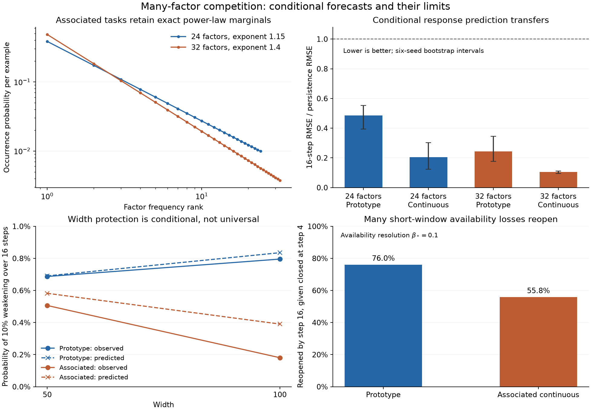

# Conditional option dynamics with many power-law refinements

**Scope update:** the [reserve chapter](competition_reserve.md) now leads the
theoretical development. This chapter supplies conditional local forecasts and
retained evidence on a broader task family. Accurate short-horizon forecasts
do not by themselves give an adequate description of current vulnerability or
explain cumulative competition. Its negative results remain relevant.

29 October 2026. This extends the [probabilistic pressure model](probabilistic_competition.md)
to a task family with 24–32 refinements and arbitrary observed network states.
It retains [spectral capability](spectral_options.md), residual demand, and
[coupled local dynamics](local_dynamics.md). The
[evidence record](../evidence/power_law_competition/README.md) separates development
failures, fresh confirmation, transfer, and causal probes.

The general model makes assumptions about the data, architecture, optimizer,
and forecast horizon. It makes **no distributional assumption about the initial
parameters**. Its probabilities are conditional on the current network and
arise from future training exposures. Gaussian initialization remains useful
only in the older, more analytically restricted special case.

This does not assert that training forgets its starting state. An all-dead ReLU
network is an immediate counterexample to universal forgetting. Rather, a given
current state has the same conditional forecast regardless of how it was reached.
We test prediction across small Gaussian, ordinary fan-in Gaussian, fan-in uniform,
and trained states without refitting the predictive model.

## 1. Data family: frequent shared rules and many associated refinements

Let R_r be a context/refinement indicator, Z contain shared continuous attributes,
and N nuisance inputs. Set

\[
P(R_r=1)=q_r=C r^{-\alpha},\qquad
y=2Z_1+\sum_{r=1}^{R}d_rR_r h_r(Z),\quad
h_r(Z)=v_r^TZ. \tag{1}
\]

Each h_r uses overlapping attributes: it changes how a shared attribute should
be interpreted in a particular context. All refinements are present throughout
training. No neurons are assigned to them. Task factors specify targets and
diagnostic contrasts. Capability modes come from the response spectrum; options
are their nonzero residual projections together with the available responses.
A diagnostic contrast is a capability probe independently of whether the
current residual demands that correction.

The primary experiment uses R=24, alpha=1.15 and d_r alternating between ±1.
The transfer experiment changes R to 32, alpha to 1.4, and the association
strength, without changing the predictor. Two realizations are used:

| Property | Prototype distribution | Associated continuous distribution |
|---|---|---|
| Factor occurrence | At most one R_r active | Several R_r can co-occur |
| Total factor mass | sum q_r=.4 | E sum R_r=1.2 |
| Attributes | Two signed attributes | Two bounded continuous attributes |
| Association | Shared attributes despite exclusive contexts | Positive within-group association plus shared attributes |
| Observation | Centered context coordinates | Context jitter, four nuisance coordinates, dense rotation |
| Training measure | Exact finite distribution | 1,024 iid examples; independent 4,096-example evaluation |

For the continuous version, group factors into four families. Within each family,
with probability rho use a common uniform U and set R_r=1{U<q_r}; otherwise use
independent uniforms. This preserves every power-law marginal exactly and gives

\[
\operatorname{Cov}(R_r,R_s)
=\rho\,[\min(q_r,q_s)-q_rq_s] \tag{2}
\]

within a group. Primary rho=.65; transfer rho=.35. Between groups, indicators
are independent, but gradients still interact through shared attributes and
parameters. This is a specific model of associated contexts, not an assumption
that semantic factors in real data are independent.

Observed context coordinates are 6(R_r-q_r), with bounded jitter in the continuous
case. Centering removes the repeated large constant that an all-negative
“absent” encoding otherwise creates as factor count grows. The dense rotation
does not change information or the capacity witness; its purpose is to remove
coordinate-aligned observation, not to claim a harder underlying distribution.
Continuous attributes, co-occurrence, and nuisance variation are the substantive
extensions beyond prototypes.

Both distributions have an exact width-(2+2R) representation on their entire
bounded support. Reconstruct c_r=3(2R_r-1)+jitter with a hidden bias. Since
|h_r(Z)|<sqrt(2) and |c_r|>=2.75,

\[
R_rh_r(Z)=\tfrac12\{[c_r+h_r(Z)]_+-[c_r-h_r(Z)]_+\}. \tag{3}
\]

Two additional units represent 2Z_1. Widths 50/100 and 66/132 therefore compare
networks at or above known representational sufficiency. Finite-time failure
is not forced by insufficient target capacity.

The abstraction is relevant to contextual calibration, shared rules with domain
exceptions, and frequently reused attributes with rarer conditional meanings.
Heavy-tailed skill frequencies have also motivated prior scaling models, including
[Michaud et al. (2023)](https://arxiv.org/abs/2303.13506). That motivation does
not establish that token frequency equals factor frequency, or that our particular
grouping and refinement functions describe language. These experiments remain
synthetic; no natural-language or other real-data transfer is claimed.

The width panel is a descriptive late-checkpoint comparison. Its prototype width
contrast is uncertain; it is not a controlled width-mediation experiment.

## 2. The general conditional law does not need random initialization

For f=c+m^(-1) sum_j a_j[w_j^Tx]_+, retain the mean-field optimizer metric
M_w=M_a=mI, M_c=1. At any given theta, one example supplies the negative gradient
velocity

\[
\xi_{w_j}(X,Y)=a_j e(X,Y)g_j(X)X,\quad
\xi_{a_j}(X,Y)=e(X,Y)[w_j^TX]_+,\quad
\xi_c(X,Y)=e(X,Y), \tag{4}
\]

where e=Y-f_theta(X). A minibatch step averages these velocities. The physical
ReLU gates and both trainable layers are retained. The probability space is the
future sample stream, conditional on theta and the declared sampling measure.

For finite support (x_l,y_l) with masses p_l, freeze these velocities for H
steps of size eta and batch size B. Let N~Multinomial(HB,p). Then

\[
\widetilde\theta_H=\theta+\frac\eta B\sum_l N_l\xi_l(\theta),\qquad
E\widetilde\theta_H=\theta+\eta H\mu,
\]
\[
\operatorname{Cov}(\widetilde\theta_H)
=\frac{\eta^2H}{B}\left(E\xi\xi^T-\mu\mu^T\right),\quad
\mu=E\xi. \tag{5}
\]

This is exact for the frozen-force model and for one actual SGD step. It retains
the shared exposure that couples every implementation. For an empirical training
set it uses that empirical sampling law; it is not automatically a population
forecast. For fresh population sampling, the corresponding law integrates (4)
against the full joint distribution.

The first attempted longer forecast used (5) directly. It failed, especially
under the uncentered input stress test. Summing current pressure for too long
misses residual feedback; taking larger grouped Euler steps can also change
stability. Reapplying the same frozen approximation every four steps did not fix
the failure. We retain that negative result rather than absorbing it into a
learned closure rate.

The maintained forecast instead applies the existing local bilinear dynamics:

\[
\widehat f(\delta,x)=f_0(x)+J_0(x)\delta+
\frac1m\sum_j\delta a_jG_{0,j}(x)\delta w_j^Tx. \tag{6}
\]

Within each local interval, differentiate (6), evolve both layers and the actual
squared-loss residual, and sample independent future minibatches. Refresh gates
once at the forecast midpoint using **predicted** parameters. Evaluate the final
capability with the physical network and its actual gates. There is no future
checkpoint or realized validation batch in the forecast. A frozen-Jacobian
ablation retains residual feedback but drops the last term of (6).

Thus the high-level model is: **data exposure drives coupled implementations;
their transported physical response determines conditional availability**.
The numerical solver approximates that conditional law. It is not an analytically
closed scalar hazard model, and currently costs multiple local particle paths.

## 3. What “lost” means, and the probability/expectation targets

Fix an audit measure, horizon tau, and unit functional probe d_r. Define

\[
\beta_r(\theta)=d_r^TC_\tau(\theta)d_r,\qquad
C_\tau=K(K+\lambda I)^{-1},\quad \lambda=(2\tau)^{-1}. \tag{7}
\]

These probes measure refinements; they need not be mutually orthogonal and are
not a list of intrinsic network eigenmodes. In the experiments they are task
refinement columns with their common affine-attribute projection removed,
normalized on a fixed balanced intervention panel. The panel is shared across
widths within a dataset seed. Its uniform measure is deliberately distinct from
population loss, which is evaluated separately on natural-frequency inputs.

We distinguish three events:

- complete structural absence: beta_r=0;
- loss of availability at a declared budget resolution: beta_r crosses below
  beta_* after starting above it;
- relative weakening: beta_r decreases by at least a stated fraction.

Primary forecasts use tau=5, relative weakening of 10%, and availability
resolution beta_*=.1, with .05/.25 resolution sensitivity retained. A 10%
decrease is **not** an extinction claim. Resolution .1 means the local discounted
operator supplies .1 of the unit-direction squared-loss benefit under its frozen
quadratic interpretation, not guaranteed nonlinear learning of the factor.

For the joint predicted parameter law from (5) or (6),

\[
p_r^{\rm loss}(H\mid\theta)
=P\{\beta_r(\widehat\theta_H)<\beta_*\mid\theta\},
\quad\beta_r(\theta)\ge\beta_*; \tag{8}
\]

opening uses the opposite inequality for an initially unavailable direction.
The expected number of affected probes is exactly

\[
E N_{\rm loss}=\sum_{r:\beta_r(\theta)\ge\beta_*}p_r^{\rm loss}. \tag{9}
\]

No factor independence is needed for (9). But the probability of any loss and
the variance of the number lost require joint events:

\[
\operatorname{Var}N_{\rm loss}=\sum_r p_r(1-p_r)
 +2\sum_{r<s}\{P(I_r=I_s=1)-p_rp_s\}. \tag{10}
\]

The forecast particles share the same sample stream across all units and factors,
so those dependencies are retained. Multiplying marginal survival probabilities
would generally discard precisely the common pressure we are trying to model.

## 4. Frequency supplies exposure clocks, not a closure coefficient

For independent example draws, a particular factor has

\[
N_r\sim\operatorname{Binomial}(HB,q_r),\quad
P(N_r=0)=(1-q_r)^{HB},\quad
\operatorname{Cov}(N_r,N_s)=HB\,[P(R_rR_s=1)-q_rq_s]. \tag{11}
\]

This remains true marginally for associated factors. With q_r=C r^(-alpha), the
rank where expected direct exposure is order one is

\[
r_{\rm exposure}\asymp(CHB)^{1/\alpha}. \tag{12}
\]

For the primary prototype task, q_24=.003307. A 16-step window with B=32 has
an 18.34% chance of seeing no example of factor 24. The associated distribution
has three times the marginal mass and allows co-occurrence: its corresponding
probability is .607%. These are exposure probabilities, not failure rates.
Shared learning can preserve, create, or damage a rare correction without a
direct occurrence of that factor.

If an idealized unresolved factor costs order q_r and cannot be learned without
an occurrence, the infinite-tail sum sum_r q_r exp(-nq_r) scales as
n^(-(alpha-1)/alpha) for alpha>1, by the substitution u=nC r^(-alpha). This is
an **exposure-only special case**, not a derived neural width exponent. Finite
factor truncation, transfer between factors, response survival, and recovery
change it. We do not insert q_r as an implementation-survival probability.

For co-occurring factors, summing q_r E[xi|R_r=1] would double-count examples.
The general force and covariance in (5) use the whole joint distribution instead.

## 5. An analytically controlled special case: a race between two pressures

For intuition, consider a current gate margin z_j whose activation supplies an
alternative witness for a given correction. In a short coherent-force interval,
suppose a rare exposure raises that margin at rate u_j>=0, while other exposure
lowers it at rate v_j>=0. These coefficients are the projections of (4) onto the
gate margin, not free hazard parameters. Assume u_j+v_j>0. Then

\[
z_j(H)=z_j(0)-\eta H v_j+
\frac\eta B(u_j+v_j)N_r. \tag{13}
\]

The expected margin drifts downward when q_r<v_j/(u_j+v_j). The finite-time
closing probability is a binomial tail with cutoff

\[
k_j=\left\lfloor\frac{B(\eta H v_j-z_j(0))}
 {\eta(u_j+v_j)}\right\rfloor. \tag{14}
\]

If all these gate witnesses must be inactive to remove the functional response,
they share the **same** exposure count. Therefore

\[
\boxed{P(\text{all alternatives closed}\mid\theta)
=F_{\rm Binomial(HB,q_r)}\!\left(\min_j k_j\right).} \tag{15}
\]

This gives a simple width mechanism with no initialization law and maximally
correlated exposure: an additional robust alternative can lower the minimum
cutoff and reduce loss probability. Identical copies leave it unchanged. Extra
units that are as vulnerable as the old ones need not help. Natural widening
also changes function, normalization, and force, so this monotonic comparison
requires unchanged existing local forces and the stated witness interpretation.
It is not a monotonic theorem for arbitrary independently trained widths.

The binomial law is exact in the two-force frozen-margin model; enumeration tests
check it independently. Extending it to a whole training phase needs gate and
residual feedback control. General implementations may need several gates or
strength from several units, so (7)–(8), rather than a one-gate rule, are used in
the empirical forecasts. There is no blanket prohibition on reopening.

## 6. How competition and width enter the general response dynamics

Within a smooth gate cell, let v_r=(K+lambda I)^(-1)d_r. A sample-induced
parameter velocity xi gives

\[
\ell_r(X,Y)=D\beta_r[\xi]
=\lambda v_r^TDK[\xi]v_r. \tag{16}
\]

The old susceptibility thus determines the drift and noise, rather than a fitted
frequency-to-hazard link. Define mu_r=E ell_r and
S_rs=Cov(ell_r,ell_s). The frozen linear-response approximation gives

\[
E\Delta\beta_r=\eta H\mu_r,\qquad
\operatorname{Cov}(\Delta\beta_r,\Delta\beta_s)
=\eta^2H S_{rs}/B. \tag{17}
\]

If the remaining mean margin above beta_* is a>0, Cantelli gives
P(loss)<=V/(V+a^2) for this linear-response model, where V=eta^2H S_rr/B.
A Gaussian approximation gives its usual normal tail. Both need qualification
when gates change: the smooth approximation performs poorly in several of the
experiments, even for one step. Physical transport in (6)–(8) retains those jumps.
Adding an epsilon bound on omitted response transport buffers a by epsilon and
adds the probability that the error exceeds epsilon. Without such control the
smooth tail is not a certificate for the neural path.

Since K=bb^T+m^(-1)sum_j Z_j, the influence in (16) is a sum of block influences
with its explicit 1/m normalization. Its variance contains every cross term:

\[
\operatorname{Var}\left(\frac1m\sum_j\ell_{rj}\right)
=\frac1{m^2}\sum_{j,k}\operatorname{Cov}(\ell_{rj},\ell_{rk}). \tag{18}
\]

Here ell_rj includes the response filtering and the block transport. Shared
minibatch pressure can leave a nonvanishing correlated component. Width does not
automatically give a 1/m reduction of this variance.

For diagnosis, screened route weights
c_rj=v_r^T Z_j v_r/m define participation
n_eff,r=(sum_j c_rj)^2/sum_j c_rj^2. This measures how concentrated the current
implementation is. It is neither a count of independent routes nor a sufficient
statistic for future survival. In the associated primary task, its late mean
rises from 11.7 at width 50 to 18.2 at width 100. The full forecast additionally
uses signs of transport, gate margins, residual demand, and shared exposure.

These equations distinguish three effects that frequency alone cannot identify:
which pressures dominate, whether their transport is adverse, and whether
alternatives can carry the demanded response in time.

## 7. What the empirical tests establish

The centered primary cohort has six independent seed/dataset banks, three
initialization families, two widths, and checkpoints 0/200/2000: 216 states.
Each forecast uses 64 future streams independent of the 64 actual continuations.
All forecasts at a checkpoint are saved before its continuations. Factors,
checkpoints, widths, and streams are dependent within seed; confidence intervals
resample the six seed banks. The 32-factor transfer has 48 further states from
six fresh banks and uses fan-in Gaussian initialization.

The following compares the coupled model's RMSE for **expected response strength**
with the RMSE of predicting no change. It is not final-loss prediction accuracy.

| Task | Factors | Steps | Error ratio | 95% seed-bootstrap interval |
|---|---:|---:|---:|---|
| Prototype | 24 | 4 | .295 | [.221, .377] |
| Associated continuous | 24 | 4 | .213 | [.182, .238] |
| Prototype | 24 | 16 | .485 | [.395, .553] |
| Associated continuous | 24 | 16 | .205 | [.124, .303] |
| Prototype transfer | 32 | 16 | .244 | [.177, .346] |
| Associated transfer | 32 | 16 | .105 | [.095, .111] |

At 16 steps, the primary error ratios by initialization are .567/.174/.142 for
prototype small-Gaussian/fan-in-Gaussian/uniform, and .655/.152/.132 for the
associated task. Thus the same predictor improves on persistence in every tested
initialization family; small initialization remains the harder case. This tests
conditional robustness, not universal forgetting of initialization.

For 10% response losses, 16-step Brier skill relative to an optimistic constant
predictor using the evaluated cohort's own event prevalence is .400/.408 in the
two primary tasks, and .262/.192 in transfer. A skill of zero means no improvement
over that constant reference; these are not percentages of correct labels.

For actual crossings of availability resolution .1, the associated task's
16-step predicted/observed probabilities are 2.315%/2.307%. The prototype result
is .492%/1.009%: the model materially underestimates those rare closure events,
despite useful mean-strength and weakening forecasts. Do not claim uniformly
calibrated extinction probabilities from the aggregate scores.

Width differences are also predicted conditionally. In the associated task at
checkpoint 2000, the observed 16-step probability of 10% weakening is .506% at
width 50 versus .181% at width 100; the forecast is .582% versus .391%. The paired
wide-minus-narrow difference is -.326 percentage points, with a six-seed bootstrap
interval [-.850,-.040]. At earlier checkpoint 200 the interval includes zero.
Late prototype weakening is slightly higher at width 100, with uncertainty
including zero. Wider does not win at every state or initialization.

Final mean held-out loss in the associated task is .10694/.10336 at widths 50/100,
averaging all initialization families. Prototype losses are .00294/.00371: the
small-initialization subset reverses the overall endpoint ordering. These modest,
mixed behavioral differences do not establish option-loss mediation of a general
natural-width advantage.

### Reopening rules out a closure-only approximation here

Among initially available probe/fork pairs that crossed below .1 by step four,
76.0% in the prototype and 55.8% in the associated task are back above .1 by step
sixteen. These are endpoint transitions, not continuously observed first passages,
and the individual pairs are not independent. Still, an absorbing-closure model
would systematically misdescribe these data. Recovery timing must remain in the
general model even if an absorbing special case is analytically useful elsewhere.

### Causal pressure can create or remove responses

A separate six-bank cohort tests 48 states. From exactly the same checkpoint,
apply common-only, refinement-only, full, or no pressure for 16 deterministic
steps. Common pressure is the weighted orthogonal projection of the current
residual onto affine shared attributes; refinement pressure is its complement.
The local model predicts all branches before intervention outcomes are computed.

| Task / isolated pressure | Mean capability change | Forecast error / zero-effect error |
|---|---:|---:|
| Prototype / common | -.000442 | .490 |
| Prototype / refinement | +.002011 | .214 |
| Associated / common | +.025147 | .077 |
| Associated / refinement | -.001608 | .161 |

Signs agree on over 95% of individual probe effects above 1e-5. These many probe
effects are clustered within states, not independent replications. Halving the
step at fixed intervention duration preserves the mean signs, but individual
prototype/common effects have step-sensitivity RMSE .00284, larger than their
small mean. Event-level attribution there is not numerically sharp.

After restoring ordinary training for 100 common-random-number SGD steps,
every isolated pressure arm improves mean loss over the no-pressure branch.
For the associated task, refinement-only pressure slightly weakens mean capability
yet improves later mean loss by .00428. These interventions establish signed
effects on capability; they reject equating mean weakening with harmful learning
or treating common pressure as intrinsically destructive. They also change
predictions and update speed, so they are not pure capability-mediation tests.

## 8. What is retained, what failed, and the next theoretical target

Retain the data family with associated heavy-tailed refinements, conditional
exposure probabilities, actual residual feedback, joint implementation transport,
and separate strength/availability/demand measurements. The previous isotropic
Gaussian pressure law is now a special case rather than the general foundation.

The uncentered 24-factor stress cohort is preserved. Its frozen and grouped-force
forecasts fail at longer horizons, and some prototype training paths barely learn.
Centering was motivated by the repeated absence offset and tested on fresh banks;
it is not a claim that the original results never happened. The improved local
model was subsequently transferred unchanged to 32 factors and a different
frequency/association distribution. Even in centered data, the model underestimates
one class of rare prototype closures. Those are concrete boundaries of validity.

The next target is a cheaper conditional state reduction that preserves the
successful predictions of (6)–(8): relevant gate margins, screened implementation
weights, signed common/refinement susceptibilities, and exposure covariance.
Any reduction must predict both loss and timely recovery, and survive the same
initialization, centering, co-occurrence, and transfer controls. We do not yet
have an initialization-independent unconditional width exponent, or an empirically
established mediator of the complete natural-width benefit.
