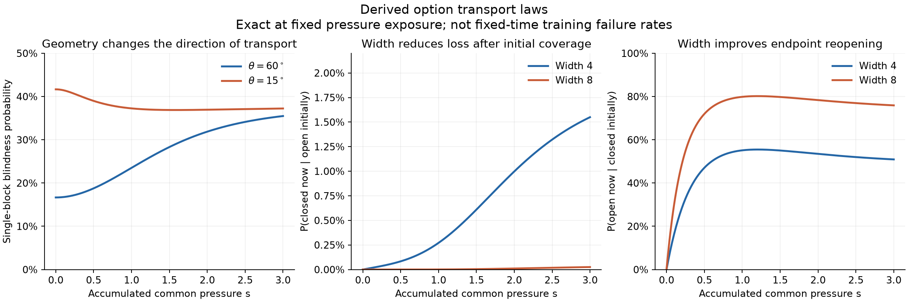

# A probability law for option transport and width

29 October 2026. A theoretical extension of
[shared implementations](shared_implementation_competition.md), using the same
functional response operator and coefficient–feature dynamics. No failure rate,
transition rate, or width exponent is fitted to training outcomes.

The main result is an explicit law for a restricted but interpretable competition
mechanism. Common learning moves randomly initialized features; geometry decides
which stop responding to a refinement; width decides how often **all** such
implementations are absent. Both closing and opening follow from the same flow.
The exact clock is accumulated common pressure. Passing to a fixed number of
ordinary training steps requires an additional clock and perturbation argument.

## 1. What is being predicted

Keep weighted squared loss, the mean-field parameterization, and its optimizer:

\[
f_m(x)=c+\frac1m\sum_{j=1}^m a_j[w_j^Tx]_+,\qquad
M_{a_j}=M_{w_j}=mI,\quad M_c=1.
\]

On a fixed weighted panel, write

\[
K_m=bb^T+\frac1m\sum_j Z_j,\qquad
B_{\tau,m}=K_m(K_m+\lambda I)^{-1},\quad \lambda=(2\tau)^{-1}.
\]

Here b=P^(1/2)1 and Z_j is the existing PSD derivative block. Options remain
eigenspaces of B. A fixed unit functional contrast d is **completely unavailable**
when d^T B d=0, equivalently Kd=0. A positive value means some response, not that
d lies entirely in range(K), and not that correction is fast enough. We derive
this exact null event first, then a separate finite-strength bound.

This distinction avoids labeling neurons as options. A block can support many
contrasts; several blocks can support one contrast. Nor do we identify the same
option across time by its sorted eigenvector index.

## 2. Task assumptions and why they are useful

The broader task remains a common rule with context-dependent refinements:

\[
y(R,Z)=s(Z)+\sum_r 1_{R=r}h_r(Z),\qquad P(R=r)=q_r.
\]

Bounded refinements in low-frequency contexts contribute small early population
forces, unless their gradients or amplitudes are unusually large. Frequencies
weight the original objective; examples need not arrive late. This is a plausible
abstraction of repeated contexts with rarer conditional distinctions. It does
not identify token occurrence frequency with the frequency of every learned
feature, or establish a language-model scaling law.

For an exactly solvable local model, take one common prototype and a pair of
refinement prototypes:

\[
u=(1,0),\quad v_\pm=(-\cos\theta,\ \pm\sin\theta),\quad
0<\theta<\pi/2,
\]
\[
P(u)=1-q,\quad P(v_\pm)=q/2,\qquad
y(u)=b_*,\quad y(v_\pm)=\pm D_*.
\]

The first coordinate separates a frequent context from a less frequent one;
the second distinguishes two outcomes within that rare context. The inputs are
standardized descriptors, so a negative dot product is compatible with context
separation. These three points are an idealization of clusters, not a claim
that realistic data have discrete support. Small cluster spread and additional
weak pressures are perturbations discussed below. Hidden biases are omitted in
this exact example; the trained output intercept is retained.

Capacity is sufficient at width three: a common-only feature [x_1]_+, and rare
features with incoming vectors (-sin(theta), ±cos(theta)), represent the three
targets exactly. Each rare feature is zero at u and at the other rare prototype,
and equals 2 sin(theta) cos(theta) at its own prototype. Choose output
coefficients accordingly, including the factor m. Thus the obstruction below
can occur above representational sufficiency.

Initialize a, w_1, w_2 independently as N(0, sigma^2), independently across
blocks. Equal variances make the probability formula explicit; anisotropic
initialization replaces the covariance in the Gaussian calculation. Small sigma
helps justify an early common-dominated interval but is not needed for the
exact common-pressure calculation itself.

| Assumption | Role | Boundary |
|---|---|---|
| Frequent coherent common pressure | Reduces early dynamics to one pressure coordinate | Several competing common directions require a multi-direction flow |
| Shared features across contexts | Common updates can move rare gates | Disjoint parameter modules remove this mechanism |
| Independent initial blocks | Supplies independently drawn implementations | Exact duplicates do not supply independent draws |
| A finite correction budget | Makes late recovery consequential | An opened gate alone does not imply timely learning |
| Small rare force during the modeled interval | Connects the common branch to full training | Small q alone is insufficient with large gradients or long horizons |

## 3. An exact pressure clock removes the apparent independence assumption

First consider the common-only gradient branch of the original loss, retaining
its weight 1-q. Let e_u=b_*-f_m(u), initially positive, and define

\[
s(t)=\int_0^t(1-q)e_u(r)\,dr.
\]

As long as e_u>0, division by ds/dt gives the exact equations

\[
\frac{dw_j}{ds}=a_j1_{w_{j1}>0}u,\qquad
\frac{da_j}{ds}=[w_{j1}]_+,\qquad \frac{dc}{ds}=1. \tag{1}
\]

These are ordinary gradient dynamics with a changed clock. Per-feature speeds
are order one under the declared metric. Increasing width does not freeze them.

Write initial coordinates (W,V,A)=(w_1,w_2,a). If W<=0 the block stays fixed.
For W>0, until its common gate closes,

\[
W_s=W\cosh s+A\sinh s,\quad
A_s=A\cosh s+W\sinh s,\quad V_s=V. \tag{2}
\]

If A<-W, the common gate hits zero at arctanh(-W/A). Under the absorbing
zero-subgradient convention it then stays at W_s=0 and
A_s=-sqrt(A^2-W^2). Continuing the hyperbolic formula through that boundary
would be incorrect. Formula (2) includes readout growth, shrinkage, sign change,
and feature motion; it is not a fixed-feature model.

**At a specified, externally fixed exposure s, the transported blocks are
independent exactly.** Each is a deterministic function of its own initialization.
We have not assumed independent survival after a coupled training trajectory.
For the common branch, all coupling has entered its clock.

The clock is explicit too:

\[
\dot s=(1-q)\left[b_*-c_0-s-
       \frac1m\sum_j A_{j,s}[W_{j,s}]_+\right]. \tag{3}
\]

With c_0=0, the common prediction in brackets increases with s; each block
contributes derivative A_s^2+W_s^2 while active, and the intercept contributes
one. The positive-residual branch approaches its unique zero. An arbitrary
large s may therefore be unreachable. The formulas below define an exact
pressure-indexed ensemble; they describe actual common training at a chosen s
only on runs that reach it. Conditioning on reachability generally destroys the
product law. For a fixed physical time T, s_m(T) is random and depends on all
blocks: do not substitute it into the iid formulas and call that exact.

One rigorous transfer uses a simultaneous exposure interval: if the clock lies
in [s_-,s_+] with high probability, evaluate events valid throughout that interval
and add the probability of clock escape. Monotonic event bounds apply only where
monotonicity has actually been established. Solving a deterministic population
version of (3) supplies a forecast, with a finite-width clock error still to bound.

## 4. Explicit closing and opening probabilities

Use the unit contrast d=(0,1,-1)/sqrt(2) in weighted output coordinates. Since
the rare points have equal mass, d is orthogonal to the intercept. Directly from
the Jacobian, a block contributes

\[
r_j=d^TZ_jd=\frac q4\left[(h_{j+}-h_{j-})^2+
 a_j^2\|g_{j+}v_+-g_{j-}v_-\|^2\right]. \tag{4}
\]

Almost surely, r_j=0 iff both rare gates are inactive. The zero-readout and
exact-boundary exceptions have zero initialization probability at a fixed finite
exposure. PSD additivity then gives

\[
d^TB_{\tau,m}d=0
\quad\Longleftrightarrow\quad
\text{every block is inactive on both rare inputs}. \tag{5}
\]

Let t_theta=tan(theta). A transported block is blind to both rare points iff

\[
W>0,\qquad W\cosh s+A\sinh s>t_\theta|V|. \tag{6}
\]

The inequality itself ensures that a common-gate death has not already occurred.
Initially common-inactive blocks remain responsive to at least one rare point;
blocks whose common gate dies also have a rare response almost surely.

Define Q_s=cosh(2s)+tan^2(theta). The three centered Gaussian variables
W, W cosh(s)+A sinh(s)-t_theta V, and
W cosh(s)+A sinh(s)+t_theta V have correlations

\[
\rho_1=\frac{\cosh s}{\sqrt{Q_s}},\qquad
\rho_2=\frac{\cosh(2s)-\tan^2\theta}{Q_s}.
\]

Their positive orthant probability is

\[
\boxed{b_\theta(s)=\frac18+
 \frac{2\arcsin\rho_1+\arcsin\rho_2}{4\pi}.} \tag{7}
\]

This is a probability derived from feature motion and initialization. It is not
a fitted survival parameter. It is independent of sigma because blindness is a
homogeneous geometric event; finite response strength is not sigma-independent.

An independent derivation integrates the angle of (W,|V|). With
N_s(phi)=cosh(s)cos(phi)-tan(theta)sin(phi), for s>0,

\[
b_\theta(s)=\frac1{2\pi}\int_0^{\pi/2}
 \left[1+\frac{N_s(\phi)}{\sqrt{\sinh^2s+N_s(\phi)^2}}\right]d\phi.
\tag{8}
\]

To obtain (8), integrate the independent Gaussian A conditional on the polar
radius R of (W,V); E_R Phi(hR)=(1+h/sqrt(1+h^2))/2. This also gives the
two-time probability b_00(s) of being blind initially and at s: replace the upper
integration limit by pi/2-theta. At s=0, b_00=b_theta(0).

This integral has a closed antiderivative. For L in [0,pi/2], define

\[
F_s(L)=\frac1{2\pi}\left[L+
 \arcsin\frac{\cosh(s)\sin L+\tan(\theta)\cos L}{\sqrt{Q_s}}
 -\arcsin\frac{\tan\theta}{\sqrt{Q_s}}\right].
\]

Then b_theta(s)=F_s(pi/2) and b_00(s)=F_s(pi/2-theta).
The implementation evaluates the angles with atan2 to remain accurate near s=0.

Independence at fixed s and (5) now give the first width law:

\[
\boxed{P(\text{contrast completely unavailable at }s)=b_\theta(s)^m.} \tag{9}
\]

Separating initial coverage from later transport is essential. The exact
endpoint transition laws are

\[
\boxed{P(\text{open at }0,\ \text{closed at }s)
       =b_\theta(s)^m-b_{00}(s)^m,} \tag{10}
\]
\[
\boxed{P(\text{closed at }s\mid\text{open at }0)
 =\frac{b_\theta(s)^m-b_{00}(s)^m}{1-b_\theta(0)^m},} \tag{11}
\]
\[
\boxed{P(\text{open at }s\mid\text{closed at }0)
 =1-\left(\frac{b_{00}(s)}{b_\theta(0)}\right)^m.} \tag{12}
\]

“Open” here means positive response to d, as in (5), rather than full span
coverage. Formula (10) counts dynamically lost responses and excludes initially
absent responses. Endpoint openness can include intermediate closing and
recovery. These laws do not assert memoryless transitions or independent fates
for different functional contrasts.

At fixed s, (9) decreases geometrically with width whenever 0<b_theta(s)<1;
(12) increases with width. The conditional closing probability in (11) tends
to zero. The unconditioned number in (10) need not decrease at every width,
because more widths also start with an open response. This is why an endpoint
failure rate and a transition rate should not be interchanged.

Useful limiting checks are

\[
b_\theta(0)=\frac12-\frac\theta\pi,\qquad
\lim_{s\to\infty}b_\theta(s)=\frac38. \tag{13}
\]

The latter is a limit of the pressure-indexed model, not a claim that infinite
exposure is reached in ordinary training. Geometry can reverse net transport:
theta=pi/3 has much more endpoint blindness after pressure, whereas theta=pi/12
has less at s=2. Both closing and opening events occur in either example.

For theta=pi/3, these **analytic model predictions** illustrate the size of the
effect; they are not measured failure rates of the repository's other toys:

| Common exposure | Single-block blindness | Null response, m=4 | Null response, m=8 |
|---|---:|---:|---:|
| 0 | .166667 | .000772 | .000000595 |
| 1 | .235095 | .003055 | .00000933 |
| 2 | .318807 | .010330 | .0001067 |

The last two panels use theta=pi/3. The opening panel conditions on the subset
initially missing this contrast, which differs across widths; it is not a paired
same-checkpoint recovery intervention.

Widths four and eight are both above the three-unit capacity witness. More width
does not reduce any individual block's probability of closure in this ensemble;
it reduces simultaneous loss of all alternatives. The changing base b_theta(s)
is the competition dynamics, and the exponent m is independently initialized
implementation multiplicity. Uniform synchronized clones retain the original
failure probability: duplicating n independent blocks k times gives b_theta(s)^n,
not b_theta(s)^(kn).

### First crossings and reopening do not require a fitted hazard

Within a common-active segment, a rare boundary satisfies
W cosh(s)+A sinh(s)=tan(theta)|V|. Setting z=exp(s) gives

\[
(W+A)z^2-2\tan\theta|V|z+(W-A)=0. \tag{14}
\]

Admissible roots z>=1 before common-gate death give crossing exposures. Negative
initial A can first decrease W_s and then increase it, allowing opening followed
by closure. Integrating these root events over initialization gives first-passage
or survival probabilities. One must keep the trajectory history to ask whether
a network ever loses **all** responses: counting units that survive uninterrupted
is only a sufficient certificate, since implementations can take over from one
another. Equations (10)–(12) intentionally make the simpler two-time claim.

## 5. Finite response strength: width protects a distribution, not only rank

At fixed exposure s the full derivative blocks Z_j(s) are iid. Their law is the
pushforward of initialization under (1), not an extra freely chosen latent state.
Consequently the entire response distribution is specified:

\[
\bar K_s=bb^T+\mathbb E Z(s),\qquad
K_{m,s}=bb^T+\frac1m\sum_jZ_j(s). \tag{15}
\]

Gaussian initialization and finite s give finite fourth parameter moments and
finite block variance v_s=E||Z(s)-EZ(s)||_F^2. Independence proves
E||K_m-bar K||_F^2=v_s/m. The resolvent identity proves

\[
\|B(K_m)-B(\bar K_s)\|\le\frac{\|K_m-\bar K_s\|}{\lambda}.
\]

For a fixed unit d, let bar beta_s=d^T B(bar K_s)d. For any chosen
finite-response resolution 0<=beta_*<bar beta_s,

\[
\boxed{P\{d^TB_{\tau,m}d<\beta_*\}
 \le \min\left(1,\frac{v_s}
 {m\lambda^2(\bar\beta_s-\beta_*)^2}\right).} \tag{16}
\]

This can be conservative at small widths. Its extra content relative to the old
initialization bound is that both the mean and the variance are now determined
**after competition**, without an assumed bound on learned pair correlations.
It applies to any d, including coupled directions; replacing d^T B d by the
scalar filter of d^T K d would generally be invalid. A response resolution is a
declared diagnostic, not a new definition of an option or a loss guarantee.

There is also an exact mean-response statement:

\[
\mathbb E B_{\tau,m+1}(s)\succeq\mathbb E B_{\tau,m}(s). \tag{17}
\]

Proof: B(K)=I-lambda(K+lambda I)^(-1) is operator concave. A sample mean of
m+1 blocks is the average of its m+1 leave-one-out means of size m. Apply operator
Jensen and average over iid blocks. This does not imply monotonicity of every
tail probability, and does not order independently trained networks at equal
physical time. It says widening improves mean discounted response at the same
pressure exposure and mean implementation law.

Importantly, one surviving block contributes only Z/m. Exact nonzero response
can be too weak to matter. At small sigma, Z is order sigma^2 initially although
the probabilities in (7) are unchanged. Width cannot manufacture a useful mean
response when the transported population supplies almost none.

## 6. When closure has an actual loss consequence

There is an exact full-objective trap in the prototype task, rather than an
assumption that closed gates are permanently lost. Suppose at some checkpoint:

1. every block has a_j>=0, w_j1>0, and
   w_j1>tan(theta)|w_j2|, so both rare gates are strictly inactive;
2. c>=0 and e_u=b_*-f(u)>=0.

Resume gradient flow on **all three prototypes with their original weights**.
The rare examples affect only c while their gates are off. The equations are

\[
\dot w_{j1}=(1-q)e_u a_j,\quad
\dot a_j=(1-q)e_u w_{j1},\quad \dot w_{j2}=0,
\]
\[
\dot c=(1-q)e_u-qc,\qquad
\dot e_u=-(1-q)\left[1+\frac1m\sum_j(a_j^2+w_{j1}^2)\right]e_u+qc.
\tag{18}
\]

The quadrant (c,e_u)>=0 is invariant: its vector field points inward at both
axes. Readouts and w_j1 cannot decrease, so rare gates remain inactive. Thus

\[
\boxed{L(t)\ge\frac q2D_*^2\quad\text{for all later }t.} \tag{19}
\]

Indeed rare loss is q(c^2+D_*^2)/2; its contrast cannot be learned through the
intercept. This is deterministic harmful competition once such a state has
been reached, despite adequate representational capacity.

It is not valid to multiply (9) by qD_*^2/2 and call the result expected final
loss: (9) also includes states with negative readouts or an unfavorable common
residual, for which the invariant argument can fail. A sufficient subset uses
initial W>0 and A>0. Both stay positive, and its single-block trap probability
at exposure s is

\[
t_\theta(s)=P\{W>0,A>0,
 W\cosh s+A\sinh s>\tan\theta|V|\}. \tag{20}
\]

This is another specified Gaussian integral. It increases with s, tends to 1/4,
and initially equals b_theta(0)/2. At fixed exposure the probability all blocks
belong to this subset is t_theta(s)^m; the probability they do so after starting
with a nonzero rare response is t_theta(s)^m-t_theta(0)^m. To turn this into an
actual training/loss probability one must additionally establish exposure
reachability, (c,e_u)>=0, and control the rare pressure before closure.

These conditions are nonempty. For example, take theta=pi/3, four units with
w_j1=.2, a_j=.4, and w_j2 alternating ±.4, c_0=0, b_*=4. Initially the complete
three-output Jacobian has full row rank. Common-only exposure s=1.5 makes all
rare gates strictly negative, all readouts positive, and keeps c and e_u
positive. The common branch reaches this exposure because f(u;s)<4 there.
Switching to the full objective then satisfies (18)–(19). This is a concrete
pressure-induced loss of initially available correction, not a capacity deficit.
The inequalities are strict and persist in an open neighborhood of the initial
parameters, so this mechanism has positive Gaussian initialization probability.

For all-data training from the start, sufficiently small positive q preserves
this construction on its finite early interval: common gates remain active,
the common vector field is smooth there, and the additional rare field is
uniformly O(q) on a bounded parameter region. Gronwall control as below keeps
the full trajectory inside the strict terminal margins. This proves existence
of a natural-training competition regime; it does not give an evaluated q range
or a failure probability for the existing q=.1 experiments.

Outside the invariant trap, recovery remains possible. The maintained bound
T_exit>=r^2/(L-F) supplies a finite-budget obstruction where its margin and loss
floor are informative. For a recruited but weak block, fixed-gate residual
pressure b_j gives (a_j+s_j)(t)=exp(||b_j||t)(a_j+s_j)(0). If a bounded rare
residual dominates that pressure, ||b_j|| is order q. Amplification then takes
order q^(-1) times a logarithmic strength ratio, provided residual and gates
remain approximately fixed. This derives a plausible rare-refinement delay;
it is not a globally exponential learning law. Include the block's 1/m kernel
weight when converting amplitude to network strength. Merely obtaining one
extra surviving unit need not shorten the correction time.

## 7. Extending beyond one coherent pressure without assuming the answer

For a prescribed residual field e_t(x), the existing equations define a flow
Phi_t on individual parameters:

\[
\dot w=a\,\mathbb E[e_t(x)1_{w^Tx>0}x],\qquad
\dot a=\mathbb E[e_t(x)[w^Tx]_+]. \tag{21}
\]

Its initialization pushforward rho_t=(Phi_t)_#rho_0 determines gate-path and
block-strength distributions. Fixed fields make blocks independent, so (15)–(17)
remain valid and complete-null events have probability
P_{rho_t}(d^TZd=0)^m when d is intercept-orthogonal. More general partial loss of
span can be computed from joint gate-pattern probabilities: at a!=0, pattern g
supplies range(P^(1/2)G X), and iid pattern counts are multinomial. The union of
those spaces plus the intercept decides span coverage. This uses the architecture,
not teacher-assigned neuron roles.

For ordinary training, a deterministic **population reference** can close (21)
self-consistently through

\[
e_t(x)=y(x)-c_t-\int a[w^Tx]_+\,d\rho_t,
\qquad \dot c_t=\mathbb E e_t(x). \tag{22}
\]

Equations (21)–(22) are distributional dynamics, not a new fitted stochastic
transition process. They allow creation and recovery as residual demand changes.
Finite-width trajectories remain coupled. A mean-field limit alone does not
justify an exponentially accurate b(t)^m estimate of rare finite-width failures,
particularly at widths four or eight or over long times.

A useful explicit transfer statement is the following. Suppose a coupled network
and independent reference particles can be matched so that, with probability
at least 1-epsilon_m, every rare preactivation differs by at most delta over the
audited interval. Define at a selected time

\[
b_-=P(\max_\pm \tilde w^Tv_\pm<-\delta),\qquad
b_+=P(\max_\pm \tilde w^Tv_\pm\le\delta).
\]

Then elementary event inclusion gives

\[
\boxed{b_-^m-\epsilon_m\le P(\text{all rare gates off})
 \le b_+^m+\epsilon_m,} \tag{23}
\]

clipped to [0,1]. No independence of the *actual* learned blocks was used. But
epsilon_m and delta must be justified, not fitted to the failure curve. Near a
gate boundary or under a collective instability they can dominate the forecast.
An absolute-error bound larger than b^m says nothing precise about that rare tail.

For the small-q perturbation in section 6, on a bounded region with common gates
fixed, let L_* be a Lipschitz constant of the coupled common vector field and
C_* bound the rare force divided by q. With identical initialization,

\[
\|\theta_{\rm full}(T)-\theta_{\rm common}(T)\|
 \le q C_*\frac{e^{L_*T}-1}{L_*}. \tag{24}
\]

Use qC_*T if L_*=0. The norm and constants must be specified for a numerical
certificate, and both paths must remain in the declared region. Rare-gate
crossings do not require a Lipschitz rare vector field for this bound: only its
uniform magnitude is used. Common-gate crossings need their own treatment.
Multiplying the incoming-parameter bound by ||v_±|| bounds rare preactivations.
Small cluster spread admits a related margin argument; it does not automatically
preserve an infinite-time blind trap on an entire continuous distribution.

## 8. Predictions that follow, and what remains open

The theory predicts separately:

- **Pressure:** common exposure changes the single-block blindness probability
  through (7); its sign depends on refinement geometry.
- **Width:** independent implementations turn that probability into (9), and
  give the initially-covered and reopening laws (11)–(12).
- **Magnitude:** mean discounted response improves with width at fixed exposure,
  but small initialization can leave surviving directions weak, via (16)–(17).
- **Frequency and time:** rarity reduces some early restoring forces and can
  delay later amplification. It also changes the common clock and loss weight.
  No universal monotonic “rarer means more closure” law follows.
- **Causality:** same-state common-pressure branches can create an invariant
  all-data obstruction, with the exact loss floor (19). Common-pressure removal
  can also remove useful creation, so it need not help overall.
- **Dependence:** clones and synchronized fates remove the multiplicity benefit;
  shared random shocks require averaging conditional probabilities, generally
  E[b(S)^m], rather than (E b(S))^m when S is independent of initialization.
  An endogenous clock needs (3) or a coupled analysis instead.

For several demanded refinements, individual missing-response probabilities can
be combined with a union bound without assuming independence across refinements.
There is no justification here for making implementation-basin mass proportional
to token frequency or for deriving a universal width power law from Zipf alone.
Frequency, geometry, and recovery must jointly determine the per-refinement laws.

The completed first step is a dynamics-derived probability law and a full-loss
trap mechanism. Remaining work is quantitative control of the exposure clock and
rare-pressure perturbation in the maintained tasks, then prediction of recovered
response strength over a correction budget. A fitted closure curve would not
resolve those gaps.

## 9. Verification and relation to existing theory

[Analytic implementation](../../scripts/studies/probabilistic_option_transport.py)
and [independent checks](../../tests/test_probabilistic_option_transport.py)
verify the gradient field, gate absorption, flow composition, Gaussian probability
by a separate polar integral, Jacobian/null-event equivalence, and transition
normalization. The
[audit](../../scripts/studies/audit_probabilistic_option_transport.py) checks the
analytic probabilities against independent Gaussian draws and the constructed
full-objective trap against finite-step gradients. Those checks validate the
derivation and implementation; they do not validate general neural prediction.

Distributional descriptions of two-layer training are established in
[Mei, Montanari and Nguyen (2018)](https://arxiv.org/abs/1804.06561).
Small-initialization ReLU alignment and its potentially adverse consequences are
studied by [Boursier and Flammarion (2025)](https://www.jmlr.org/papers/volume26/24-1523/24-1523.pdf).
These provide context, not a ready-made finite-width independence theorem for
our ReLU trajectories. The specific contribution here is connecting the explicit
pressure flow to existing functional options, joint closing/opening probabilities,
finite-strength reliability, and a causal loss obstruction, while keeping the
clock and recovery qualifications visible.
