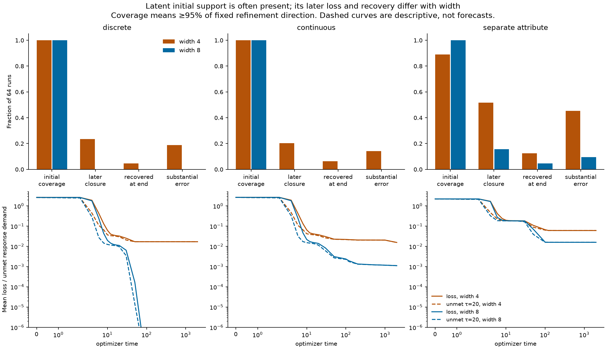
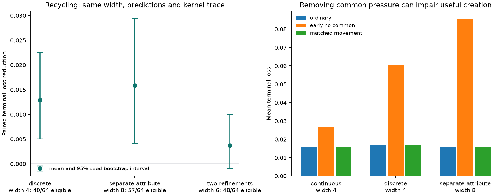

# Heterogeneous demand, shared implementations, and width

29 October 2026. Continuation of the [spectral response framework](spectral_options.md),
[delayed-demand study](delayed_demand_and_width.md), and
[finite-budget competition criterion](finite_budget_competition.md).
MNIST is paused. [Executed evidence and reproduction](../evidence/toy_resource_competition/README.md)
include the pilot, fresh confirmation, numerical checks, and negative results.

The subsequent [probabilistic derivation](probabilistic_competition.md) makes the
width argument explicit in a coherent-pressure regime. It derives a transported
implementation law, closing/opening probabilities, and a full-objective loss
trap; its fixed-pressure exactness does not replace the general correlation
qualifications in section 4 below.

## 1. The minimal continuation

Keep capability modes as eigenspaces of the budget-matched response operator.
An option is the nonzero projection of a declared residual into one of these
eigenspaces, considered together with its response; its value includes both
strength and demand. Add an explicit relationship between corrections through
their **shared derivative implementations**, and evolve those implementations with the existing coupled
feature–coefficient dynamics. Do not introduce a conserved option count or an
independent scalar law for each option.

The phenomenon is conditional: a currently dominant pressure can remove a route
for a later-useful correction. Harm depends on whether sufficiently strong
alternatives are retained or recruited before the correction budget expires.
The same pressure can create useful routes. More width can improve initial
coverage and subsequent reliability, without slowing every individual feature.

The new experiments support this chain on controlled tasks, including a task
whose shared rule and refinement use different input attributes. They do **not**
identify a universal natural-width mediator, prove that removing common pressure
helps, or establish a closed low-dimensional predictor of whole training runs.

## 2. A task family, not a single construction

Let Z contain shared attributes and R take common/rare context values, independent
of Z for the simplest statement. Write

\[
 y(R,Z)=s(Z)+\sum_{j=1}^r 1_{R=j}h_j(Z),\qquad P(R=j)=q_j.
\]

The functions h_j may use different attributes from s. They need not be mutually
orthogonal or have assigned neural implementations. With C the conditional-mean
projection onto functions of Z,

\[
 Cy=s+\sum_jq_jh_j,\qquad (I-C)y=\sum_j(1_{R=j}-q_j)h_j.
\]

The centered context covariance is diag(q)-qqᵀ. For one refinement,
\(\|(I-C)y\|_P^2=q(1-q)\|h\|_P^2\). The initial shared demand is order one
when s does not cancel the average refinement; the centered demand is order q
for bounded h. Frequency changes the weighted pressure, not an externally
scheduled curriculum: every example remains in the objective throughout.

This gives a plausible route to delayed *relative* demand, not a theorem that
shared learning must happen first. That also requires usable shared responses
and no compensating amplification of rare gradients. A centered-target control
violates the dominant-shared-demand assumption. Independence can be relaxed by
centering with q_j(Z)=P(R=j|Z); the constant covariance formula then changes.

For the current residual e=y-f, the actual pressures are Ce and (I-C)e, not the
initial teacher functions. They are orthogonal in data space and their parameter
updates add exactly. Their parameter implementations generally overlap.

The experiments retain the original discrete and continuous tasks and add:

- q=.02, to vary frequency without changing the input support or capacity witness;
- a centered target, to remove the dominant shared target component;
- two categorical refinements, with frequencies .10/.03 and coefficients 2/−1;
- a separate-attribute task y=2Z₁+2RZ₂, with independent signed attributes.

Each target has a four-unit witness, or six units for two refinements, on the
whole bounded support. The learner has no assigned neuron roles. These are
controlled realizable problems with small Gaussian initialization, full-batch
squared loss, and the declared mean-field optimizer metric; they are not evidence
for arbitrary architectures, data distributions, or ordinary SGD.

## 3. Intrinsic option interactions

Use weighted output coordinates F=P^(1/2)f and whitened parameters
β=M^(−1/2)θ for constant M. Let D=∂F/∂β, K=DDᵀ, λ=1/(2τ), and

\[
 C_\tau=K(K+\lambda I)^{-1},\qquad r(u)=D^Tu.
\]

The implementation r(u) of a functional direction u is a vector in the same
parameter space as every other implementation. Its overlap r(u)ᵀr(v)=uᵀKv
controls immediate cross-progress. It does **not** determine how options change.
For that, define H_u=∇²_β(uᵀF). Pressure p gives β̇=r(p), so in a smooth region

\[
 \boxed{\mathcal T(u,v;p)=r(v)^TH_ur(p)+r(u)^TH_vr(p)=u^T\dot K[p]v.}
\]

This susceptibility is symmetric in u,v and linear in the current pressure p.
It follows by differentiating DDᵀ, not by postulating competition coefficients.
The response transport is

\[
 \boxed{\dot C_\tau[p]=\lambda(K+\lambda I)^{-1}\dot K[p]\,(K+\lambda I)^{-1}.}
\]

Diagonal transport changes strength; off-diagonal transport changes orientation
and coupling. Both can have either sign. Orthogonal output tasks can interact
through shared implementations and their Hessians. If D is constant, this
mechanism is absent even when gradient overlap remains nonzero. For changing
optimizer metrics or loss curvature, their already-established transport terms
must also be retained; this study isolates constant metric and squared loss.

ReLU gate changes require finite updates. From the same state, evaluate C₀,
C_C, C_R, C_full after no update, common-only, refinement-only, and the summed
update. The symmetric allocation

\[
 \Delta_C=\tfrac12(C_C-C_0+C_{\rm full}-C_R),\quad
 \Delta_R=\tfrac12(C_R-C_0+C_{\rm full}-C_C)
\]

sums exactly to C_full−C₀. It is a specified allocation of nonlinear interaction,
not a unique attribution law. Our event audit additionally reports the direct
common-only and refinement-only counterfactuals, so interpretation does not
rely on this allocation convention.

### What is the shared resource?

For f=c+m^(−1)Σ_j a_j ReLU(w_jᵀx), with M_w=M_a=mI and M_c=1,

\[
 K=bb^T+\frac1m\sum_j Z_j,\quad b=P^{1/2}1,
\]
\[
 Z_j=P^{1/2}[h_jh_j^T+a_j^2G_jXX^TG_j]P^{1/2},\quad
 h_j=\operatorname{ReLU}(Xw_j),\ G_j=\operatorname{diag}(Xw_j>0).
\]

Each neuron supplies a block of trainable derivative directions. For a_j≠0 its
structural implementation space is range(P^(1/2)G_jX); its response strength also
depends on a_j and w_j. Several blocks can implement one correction; one block
can help several corrections. At a_j=0 the actual block contains only the
outgoing feature direction P^(1/2)h_j until the coefficient grows. This distinction
matters for recycling. Blocks are architecture-defined implementations, not
options or a new neuron-count definition of capability.

The existing dynamics provide a simple closure at the implementation level:

\[
 \dot w_j=a_j b_j(e),\quad \dot a_j=w_j^Tb_j(e),\quad
 b_j(e)=\sum_i p_i e_i g_{ji}x_i.
\]

Common and refinement pressures add inside b_j. Features become useful or cease
to be useful as these coupled updates change their strength and gates. This is
the same bilinear mechanism already used in the local response model, with the
physical gate changes retained. The susceptibility above describes its effect
on arbitrary functional options; it does not replace the state dynamics.

On a short interval with approximately fixed residual and gates, put
ν=||b_j|| and s_j=w_jᵀb_j/ν. Then

\[
 s_j(t)+a_j(t)=e^{\nu t}(s_j(0)+a_j(0)),\quad
 s_j(t)-a_j(t)=e^{-\nu t}(s_j(0)-a_j(0)).
\]

Thus a weak newly available route can amplify. A zero readout coefficient need
not mean permanent absence: ȧ_j=〈e,h_j〉_P can recruit it. Conversely, if every
available derivative is orthogonal to the residual, deterministic training has
no first-order recruitment signal. Neither a frozen C nor its first derivative
alone describes all delayed amplification. Fixed residual and gate assumptions
must be checked before using this exponential as a quantitative forecast.

## 4. Width enters through the same resource model

### Initialization: a probabilistic statement with a proof

At iid initialization the Z_j are iid, and
K̄=bbᵀ+E Z_j does not depend on width under this scaling. Let S be its range,
μ=λ_min(K̄ restricted to S)>0, and σ²=E||Z_j−E Z_j||_F²<∞. On finite input
support, Gaussian initialization has the required finite moments. Independence
and zero-mean cross terms give

\[
 E\|K_m-\bar K\|_F^2=\sigma^2/m.
\]

Therefore, for 0<δ<μ, Markov's inequality and the operator/Frobenius norm bound
imply, with probability at least 1−σ²/(mδ²),

\[
 C_{\tau,m}|_S\succeq
 \frac{\mu-\delta}{\mu-\delta+\lambda}I_S.
\]

The bound can be loose or vacuous at small widths. It establishes increased
reliability around the same mean kernel, not increasing mean strength by fiat.
S is a fixed possible implementation space, not a teacher-selected mode list.
Directions outside S are not covered by this result.

There is also a simple latent-span statement. If r iid units have probability
p>0 of jointly spanning a useful subspace U, grouping m units into disjoint
r-tuples bounds the probability that none supplies this certificate by
(1−p)^floor(m/r). Cluster-separated ReLU tasks admit positive-probability gate
cones around finite representation witnesses. This is a sufficient certificate,
not an exact coverage probability or an independence claim about learned fates.
It says nothing about whether tiny initial coefficients supply adequate strength.

### Dynamics: why independence cannot be assumed

At later times all Z_j depend on the shared learned residual. For exchangeable
units at a fixed width, let σ²_t be the block variance and
c_t=E〈Z₁−E Z₁,Z₂−E Z₂〉_F. Exactly,

\[
 E\|K_m(t)-E K_m(t)\|_F^2
 =\sigma_t^2/m+(m-1)c_t/m.
\]

A conditional width-protection result follows if the mean later-useful response
stays bounded below and σ²_t is bounded while c_t≤C/m: the same concentration
argument gives a failure bound of order 1/m at each audited time. A union bound
covers a finite set of times. Uniform protection over an interval additionally
requires control between observations, including gate jumps. Correlated closure
or collapse of the mean useful response defeats the argument.

These are meaningful, falsifiable assumptions, not established properties of
our finite-width paths. In particular, this toy metric gives O(1) per-neuron
velocities. The earlier square-root-width drift bound does **not** apply here.
Natural width may instead supply more alternative initial blocks and more
recruitment opportunities, with jointly dependent survival.

For an availability event A_t, initial coverage, survival without closure, and
recovery after closure are distinct joint probabilities. For example,
P(A_T|A₀) splits into paths that never close and paths that close and recover.
There is no assumed memoryless transition law. Our structural coverage audit
uses Q_t=||Proj_range(D_t) d||² for a normalized task-refinement contrast d;
finite availability uses dᵀC_τd. Q_t and dᵀC_τd must not be interchanged.

## 5. From response paths to finite-budget harm

For weighted squared loss L=||e||²/2, gradient flow gives
−L̇=eᵀKe. Define b_τ=eᵀC_τe/||e||²=V_τ/L. A useful scalar relation follows
without following individual eigenvectors:

\[
 \frac{e^TKe}{\|e\|^2}\ge\lambda\frac{b_\tau}{1-b_\tau},\qquad
 \log\frac{L(t_0)}{L(T)}\ge
 \int_{t_0}^T\frac{b_\tau(t)}{\tau[1-b_\tau(t)]}\,dt.
\]

Proof: Cauchy–Schwarz gives
(eᵀ(K+λI)e)(eᵀ(K+λI)^(−1)e)≥||e||⁴; substitute
1−b_τ=λeᵀ(K+λI)^(−1)e/||e||² and integrate the loss-rate identity.
This relates residual-loaded finite response to accumulated progress while
allowing rotations. It is an observed-path bound, not a forecast using the
initial C. Euler GD requires the existing finite-update ledger remainder.

For descriptive plots we also report U_τ=L−V_τ, the demand not covered by the
local discounted response, and its time average over [20,2000]. The sparse-grid
trapezoidal integral is descriptive, not an exact training ledger. Persistent
large U_τ and actual null residual energy track the discrete obstruction; a
transient deficit can disappear through recruitment.

The earlier recovery theorem remains valid: if a parameter region enforces loss
at least F and useful escape requires optimizer-distance r, gradient flow needs
at least r²/(L−F) time to escape. It explains how an unavailable correction can
remain trapped despite its large residual. However, the old blind-set witness
at time 100 certifies **none** of the new discrete/continuous ordinary failures
through time 2000; margins or available surplus make it too weak. Four centered
narrow runs are covered, with no observed violations. This is a failure of
certificate coverage, not a license to call the other failures proven permanent.
Their persistence is measured over the finite experimental budget.

## 6. Evidence for the chain, with its boundaries

The pilot used 32 seeds to time 500. Fresh confirmation used 64 nested-width
pairs per family to time 2000, dt=.05. Independent initial coverage used 4,096
banks. The three principal families were rerun at dt=.025 with the same banks.
“Substantial error” means training-measure loss above 5% of the initial centered-refinement energy;
raw losses and 1%/10% sensitivities are saved. Structural availability means
Q≥.95, with .90/.99 sensitivities. These are descriptive analysis cutoffs,
not independently preregistered outcome predictions.

| Family | Widths | Final mean loss, narrow / wide | Substantial errors /64, narrow / wide |
|---|---|---|---|
| Discrete | 4 / 8 | .016875 / approximately 0 | 12 / 0 |
| Continuous, dense evaluation | 4 / 8 | .015554 / .001113 | 9 / 0 |
| Rarer, q=.02 | 4 / 8 | .003369 / approximately 0 | 11 / 0 |
| Centered target | 4 / 8 | .021756 / .001406 | 16 / 1 |
| Two refinements | 6 / 12 | .003134 / approximately 0 | 2 / 0 |
| Separate attribute | 4 / 8 | .060313 / .015781 | 29 / 6 |

Initial latent coverage in the independent banks rises from 96.29% to 99.95%
for discrete widths 4/8, and from 91.50% to 99.90% for separate attributes. Mean
initial refinement strength at τ=20 barely changes (about 2.70e−5 for discrete):
width improves coverage reliability and the lower tail, not large initial strength.

In the confirmation discrete cohort all 64 runs at each width start with Q≥.95.
Fifteen narrow paths cross below it; three recover by the endpoint. No wide path
crosses below it. Thus initial *missing span* alone cannot explain this cohort's
width gap. The separate-attribute family starts with 57/64 versus 64/64 covered;
33 versus 10 of those paths close, and eight versus three recover. Among initially
covered runs, 23/57 narrow and 6/64 wide runs have substantial final error.
These are sampled-path probabilities; short unobserved excursions may be missed.

### Pressure causes some actual losses of support

Replaying every early gate-changing update identifies the first structural
coverage drop larger than .03 per run. From that exact preceding state, the
common-only update causes a large drop while refinement-only does not in 8/64
narrow discrete runs, versus 0/64 wide; five of those eight end with substantial
error. In separate attributes the counts are 30/64 versus 9/64, with 20 versus
four eventual failures. Common demand dominates at all of these events.
These are local causal effects of pressure on support; later loss association
alone is not mediation proof.

Other events require both updates, or occur under refinement pressure. Halving
the step preserves the strong narrow/wide event contrast but changes the exact
allocation (discrete common-only count 9; separate-attribute counts 25/6).
The attribution of a particular boundary crossing is step dependent. End losses
are stable: discrete unchanged, continuous mean changes about 1e−5 at width 4,
and separate-attribute width-4 mean changes by −.000234.

Removing common pressure for the entire early interval [0,20) is **harmful on
average** in the principal families. Discrete width-4 mean loss rises from .016875
to .060313; separate-attribute width-8 loss rises from .015781 to .085547. Full
updates with optimizer-distance speed matched to the knockout remain close to
ordinary training. This rejects “common pressure is generally wasteful” and
supports retaining both feature creation and feature destruction in the model.

### A different causal intervention: restore a direction at the same width

At time 20, redistribute readouts to set one coefficient to zero while exactly
preserving the current predictions on training and dense audit grids. Select
the eligible unit with the smallest metric readout displacement. The control
retains its incoming feature. Treatment gives it an unselected random direction,
scaled to preserve its weighted activation energy. Since its readout is zero,
this preserves the entire current prediction and the **trace of K** between
control and treatment, while changing directional response. Width and all other
post-redistribution parameters match. Full K, parameter norm, and higher-order
response dynamics do not match; this is a direction/recruitment intervention,
not natural widening or pure mediation by a single eigenvalue.

Four random directions per eligible checkpoint were trained to time 2000.
Bootstrap intervals resample original seeds after averaging the four draws.

| Family / width | Eligible /64 | Control → recycled mean loss | Paired reduction, 95% seed-bootstrap interval |
|---|---|---|---|
| Discrete /4 | 40 | .015750 → .002813 | .012938 [.005063, .022500] |
| Separate attribute /8 | 57 | .017719 → .001886 | .015833 [.004079, .029387] |
| Two refinements /6 | 48 | .004178 → .000467 | .003711 [−.000934, .009978] |
| Continuous /8 | 36 | .001107 → .001067 | .000041 [.000025, .000060] |

For discrete width 4, 23 of 160 draws improve loss by more than 1e−4 and none
worsen it by that amount. The corresponding separate-attribute width-8 counts
are 23/228 and zero. Many starting checkpoints were already solved. Two-refinement
resampling has eight improvements and one worsening; its average benefit is
uncertain. Continuous width 4 has no eligible exact-preserving recycling states;
separate-attribute width 4 has only one. The latter's apparent benefit has no
useful population uncertainty estimate. Do not extrapolate these selected
eligibility subsets to every run or every width.

### Which statistics survive the causal tests?

Total instantaneous strength is not sufficient: recycling holds trace(K) fixed.
Initial spectral breadth, fixed-refinement strength, and residual-loaded gain
also fail as general scalar explanations of long-budget intervention effects.
Even τ=1000 gives weak seed-level correlations with the discrete and
separate-attribute recycling gains. The change in structural refinement coverage
has correlations 1.00 and .915 in those two subsets; this is a descriptive audit
of the randomized treatment, not an independent predictive validation or a
unique mediation estimate. Some newly supported directions are initially weak
and then amplify through coefficient–feature coupling.

This is not just a mismatched observation horizon. Replaying the exact frozen-flow
and stable frozen-GD operators for all 1,980 remaining time units predicts mean
discrete-width-4 gain .001503 versus actual .012938, with seed-level correlation
−.019. It also predicts a .001137 effect at discrete width 8 where ordinary
learning removes the difference. These retrospective, unfitted comparisons
support keeping response evolution and recruitment in the model.

Coverage alone is also insufficient. Two-refinement runs often close and
recover (seven of eight initially covered narrow paths that close recover).
The pilot had no final failures in that family; the fresh cohort has two, so a
strict absence claim does not replicate. Continuous narrow paths also recover,
and fine-scale residual error persists even when coarse refinement coverage is
high. Exact full-span thresholds would misleadingly classify most continuous
runs as closed. Use actual residual loading, strength over the relevant budget,
and recovery alongside structural coverage. The inverse-participation heuristic
for implementation diversity did not give a consistent mediator and is not
promoted into the core model.

## 7. What has, and has not, been established

The controlled causal chain now has separate evidence at each link: task weights
set orthogonal demand scales; same-state pressure interventions change support;
random directional restoration changes later correction at fixed prediction,
width and trace; and natural width changes initial coverage and closure/recovery
frequencies. The strongest new positive result is direction restoration and
recruitment, not generic preservation. The earlier copy intervention's weak or
harmful effects remain consistent with this distinction: preserving an existing
response need not provide a missing direction and can slow useful creation.

This is not a complete identification of the natural-width causal effect.
The intervention modifies higher-order geometry and is only eligible on subsets;
local closure attribution is not a whole-trajectory intervention; and the old
recovery certificate does not cover most new failures. Centered-target failures
show that some obstructions arise without dominant common target demand. Such
failures are useful controls, not evidence for the specific common-to-refinement
mechanism. Rare frequency alone neither guarantees obstruction nor orders its
probability monotonically.

The next focused question is whether a small number of **route availability and
recruitment assumptions** predicts persistent versus recoverable deficits across
these families. Keep the block response/dynamics above; test the assumptions on
naturally initialized width pairs. Avoid treating a generic breadth statistic,
a static frozen response, or independent unit survival as a substitute for that
remaining causal work. No MNIST experiment was added in this phase.
