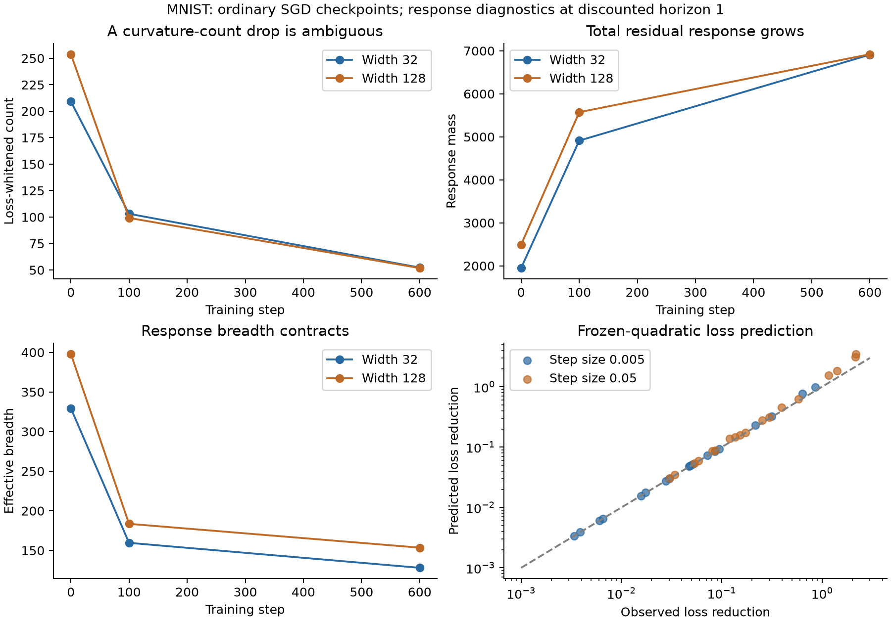

# Options derived from gradient descent: residual response and loss benefit

28 October 2026. Builds on `conditional_refinement_options.md`, preserving its
functional viewpoint, many simultaneous options, turnover, and held-out checks.

## Main revision

Do not define options by inventing an editing objective. Start with the actual
training loss and optimizer. A **capability mode** is a spectral direction of
the local response. An **option** is a correction required by a declared
residual in such an eigenspace, considered together with the available response.
Its value includes both demand and capability. A demanded correction can have
zero response, in which case the option is closed.

The preferred object is a positive semidefinite response/benefit operator in
fixed output-residual coordinates. Its eigenvectors are discovered from model
derivatives. No teacher, semantic role, focal subset, or protected direction is
provided. The actual residual supplies the demanded corrections. A fixed
reference residual can instead be declared for comparisons across checkpoints.
We write \(B_t\) for fixed-horizon benefit and \(C_\tau\) for discounted
response. This terminology and notation leave all operators and derivations
unchanged.

Two changes were necessary during this iteration:

1. A direct loss-whitened effective-dimension count falls as cross-entropy
   confidence improves. This is not sufficient evidence of lost neural options.
2. The fixed-residual response operator separates total strength from spectral
   breadth. In the experiments strength grows while breadth shrinks. Reporting
   either scalar alone would miss an important part of the behavior.

The derivation gives the old resolvent form a dynamical meaning: it is an exact
exponentially averaged finite-time GD response for the local quadratic model.
The resolvent's scale is an observation horizon, not an added regularizer in
the network's training objective. Ordinary fixed-horizon GD has a different
spectral filter, which is also derived below.

## 1. A more specific high-level setting

Assume **shared prediction with conditionally stable refinements**:

- An underlying context \(C\) determines the conditional target distribution.
  Observations also vary in nuisance factors \(V\), with
  \(P(Y\mid C,V)=P(Y\mid C)\). Existing augmentations or repeated observations
  may reveal some of these equivalences; arbitrary perturbations do not.
- At a checkpoint, many contexts are approximately calibrated, while others
  retain systematic residuals. A shared predictor can learn the broad rule
  before all contextual refinements. Calibration refers to the conditional
  expected gradient, not the claim that every noisy labeled example has zero
  gradient.
- Over a short window, the network's derivative representation changes slowly
  enough to approximate its response. This is a testable local approximation,
  not a permanent lazy-training or infinite-width assumption.

These are meaningful simplifications for heterogeneous vision or language
prediction. They do not assume known experts or named roles. Their purpose is
to explain why already learned behavior exerts restoring pressure against new
corrections. The measurement itself does not need to identify the calibrated
contexts: it uses all residuals and derivatives, with their actual data weights.

The framework does not promise to preserve arbitrary future tasks. Nonlocal
revisions, new input support, and new semantics can require new representations.
An option here concerns a demanded correction on the measured distribution and
the local response available to make it.

### Coherence is already in an ordinary augmented loss

For squared error, averaging over observations of a context gives

\[
 \mathbb E_V\tfrac12\|f(C,V)-y\|^2
 =\tfrac12\|\bar f(C)-y\|^2+
   \tfrac12\mathbb E_V\|f(C,V)-\bar f(C)\|^2.
 \tag{1}
\]

There is no chosen consistency coefficient. For cross-entropy, let
\(\bar z=\mathbb E_V z_V\) and \(p_z=\operatorname{softmax}(z)\). Exactly,

\[
 \mathbb E_V\ell(z_V,y)=\ell(\bar z,y)+
 \mathbb E_V D_{\rm KL}(p_{\bar z}\Vert p_{z_V}). \tag{2}
\]

The orientation of this KL is important. It follows from the Bregman divergence
of log-sum-exp. Ordinary training on equivalent views already trades mean fit
against inconsistency; neither term must decrease separately on every step.

Similarly, a calibrated context has a small expected loss gradient, so changing
it has predominantly quadratic loss cost. An unresolved context supplies a
linear residual drive. This yields the old “improve Q while not damaging P”
structure from the original risk. Q/P are an explanatory partition, not inputs
to the new measurement.

## 2. Derivation from the actual training objective

Use centered output contrasts to remove the common-logit gauge. On \(n\)
examples, stack the logits \(z\), their parameter Jacobian \(J\), and the
negative output gradient \(e=-\nabla_z\sum_i\ell_i\). For cross-entropy,
\(e_i=y_i-p_i\), expressed in the full contrast basis. This is an observed
residual, not a teacher function or a proposed future edit.

Let \(H=\operatorname{blockdiag}(\nabla_{z_i}^2\ell_i)\), and let the optimizer
metric be \(M\succ0\). Write \(\delta\theta=M^{1/2}u\) and
\(D=JM^{1/2}\). Ordinary SGD in the experiment has \(M=I\). The local
Gauss–Newton approximation to the actual risk is

\[
 L(u)\approx L(0)-\frac1n e^TDu+\frac12u^TAu,
 \qquad A=\frac1n D^THD. \tag{3}
\]

The approximation omits residual-weighted second derivatives of the network
and freezes output curvature. These two approximations are separated in the
experiments. No additional editing penalty has been inserted.

Gradient flow starting at the checkpoint obeys

\[
 \dot u=\frac1nD^Te-Au,\qquad
 u(t)=\phi_t(A)\frac1nD^Te,
 \quad \phi_t(a)=\frac{1-e^{-ta}}a,
 \quad\phi_t(0)=t. \tag{4}
\]

Substituting into the same quadratic risk gives

\[
 \boxed{L(0)-L(t)=\frac1{2n}e^TB_t e,\qquad
 B_t=\frac1nD\phi_{2t}(A)D^T.} \tag{5}
\]

Thus \(B_t\) is a **loss-benefit operator derived from GD**. The ordinary
prediction-response operator at time \(t\) is \(B_{t/2}\):
\(\delta z(t)=B_{t/2}e\). This factor of two should not be dropped.

For \(k\) steps of GD at rate \(\eta\), replace \(\phi_{2t}(a)\) by

\[
 \psi_{k,\eta}(a)=\frac{1-(1-\eta a)^{2k}}a,
 \qquad \psi_{k,\eta}(0)=2k\eta. \tag{6}
\]

It is nonnegative on a stable quadratic, \(0\le\eta a\le2\). Large step-size
effects cannot be absorbed into a universal width claim.

### Why a resolvent now appears naturally

Average (5) over observation times \(T\) drawn from an exponential distribution
with mean \(\tau\). This is a discount convention for a diagnostic; actual
training need not stop randomly. Since
\(\mathbb E\phi_{2T}(A)=(A+(2\tau)^{-1}I)^{-1}\),

\[
 \boxed{C_\tau=
 \frac1nD\left(A+\frac1{2\tau}I\right)^{-1}D^T.} \tag{7}
\]

The discounted loss benefit is exactly
\(e^TC_\tau e/(2n)\) for the local model. The inverse now represents
GD's finite response time and the original loss's restoring forces. It is not
justified by saying the network solves an unrelated ridge editing objective.
At a deterministic horizon, (5) or (6), rather than (7), is the exact filter.

For an explanatory focal/background split, (7)'s focal block has the form
\(Q(A+(2\tau)^{-1}I)^{-1}Q^T\), with
\(A=Q^TH_QQ+P^TH_PP\). The distribution weights and loss curvature determine
the Q/P tradeoff. They are not free protection coefficients. This is the
precise sense in which the earlier useful formula survives.

## 3. Capability modes and demanded options

Fix the data distribution or audit panel, optimizer geometry, output-residual
coordinates, and horizon. The eigenspaces \(E\) of \(C_\tau\), or of the
chosen fixed-horizon benefit operator, are **capability modes**; their
eigenvalues \(\beta_E\) are response strengths. A repeated eigenvalue defines
one subspace, rather than distinguished individual vectors.

Also declare a residual demand \(e\). An **option** is a nonzero demanded
correction \(q_E=\Pi_Ee\), considered together with its response in
eigenspace \(E\). Its value is \(\beta_E\|q_E\|^2/(2n)\). It is open
when \(q_E\ne0\) and \(\beta_E>0\), and closed when \(q_E\ne0\) but
\(\beta_E=0\). If \(q_E=0\), there is no current demand in that eigenspace;
satisfying demand is not closure. Summing these values gives exactly (9), so
the definition changes no measurement or derivation.

Demand usually means the current model's residual. A fixed reference residual,
or a specified residual component, may instead be declared to isolate changes
in capability. A unit vector \(d\) with no declared demand is a capability
probe, not by itself a current option. Across checkpoints, hold the reference
correction fixed rather than identifying options by sorted eigenvector index.

The primary object is the spectrum, not its integer rank. For ordinary networks
rank can remain full while weak responses deteriorate substantially. Two useful
collective summaries are

\[
 \mathcal M=\operatorname{tr}C_\tau,\qquad
 \mathcal D=\frac{(\operatorname{tr}C_\tau)^2}
                  {\operatorname{tr}(C_\tau^2)}. \tag{8}
\]

\(\mathcal M\) is **response mass**, in fixed residual-response units. It is
independent of demand and is not a count or total value of current options.
\(\mathcal D\) is **effective breadth**, the participation
ratio of the response strengths. It is one for a single mode, and \(d\) for
\(d\) equal modes. Multiplying every strength by a constant changes mass but
not breadth. Breadth alone would give too much credit to uniformly tiny modes,
so both must be reported. A zero operator has zero mass and breadth by convention.

No threshold defines viability. If a thresholded or softly saturated count is
later useful, it must be stated as a strength-resolution curve, not treated as
an intrinsic neuron count. The finite-horizon definition permits weak directions
without declaring irreversible death.

Most importantly, usefulness now follows from the actual residual:

\[
 V_\tau(e)=\frac1{2n}\sum_j\beta_j|\langle v_j,e\rangle|^2. \tag{9}
\]

An available capability mode need not carry demand. A falling residual can
reduce current option value while response mass grows. Strong capability in
many modes need not help if the residual occupies weak or null modes. There is
no claim that trace alone predicts loss. Historical code and result records
retain names such as `option_mass`; these denote response mass under the
current terminology, without changing the recorded numbers.

### An instantaneous connection requiring no frozen-curvature forecast

At every actual gradient-flow checkpoint,

\[
 -\dot L=\|M^{1/2}\nabla_\theta L\|^2
 =\frac1{n^2}e^TDD^Te. \tag{10}
\]

This identity is exact for the current network and full-batch risk. Recomputing
the residual and response geometry permits a trajectory-level loss ledger even
when a frozen finite-time forecast fails. It does not prove that declining
response mass caused a particular future error.

## 4. Why the first candidate was misleading

Writing \(K=H^{1/2}DD^TH^{1/2}/n\) gives the usual whitened filter
\(I-e^{-2tK}\), or \(K(K+(2\tau)^{-1}I)^{-1}\). Its trace is a legitimate
dimension of **currently loss-weighted** responses. But its coordinates change
with the model's confidence. It is unsuitable by itself as a structural
option-destruction measure.

In MNIST, this count fell from roughly 209 to 52 for width 32 and 254 to 52
for width 128 while loss improved. Holding output curvature at the uniform
classifier value instead showed increasing response dimension. This rules out
calling the original drop evidence of destruction.

Equation (7) uses fixed residual coordinates and avoids that specific artifact.
Its output-curvature factors can be applied without inverting tiny class
probabilities. Confidence can change true restoring pressure, so it is still
useful to report a frozen-curvature control to distinguish that effect from
changes in the Jacobian. Neither diagnostic is metric-free.

## 5. What width and turnover mean here

Compare operators on the same data/output coordinates and fixed horizon tau.
Write C_s=C_tau(theta_s) and C_t=C_tau(theta_t) for two actual checkpoints. Define

\[
 \mathcal L_{s,t}=\operatorname{tr}(C_s-C_t)_+,\qquad
 \mathcal G_{s,t}=\operatorname{tr}(C_t-C_s)_+. \tag{11}
\]

They measure net weakening and strengthening over an interval, including
rotations of the available response directions. They do not align eigenvectors
by their sorted indices, count every intermediate event, or imply that any
weakened direction is permanently lost.

For fixed predictions/loss curvature and optimizer costs, genuinely extra
Jacobian directions enlarge \(G=DD^T/n\) in PSD order. The discounted operator
is monotone under this enlargement. For invertible \(G\),

\[
 C_\tau=(H+(2\tau)^{-1}G^{-1})^{-1}; \tag{12}
\]

inverse ordering proves the claim, and a regularization limit handles singular
\(G\). Thus extra directions cannot decrease discounted response mass or the
benefit for any fixed residual in this controlled comparison. Matched-cost
copies \([D/\sqrt2,D/\sqrt2]\) leave it unchanged. Breadth is not monotone:
strengthening one mode much more than others can reduce participation ratio.

This is not a theorem comparing independently trained widths. They have
different predictions, curvature, residuals, and feature geometry. Deterministic
finite-time filters also do not inherit every operator-order property of the
resolvent; matrix exponential monotonicity must not be assumed for noncommuting
operators. These distinctions are important for avoiding another overly broad
width law.

## 6. SGD adds a measurable noise term

For an unbiased minibatch gradient \(g+\xi\) in optimizer coordinates,
with covariance \(\Sigma\), the local quadratic gives

\[
 \mathbb E[L_{k+1}-L_k]
 =-\eta\|g\|^2+\frac{\eta^2}{2}g^TAg+
   \frac{\eta^2}{2}\operatorname{tr}(A\Sigma). \tag{13}
\]

This is exact for a quadratic and a one-step conditional gradient covariance;
using GGN curvature in a nonlinear network is approximate. With replacement,
the finite-pool gradient covariance scales as inverse batch size. Mean parameter
dynamics agree with GD on a fixed quadratic, but mean loss has the additional
variance term. More options do not automatically eliminate SGD noise or its
collateral effects.

## 7. Experiments and rejected extrapolations

The initial checkpoints are the previous ordinary-SGD MNIST models: widths 32
and 128, two seeds, checkpoints 0/100/600, all parameters trained. No teacher or
designated task direction is supplied. A fixed random 64-example training panel
provides derivatives; 128 separate validation images audit transfer.

The new continuations optimize the sampled panel by ordinary GD or SGD. They
are local branch tests, **not** continuations on all 8,192 original training
examples. The main checkpoints were trained without augmentation. The augmented
loss identity was separately audited on equivalent-view batches; an invariance
penalty is not silently attributed to unaugmented training.

### Current availability: strength grows, breadth contracts

The following averages use discounted horizon \(\tau=1\) as a standardized
checkpoint response diagnostic, not a claim that the quadratic remains valid
for a full unit of subsequent training time:

| Width | Checkpoint | Response mass | Effective breadth |
|---|---:|---:|---:|
| 32 | 0 | 1,948 | 329.2 |
| 32 | 100 | 4,912 | 159.6 |
| 32 | 600 | 6,910 | 128.1 |
| 128 | 0 | 2,490 | 397.9 |
| 128 | 100 | 5,574 | 183.5 |
| 128 | 600 | 6,921 | 153.5 |

There are 576 output-residual coordinates. These effective breadths are not
counts of semantic concepts. The wider model has greater breadth initially and
later. Total strength is nearly equal at the final checkpoint, so a mass-only
interpretation would miss the width difference.



A shorter-horizon follow-up checks that this contrast is not peculiar to
\(\tau=1\). For the first seed at \(\tau=.025\), width-32 breadth changes
114.8→67.3, while width-128 breadth changes 154.7→93.6. The larger breadth at
width 128 persists at all four checked horizons .005/.025/.1/1. Its final mass
is actually smaller at the shorter horizons: 230.7 versus 242.2 at .025.
Thus strength and breadth must not be conflated. Nor does a larger final breadth
prove better preservation: much of the advantage is already present initially,
and the absolute breadth gap narrows in this example.

Doubling the panel from 64 to 128 examples at .025 changes final mass only
slightly (242.2→240.6 and 230.7→229.7), but increases estimated breadth
67.3→75.9 and 93.6→109.2. The width ordering survives, while the count is not
yet statistically stable. A population number should not be inferred from this
single small panel. These follow-ups use one seed and are exploratory.

At the same horizon \(\tau=1\), response mass lost between initialization and checkpoint 600
is 175.6/153.9 for the two width-32 seeds and 140.4/94.4 for width 128. Gains
are much larger than losses. A fixed-output-curvature control also has less
weakening at width 128, about 19.9/17.9 versus 26.9/25.4. These small, correlated
experiments support studying preservation, but do not establish that it causes
the final width advantage. No exact extinction is demonstrated.

### Direct connection to observed loss

On six checkpoint/width states from the first seed, deterministic branch tests
separate two approximations:

1. freeze both Jacobian and cross-entropy curvature: the quadratic spectral law;
2. freeze only the Jacobian and evolve the actual cross-entropy residual.

| Step size | Steps | Median relative error in quadratic gain | Maximum |
|---|---:|---:|---:|
| .005 | 1 | .39% | 1.72% |
| .005 | 5 | 1.61% | 6.21% |
| .005 | 20 | 2.63% | 22.01% |
| .05 | 1 | 1.57% | 15.04% |
| .05 | 5 | 5.38% | 32.91% |
| .05 | 20 | 12.73% | 61.69% |

Keeping the actual CE loss reduces the median 20-step, rate-.05 error to 1.03%.
Thus the longer-window failure is often curvature evolution, not an absence of
useful local feature geometry. A good option diagnostic cannot license freezing
that curvature for arbitrary horizons. The spectral expression is exact in its
local model, not a universal nonlinear forecast. For example, one initial
width-128 state has discounted quadratic gain 2.90 at \(\tau=1\), exceeding
its actual CE loss 2.45. This explicitly rules out interpreting that long-horizon
diagnostic as a certificate of recoverable true loss.

The instantaneous gradient-norm ledger agrees with the residual/kernel expression
to about \(1.5\times10^{-14}\); the augmented-CE identity agrees to
\(4.5\times10^{-16}\). The two independently computed discounted gain formulas
agree to numerical precision.

### Collateral loss is measured, not assumed to decrease with width

Define collateral on a branch as the average positive part of each example's
loss change. This uses no chosen protected class or error threshold. After 20
steps at rate .05 from checkpoint 600, it is .00329 for width 32 and .00338 for
width 128. Frozen-Jacobian CE predicts .00323/.00325. Consequently, the claim
“wider preserves more options, therefore every collateral measure decreases”
is **not supported** here. Residual alignment and which examples are disturbed
matter as well as spectral breadth.

The same continuations increase held-out CE by .04968/.04185 for widths 32/128,
despite reducing the panel loss. Frozen-Jacobian CE predicts .05082/.03954.
This retains the previous iteration's lesson: empirical responsiveness is not
automatically population usefulness. The fact that the latter metric favors
width does not override the in-panel counterexample or prove mediation.

### SGD audit

Thirty-two independent minibatches per configuration test (13), at batch sizes
16 and 64, rates .005 and .05, initial/final checkpoints and both widths.
At rate .005 the predictions are close to the Monte Carlo means relative to
sampling error. At rate .05, initial-state errors are material: for width 128,
batch 16, predicted loss is 1.9006 versus observed 1.9962 (SE .0164).
At the final width-128 state, batch 64, prediction is .13653 versus .13688
(SE .00151). This supports a local noise correction, not its unrestricted use
at larger steps. Raw means, uncertainty and noise terms are retained.

### Scalable estimation

For a random residual probe \(z\), let \(v=D^Tz/\sqrt n\). Then
\(z^TC_\tau z=v^T(A+(2\tau)^{-1}I)^{-1}v\). GGN matrix-vector
products require a JVP, the actual output-loss Hessian product, and a VJP.
No full Jacobian, kernel or parameter Hessian is required. The second spectral
moment can likewise be estimated from \(\|C_\tau z\|^2\).

A separate implementation on the final width-32 network uses 16 random probes
and at most 24 CG iterations per solve. It estimates mass 7,173 (estimated
SE 171), versus exact 6,880, and breadth 124.6 versus exact 126.7. The breadth
ratio estimator has its own sampling error; the mass SE is not its confidence
interval. This is feasible as an occasional diagnostic, not a demonstrated
negligible-overhead monitor for a large language model. Buffer/population error
and nonlinear error remain separate from solver/probe error.

## 8. What is retained, rejected, and next

Retain: functional rather than neuronal options; all residual directions;
the distinction between capability and residual demand, jointly defining options; spectral turnover;
matched-cost redundancy controls; and held-out loss checks.

Reject: a manually weighted editing objective as the starting definition;
interpreting CE-whitened dimension decline as structural destruction; a universal
only-consumption story; and assuming more breadth must reduce every collateral
measure. Do not replace a failed count with an endpoint-fitted survival rate.

The strongest next experiment is a fixed-function intervention that changes
the residual-response spectrum while controlling learning speed and current
loss, followed by ordinary updates and held-out evaluation. Compare changes
in (9), not just changes in mass. For example, remove or restore derivative
directions selected by their contribution to weak, residual-loaded modes while
matching initial logits and auditing the introduced optimizer geometry. This
would test whether options mediate loss rather than merely accompany width.
Such an intervention must be specified and validated before claiming a causal
preservation mechanism; it has not been performed here.

Before a deep-network extension, horizons and panel sizes should also be checked
for stability. The present theory is a firmer local foundation with a genuine
GD origin, but not yet a global explanation of persistent width advantages.

## Subsequent trajectory and matched-loss tests

The retained ordinary-SGD trajectory evidence tests
eight paired widths through 800 steps, rather than only local panel branches.
It finds broader response spectra at width 128, but no reliable incremental
gain-difference prediction from the option summaries beyond loss/gradient
baselines. Its later matched-loss analysis retains the average finding that
the wider model's residual has less loading on its relatively strongest modes,
even at equal full-training or panel loss; lower-loss differences are uncertain.
Breadth remains greater at width 128. Thus the local results here should not be
read as demonstrating that option preservation explains the ordinary width
advantage. The compact evidence record reports paired uncertainty, common-demand comparisons,
and the distinction between mode rank and absolute response strength.

## Literature and reproduction

The relationship between early stopping and spectral filtering is established;
see [Yao, Rosasco and Caponnetto](https://web.mit.edu/lrosasco/www/publications/earlystop.pdf).
GGN curvature products are established tools; see
[Schraudolph](https://nic.schraudolph.org/pubs/Schraudolph02.pdf).
The project's `competition_definition.md` already used quadratic spectral
dynamics for a different neuron-coupling counterfactual. The present contribution
is the residual-option interpretation, removing externally chosen Q/P roles,
the fixed-coordinate correction, and its audits. The resolvent and gradient-flow
identities themselves are not claimed as new.

```sh
.venv/bin/python scripts/studies/explore_gd_option_dynamics.py
.venv/bin/python scripts/studies/audit_gd_option_dynamics.py
.venv/bin/python scripts/studies/audit_gd_option_matrixfree.py
.venv/bin/python scripts/studies/profile_gd_option_horizons.py
MPLCONFIGDIR=/private/tmp/neural-competition-mpl .venv/bin/python scripts/studies/plot_gd_option_dynamics.py
```

Results, audit details and operators are in `docs/evidence/gd_options/`. The branch
protocol preceded its new outcomes. The residual-coordinate revision followed
the curvature-confounding result and is explicitly exploratory. Existing work
and its raw results are preserved.
