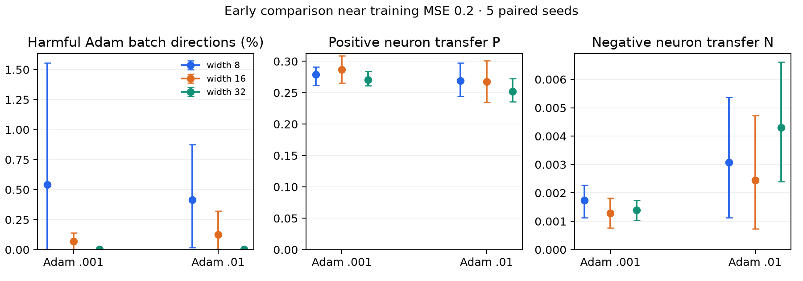
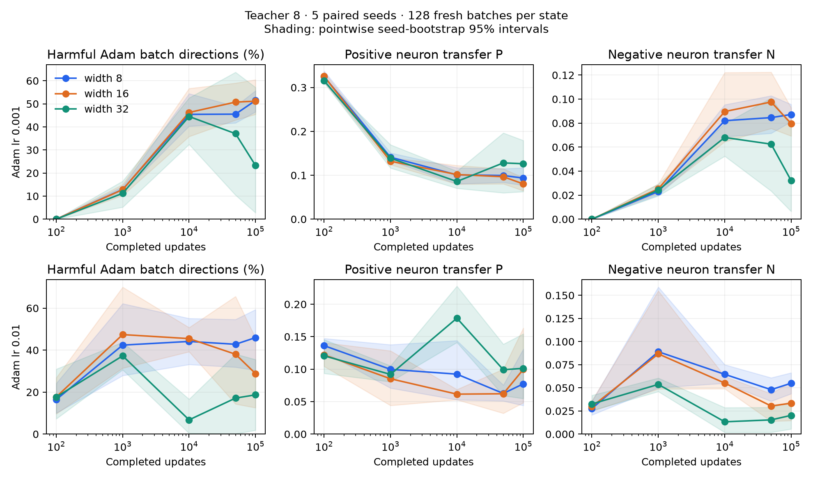

# Adam cross-batch gradient and update transfer

This quick follow-up separates instantaneous gradient conflict from conflict in
Adam's next direction. Near the same early loss, wider networks have fewer
first-order harmful batch transfers, but these events are already rare and
neuron-level positive/negative masses do not show a consistent width effect.
At later equal-step checkpoints, width 32 often has smaller negative transfer;
width 16 is not a consistent improvement on width 8. Different fitting stages
remain an important confound in these later comparisons.

## Protocol

Reuse the main robustness trajectories: teacher width 8, teacher seed 2027,
student widths 8/16/32, initialization seeds 0–4, and Adam learning rates
0.001/0.01. Both layers and hidden biases train; outgoing coefficients start
at zero. The architecture, data and scaling match [the robustness report](robustness.md).
Adam uses betas (0.9, 0.999), epsilon 1e-8, without weight decay or AMSGrad.

For each profile and seed/width, inspect completed updates 100, 1,000, 10,000,
50,000 and 100,000, plus an early state near training MSE 0.2. This gives
**180 states**. The first 1,000 updates are replayed using the original paired
minibatch streams; later states and both moment buffers come directly from
saved checkpoints. Replayed MSE at step 1,000 matches the recorded training
history to 8.4e-17. No long training run was repeated.

Each state uses 128 freshly drawn training minibatches of size 64, sampling
with replacement using seed 20261021. The same probe draws are shared across
profiles, widths, seeds and checkpoints. Evaluate all 128×127 = 16,256 ordered
off-diagonal batch pairs. Different batches can contain some of the same data
points; batches are not forced to be disjoint. This is empirical training-data
transfer, not a new held-out generalization experiment.

Early states minimize log-distance to MSE 0.2 over a short replay grid (every
five updates through 200, then every 25 while still approaching the target).
All models have an eligible state within 10% of the target. Mean attained MSE:
0.19965/0.20063/0.19925 at lr .001 and 0.20069/0.19843/0.19774 at lr .01.
Individual matched MSEs range from 0.18826 to 0.20721. Mean update counts are
575/495/445 and 66/59/52, respectively; matching loss does not match history.

## Adam direction and measures

At a fixed state after t updates, freeze its pre-step moments m_t and v_t.
Each candidate source batch B has gradient g_B and its own possible next step:

\[
m_{t+1}(B)=\beta_1m_t+(1-\beta_1)g_B,\qquad
v_{t+1}(B)=\beta_2v_t+(1-\beta_2)g_B^2,
\]
\[
h_B=\frac{m_{t+1}(B)/(1-\beta_1^{t+1})}
{\sqrt{v_{t+1}(B)/(1-\beta_2^{t+1})}+\epsilon},\qquad
\delta_B=-\eta h_B.
\]

Candidate B never changes the history used for another candidate. For target
batch C, T(B,C)=g_C dot h_B predicts Delta L_C≈−eta T(B,C). **T<0 means
first-order harm**. T is asymmetric, so both batch orders are included. Raw
gradient conflict instead uses X(B,C)=g_C dot g_B.

Neuron attribution uses t_r=g_{C,r} dot h_{B,r}. Normalize by
S=sqrt(E_C||g_C||² E_B||h_B||²), as in the momentum analysis:

\[
P_{\rm step}=\mathbb E_{B\ne C}\sum_r[t_r]_+/S,\qquad
N_{\rm step}=\mathbb E_{B\ne C}\sum_r[-t_r]_+/S.
\]

P_step−N_step is normalized mean transfer. These masses distinguish more
helpful neuron contributions from less harmful contributions. Global harm
mass uses E[-sum_r t_r]_+/S, which is different from N_step. Raw P/N and
full-gradient agreement A=||g_train||²/E||g_B||² are also saved. A and the
off-diagonal empirical raw mean are distinct finite-sample quantities.

Diagnostics use float64 at the saved float32 parameters/moments, with gradients
recomputed in float64. They measure the mathematical Adam direction and local
first-order transfer. They do not include float32 parameter rounding or measure
the exact loss change of a full finite step; the earlier exact pair-accounting
study uses actual rounded steps. Autograd and independently restored
torch.optim.Adam verify one candidate at **every one of the 180 states**;
maximum gradient error 1.12e-16 and update error 2.23e-16.

All displayed statistics first average batch pairs within each state, then
average the five training seeds. Pointwise 95% intervals use 4,000 paired-seed
bootstrap resamples, seed 741. Batch pairs are correlated and are not independent
uncertainty samples. Five seeds give limited precision; intervals are exploratory
and conditional on this teacher, input dataset, initialization and probe draws.

## Early matched-loss results

Arrows below mean student widths 8 → 16 → 32.

| Measure | Adam lr .001 | Adam lr .01 |
| --- | --- | --- |
| First-order harmful Adam transfers | 0.541% → 0.0689% → 0.00123% | 0.416% → 0.125% → 0.00246% |
| Raw negative gradient dots | 21.83% → 19.35% → 17.72% | 18.12% → 16.62% → 9.24% |
| Positive neuron mass P_step | .2788 → .2867 → .2708 | .2693 → .2679 → .2522 |
| Negative neuron mass N_step | .001741 → .001289 → .001389 | .003078 → .002447 → .004300 |

There is a favorable frequency pattern, but it concerns a small absolute tail.
Width 8→16 changes harmful frequency by −0.472 percentage points
[−1.528, +0.111] at lr .001 and −0.290 points [−0.753, +0.021] at lr .01.
Neither paired interval excludes zero. Width 8→32 gives −0.540 points
[−1.556, −0.0025] and −0.413 points [−0.875, −0.0160], respectively, but five
seeds remain a small sample and these are pointwise exploratory comparisons.

Neither early P_step nor N_step has a paired width difference whose interval
excludes zero. At lr .01 the width-32 N_step point estimate increases. Thus this
check does **not** replicate a clear early combination of both more positive
mass and less negative mass like the earlier momentum observation. Raw gradient
conflict is much more common than harmful Adam transfer at these early states;
using raw gradients as the Adam direction would materially misrepresent them.

## Dependence on training phase

| LR | Completed updates | Harmful transfer %, widths 8 → 16 → 32 |
| --- | ---: | --- |
| .001 | 100 | 0 → 0 → 0 |
| .001 | 1,000 | 12.89 → 12.77 → 11.19 |
| .001 | 10,000 | 45.43 → 46.26 → 44.51 |
| .001 | 50,000 | 45.52 → 50.75 → 37.07 |
| .001 | 100,000 | 51.44 → 51.15 → 23.27 |
| .01 | 100 | 16.44 → 17.69 → 17.68 |
| .01 | 1,000 | 42.40 → 47.41 → 37.29 |
| .01 | 10,000 | 44.15 → 45.50 → 6.77 |
| .01 | 50,000 | 42.80 → 38.05 → 17.14 |
| .01 | 100,000 | 45.96 → 28.82 → 18.70 |

The effect is not uniformly present across checkpoints. In particular, width 16
does not consistently reduce harmful frequency, and at lr .001 there is almost
no width difference at 10k despite markedly different fitting losses.

At 100k, N_step decreases from .08720 to .03212 for width 8→32 at lr .001,
and .05498 to .02023 at lr .01. The paired intervals for these N_step reductions
exclude zero. P_step point estimates also increase, but their intervals include
zero. At lr .01, 10k gives a clearer simultaneous pattern: P_step .0923→.1785,
N_step .0646→.0133, with both paired intervals excluding zero. These are
descriptive comparisons: the wide models are already much better fitted.

For example, 100k MSE is .10466/.04929/.00000117 at lr .001 and
.10502/.03516/.00000110 at lr .01. Large harmful frequencies near an optimum
need not imply a large loss cost: frequency ignores magnitude, and gradients
and steps there can be tiny. The saved expected first-order gain/harm columns
retain the unnormalized loss scale alongside normalized masses.

This supports a **phase-dependent association**, especially at width 32, rather
than a general monotonic reduction of Adam conflict with width. It does not
establish that conflict reduction causes faster fitting. These are cross-data
demands attributed to neurons, not direct interactions between different neurons
on one batch. They are a separate diagnostic from the same-batch J_rs costs.

## Validation, retained evidence and reproduction

This report describes the complete original cohort and diagnostic draws. Its estimates were preserved before pruning. Compact versioned [tables](../tables/README.md) and [figures](../figures/README.md) remain; full computed tables are compressed under `runs/retained/aggregates/adam_cross_batch/`. Representative raw states are a purposive subset and must not be used to re-estimate these cohort rates or intervals.

See [data retention](../data.md) for the manifest and [reproduction](../reproduction.md) for original producers under `scripts/studies/`. Full-cohort analyses require regenerating their original-layout inputs; notebooks have been removed. Historical full-cohort audits and original execution sources are retained in archive provenance.
