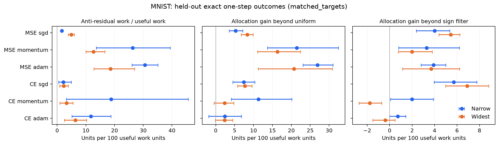
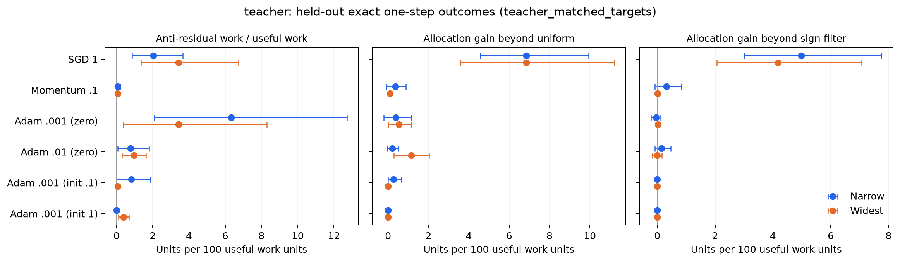

# Testing residual work and avoidable neuron-update allocation

New experiments and analysis, 18 October 2026.

**We found a useful, operational measure of avoidable update allocation, and
substantial local effects in several MNIST settings. We did not find a measure
that consistently decreases with width across these experiments.** In particular,
the new measures do not rescue a general explanation of the teacher–student
width advantage through less local neuron competition.

The best next object is the **set of corrections available by reweighting the
current neuron proposals**, together with their loss response. Its scalar
allocation regret answers an intervention question, survives the duplicate-neuron
counterexample, and has a meaningful objective scale. It should be accompanied
by anti-residual work and a representation-access diagnostic. Calling any one
of these a complete definition of competition would overstate the evidence.

This study implements several previously unmeasured proposals in the
[pair-cost note](../theory/pair_cost_and_competition.md). It is exploratory;
the calibration-size and tighter loss-matching checks were added after inspecting
the initial results. No favorable metric or setting was silently substituted
for a failed one. Complete episode and seed tables are retained.

## What was actually run

- Reconstructed **all 245 original teacher trajectories in 15 settings**, measuring
  25 logarithmically spaced checkpoints each: 6,125 original model states.
  Both teacher sizes, both teacher realizations, SGD, momentum, two Adam rates,
  and the initialization/rate controls are included.
- At each state, selected neuron coefficients on 512 training examples and
  evaluated exact parameter interventions on 1,024 separate test examples.
  Repeated at the ordinary step and at 1% of that step.
- Repeated four core settings with **all 8,192 training examples** for coefficient
  selection, keeping the same 1,024 test examples and identical state membership.
- Added a tighter teacher comparison: first sampled states within 5% of reference
  MSE **.2 and .1**, four fresh proposed minibatches per state, all-training
  calibration, and the same independent test evaluation. Found **486/490** intended
  targets; missing comparisons remain missing.
- Applied the same design to **119 existing MNIST matched-loss checkpoints**,
  widths 16/128, all three optimizers, squared loss and cross-entropy, five seeds,
  and four fresh proposed minibatches each. Calibration uses 512 training images;
  evaluation uses 1,024 test images. Existing targets are .15/.1 for MSE and
  .6/.3 for CE.
- Refit the readout on all training examples at the final sampled state of
  **every teacher trajectory**, assessing the refit on all test examples.

These are new diagnostics and hypothetical one-step interventions on old
trajectories, **not additional independent training seeds or sustained training
with a new optimizer**. The two original teacher-8 momentum cohorts overlap.
All models still have one hidden ReLU layer. MNIST is an additional dataset,
vector output, loss and nonzero-initialization test, not a deep-network test.

## 1. Use a feasible correction set, not the number of unfavorable pairs

At a frozen state, let the optimizer propose parameter changes delta_r, including
its current moments. Define the linearized function changes

\[
\ell_r=J_r\delta_r,\qquad
\mathcal Z=\left\{\sum_r\alpha_r\ell_r:0\leq\alpha_r\leq1\right\}.
\]

The intervention suppresses some **updates**, retaining every neuron's existing
contribution. It neither deletes neurons nor retrains their directions.
For half-MSE on the calibration set,

\[
Q(\alpha)=b^\top\alpha+\tfrac12\alpha^\top M\alpha,
\quad b_r=\langle e,\ell_r\rangle,
\quad M_{rs}=\langle\ell_r,\ell_s\rangle.
\]

Define local allocation regret

\[
R=\min_{\gamma\in[0,1]}Q(\gamma\mathbf1)
 -\min_{\alpha\in[0,1]^m}Q(\alpha)\geq0.
\]

The comparison against the **best uniform shrink** removes the benefit available
from simply shortening the entire proposed step. The unit box gives the same
per-neuron damping budget at every width. It does not test acceleration,
reversing directions, or discovering new features.

**Why this is preferable to C_plus as the main diagnostic:** replacing any
ell_r by q copies ell_r/q leaves Z and the uniform ray unchanged. Both optima,
and therefore R, are unchanged. Positive pair cost fails this test. This is
invariance to subdividing identical proposed function movements, not a claim
that ordinary SGD/Adam after a neuron split generates identical movements.

R on its fitting set is nonnegative by construction. Our principal reported
outcome instead uses calibration-selected coefficients in an **actual parameter
forward pass on separate examples**:

\[
\widehat R_V=L_V(\theta+\widehat\gamma\delta)
 -L_V(\theta+\widehat\alpha\odot\delta).
\]

This value can be negative. Fractional parameter movement is not treated as an
exact interpolation between before/after neuron functions. The uniform control
selects the best exact calibration loss over 33 fractions in [0,1], plus the
analytic quadratic uniform optimum. It is **grid-best**, not a guaranteed global
minimum of the nonlinear parameter path. Endpoints include doing nothing and
the ordinary update.

For CE, Q uses the local softmax Hessian in logit space. It is a second-order
surrogate, not an exact quadratic loss identity. All intervention outcomes still
use exact CE and exact nonlinear forwards. At both losses the proposals come
from the original optimizer, rather than replacing Adam by a fixed kernel.

Controls are: the ordinary step, uniform shrink, joint neuron allocation,
four randomly assigned groups with one coefficient per group, shuffled selected
coefficients, and a sign filter described below. Group assignments and shuffles
are seeded in advance of outcomes. Four groups fix the number of adjustable
coefficients across widths; shuffling retains the amount of damping while
changing which neurons receive it. These controls answer different questions.

## 2. Separate bad individual directions from relative-step effects

For exact finite neuron prediction changes d_r and residual e, write

\[
w_r=-\langle e,d_r\rangle,\quad
P=\sum_r[w_r]_+,\quad N=\sum_r[-w_r]_+.
\]

P is useful residual work; N is anti-residual work. For the additive squared-loss
model, the exact actual progress is

\[
L_0-L_1=P-N-\tfrac12\left\|\sum_rd_r\right\|^2.
\]

These quantities survive subdividing identical contributions. Unlike standalone
harm H, N excludes the individual quadratic movement cost. They remain dependent
on the evaluation objective and on the substantive choice of neuron blocks.
For CE, replace e by the loss gradient in logits. The exact remainder is the
nonnegative CE Bregman divergence between the before/after logits, rather than
half squared movement.

The **sign filter** retains directions with calibration b_r<0, zeros the others,
then optimizes one common scalar in [0,1] along that filtered direction. This
tests whether the joint optimizer offers more than suppressing individually
unhelpful proposals. Excess over this control is still not uniquely a pair
effect: it can include differences in individual curvature and optimal step
size. We report it as “beyond sign,” not a pure causal competition component.

There is a useful small-step deduction. Put ell_r=eta*v_r and define P_0/N_0
from -<e,v_r>. For fixed directions and a smooth loss expansion,

\[
R(\eta)=\eta\min(P_0,N_0)+O(\eta^2).
\]

To first order, the box optimum keeps each helpful direction; the uniform
optimum either keeps everything or stops. When the total direction is helpful,
P_0>N_0 and the leading allocation regret is eta*N_0. Thus **a large allocation
regret at tiny steps can be entirely due to individual harmful directions**.
This calculation is our deduction, not an imported theorem or an empirical
finding. It explains why the sign control is necessary.

There is also a structural limit on a universal first-order same-objective
competition theory: for full-gradient SGD,
g_r^T delta_r=-eta*||g_r||² for every block. Every block is individually helpful
to first order on that objective. Adverse effects must arise from finite steps,
different data objectives, history/preconditioning, or evolution across time.
This does not say that neurons cannot obstruct feature formation.

## 3. The clearest new positive result is local MNIST allocation

The following values are **extra held-out loss reduction per 100 units of
ordinary helpful work P**, beyond the grid-best uniform shrink. They are ratios
of sums within each seed, then equal seed means; brackets are pointwise 95%
paired-seed bootstrap intervals for the width difference.

| Loss / optimizer | Width 16 | Width 128 | Wide minus narrow [interval] |
| --- | ---: | ---: | ---: |
| MSE / SGD | 5.28 | 8.34 | **+3.06 [.50, 5.89]** |
| MSE / momentum | 21.44 | 16.32 | −5.12 [−19.64, 4.13] |
| MSE / Adam | 26.91 | 20.70 | −6.21 [−14.25, 1.83] |
| CE / SGD | 7.43 | 7.69 | +.26 [−3.51, 4.67] |
| CE / momentum | 11.28 | 2.35 | **−8.93 [−17.36, −1.77]** |
| CE / Adam | 2.42 | 2.34 | −.08 [−5.16, 4.48] |

At width 16, the allocation gain's own interval excludes zero in five of these
six settings; CE/Adam is uncertain. This is a useful multi-optimizer local
signal. **Its width ordering is not consistent.** MSE/SGD significantly reverses
the proposed ordering; MSE/momentum and MSE/Adam have favorable point estimates
but uncertain width contrasts. The intervals are exploratory and unadjusted
for multiple comparisons.

The absolute scale matters. At width 16, these extra improvements are respectively
**1.10%, .97%, .28%, 1.90%, .42%, and .043% of current held-out loss per tested
step**, averaging per-state fractions within seed. Therefore “26.91 per 100
helpful work units” does **not** mean 27% of current loss, final error, or training
time. It also cannot be summed over hypothetical branches into a training rescue.

Normalization can change the width ranking: MSE/SGD has a larger gain per unit
helpful work at width 128, but a smaller gain as a fraction of current loss
(.39% versus 1.10%). We therefore retain raw effects and both denominators.
“More allocation cost” in the table refers specifically to cost per useful
work, not an invariant ordering under every normalization or equal function-step
size. The interventions do not match function-step RMS across widths.

The sign and shortened-step controls refine the interpretation:

- For MSE/Adam, full-step gains of 26.91/20.70 become 20.04/9.77 at 1% step,
  in the same helpful-work units. Joint allocation adds only −.14/−.03 beyond
  the sign filter at the tiny step. Most of that persistent signal is therefore
  individually harmful directions, not an additional joint-allocation effect.
- MSE/momentum similarly retains 21.35/7.05 at 1% step, with essentially zero
  additional benefit over the sign filter.
- At the full step, SGD's gains beyond the sign filter are 4.00/5.43 for MSE
  and 5.71/6.90 for CE. They collapse near zero at the tiny step. This is a
  finite-step allocation effect; it is not smaller at the wider model.
- Four-group allocation still helps MSE/Adam (16.83/2.38) and MSE/momentum
  (9.63/2.24). Thus all of the local benefit is not merely fitting 128 free
  coefficients. The group control does not turn the unrestricted width
  comparison into a universally ordered result.

Anti-residual work N/P falls from **30.55% to 18.56%** for MSE/Adam and from
**26.32% to 12.67%** for MSE/momentum. Their paired reductions have intervals
[−17.69, −6.64] and [−28.75, −.35] percentage points. MSE/SGD instead increases
from **1.60% to 4.91%**, difference [+2.34, +4.31]. This reinforces the need
for optimizer-specific claims rather than a renamed universal competition score.

## 4. Tightly matched teacher results are weaker and sometimes reverse

Here coefficient selection uses the entire training set; states are within 5%
of the two MSE targets and candidate minibatches are paired across widths.
The units are again extra held-out loss reduction per 100 helpful work units.

| Setting | Widths | Narrow allocation gain | Wide allocation gain |
| --- | --- | ---: | ---: |
| SGD, original 200k cohort | 8 → 16 | 6.84 | 6.85 |
| Momentum, original 200k cohort | 8 → 16 | 1.20 | −.057 |
| Adam .001, teacher 8/2027 | 8 → 32 | .371 | .528 |
| Adam .01, teacher 8/2027 | 8 → 32 | .203 | 1.149 |
| Momentum .1, teacher 16/2027 | 16 → 64 | .131 | 19.714 |

The SGD width difference is .003 [−2.15, 2.64]. The original momentum difference
is −1.26 [−2.92, −.17], consistent with less local allocation cost at width 16,
although the five-seed 100k cohort's 8→32 comparison is smaller and uncertain.
For teacher-16 momentum the wider-minus-narrow difference is **+19.58
[2.75, 35.69]**. Its wider model has much more avoidable allocation cost at
these states. All remaining teacher/rate/initialization conditions are in the
tables, including near-zero and negative transfer outcomes.

Low-rate teacher-8 Adam's .371/.528 gains amount to only **.00044%/.00065%
of current held-out loss** per tested step. These local interventions do not
look like a large direct explanation of its eventual width advantage.

The initial log-time study gave different impressions. In the broad reference
MSE .0766–.2 band, low-rate Adam's 512-example-calibrated gains were negative
(−2.96/−4.52). All-training calibration on the **identical states and identical
test examples** gave +3.99/+1.17. This directly demonstrates sensitivity to
coefficient estimation. However, the tighter first-target comparison above is
smaller and does not preserve that width ordering. The broad band samples
different residence times, phases and residuals; it is not exact loss matching.
Both analyses remain available. A calibration failure is not evidence that
no good allocation exists, and a favorable broad-band average is not a robust
width mechanism.

Coverage: three teacher-16/2037 low-rate Adam narrow starts did not supply the
.1 target, and one width-16 SGD start did not supply the .2 target within the
sampling/tolerance rule. Absence is not coded as zero. A seed/target enters the
paired summary only if every intended width has coverage. “Not sampled within
tolerance” is not necessarily “never crossed that loss.”

## 5. Alignment and feature access do not collapse into the same story

We also measured the corrective squared cosine of the actual total movement.
For squared loss it is [−<e,d>]_+²/(||e||²||d||²), and its parallel/perpendicular
movement decomposition is exact. For CE it uses the Euclidean logit-loss gradient;
it is not a fraction of loss or a Fisher-metric accessibility certificate.

This measure also fails as a universal width explanation. At matched MNIST
losses, MSE/SGD's corrective cosine falls **5.13%→1.26%**, whereas MSE/Adam's
increases **.49%→1.14%**. We retain it as geometry of the actual proposal,
not as a metric selected to agree with successful fitting.

The full-cohort readout check supplies a strong alternative diagnosis. At update
99,743 in default teacher-8 Adam .001, the width-8 mean training half-MSE is
**.0523291**. Reoptimizing every outgoing coefficient with unrestricted least
squares lowers it only to **.0523072**: on average **99.96%** of the loss remains.
Held-out loss does not improve materially (.0548317→.0548347). Width 32 already
has training loss about **9.63e−7**.

At Adam .01, narrow loss .0524080 falls only to .0520770 after the same refit
(99.37% remaining). This extends the earlier illustrative saved-state checks to
the complete cohorts. It locates a limitation in the **current representation**,
not just its current readout. It neither proves those states are local minima
nor excludes competition as a historical cause of poor features. The measured
small-step allocation interventions do not establish that historical pathway.

## Recommended research object and next decision

Use **(residual, proposed correction set, loss response)** as the core object,
with three separate questions:

1. **Direction quality:** how much useful and anti-residual work do the proposed
   units perform on independent examples? Use P, N, N/P and actual progress.
2. **Avoidable allocation:** can held-out performance improve by changing relative
   update sizes beyond uniform shrink and the sign filter? Use R on the
   calibration set, signed held-out gain, raw/loss units, and group controls.
3. **Available features:** can the representation supply the missing correction
   at all? Start with the readout floor; tangent/trust-region and controlled
   feature-expansion tests address a different limitation from damping proposals.

For a focused positive study, **MNIST squared-loss momentum and Adam** are the
best candidates here for first-order harmful-direction filtering; **SGD at
ordinary step sizes** is a candidate for finite-step relative allocation.
These are distinct operational phenomena. The present data justify neither
calling both a single universal mechanism nor treating their costs as the
fraction of the width benefit explained.

The next decisive experiment would apply sustained filtering/allocation at both
widths, with equally calibrated uniform and sign-filter baselines, common
additional-data/compute budgets, and independently chosen learning rates.
Ask whether it improves the narrow trajectory and reduces the width gap, not
only whether a local score decreases. This sustained intervention has **not**
been performed here. If it cannot close any material gap, the mechanism should
remain a local optimizer defect rather than an explanation of overparameterization.

## Relation to the literature

[Sankararaman et al., ICML 2020](https://proceedings.mlr.press/v119/sankararaman20a.html)
study negative correlations between gradients from different examples. That is
a relevant precedent for data-transfer conflict, but it does not identify a
direct neuron–neuron mediator in these Adam trajectories.

[Pezeshki et al., NeurIPS 2021](https://arxiv.org/abs/2011.09468)
formalize gradient starvation as suppression of learning other predictive
features under cross-entropy. This is closer to a feature-formation hypothesis
than same-step pair cost. Its setting does not establish starvation in our
squared-loss teacher model; a corresponding feature intervention would be needed.

[Liu, Zhu and Belkin](https://arxiv.org/abs/2003.00307) connect optimization to
tangent-kernel/PL* conditions. This motivates separating access to directions
from allocation of a particular optimizer proposal; no global convergence
guarantee follows from the snapshot measurements here.

[Xu and Du, COLT 2023](https://proceedings.mlr.press/v195/xu23a.html) show that
overparameterization can slow gradient descent even for learning a single ReLU
under their assumptions. It is a useful boundary on the claim that more neurons
must alleviate every dynamical obstruction, not an explanation of these runs.

## Reproduction and numerical checks

See the [data and command guide](../tables/allocation/README.md),
[metric implementation](../../src/neural_competition/allocation.py), and
[numerical tests](../../tests/test_allocation.py).

All 245 replay endpoint losses agree with the original tables within **9.81e−17**;
41 retained parameter/moment/RNG checkpoints match bitwise. The audit verifies
375 file/source hashes and 21,090 episode rows, with maximum work-budget error
**5.01e−16**. Convex box-solver duality gaps are at most **2.26e−8** of the
stated objective coefficient scale (the full-calibration sensitivity is the
largest); main matched teacher and MNIST gaps are below 1e−10. Tests independently
check Jacobian products, CE Hessians, subdivision invariance, known optima and
exact work accounting. The repository suite passes **69 tests**, and Ruff passes.

Uncertainty resamples training seeds, not correlated checkpoints, sources,
neurons or targets. Five-seed intervals are imprecise, conditional on these
teachers/datasets, and not adjusted for the many exploratory comparisons.
Width still changes dynamics and feature-learning scale under the original
parameterization. These experiments do not equalize all those effects.
