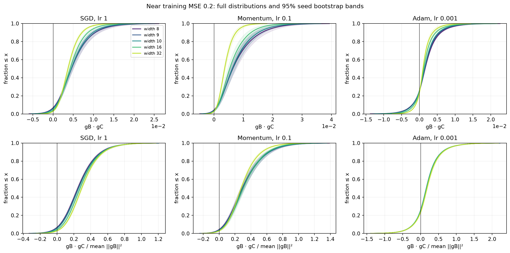
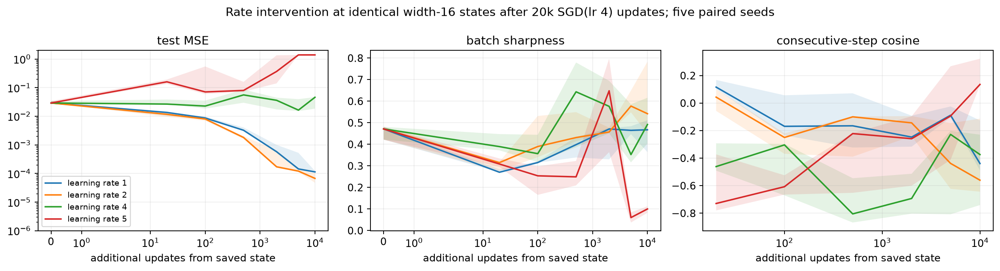
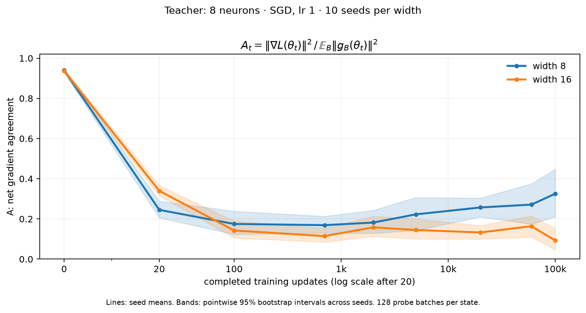

# Pier's suggested experiments: what the distributions show

The distribution measurements contain signal, and that signal depends strongly on
the optimizer and learning stage. Extra width modestly changes the early gradient
geometry; the clearest tail result is lighter dot-product tails for momentum/SGD.
There is no universal width-induced skewness shift across all optimizers. A separate
saved-state intervention shows that finite-step dynamics cause one high-rate plateau.

## Protocol and scope

One fixed eight-neuron teacher, 20-dimensional Gaussian inputs, 8,192 training and
4,096 test examples; noiseless scalar regression. Both student layers and hidden
biases train. The network divides its output by sqrt(width). The default output
coefficients start at zero. Training uses half-MSE; every reported error below is
ordinary MSE. The same seed pairs widths/optimizers by minibatch order.

- **Main study:** widths 8, 9, 10, 16, 32; seeds 0–9; 100k updates; SGD lr 1,
  momentum lr 0.1/beta 0.9, Adam lr 0.001/default betas. 150 completed runs.
- **Early comparison:** the same widths/optimizers, seeds 0–39; snapshots near
  training MSE 0.2. This higher loss includes narrow Adam runs that never reach 0.01.
  Check the crossing every update; keep observed losses within 10% of the target.
  599 of 600 states qualify (one width-10 SGD state undershoots to MSE 0.1793).
- **Probe distributions:** 128 fixed independent minibatch draws of size 64 per
  snapshot, giving 8,128 distinct pairs. For widths 8 and 16, all forty early seeds
  are checked again with **512 fresh batches**, giving 130,816 pairs per state.
  The fresh gradients are saved; no training is repeated for this check.
- **Other controls:** five-seed, 20k-update learning-rate/Muon pilot (45 runs),
  ten-seed Adam initialization control at widths 8/16 (20 runs), a five-seed
  high-rate stability pilot at widths 8/16 (40 starts, 3 divergent), and twenty
  saved-state learning-rate continuations (five seeds × four rates).

There are **875 training starts in these new collections: 872 completed, 3 divergent**.
Most starts are short early comparisons. The old curated SGD cases remain intact.

## 1. Full distributions, skewness and tails

For independent minibatches at frozen parameters,

\[
\mathbb E[g_B^\top g_C]=\|\nabla L\|^2.
\]

The raw mean consequently measures full-gradient magnitude as well as learning
progress. We plot both raw products and products divided by mean squared batch-
gradient norm, along with cosines. The normalization removes an overall magnitude
scale; it does not make training dynamics width-invariant.

At comparable early MSE, the **512 fresh-batch** check gives:

| Optimizer | Skewness | Excess kurtosis | Paired skewness change [95% interval] |
| --- | --- | --- | --- |
| SGD (lr 1) | 0.640 → 0.608 | 1.62 → 1.41 | -0.032 [-0.112, +0.048] |
| Momentum (lr 0.1, beta 0.9) | 0.806 → 0.730 | 1.57 → 1.28 | -0.076 [-0.149, -0.001] |
| Adam (lr 0.001) | 0.823 → 0.767 | 7.04 → 7.06 | -0.056 [-0.164, +0.059] |

Arrows are width 8 → 16. Intervals are exploratory paired 95% seed-bootstrap
intervals for the width difference; no multiple-comparison correction is applied.
The momentum skewness change is modest and its fresh-probe interval barely excludes
zero. Its excess-kurtosis change is more consistent: about −0.287, interval
[−0.482, −0.105]. SGD's skewness change is uncertain, but its excess-kurtosis change
is about −0.210 [−0.404, −0.025]. Adam has no clear width-8-to-16 change in either.

Adam's dot-product tails are much broader than the other optimizers' at this loss.
Exact fourth moments depend on the probe sample: the original 128-batch estimates
were around 4.5 for Adam and the fresh 512-batch estimates are around 7. This supports
a qualitative tail difference; it does **not** establish a power-law tail or precise
population kurtosis. These are tails of gradient **inner products**, not a claim
about every coordinate of the gradients.

## 2. Pairwise disagreement is not the same as harmful optimizer updates

In the forty-seed early comparison, Adam at width 8 has about **25.6% negative
minibatch-gradient pairs**, while only **0.6% of probe batches** oppose its actual
update to first order. The latter projects independent probe gradients onto the
realized, preconditioned Adam step. Its raw first moment is a third distinct direction.

Momentum's corresponding first-order harmful-probe fraction falls from about
**5.7% at width 8 to 1.3% at width 16** (paired change −4.38 percentage points,
95% interval [−6.29, −2.71]). This is a useful width signal. It is not evidence that
this statistic by itself explains eventual fitting: narrow Adam can have very low
early update harm and still fit much worse than SGD.

The archived tables include distributions against the exact full-training gradient,
updated moment buffers, and actual descent directions. Buffer/step distributions
are projections of a saved buffer/step onto many probe gradients; they are not
independent optimizer histories at a fixed parameter state.

## 3. Final fits and an initialization-specific obstruction

Median test MSE after 100k updates; parentheses give test-MSE < 1e-6 successes:

| Width | SGD lr 1 | Momentum lr 0.1 | Adam lr 0.001 |
| --- | --- | --- | --- |
| 8 | 0.00331 (3/10) | 0.0034 (3/10) | 0.11 (0/10) |
| 9 | 0.000105 (3/10) | 0.00127 (5/10) | 0.11 (0/10) |
| 10 | 1.98e-08 (9/10) | 8.56e-05 (5/10) | 0.11 (0/10) |
| 16 | 2.54e-08 (10/10) | 2.12e-08 (10/10) | 0.0613 (0/10) |
| 32 | 2.88e-08 (10/10) | 3.81e-08 (10/10) | 2.38e-06 (4/10) |

These are ten consecutive seeds, rather than the earlier purposively retained subset.
The shorter Muon pilot is a hybrid: PyTorch Muon on the incoming weight matrix
(lr 0.02, momentum 0.95, Nesterov, original aspect-ratio adjustment), Adam lr 0.001
on hidden biases/output weights, zero weight decay throughout. Its width-8/10/16
median errors stay around 0.11 after 20k updates. This pilot does not establish an
optimizer ranking or rule out better Muon settings.

Every main-study width-8 Adam run ends with all output coefficients negative.
Such a network can only predict nonpositive values. This teacher has positive targets,
which imposes a test-MSE lower bound of **0.06960** on any nonpositive predictor;
Adam's observed error is about 0.11. The sign restriction explains a concrete part
of the obstruction, not the exact plateau height.

The paired control changes only outgoing initialization to N(0, 0.1²):

| Output initialization | Width | Seeds | Median test MSE |
| --- | --- | --- | --- |
| random output weights, sd 0.1 | 8 | 10 | 0.02563 |
| random output weights, sd 0.1 | 16 | 10 | 0.0008494 |
| zero output weights | 8 | 10 | 0.1098 |
| zero output weights | 16 | 10 | 0.06125 |

This changes the initial predictions and enables hidden-feature gradients immediately.
It demonstrates substantial initialization sensitivity; it does not isolate one
unique mechanism or show that Adam cannot learn this task. The architecture always
has enough representational capacity at width 8.

## 4. Curvature, oscillations and finite-step effects

**Measurement correction:** the paper defines batch sharpness as

\[
S_B=\frac{\mathbb E[g_B^\top H_Bg_B]}{\mathbb E[\|g_B\|^2]}.
\]

The old code averaged individual ratios. Those legacy values remain labelled as
such; the corrected `batch_sharpness_ratio` uses separately saved numerators and
denominators. New snapshots use 16 or 32 float64 HVP probes. See
[Andreyev & Beneventano, Definition 1](https://arxiv.org/html/2412.20553v3#S3.SS1).
SGD's reference is 2/lr. Momentum has batch-dependent references; the small-batch
2(1−beta)/lr reference is illustrative here. We do not apply SGD's reference to
Adam, or infer EoSS from a scalar plateau alone. See the
[momentum paper](https://arxiv.org/html/2604.14108v1).

At width 16, SGD lr 4 has median test MSE about 0.0292 at 20k updates, negative
consecutive-step alignment, and batch sharpness close to 2/lr. Three of five
width-8 SGD-lr-4 starts diverge. Divergence is counted explicitly, rather than
excluded from the success rate.

For the five width-16 high-rate snapshots, the saved update predicts first-order
harm on only **0.16%** of probes on average, but actually increases **35.8%** of probe
losses. Shortening the same direction to 1% of its length reduces actual harm to
**0.31%**. This is an exact float64 finite-step evaluation. The local quadratic loss
model explains much of the correction, and ReLU gate crossings are also recorded.

A stronger intervention starts all four continuations from each seed's **identical**
20k-update state, with identical subsequent minibatches. After another 10k updates:

| New SGD learning rate | Paired seeds | Median test MSE |
| --- | --- | --- |
| 1 | 5 | 0.0001055 |
| 2 | 5 | 7.441e-05 |
| 4 | 5 | 0.04285 |
| 5 | 5 | 1.405 |

Changing the learning rate directly changes whether this plateau persists. This is
causal evidence about the finite-step training regime, consistent with Pier's
motivation for tracking sharpness and oscillations. It is not a causal intervention
on skewness, and is not a full replication of all EoSS claims.

## Interpretation and next useful tests

The most useful working hypotheses are optimizer-dependent tail/geometry changes
with width, filtering/preconditioning that separates raw gradient conflict from
actual update harm, and finite-step instability that can obstruct narrow or high-rate
training. The data do not support a universal statement that width always reduces
conflict, or that a single gradient statistic explains successful fitting. Five
sampled widths cannot establish a phase transition.

All intervals condition on this fixed teacher, dataset and probe draw. They describe
variation across training seeds, not uncertainty over teachers or task families.
Fresh probe validation checks one further source of sampling sensitivity. The later
MSE-0.01 comparison reports eligibility counts because omitting Adam failures would
otherwise bias interpretation. Near numerical error floors, conflict fractions are
not used as mechanistic evidence.

Next: vary the teacher's sign balance and repeat the initialization control across
optimizers; compare width under controlled hidden-feature learning strength; and
vary batch size from saved oscillatory states. Layer normalization, attention, CIFAR
and language are separate architecture/task studies, not results of this experiment.

## A over training steps

The original width-8/16 SGD curve uses the exact full-training-gradient numerator and 128 batch-gradient energy probes at nine shared checkpoints, with ten seeds. At step 19,999, A averages .257 at width 8 and .133 at width 16; median test MSE is .00423 and .00000953. This equal-step observation does not support A as a universal predictor of fitting. Very low-gradient ratios also require caution.

## Validation, retained evidence and reproduction

This report describes the complete original cohort and diagnostic draws. Its estimates were preserved before pruning. Compact versioned [tables](../tables/README.md) and [figures](../figures/README.md) remain; full computed tables are compressed under `runs/retained/aggregates/distributions/`. Representative raw states are a purposive subset and must not be used to re-estimate these cohort rates or intervals.

See [data retention](../data.md) for the manifest and [reproduction](../reproduction.md) for original producers under `scripts/studies/`. Full-cohort analyses require regenerating their original-layout inputs; notebooks have been removed. Historical full-cohort audits and original execution sources are retained in archive provenance.
