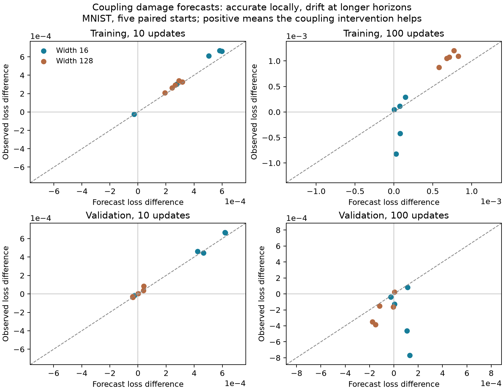

# Quantitative competition forecasts on MNIST: local success, long-horizon limits

23 October 2026. The [definition and derivation](../theory/competition_definition.md)
specify competition as optimization damage from inter-neuron coupling relative
to a reference preserving isolated-block response speeds. The definition gives
a computable loss forecast, rather than merely a correlated interaction score.
The [protocol](../theory/coupled_modes_protocol.md) records the initial design
and which revisions followed observed failures.

**Result:** a full frozen-Jacobian model predicts the sign of an explicitly
specified readout-coupling intervention in all ten width/seed cases at one and
ten updates on five-epoch MNIST states. At 100 updates, held-out prediction fails
to beat a zero-effect forecast. This is evidence for a local quantitative model,
not a theory of total competition damage during training.

## Definition in objective units

For positive local curvature H and its neuron-block diagonal D, let
C=D^-1/2 H D^-1/2. A direction v has destructive functional overlap when
vᵀHv < vᵀDv. Normalize the blocks' own curvature before interpreting overlap.
For block-normalized gradient flow, eigenmode i has rate lambda_i of C and
initial residual loss E_i. Its cost relative to independent rate-one relaxation is

    Delta(T) = sum_i E_i [exp(-2 lambda_i T)-exp(-2T)].

Low-rate modes contribute damage; high-rate modes contribute cooperation. Both
must be retained. This is ordinary quadratic-conditioning theory applied to a
specified neuron partition and causal branch, not a claim of a new spectral law.
The general-metric construction in the theory note also handles ordinary
Euclidean descent while preserving the trace of the local response rates.

## Actual experiment and scope

Existing squared-loss MNIST checkpoints, five initialization seeds (0–4), widths
16 and 128. These are five paired starts, not ten independent initializations.
The primary follow-up uses checkpoint 2145 (five epochs), a fixed 4096-example
training subset and 1024 validation examples. Forecasts are computed and saved
before either continuation. No forecast coefficients are fitted to future loss.

Each state branches into ordinary full-gradient descent and an intervention
changing the readout preconditioner to remove its normalized cross-neuron
coupling while retaining isolated-block speeds. Incoming weights and biases
continue ordinary gradient descent in both arms. The preconditioner stays fixed
over the continuation, and both arms start from the same parameters. The step
size is at most one, reduced equally for both branches if required by frozen
readout stability. Horizons are 1,10,100 updates.

This is an intervention on readout coupling, not all interactions in the entire
network. It also changes the optimizer, incurs extra computation, and is not a
compute-matched claim about a superior training algorithm. Continuations use
full gradients on a subset, not the original minibatch streams or momentum/Adam.

Two forecasts are retained: frozen hidden features with evolving readouts, and
the full initial Jacobian including incoming weights, biases and readouts.
Validation predictions use the initial validation Jacobian and predicted
parameter changes. They are not inferred from training-loss improvements.

## Prediction accuracy on the later training phase

RMSE of the predicted *difference between branch losses*. Loss is half the sum
of ten output squared errors, averaged over examples; these are absolute loss
units, not accuracy percentage points.

| Horizon | Training: full-Jacobian forecast | Training: predict zero | Validation: full-Jacobian forecast | Validation: predict zero |
| --- | ---: | ---: | ---: | ---: |
| 1 update | 2.91e-5 | 2.60e-4 | 3.01e-5 | 2.61e-4 |
| 10 updates | 5.22e-5 | 4.21e-4 | 2.79e-5 | 3.61e-4 |
| 100 updates | 4.02e-4 | 8.14e-4 | **3.55e-4** | **3.39e-4** |

At one and ten updates, the forecast gets the sign right in 10/10 cases on both
training and validation. At 100, this falls to 8/10 training and 7/10 validation.
The ten-update RMSE reductions relative to zero are about 88% and 92%, respectively.
These descriptive metrics are conditional on the selected phase, dataset and
five starts. They are not a broad accuracy guarantee or independent 30-run evidence.

At ten updates, mean predicted training damage is .0003245 and mean observed
damage .0003651; on validation these are .0002109 and .0002276. The effects are
small relative to initial losses around .05–.09. They do not explain the entire
ordinary width gap. At 100 updates, wide models have mean positive training
damage .001060, while their mean validation contrast is **negative** (−.000205).
Faster fitting can worsen generalization, which is why both objectives are kept.

The readout-only forecast is materially worse: at ten updates its training RMSE
is .000877, exceeding the zero baseline .000421. Its validation RMSE is .000880,
also worse than zero. Including hidden-layer response is necessary even over
these relatively short continuations.

## Failed and exploratory stages retained

The first probe used 256 fitting examples and normalized readout learning rates.
Its frozen-feature forecasts matched direct iteration, as expected from algebra.
One live width-16 start became catastrophically unstable (validation loss about
2.1e71 in the intervention). All five wide intervention branches also worsened
validation at the longest tested horizon. The pilot is retained unfiltered.

Increasing the fitting subset to 4096 removed that observed instability and
improved out-of-sample behavior. In the normalized comparison, the longest
horizon's mean predicted/observed training contrasts were .000422/.000474 at
width 16 and .003041/.003169 at width 128. However, some intermediate-horizon
signs were wrong, and this normalized experiment substantially changes ordinary
learning rates.

The ordinary-metric epoch-one follow-up kept an ordinary Euclidean baseline.
Its readout-only forecast often had wrong short-horizon signs once hidden weights
moved. That failure motivated the full-Jacobian model, tested subsequently at
the five-epoch states. The later phase was selected before its nonlinear branches
were run, but the broader research sequence remains exploratory. All phases share
initialization seeds and data and must not be pooled as independent replication.

## What the result does and does not support

This is a concrete definition that yields quantitative, testable forecasts on
real labeled data without a teacher. It predicts both harm and cooperation, and
states the relevant optimizer, block partition, objective and horizon.

It does **not** establish a monotone decrease of competition with width. Wide
models can have more removable coupling cost while still fitting better overall.
It does not forecast complete training, validate cross-entropy or Adam, or prove
that the chosen preconditioning contrast uniquely isolates all harmful neuron
interaction. Calling a preconditioner benefit "competition" without stating this
reference would overstate the evidence.

The next required advance is a forecast of representation/Jacobian drift and a
prospectively calibrated reliable horizon. The local spectrum also governs how
readout lag amplifies a moving optimal readout, providing a bridge to the earlier
feature-formation results. That dynamic bridge remains to be quantitatively
validated. Summing local intervention effects along the ordinary trajectory
would not produce an identified total causal training penalty.

## Reproduction and verification

[Full forecasts, audits and executed sources](../tables/coupled_modes/README.md).
The analyzer checks all frozen-feature predictions against iterative updates,
reconstructs final training and validation losses for all 40 branch-pair bundles,
and keeps all 120 horizon rows. Saved sources preserve the successive versions.
Unit tests cover exact quadratic forecasts, zero coupling for orthogonal features,
column-rescaling invariance, and the ordinary-metric reference's trace and loss
prediction. The complete test suite has 47 passing tests.
