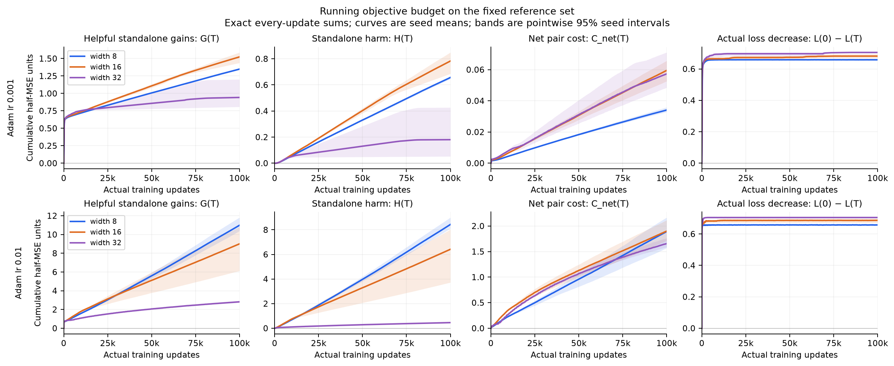
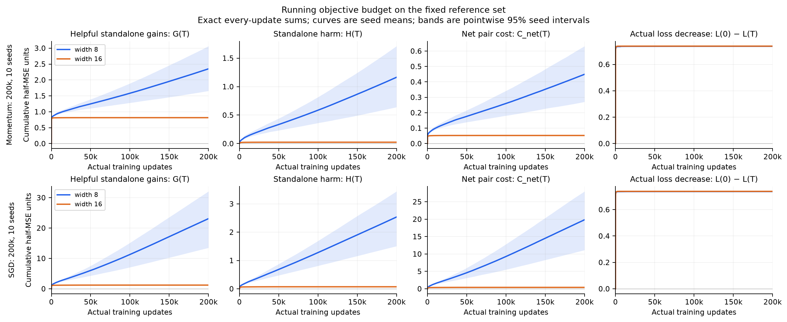

# Running helpful gains, standalone harm and net pair cost

These plots use **training update count**, with raw cumulative half-MSE
units. They do not use loss bins or normalize by helpful gain. No training
or replay was performed to produce them: the original studies measured each
actual update and retained exact prefix sums for the full cohorts.

For update t, A_r is its isolated neuron-r loss change, holding all proposed
updates fixed. With exact prediction changes d_r,

\[
G_t=\sum_r[-A_r]_+,\quad H_t=\sum_r[A_r]_+,\quad
C_{{\rm net},t}=\sum_{r<s}\langle d_r,d_s\rangle=C_{+,t}-C_{-,t}.
\]

The plotted running sums after T completed updates are

\[
G(T)=\sum_{t=1}^T G_t,\qquad H(T)=\sum_{t=1}^T H_t,\qquad
C_{\rm net}(T)=\sum_{t=1}^T C_{{\rm net},t}.
\]

On the **same fixed reference examples throughout training**,

\[
L_{\rm ref}(0)-L_{\rm ref}(T)=G(T)-H(T)-C_{\rm net}(T).
\]

The fourth column displays that objective decrease. The first three panels
plot gain and cost magnitudes, so H and net pair cost must be subtracted
from G, not added. Current reference loss is initial loss minus the fourth
column. G and H are nondecreasing sums; net pair cost and objective progress
need not be monotone. Net pair increments can be favorable, and stochastic
updates can increase reference loss.

## Adam trajectories

Teacher 8/2027, original zero-output initialization, five seeds, fixed
256-example training reference, 100k updates. Colors denote **student width**.
The two learning rates have separate rows; each component has its own y-scale.
Bands are exploratory pointwise 95% seed-bootstrap intervals.



The endpoint means below use raw half-MSE units. Every model starts at
reference loss .704704 in these zero-output cases.

| Adam | Width | G(T) | H(T) | C_net(T) | Actual reference-loss decrease |
| --- | ---: | ---: | ---: | ---: | ---: |
| .001 | 8 | 1.348811 | .656744 | .034081 | .657986 |
| .001 | 32 | .942251 | .180301 | .057248 | .704703 |
| .01 | 8 | 10.982320 | 8.433226 | 1.891657 | .657437 |
| .01 | 32 | 2.818022 | .457924 | 1.655395 | .704703 |

Thus low-rate Adam's wide model has much less accumulated standalone harm
but more net pair cost. High-rate narrow Adam repeatedly accumulates both
large helpful and large harmful movements while net objective progress
changes little. Neither G nor the raw costs are bounded by initial loss:
they can count repeated correction and undoing across many updates.

## SGD and momentum trajectories

The original 200k study has ten seeds and widths 8/16, using a fixed
512-example reference. Its initial reference loss is .738057, so raw
reference values should not be mixed with the later 256-example study.



For the later five-seed 100k momentum cohort, including width 32, see
[the corresponding running budget](../figures/cumulative_budget/momentum_100k_cumulative_budget.png).
For Adam .001 with outgoing initialization std 0/.1/1, see
[the initialization comparison](../figures/cumulative_budget/adam_initialization_cumulative_budget.png).

These totals answer what the actual trajectories experienced. Differences
include earlier convergence and subsequent update activity. They do not
hold phase or activity fixed and are not causal fractions of the width
benefit; the [magnitude audit](effect_magnitude.md) explains that distinction.

## Reproduction and data checks

```sh
MPLCONFIGDIR=/tmp/neural-competition-matplotlib .venv/bin/python scripts/studies/plot_cumulative_budget.py
```

The [producer](../../scripts/studies/plot_cumulative_budget.py) writes PNG/PDF
figures and [versioned curve data, endpoints and provenance](../theory/checks/cumulative_budget/README.md).
Each retained plotting point is an exact sum of all actual updates through
that point; the lines interpolate between these displayed prefixes. They
are not estimates formed by integrating sparsely sampled per-step metrics.

All 130 original-run endpoints are checked against the original cohort
tables. Where full seed-0 update records survive, the reconstructed loss
curve is additionally compared with independently evaluated after-step
reference losses. The original cumulative table's `reference_mse` column
records the loss **before** its final update; the new curve data explicitly
store `reference_loss_after` to avoid that one-step offset.
