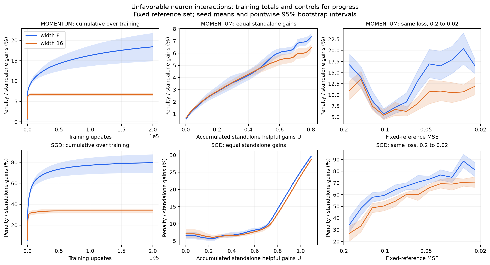

# Accumulated neuron-update interactions

Greater width has a smaller interaction penalty in these new runs, including
comparisons at equal accumulated standalone gains and in a shared loss range.
The large raw cumulative difference shrinks substantially after matching useful
activity. The advantage is not uniform in every individual loss bin. This is
descriptive accounting along actual training trajectories, not a causal
explanation of the final fitting advantage.

## Experiment

- Teacher width 8; students 8 and 16; seeds 0–9 paired by minibatch sequence.
- 200,000 updates for every run; batch size 64; all layers and biases train.
- Momentum: learning rate 0.1, beta 0.9. Plain SGD control: learning rate 1.
- The existing Gaussian 20-dimensional data and noiseless teacher are reused:
  8,192 training and 4,096 test examples, data seed 2026, teacher seed 2027.
- Student outputs start at zero; output normalization is 1/sqrt(width).
- Every actual update is measured on its source minibatch and on one fixed
  random subset of 512 training examples, shared by all runs and optimizers.
  The reference subset uses draw seed 20261020. Its MSE defines loss bins.
- Training is float32. Exact finite prediction changes are evaluated in
  float64 from the actual rounded before/after parameters. Momentum history
  is used normally. There is no pruning, freezing, or intervention on updates.
- A batched CPU runner implements the ordinary half-MSE gradient and classical
  momentum. It is tested against PyTorch autograd/SGD, including momentum
  buffers and padded inactive neurons. Floating-point operation order can
  change individual basins relative to the older sequential runs; these are
  new trajectories, not continuations or bitwise copies of those runs.

There are 40 runs and 8 million actual updates in total. Every update has both
source and reference measurements. Full train/test MSE is evaluated every
1,000 updates. No interpolation over sparse checkpoints is used to accumulate
the interaction quantities.

## Exact quantities

For a fixed proposed update to every neuron, let d_r be the exact prediction
change of neuron r and e=f-y. All averages below use the indicated evaluation
set (source batch or fixed reference):

\[
A_r=\mathbb E[e d_r+\tfrac12d_r^2],\qquad
J_{rs}=\mathbb E[d_rd_s].
\]

J_rs is also the four-loss contrast L_rs-L_r-L_s+L_0. Positive J adds loss
relative to the sum of the separate effects: an unfavorable interaction.
Negative J supplies a favorable interaction credit. We count each unordered
pair once, including interactions involving individually harmful neurons.
Only the frequency restricted to helpful pairs conditions on A_r,A_s<0.
Frequency sign tests use tolerance 1e-10 times the current batch/reference
half-MSE. Continuous penalty and gain magnitudes retain all values.

\[
G_t=\sum_r[-A_{r,t}]_+,\quad H_t=\sum_r[A_{r,t}]_+,\quad
C_{+,t}=\sum_{r<s}[J_{rs,t}]_+,\quad
C_{-,t}=\sum_{r<s}[-J_{rs,t}]_+.
\]

The loss change is exactly H_t-G_t+C_+,t-C_-,t. On the fixed reference,
these changes telescope:

\[
L_V(\theta_T)-L_V(\theta_0)
=\sum_{t<T}(H_t-G_t+C_{+,t}-C_{-,t}).
\]

The cumulative raw penalty is K_+(T)=sum_t C_+,t. Its normalized value is
S_+^cum(T)=sum_t C_+,t / sum_t G_t. Favorable credit and net interaction are
reported with the same denominator. Percentages refer to summed standalone
helpful gains, not current loss or a percentage of interfering pairs.

Source-batch contributions use a changing evaluation set and do not telescope
to one objective. Their cumulative values remain useful local diagnostics.
Cumulative raw penalties can exceed initial loss because repeated improvement
and deterioration contribute over many updates. They are not remaining error.

## Controls for training progress

1. **Same cumulative standalone gain U.** Set U(T)=sum_t G_t and plot K_+,
   K_net and S_+ against U. Each optimizer/view uses only the range reached by
   every one of its 20 runs; all ten paired seeds remain in every curve. The
   interpolation uses cumulative records from every actual update, not just
   plotted snapshots. U is useful *standalone activity*, not net learning
   progress; models at equal U need not have equal accuracy.
2. **Same reference loss.** Pool penalties and gains separately within fixed
   log-spaced reference-MSE bins, then take their ratio. All visits to a bin
   count, including returns to a bin. Seeds are paired within each bin.
3. **Equal weighting of a common loss range.** The primary scalar summary uses
   12 equal log-width bins between MSE 0.2 and 0.02. Each seed must visit all
   12 bins at both widths; average its 12 bin ratios equally, then average
   paired seeds. All ten paired seeds qualify here for both optimizers.
4. **Coverage at lower losses.** The broader loss-bin figure shows the number
   of available paired seeds. Successful narrow runs are a selected subset;
   their later comparisons do not represent all narrow initializations.

Ratios are pooled within each training seed before averaging; ratios of the
displayed mean quantities need not equal the mean of the seed ratios.
Tables use 4,000 paired-seed bootstrap resamples (seed 741), and curves use
1,500. Intervals are exploratory and pointwise, conditional on this one teacher
and dataset, without correction for multiple comparisons.

## Momentum results

On the fixed reference set, unfavorable interaction penalty / standalone gains:

| Comparison | Width 8 | Width 16 | Difference 16−8, 95% CI | Paired seeds |
| --- | ---: | ---: | ---: | ---: |
| All 200k updates | 18.41% | 6.77% | -11.64 pp [-15.02, -8.00] | 10 |
| Same loss bins, MSE 0.2 to 0.02 | 13.50% | 9.42% | -4.09 pp [-5.15, -2.92] | 10 |
| Same cumulative standalone gain U | 7.35% | 6.48% | -0.87 pp [-1.19, -0.54] | 10 |

The raw reference penalty after 200k updates is 0.49534 versus 0.05514 half-MSE
units: about 89% lower at width 16. At equal U, it is 0.05894 versus 0.05199:
about 12% lower. Much of the raw difference therefore accompanies different
amounts of continued update activity. The residual difference after this
control is smaller and clear in these paired seeds.

The original source-batch view also favors width 16:

| Comparison | Width 8 | Width 16 | Difference 16−8, 95% CI | Paired seeds |
| --- | ---: | ---: | ---: | ---: |
| All 200k updates | 6.46% | 5.05% | -1.41 pp [-1.90, -0.96] | 10 |
| Same loss bins, MSE 0.2 to 0.02 | 4.65% | 3.93% | -0.72 pp [-1.12, -0.42] | 10 |
| Same cumulative standalone gain U | 5.78% | 5.09% | -0.69 pp [-1.08, -0.33] | 10 |

Net interaction (after favorable credits) has the same direction in all three
scalar comparisons. At the same reference loss, the advantage is not uniform
over all bins; the reference curves cross at some later losses. Very low loss
comparisons contain only four successful narrow momentum seeds.

## SGD control

Fixed-reference penalty / standalone gains:

| Comparison | Width 8 | Width 16 | Difference 16−8, 95% CI | Paired seeds |
| --- | ---: | ---: | ---: | ---: |
| All 200k updates | 79.66% | 33.64% | -46.02 pp [-54.81, -35.89] | 10 |
| Same loss bins, MSE 0.2 to 0.02 | 66.35% | 56.58% | -9.77 pp [-12.39, -7.22] | 10 |
| Same cumulative standalone gain U | 29.67% | 28.73% | -0.94 pp [-1.51, -0.39] | 10 |

Source-batch view:

| Comparison | Width 8 | Width 16 | Difference 16−8, 95% CI | Paired seeds |
| --- | ---: | ---: | ---: | ---: |
| All 200k updates | 29.04% | 14.10% | -14.94 pp [-18.29, -11.11] | 10 |
| Same loss bins, MSE 0.2 to 0.02 | 16.50% | 12.88% | -3.62 pp [-4.42, -2.87] | 10 |
| Same cumulative standalone gain U | 13.93% | 12.57% | -1.36 pp [-1.95, -0.85] | 10 |

SGD also shows smaller penalties in the primary comparisons, but its reduction
at equal reference U is only about 3%. Absolute penalty levels should not be
used to rank the optimizers: their learning rates and step histories differ.

## Final fitting

| Optimizer | Width | Mean train MSE | Median train MSE | Mean test MSE | Train MSE < 1e-6 |
| --- | ---: | ---: | ---: | ---: | ---: |
| momentum | 8 | 0.00241 | 0.00287 | 0.00253 | 4/10 |
| momentum | 16 | 2.1e-10 | 1.94e-11 | 1.72e-08 | 10/10 |
| sgd | 8 | 0.0029 | 0.00344 | 0.00304 | 3/10 |
| sgd | 16 | 1.5e-10 | 4.42e-11 | 1.74e-08 | 10/10 |

## What these measurements establish

The wider network incurs a smaller local interaction penalty in the shared
primary loss range and at matched accumulated standalone gains. The difference
is not explained solely by adding inactive post-convergence steps. This
supports the local interference hypothesis, with a smaller effect after
controlling useful activity than the raw 200k totals suggest.

The metric includes ordinary diminishing returns, and depends on step sizes,
neuron decomposition and how prediction changes are distributed across units.
Width changes all of those. It does not isolate learned coordination, prove
that the penalty is avoidable, or show that removing it would improve final
loss by K_+. Altering updates would change all subsequent states. A causal
explanation of the final fitting advantage still requires an intervention
with controls for useful progress and step length.

## Raw totals and progress controls answer different questions

For total penalty actually experienced over a fixed budget, raw accumulated C_plus is the primary descriptive quantity. Earlier convergence is part of that observed benefit. Equal U and matched loss probe activity and phase; they are complementary estimands, not universally fairer replacements. The 89% raw momentum difference and 12% equal-U difference are both meaningful. See [the synthesis](../README.md) for this distinction.

## Validation, retained evidence and reproduction

The full 40-run accounting and fixed-reference telescoping checks passed, with maximum error 4.97e-13. Independent NumPy and direct four-loss checks, optimizer tests and frozen-source hashes were also verified.

This report describes the complete original cohort and diagnostic draws. Its estimates were preserved before pruning. Compact versioned [tables](../tables/README.md) and [figures](../figures/README.md) remain; full computed tables are compressed under `runs/retained/aggregates/trajectory/`. Representative raw states are a purposive subset and must not be used to re-estimate these cohort rates or intervals.

See [data retention](../data.md) for the manifest and [reproduction](../reproduction.md) for original producers under `scripts/studies/`. Full-cohort analyses require regenerating their original-layout inputs; notebooks have been removed. Historical full-cohort audits and original execution sources are retained in archive provenance.
