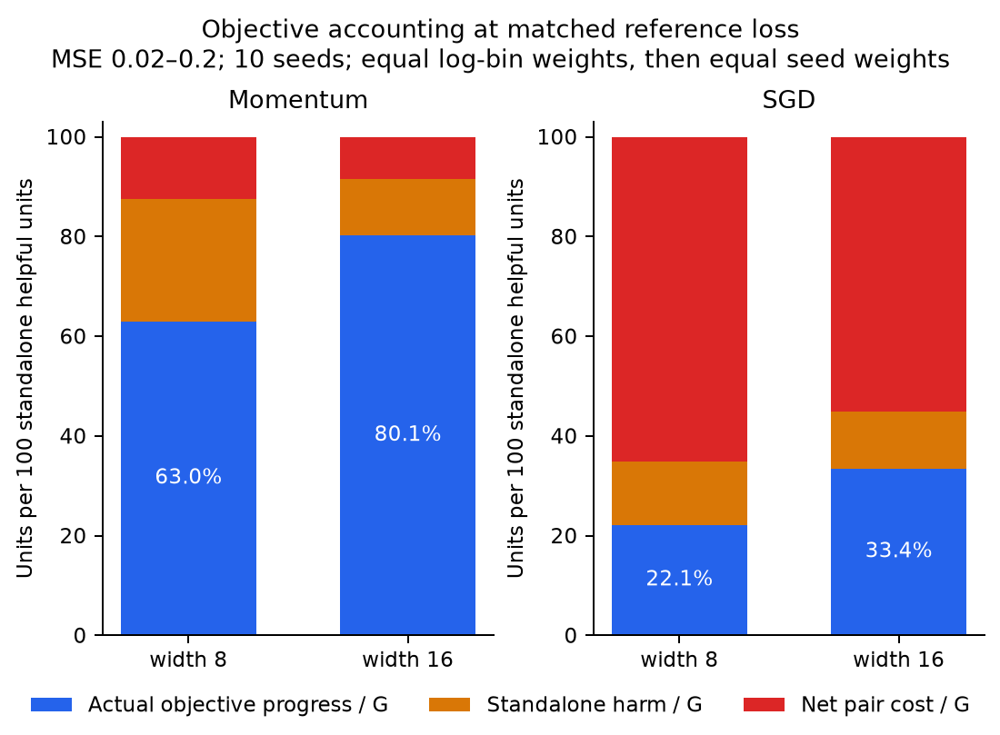
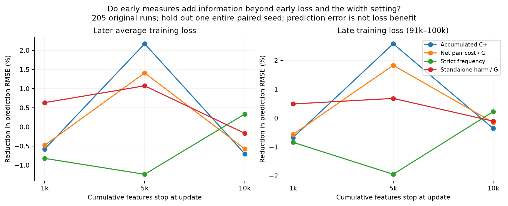

# Does measured interference have a meaningful objective scale?

Analysis of existing results, 18 October 2026. No training was performed.

**There are meaningful local objective effects in SGD and momentum, but we
do not yet have a convincing general predictor or causal account of the
width advantage.** The strict reversal statistic is especially small for
low-rate Adam. Broader pair costs can be large, yet their cumulative savings
are not a fraction of final loss explained. A prediction check using early
measurements finds little stable additional information beyond early loss
and the particular width/optimizer comparison.

The most promising broader distinction is between useful residual correction,
anti-residual neuron motion, and total finite-step movement cost. These have
an exact objective-unit budget. They still need a prospective test; defining
a score to match a width ranking would not establish the mechanism.

The subsequent [temporal peer-update experiment](temporal_branches.md) now
tests whether one earlier neuron movement causally changes later standalone
harm at other neurons. It covers every original setting with short paired
continuations and prediction-matched controls. It identifies some temporal
influence, especially in narrow momentum, without establishing a general
causal explanation of the width advantage.

## 1. Raw cumulative costs can be large without explaining that much final loss

On a fixed reference set, the existing quantities satisfy exactly

\[
L_0-L_T=G-H-K_{\rm net},\qquad K_{\rm net}=K_+-K_-.
\]

All symbols here denote sums over updates.

The [running-budget plots](cumulative_budget.md) show these sums against actual
training steps for SGD, momentum and Adam. They also plot the loss decrease,
in raw units without loss bins or normalization by G.

Between a narrow and wide model,

\[
L_{n,T}-L_{w,T}
=(L_{n,0}-L_{w,0})
+[(G_w-H_w)-(G_n-H_n)]
+[K_{{\rm net},n}-K_{{\rm net},w}].
\]

The initial term is zero for the default zero-output comparisons, but must
be retained for random-output initialization. These are exact accounts of
two observed trajectories, not interventions that keep the other terms fixed.
Mean fixed-reference values, in **half-MSE units**, illustrate the issue:

| Setting | Widths | Final reference-loss advantage | Net pair-cost saving | Change in net standalone gain |
| --- | --- | ---: | ---: | ---: |
| Momentum, 200k, 10 seeds | 8 → 16 | .001106 | +.396628 | −.395523 |
| SGD, 200k, 10 seeds | 8 → 16 | .001299 | +19.423529 | −19.422230 |
| Adam .001, 100k, 5 seeds | 8 → 32 | .046718 | −.023166 | +.069884 |
| Adam .01, 100k, 5 seeds | 8 → 32 | .047266 | +.236262 | −.188996 |

The SGD/momentum terms are large and largely cancel. Repeated movement and
undoing of movement can accumulate far more cost than the initial loss.
Conversely, Adam .001 pays more net pair cost while attaining a better loss.
Dividing a cumulative saving by the final width gap would give enormous or
negative percentages; none would be a valid percentage of benefit explained.

For example, momentum's raw K_plus=.49534→.05514 is a real descriptive
difference, but subtracting .44020 from a counterfactual final loss is not
justified. Changing the updates would change all subsequent states and gains.

## 2. A useful scale: actual objective progress per standalone helpful unit

Within a fixed reference-loss bin, define

\[
R=\frac{\sum_t(L_t-L_{t+1})}{\sum_tG_t}
=1-\frac{\sum_tH_t}{\sum_tG_t}
-\frac{\sum_tC_{+,t}}{\sum_tG_t}
+\frac{\sum_tC_{-,t}}{\sum_tG_t}.
\]

Unlike an event frequency, this places each term on the scale of actual
objective progress. Ratios pool visits within a seed/bin, then bins and seeds
receive equal weights. It is still conditional on the neuron's decomposition:
G is hypothetical standalone activity, not actual progress or compute. R
does not measure final benefit explained or imply a proportional speedup.

| Study/setting | Widths | Actual progress per 100 helpful units, R | Improvement from smaller net pair cost | Improvement from less standalone harm |
| --- | --- | ---: | ---: | ---: |
| 200k SGD | 8 → 16 | 22.14 → 33.44 | +10.12 units | +1.17 units |
| 200k momentum | 8 → 16 | 62.97 → 80.15 | +4.04 units | +13.14 units |
| 100k momentum | 8 → 32 | 80.34 → 89.82 | +4.20 units | +5.28 units |
| Adam .001, zero output | 8 → 32 | 53.42 → 84.61 | +.89 units | +30.30 units |
| Adam .01, zero output | 8 → 32 | 42.55 → 82.68 | +5.38 units | +34.76 units |
| Adam .001, output std .1 | 8 → 32 | 81.12 → 98.70 | +.56 units | +17.03 units |
| Adam .001, output std 1 | 8 → 32 | 95.63 → 96.17 | −.21 units | +.75 units |

The first two rows use all 12 shared MSE bins .02–.2 and ten paired seeds.
The other rows use the five shared bins .0766–.2 and five paired seeds.
These are different experiments/reference sets; their absolute levels must
not be compared as an optimizer ranking. Every intended run covers its
reported interval. No successful narrow subset is silently selected.

The net pair contributions have paired 95% intervals **[7.53, 12.79]** units
for SGD, **[2.82, 5.15]** for 200k momentum, **[2.58, 5.96]** for 100k
momentum, and **[1.89, 8.86]** for Adam .01. Those are meaningful local
budget differences, not just a tiny frequency pattern. Adam .001's .89-unit
estimate has interval **[−.40, 1.88]**; its much larger, clearer change is
in standalone harm. Std .1 has an uncertain pair improvement, and std 1 has
a clear small pair-cost worsening.

For SGD, the pair term accounts for about 90% of this **local retention
difference**. This is not 90% of the final fitting advantage. In particular,
C_plus contains benign diminishing returns and is sensitive to subdividing
one useful correction among neuron copies.

[The corresponding Adam/control figure](../figures/effect_magnitude/robustness_matched_efficiency.png)
shows the large orange standalone-harm component in narrow zero-output Adam.
Orange is not a direct neuron–neuron interaction: it also reflects update
direction, feature geometry, optimizer history and single-neuron step size.

## 3. Strict reversals: sometimes numerically tiny even after accumulation

The stricter diagnostic sums marginal harm only when both neurons help alone
but adding the second after the first raises loss. Its sum H_Q overlaps
neurons across alternative ordered pairs, so it is **not an additive loss
budget term**. Nevertheless, its scale is informative:

| Default Adam | Width | Cumulative strict pair harm H_Q | H_Q / actual reference loss decrease |
| --- | ---: | ---: | ---: |
| .001 | 8 | .0000829 | .0126% |
| .001 | 32 | .0006131 | .0870% |
| .01 | 8 | .04344 | 6.61% |
| .01 | 32 | .05944 | 8.43% |

Ratios are calculated within seed before averaging. At .001 this statistic
does not look like a substantial **direct** loss cost, even cumulatively,
and its whole-budget total is larger in the wide model. At .01 it is no
longer negligible, but again the full-budget harm is not reduced by width.
This strengthens the distinction between a favorable matched-loss frequency
trend and a substantial explanation of the observed objective advantage.

Small local effects could change later feature development. These totals
neither bound such a cascade nor supply evidence that it occurred. A cascade
claim needs predictive timing or an intervention, rather than a large relative
reduction of an already tiny number.

## 4. A direct objective connection exists early for momentum

The independent early momentum study gives a more direct size check. Near
training MSE .2, its actual recorded update is evaluated on **512 fresh target
minibatches**, with 40 paired training seeds. Mean half-MSE improvement per
update is:

| Direction and scale | Width 8 | Width 16 | Relative change |
| --- | ---: | ---: | ---: |
| Momentum, actual full step | .003082 | .004327 | **+40.4%** |
| Momentum, same direction at 1% step | .00004490 | .00005084 | **+13.2%** |
| SGD, actual full step | .003204 | .003264 | +1.9%, uncertain |

Momentum's extra full-step improvement is .001245, paired interval
[.000861, .001654]; at 1% step its extra improvement also has an interval
above zero. Here the favorable transfer pattern accompanies a material
change in **actual objective progress**, not merely a normalized sign score.
This is extra progress per early update, not 40% lower eventual loss caused
by competition. Later at MSE .01 the one-step width advantage is absent and
the point estimates favor the narrow models.

Fresh-target momentum P_step increases and N_step decreases, but their
normalization changes with width. We cannot assign the 40.4% gain to the
decrease in N alone. More positive transfer and different movement size/curvature
also matter.

Adam supplies a useful contrasting scale check at matched MSE .2. For widths
8→32, expected **net first-order** gain increases .0001126→.0001897 at lr .001
and .001253→.002068 at lr .01. The reduction of the globally harmful transfer
tail is only **.069% and .047% of those gain differences**, respectively.
Eliminating that rare harmful tail while holding positive transfers fixed
would therefore explain very little of the early gain difference in this
accounting. That is not a bound on hidden neuron-level cancellation or on
later cascades; it rules out treating the early global tail as the main
measured direct benefit.

## 5. Does an early cumulative measure predict the later width advantage?

We performed an exploratory chronological check using all **205 original
robustness runs**: 28 narrow/wider comparisons, five paired seeds, yielding
140 paired contrasts at each feature cutoff (1k, 5k, 10k updates).

Targets use objective units, not log ratios that could overemphasize tiny
near-zero errors:

- The narrow-minus-wide **mean future training half-MSE**, integrating the
  saved 1,000-update grid from the feature cutoff through 100k.
- The narrow-minus-wide mean training half-MSE over updates 91k–100k.

Targets are normalized by the teacher's zero-predictor training half-MSE,
shared across widths/initializations. The baseline knows the particular
optimizer/teacher/width comparison, the two current training losses and the
initial loss gap. One early metric at a time is added. We hold out an entire
initialization seed across all settings; feature standardization and linear
model coefficients use only the other four seeds. No later outcomes enter
the early features or fitting of the held-out fold.

Reduction in held-out RMSE for the **future-average-loss advantage**:

| Added early feature | Through 1k | Through 5k | Through 10k |
| --- | ---: | ---: | ---: |
| Raw accumulated C_plus reduction | −.58% | +2.17% | −.70% |
| Net pair cost / G reduction | −.48% | +1.41% | −.57% |
| Strict frequency reduction | −.82% | −1.24% | +.34% |
| Standalone harm / G reduction | +.63% | +1.07% | −.17% |

Late-loss forecasts tell a similar story. The best exploratory 5k gain among
the additional tested features is roughly 3% RMSE improvement from favorable
pair credit, and it does not persist at the other cutoffs. At 1k, raw C_plus
and net pair totals worsen future-average prediction in every held-out seed.
The within-comparison correlation of raw C_plus savings with the future
advantage is only .021 at 1k. The between-comparison-mean correlation is
negative (−.431), rather than a universal positive savings/benefit relationship.

These percentages describe **prediction error**, not the fraction of loss
benefit explained. The check does not establish a strong, stable extra
predictor. It also does not rule out a phase-dependent or nonlinear mechanism:
there are only five independent paired-seed folds, the experiments share
teacher/data settings, and the baseline comparison effects deliberately
remove the average width benefit. This tests information about deviations
from that expected benefit; it is not a test that all average width effects
are unrelated to interference. Between-setting correlations are reported
descriptively, without treating 28 overlapping contrasts as independent trials.

## 6. A better objective-unit decomposition to test next

Let s_r=−<e,d_r> be useful linear residual work, I_r=||d_r||²/2, and define

\[
P=\sum_{t,r}[s_{r,t}]_+,\qquad N=\sum_{t,r}[-s_{r,t}]_+,\qquad
Q=\tfrac12\sum_t\|\sum_r d_{r,t}\|^2.
\]

Then the fixed-reference objective satisfies **L_0−L_T=P−N−Q** exactly.
Here P/N denote prediction-space work, not the older normalized batch-gradient
masses with the same letters. N is motion against the current residual by
individual neurons; Q is total finite-step squared-movement cost. Neither
is automatically a direct pairwise interaction or a removable inefficiency.

This decomposition passes the identical-copy test: replacing d_r by copies
d_r/q preserves P, N and Q, while it can increase C_plus. The total work
W=P−N and Q are already recoverable from the old sufficient statistics:

\[
I=\sum_{t,r}I_{r,t},\quad W=G-H+I,\qquad Q=I+K_{\rm net}.
\]

The new tables verify this identity for all 245 fixed-reference trajectories.
Cumulative Q/W averages 91.4%→42.4% in 200k SGD and 45.6%→8.86% in 200k
momentum. These are large finite-step costs on the objective scale. Adam
.001 instead gives 6.62%→8.18%: this alternative is not universally reduced
by width either. It measures total movement cost, not competition alone.

The exact sign-separated P and N need per-neuron linear-work records that
the old summaries did not retain. We can nevertheless bound N without new
training, since [-s_r]_+=[A_r−I_r]_+:

\[
\max(H-I,0)\le N\le H.
\]

For default Adam .001, the mean cumulative N lies in **[.6441, .6567]** at
width 8 and **[.1745, .1803]** at width 32. Its decline is therefore bounded
between **.4638 and .4822 half-MSE units** across the paired cohort. The
mean within-run N/P is bounded around **47.8–48.2% versus 14.2–14.8%**.
There is a substantial anti-corrective-motion phenomenon to investigate,
even though strict pair reversals are tiny. It is not monotone at every
width: width 16's whole-run N is larger than width 8's despite better fitting.

These bounds do **not** identify why the motion changes or make it a causal
loss saving. As with the raw pair budget, repeated motion and different phase
residence affect the total. Exact P/N should be measured prospectively at
first passages through common losses, with movement magnitude and optimizer
history recorded, then tested against later objective gains.

The most discriminating intervention remains neuron-step reweighting against
the **best uniform shrink** of the same proposed update. Evaluate the extra
recoverable improvement on independent examples, in half-MSE and relative to
ordinary progress, before running a training continuation. A sizable local
gain that predicts later gains would connect allocation/competition to the
objective more directly than another favorable frequency curve.

## Evidence and reproduction

The [computation directory](../theory/checks/effect_magnitude/README.md) contains
the producer, definitions, input hashes, full per-seed outputs, paired intervals
and every held-out prediction. The underlying reports cover
[cumulative penalties](cumulative_penalties.md), [strict events](strict_matched_loss.md),
[momentum](momentum.md), and [Adam transfer](adam_cross_batch.md).
