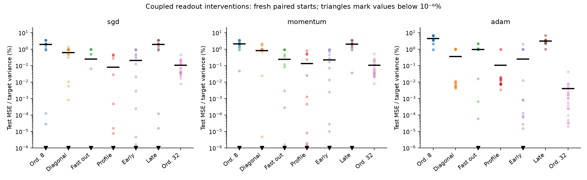
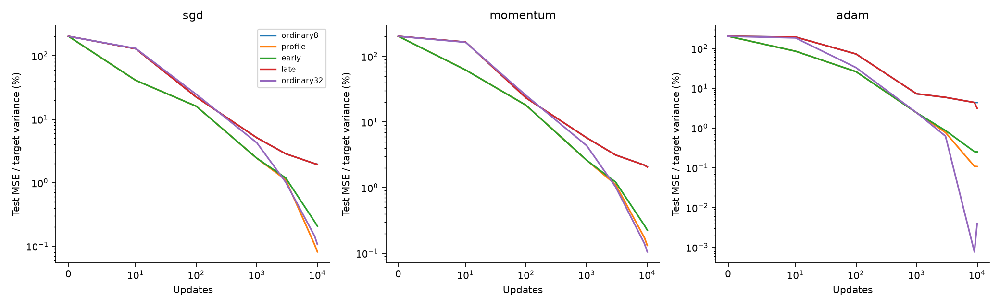

# Coupled readout adaptation and feature formation

18 October 2026. Follow-up to [signed residual growth](residual_growth.md), with
20 fresh paired starts per optimizer in the main task. **Early readout corrections
rescue narrow feature learning, but the resulting scalar diagnostics do not yet
predict the width-benefit boundary.** This strengthens the intervention evidence;
it does not identify competition as the unique mediator of width.

## The object: optimize out the current readout

For a scalar squared-loss network with current feature matrix Φ(W), define

\[
R(W)=\min_a\frac{\|y-\Phi(W)a\|^2}{2n},\qquad a_* = \Phi^\dagger y,
\]
\[
L(W,a)=R(W)+E(W,a),\qquad
E(W,a)=\frac{\|\Phi(W)(a-a_*)\|^2}{2n}.
\]

R measures what the **current learned features** can fit after jointly optimizing
their coefficients. E measures the excess loss of the current readout. Both use
training labels and actual features; neither uses teacher directions or partitions
neurons. Test profiled loss fits coefficients on training data and evaluates them
on held-out data. The decomposition is an empirical training-loss identity, not
an identity for test loss.

The coefficient of a nonredundant feature has a conditional form. Let
z_r=(I−P_{Φ_{−r}})φ_r. Then its optimal coefficient is

\[
a^*_r=\frac{z_r^\top y}{\|z_r\|^2}.
\]

Thus an overlapping feature's appropriate coefficient depends on the span of
all the other *current* features. If z_r=0, this individual coefficient is not
identified; the fitted prediction and R remain well-defined. This corrects a
weakness of the earlier teacher-center conditional-Gram construction: it used
a fixed surrogate span instead of the evolving representation.

On a differentiable, locally constant-rank region, the envelope identity gives
∇_W R=∇_W L(W,a*). Ordinary Euclidean gradient flow therefore obeys

\[
\frac{dR}{dt}=-\langle\nabla_W R,\nabla_W L(W,a)\rangle.
\]

For unit-rate readout gradient flow, put G=ΦᵀΦ/n and δ=a−a*. Wherever a* is
differentiable,

\[
\dot\delta=-G\delta-\dot a_*.
\]

This is a candidate **dynamic obstruction**: readout learning must track an
optimum that moves as features change, and that lag changes the feature updates.
Slow Gram directions can impede tracking. These identities do not prove that
width improves conditioning, that δ is always harmful, or that SGD/momentum/Adam
follow the same flow. In particular, profiling is a known variable-projection
method, not a new optimization principle: see
[Newman et al., Train Like a (Var)Pro](https://arxiv.org/abs/2007.13171).

A tempting stronger claim failed in exploratory traces: failing narrow models
generally still **decrease** R. Competition cannot be identified simply by
whether representation quality locally worsens. Less effective paths can also
make continuous progress. The fresh main cohorts confirm the limitation: mean
ordinary width-8 R decreases at every recorded checkpoint for all optimizers,
yet their final fitting deficits remain.

## Main intervention result

Same original 30° paired Gaussian task, coefficients (1,−3), eight teacher
features, both student layers trained, no output intercept. Data seed 9027;
fresh initialization/minibatch seeds 100–119; 4096 train and 4096 test examples;
10,000 updates; original width normalization and optimizer rates unchanged.

A correction jointly solves the current readout by full-training least squares,
then ordinary joint training resumes. Corrections occur every ten updates.
“Early” uses 100 corrections in steps 0–999 and then 9000 ordinary updates;
“late” uses the same number in steps 9000–9999. Standard correction arms reset
readout moments, while retaining incoming moments and elapsed update counts.
The first correction changes predictions; it is not function-preserving.

**Mean test MSE as a percentage of training target variance; lower is better.**
Raw tables store half-MSE, so these entries equal 200 × table loss.

| Optimizer | Ordinary width 8 | Ordinary width 32 | Width 8, continuous correction | Width 8, early only | Width 8, late only |
| --- | ---: | ---: | ---: | ---: | ---: |
| SGD | 1.955% | 0.107% | 0.0815% | 0.207% | 1.948% |
| Momentum | 2.075% | 0.105% | 0.132% | 0.225% | 2.062% |
| Adam | 4.385% | 0.00399% | 0.107% | 0.251% | 3.142% |

Early corrections close 94.6%, 93.9%, and 94.4% of the ordinary mean width gap.
This is (ordinary8−early)/(ordinary8−ordinary32), using cohort means: **a gap
closed by intervention, not a uniquely mediated fraction attributable to competition**.
It removes 1.75, 1.85, and 4.13 percentage points of target-variance error,
respectively. Early correction improves 18/20, 20/20, and 20/20 starts. Paired
95% bootstrap intervals for its absolute improvement are respectively
[1.25,2.25], [1.40,2.32], and [3.25,4.97] percentage points. Intervals are
exploratory seed uncertainty, with no multiplicity correction.

## What makes this stronger causal evidence

- **Fixed width, paired training streams.** Every intervention has eight ordinary
  trainable neurons, with no copied units, assigned roles, or teacher directions.
  Ordinary8 and late branches have bitwise identical parameters and optimizer
  states through the recorded step-9000 checkpoint before intervention.
- **The benefit is in learned features.** A terminal readout refit of ordinary8
  leaves MSE at 1.948%, 2.070%, and 4.370%; it barely rescues the original failure.
  Early-corrected models retain their advantage after corrections stop. Merely
  fitting the final coefficients cannot explain the result.
- **More than an initialization change.** One initial refit leaves MSE at
  1.075%, 1.130%, and 2.672%, substantially above repeated early correction.
  Early corrections retaining all optimizer moments also beat this initial-only
  control: paired intervals exclude zero for all three optimizers.
- **Moment erasure is not required.** Early corrections *without* moment resets
  reach 0.207%, 0.238%, and 0.447% MSE, closing 94.6%, 93.2%, and 89.9% of the
  width gap. Thus the rescue survives a cleaner coefficient-only intervention.
- **However, Adam has a serious alternative explanation.** Resetting readout
  moments alone reaches 0.545% MSE, while doing nothing useful for SGD or momentum.
  The no-reset early intervention does not clearly beat reset-only for Adam
  (paired interval crosses zero; wins 7/20). Adam's optimizer history can relieve
  a similar obstruction without solving the coupled readout.

Full correction beats the diagonal-preconditioned, exact-line-search control
in mean loss in all three main cohorts, with paired intervals excluding zero
(the Adam comparison is marginal and exploratory). A 10× readout learning rate
also works well: its errors are 0.247%, 0.239%, and 0.968%. The full-versus-fast
momentum comparison is inconclusive, and SGD's mean improvement is concentrated
in a failure tail. Joint inversion is therefore **not established as necessary**.
All corrections add full-data compute; this is not a compute-matched efficiency
comparison.

## Robustness and surviving failures

The six recorded controls use ten starts per optimizer. Full corrections lower
mean error in all opposing-sign settings, including the new 45°/(1,−2) task.
The uncentered 45° and 60° tasks improve in all ten starts for every optimizer.
However, the mean-initialized output-intercept controls are much weaker: at 30°,
only 3/10 SGD, 3/10 momentum, and 2/10 Adam starts improve. Their paired intervals
include zero. At 60° with an intercept, intervals also include zero. Balanced
opposing coefficients (1,−1) are mixed; faster readout SGD can solve that task
while full correction leaves substantial error. These results qualify the main
mechanism instead of establishing a general opposing-sign rule.

Same-sign (1,3) corrections worsen mean SGD and momentum loss; momentum's
increase is clear in the paired interval. Adam's small mean improvement comes
from only 1/10 improving starts. This is not a universally beneficial training
change. The fast-readout SGD arm with a learned intercept diverges in all ten
starts at both angles: its physical intercept step size becomes 3. These 20
failures are retained as infinite losses, not dropped or silently retuned.

On the second dataset (seed 9037, ten of the same initialization seeds), early
corrections give MSE 0.250%, 0.424%, 0.204% versus ordinary8's 1.701%, 2.603%,
4.519%. This is a dataset check, not ten new initialization replicates.

The first five main starts were extended to 100,000 updates, with **all**
interventions stopped at 10,000, including the increased readout rate. Ordinary8
ends at 0.778%, 0.557%, 2.402% MSE; the early arm ends near numerical zero for
SGD/momentum and at 0.387% for Adam. Diagonal and fast-readout controls also retain
benefits, so persistence is not unique to full correction. These five-start
extensions are small and selected by seed order, not by successful outcomes.

**Predictive precision has not improved yet.** At ordinary step 1000, adding
log R and log E to log training loss worsens mean squared log-final-loss
prediction under leave-whole-setting-out evaluation for all three optimizers:
SGD 14.12→14.36, momentum 16.84→17.93, Adam 14.31→16.13. There are only seven
settings; a 1e−12 loss floor and near-exact same-sign fits make this a difficult,
poorly calibrated forecast. This is a failed specific forecast, not a proof
that no useful conditional predictor exists. Neither R, E, nor their local
alignment currently supplies the desired sign boundary.

## Interpretation and next discriminating question

The evidence supports a consequential **early readout–feature feedback pathway**:
changing coefficient adaptation changes the features ordinary training eventually
learns. It is consistent with competition through shared overlapping feature
demands. It does not yet isolate harmful interactions between specific neurons,
prove that widening acts through this pathway, or identify the fraction uniquely
mediated by it. Profiling can also alter update magnitudes, signs, effective
conditioning, and optimization basins.

The next useful refinement is a trajectory-level tracking object derived from
δ̇=−Gδ−ȧ*, with interventions matched for prediction movement and optimizer
history. It needs to forecast which *ordinary* runs will fail before inspecting
their endpoint, including the intercept and same-sign controls. Simply giving
R/E another name, selecting a successful seed, or adding more post hoc metrics
would not resolve the present failure. No transfer result on MNIST is claimed.

## Evidence and reproduction

[Protocol and dated follow-up order](../theory/feature_profile_protocol.md),
[complete tables and audits](../tables/feature_profile/README.md), and
[reproduction commands](../reproduction.md#coupled-readout-follow-up).
Initialization/history controls and dataset/long-run checks were added after
seeing main outcomes; repeated main arms are consistency checks, not extra
independent evidence. The analyzer reconstructs every final test loss from
saved states (33 bundles, including extensions) and verifies source snapshots.
All original residual-growth experiments remain intact.
