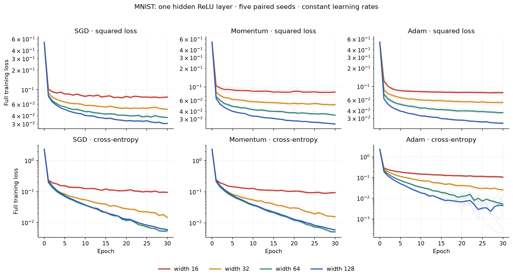
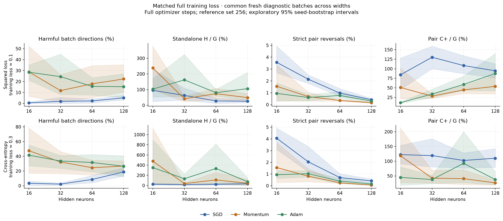
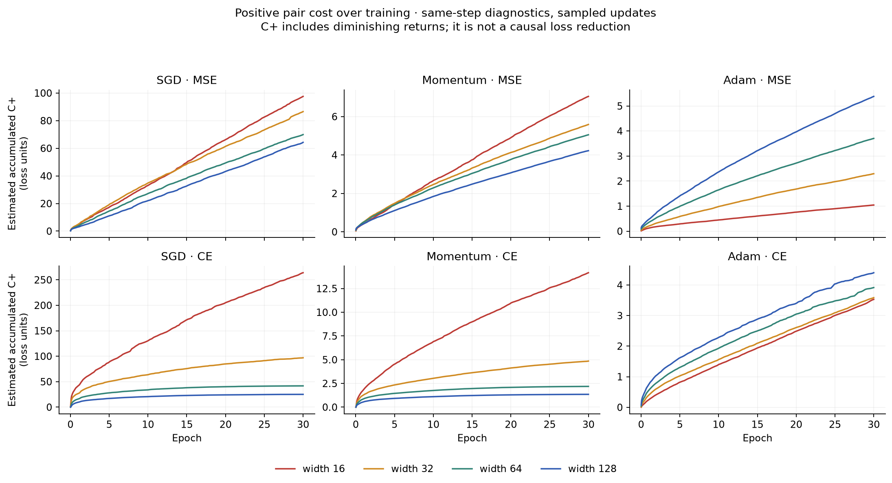
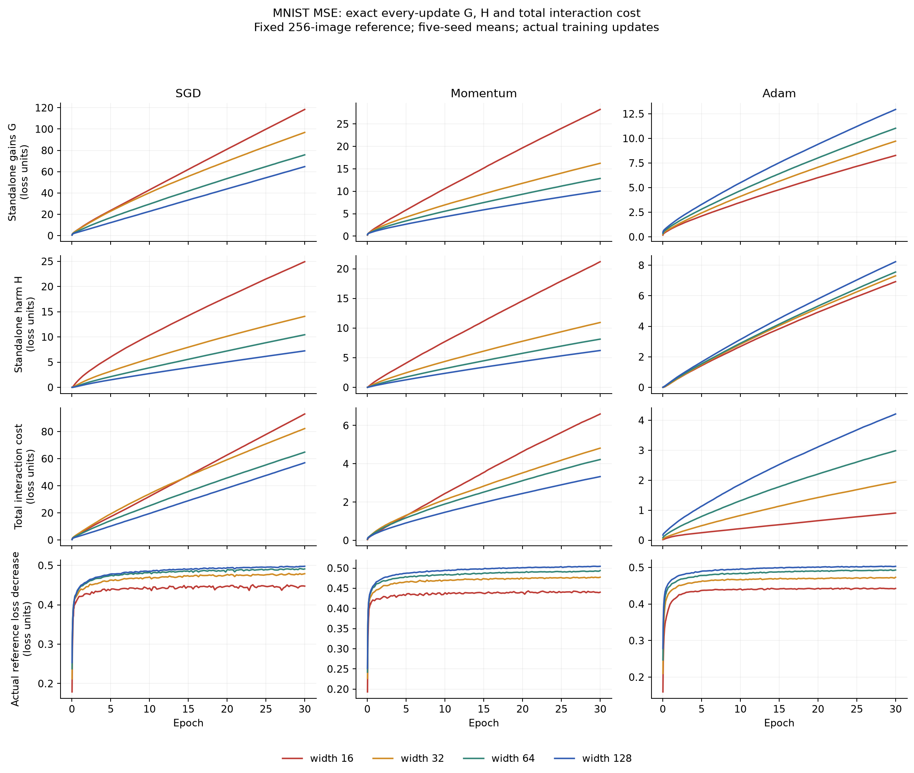
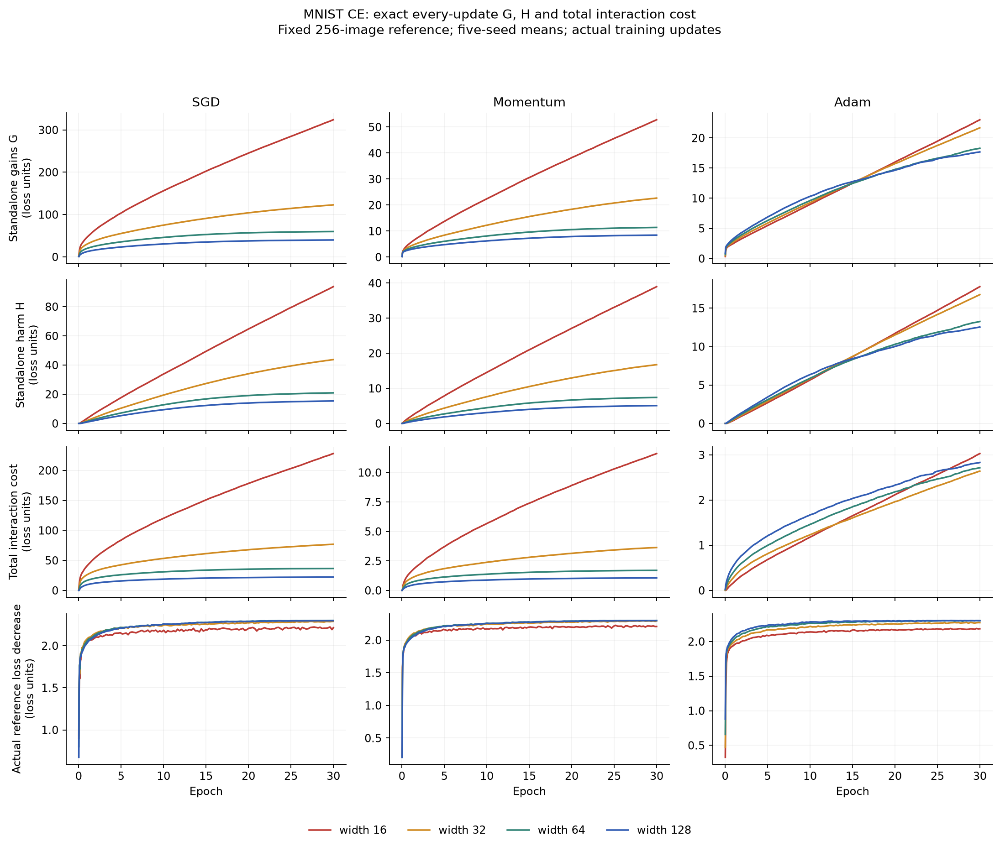
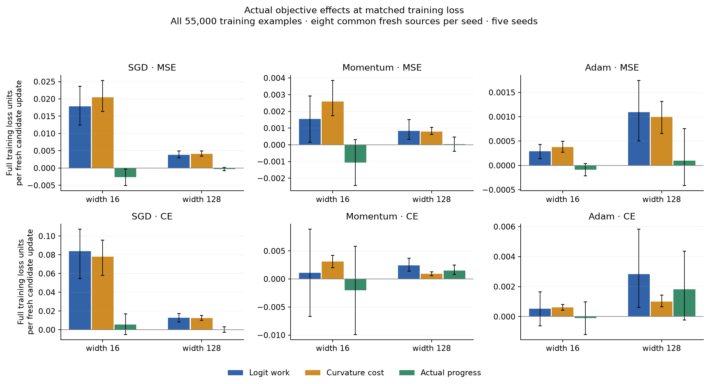

# MNIST: width, batch transfer and neuron interactions

The first real-data experiment confirms a substantial width benefit and gives
counterexamples to treating any one interference score as its explanation.
Width 16→128 improves test accuracy by roughly 3–5 percentage points. Strict
harmful pair events generally become less frequent per eligible pair, including
for Adam. However, wider SGD models can have **more harmful batch directions**
at matched training loss, and wider Adam models accumulate **more C_plus** under
both squared loss and cross-entropy. Lower per-pair frequency also need not mean
lower total strict harm.

These are completed experiments: 120 main runs, 80 learning-rate controls and
96 separate short rate-tuning runs. No temporal branching is used. The primary
G/H/total-interaction budgets now measure **every actual update** on a fixed
256-image reference set; pair penalties and strict events sample training time.

## Model, data and protocol

Each 28×28 image is flattened to 784 inputs. The model has one hidden ReLU layer,
no output bias, and ten raw class scores:

\[
f(x)=\frac1{\sqrt m}\sum_{r=1}^m a_r\operatorname{ReLU}(w_r^\top x+b_r),
\quad a_r\in\mathbb R^{10}.
\]

One parameter block is **one neuron**, containing its 784 incoming weights,
one bias and ten outgoing weights. The four widths 16/32/64/128 have
12,720/25,440/50,880/101,760 parameters. Every parameter belongs to exactly one
neuron. Incoming weights start N(0,1/784), biases zero, and outgoing weights
N(0,.1²). Nonzero outgoing initialization avoids importing the old zero-readout
initialization as the only possible source of an Adam counterexample.

The [official MNIST archives](https://docs.pytorch.org/vision/stable/_modules/torchvision/datasets/mnist.html)
come from PyTorch's dataset mirror and pass all four documented MD5 checks.
Reserve 500 examples per class from the original training split for validation:
55,000 training, 5,000 validation and the original 10,000 test examples.
Normalize pixels using the training mean .1305662 and standard deviation
.3080179. There is no augmentation, dropout, normalization layer or weight decay.

Each main setting has five initialization/minibatch seeds, 0–4. Initialization
streams and shuffled minibatch orders are shared across widths, losses and
optimizers for the same seed. Each epoch has 429 batches of 128, dropping a
randomly located remainder of 88 examples after each reshuffle. Train 30 epochs,
12,870 updates per run, at a constant learning rate. Both layers train.

Squared loss means **half the sum of squared errors over ten raw scores**,
averaged over examples; targets are one-hot. It is not MSE after softmax and
does not average over the class dimension. Cross-entropy uses the same logits
and architecture. Accuracy is argmax in both cases.

| Loss | SGD | Momentum, beta .9 | Adam, betas .9/.999 |
| --- | ---: | ---: | ---: |
| Squared loss | 1 | .3 | .003 |
| Cross-entropy | 1 | .1 | .003 |

Choose each common rate using five-epoch validation loss at widths 16/128 and
two separate seeds, 1000/1001. Average log validation loss equally over these
four cases. The four-rate grids are SGD .03/.1/.3/1, momentum .01/.03/.1/.3,
and Adam .0003/.001/.003/.01. The test split never selects rates.
This is a limited tuning grid, not a claim of optimal settings or an optimizer
ranking. Some selected rates lie at grid boundaries.

The 60 lower-rate controls divide the common rate by three at widths 16/128.
Another 20 runs use the rate individually preferred by a width in the same
independent tuning data: squared-loss width-16 SGD .3, momentum .03 and Adam
.001; cross-entropy width-128 momentum .3. Other individually tuned cases reuse
their unchanged main runs. Controls are identified separately in every table.
Together the 200 full runs contain 2,574,000 updates; tuning adds 205,920.
Diagnostic replays are not additional independent training starts.

## Fitting improves substantially

Means of five seeds after 30 epochs:

| Loss | Optimizer | Training loss, 16→128 | Test accuracy, 16→128 |
| --- | --- | --- | --- |
| Squared | SGD | .07742 → .03058 | 93.18% → 97.51% |
| Squared | Momentum | .08242 → .02484 | 92.40% → 97.60% |
| Squared | Adam | .07890 → .02495 | 92.59% → 97.39% |
| Cross-entropy | SGD | .09471 → .00591 | 94.83% → 97.90% |
| Cross-entropy | Momentum | .09332 → .00597 | 94.95% → 97.94% |
| Cross-entropy | Adam | .10433 → .00438 | 95.05% → 97.76% |

The paired test-accuracy differences have exploratory 95% seed-bootstrap
intervals above zero in all six settings. Width 128 also wins against width 16
under both rate-control protocols. Width 64 and 128 have similar cross-entropy
training accuracy, about 99.9% or above, and training loss is not strictly
monotone between these two widths. Wider is not better at every intermediate
comparison.

Unlike the teacher problem, there is no known sufficient minimal width.
The width-16 models still have appreciable training error, so their improvement
at larger width cannot be assigned entirely to optimization rather than
representational capacity. Test accuracy is evidence of practical relevance;
it is not part of the loss-budget identity.

## Batch transfer does not universally improve

Matched states target **full training loss**, not the 256-image reference loss:
.15/.10 for squared loss and .60/.30 for cross-entropy. Locate an observed
crossing on a coarse replay grid and refine within its bracket; require loss
within 5% of target. These are early crossing states, not averages over every
visit to a loss band. Their optimizer histories and training times differ.

There are 396 accepted states out of 400 targets across main and control runs.
Four high-rate cross-entropy SGD targets fail the tolerance and are excluded,
with all failures retained in the coverage table. Main squared-loss comparisons
have all five seeds; cross-entropy comparisons at .30 for widths 16/128 do too.

At each accepted state use 64 fresh batches of 128, drawn independently with
replacement and common across widths for each seed/target. Compute all 4,032
ordered off-diagonal transfers. Candidates
share frozen prior optimizer moments; Adam recomputes both candidate moments
from each source gradient. Batch pairs are not independent statistical samples.

| Loss and target | Optimizer | Harmful direction frequency, 16→128 |
| --- | --- | --- |
| Squared, .10 | SGD | .57% → 5.04% |
| Squared, .10 | Momentum | 28.75% → 22.36% |
| Squared, .10 | Adam | 28.52% → 15.31% |
| Cross-entropy, .30 | SGD | 3.34% → 18.76% |
| Cross-entropy, .30 | Momentum | 47.62% → 26.77% |
| Cross-entropy, .30 | Adam | 41.52% → 26.48% |

The SGD increases have paired intervals above zero. Squared-loss Adam's
decrease is also clear: −13.21 percentage points, interval [−20.15, −6.55].
The other decreases in this table have substantial seed uncertainty.
Earlier momentum states give clearer reductions in harmful directions.
For squared-loss Adam at .10, P_step increases and N_step decreases; for
cross-entropy Adam at .60, P_step increases while N_step has no clear reduction.
Improved beneficial alignment and reduced negative alignment are distinct.

## Strict pair frequency falls, but counts and harm must also be retained

At each matched state draw 16 fresh source batches with replacement, common across widths.
Evaluate each fixed candidate update at full and 1% scale on the fixed
256-training-image reference and a separate 256-validation-image probe.
The validation probe is held out from parameter fitting but participates in the
full validation split used for rate tuning; it is not an untouched test set.

All isolated neuron effects are evaluated exactly. Squared loss evaluates all
pairs. Cross-entropy samples up to 256 unordered pairs without replacement per
source, applying inverse-inclusion weights to totals. The strict event still
requires both neurons to help alone and one recipient to become harmful after
the other neuron's fixed update. Frequency conditions on both helping alone.

| Loss and target | Optimizer | Strict frequency, 16→128 | Aggregate severity, 16→128 |
| --- | --- | --- | --- |
| Squared, .10 | SGD | 3.568% → .421% | .908% → .0170% |
| Squared, .10 | Momentum | 1.551% → .169% | .505% → .0071% |
| Squared, .10 | Adam | .949% → .305% | .0288% → .0070% |
| Cross-entropy, .30 | SGD | 4.060% → .411% | 1.026% → .0063% |
| Cross-entropy, .30 | Momentum | 1.555% → .059% | .165% → .0002% |
| Cross-entropy, .30 | Adam | .941% → .150% | .0504% → .0008% |

Severity divides total positive marginal harm over events by total recipient
standalone benefit over all eligible ordered pairs. These are means of
within-seed ratios. Frequency point estimates decrease in all six comparisons;
the squared-loss Adam frequency interval just includes zero. Severity decreases
have paired intervals below zero in these comparisons.

**This does not establish fewer harmful interactions in total.** For squared-loss
Adam at .10, estimated strict events per source update increase .2625→9.5375.
Total strict marginal harm per G increases .162%→.377%, even though conditional
frequency and severity both fall. More pairs and different recipient-benefit
distributions change the aggregate. Pair events overlap in neurons, so their
harm sum is not an additive component of the full update's loss.

## Cumulative C_plus still reverses for Adam

Pair diagnostics sample two updates uniformly without replacement in each
prespecified time stratum: ten-update strata for the first 200 updates, then
100-update strata, including a final shorter stratum. There are 294 measured
updates per main run. Multiply each sampled value by stratum length / 2.
The sampling generator is independent of training and does not select on loss.
Cross-entropy also samples pairs; squared loss uses all pairs at each draw.

| Loss | Optimizer | Estimated accumulated C_plus, 16→128 |
| --- | --- | --- |
| Squared | SGD | 97.54 → 64.28 |
| Squared | Momentum | 7.05 → 4.22 |
| Squared | Adam | 1.05 → 5.38 |
| Cross-entropy | SGD | 263.95 → 25.09 |
| Cross-entropy | Momentum | 14.17 → 1.35 |
| Cross-entropy | Adam | 3.53 → 4.40 |

These are raw objective units, not percentages of initial loss or remaining
error. Repeated stochastic improvement and damage can make them much larger
than the initial loss. Squared-loss SGD also has heterogeneous seed-relative
changes despite the lower cohort mean.

Adam's increase persists when both widths use one-third the learning rate.
Moreover, individually tuning the two widths can make accumulated C_plus rise
with width even for squared-loss SGD and momentum, while fitting still improves.
Its width trend is not an optimizer-independent explanation or success criterion.

## Exact every-update accounting: a substantial budget, no universal efficiency trend

For squared loss, vector neuron changes preserve the original exact identities:

\[
A_r=E[(f-y)^\top d_r+\|d_r\|^2/2],\quad J_{rs}=E[d_r^\top d_s],
\quad \Delta L=H-G+\sum_{r<s}J_{rs}.
\]

For cross-entropy, isolated and four-loss pair contrasts remain exact, but their
pair sum need not close the full-update budget. Define instead
\(C_{\rm all}=\Delta L-\sum_r A_r\). Then
\(\Delta L=H-G+C_{\rm all}\) exactly. It includes all interaction orders and is
not interchangeable with pair-only C_net or C_plus.

An initial sampling audit found that cancellation could turn modest G/H errors
into large relative errors in net interaction cost. We therefore replayed
**all 120 main trajectories**, computed every update's G, H and C_all on the
fixed 256-image reference in float64, and verified the final parameters and
optimizer moments bitwise against the original runs. The main budget tables
and curves use those complete sums. Control-run budgets remain explicitly
labelled estimates. The sampling-audit table preserves the original errors.

Mean net progress per 100 units of accumulated standalone benefit:

| Loss | SGD, 16→128 | Momentum, 16→128 | Adam, 16→128 |
| --- | --- | --- | --- |
| Squared | .415 → .770 | 1.565 → 5.017 | 5.400 → 3.893 |
| Cross-entropy | .692 → 5.764 | 4.193 → 27.202 | 9.572 → 13.066 |

All these width differences have paired seed-bootstrap intervals excluding zero,
including the **decrease** for squared-loss Adam. Thus larger width can improve
final fitting while using more standalone activity per unit net progress.
For that Adam setting, H/G decreases 83.82%→63.61%, but total interaction cost/G
rises enough to offset it. For cross-entropy SGD, H/G increases 29.12%→38.64%
while net progress/G improves because interaction cost falls more strongly.

These budgets are materially larger than a one-percent correction to training
progress in several settings. They describe actual local loss accounting;
they do not say how much final loss an intervention could recover. A wider
trajectory's smaller cumulative cost may also reflect its earlier convergence.

## Direct objective checks on all training examples

For widths 16/128, repeat the first eight matched-state source draws and evaluate
both the full and 1% candidate updates on **all 55,000 training examples**.
This checks that the smaller reference set has not manufactured a local benefit.
There are 119 accepted states and 1,904 full-objective candidate evaluations.

The clearest Adam results are:

| Setting | Mean full-training loss decrease per full update, 16→128 | Paired gain difference, 95% interval |
| --- | --- | --- |
| Squared loss ≈ .15 | .000951 → .002051 | .001100 [.000569, .001695] |
| Cross-entropy ≈ .60 | .006343 → .015138 | .008794 [.005564, .011096] |

These are meaningful local objective differences. They also survive at 1% step
scale. However, at squared loss .10 the Adam full-step difference is uncertain,
and at cross-entropy .60 momentum's narrow model makes **more** one-step progress
despite its larger strict pair frequency. Strict interference is not sufficient
to rank actual update quality.

For squared-loss SGD near .10, the full-step means are −.002600→−.000281:
the wider update is less harmful, with a paired difference .002319
[.000323, .004558], but neither mean is a positive improvement. At 1% step the
narrow update is more helpful. Finite-step curvature matters substantially.

The full-objective probes additionally separate logit work from curvature.
For actual logit movement d, define
\(W=-E[\nabla_z\ell(z,y)^\top d]\) and
\(Q=E[\ell(z+d,y)-\ell(z,y)-\nabla_z\ell(z,y)^\top d]\).
Actual progress is exactly W−Q. Q is nonnegative for these convex logit losses:
half squared movement for squared loss; the mean KL divergence from old to new
softmax probabilities for cross-entropy. This is a total-movement decomposition,
independent of the neuron partition. W uses the **finite actual logit change**,
not the parameter-linearized score g dot delta.

At cross-entropy .60, Adam's W increases .00709→.01812, while Q also increases
.000747→.002983. Here the wider model wins through substantially more useful
logit work despite paying more curvature cost. At other settings, especially
large-rate SGD, reduced curvature cost is prominent. Both mechanisms belong in
the theory; neither follows from C_plus alone.

## What this changes in the working hypothesis

The data support studying whether width changes the **distribution and
consequences** of incompatible demands, with useful reinforcement measured
alongside harmful effects. They do not support a universal chain
"wider → less measured interference → better optimization".

Three distinctions now matter particularly:

1. Conditional pair frequency/severity can improve while total strict harm grows.
2. Batch-transfer conflict, standalone harm, pair overlap and total curvature
   can move in different directions, even at matched loss.
3. A larger budget term is not a larger causal contribution to the final width
   advantage. Capacity, initialization, effective learning rates, optimizer
   history and training phase remain relevant.

For the next architecture transfer, preserve these separate outcomes, include
learning-rate and functional-movement controls, and retain direct objective
checks. The MNIST evidence does not justify choosing a replacement competition
metric simply because its width trend agrees across optimizers.

## Validation, uncertainty and retained evidence

Analytic gradients and SGD/momentum/Adam updates match PyTorch in float32 and
float64 tests. Direct four-loss contrasts validate MSE and CE pairs, including
gate crossings; tests verify frozen Adam histories and attribution sums.
The sampled MSE pair identity has maximum error 1.23e−16. Matched replays and
all every-update budget replays recover original states and optimizer moments
bitwise. Full-reference sums telescope to the endpoint objective difference
with maximum error 1.16e−15. The final repository suite has 62 passing tests;
Ruff passes across source, scripts and tests.

Intervals use 10,000 paired seed-bootstrap draws with RNG seed 741. Five seeds
give exploratory, pointwise intervals conditional on this dataset/split and
the tuning procedure; they are not adjusted for many comparisons. Pair draws,
neurons, source batches and diagnostic replay runs are not independent training
replicates. Missing matched targets stay visible. The secondary 1% interpolation
is rounded to float32 and is a local direction-scaling check, not another
training trajectory.

All compact per-seed results, complete diagnostic aggregates, coverage and
audits are [versioned with the study](../tables/mnist/README.md). Raw datasets,
optimizer checkpoints and every-update audit arrays remain in ignored
`data/mnist` and `runs/mnist`. See [reproduction](../reproduction.md#mnist-width-study).
