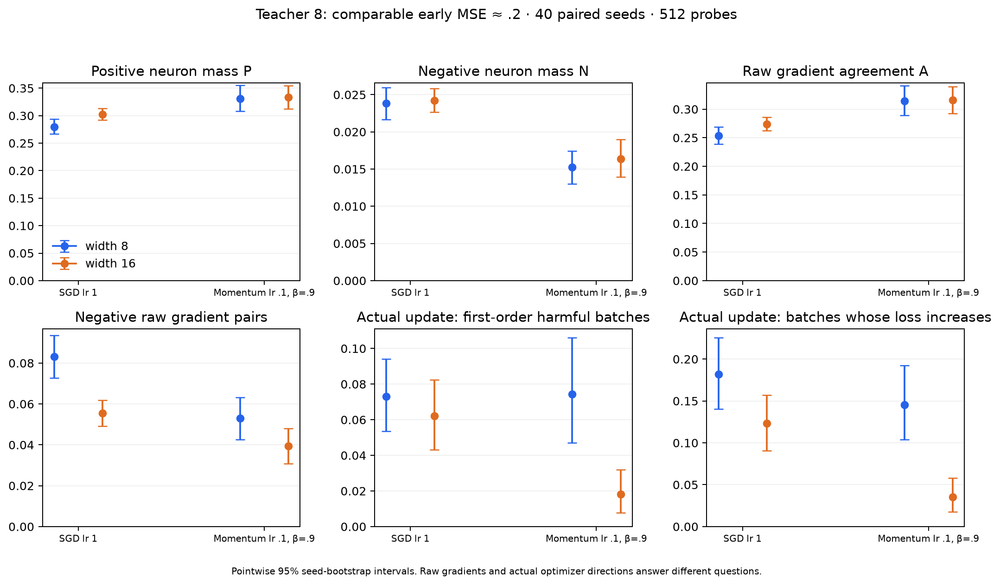
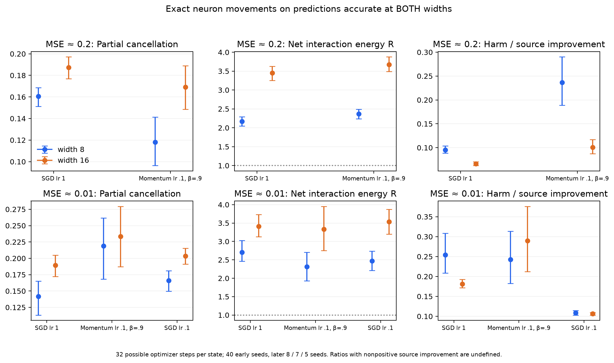
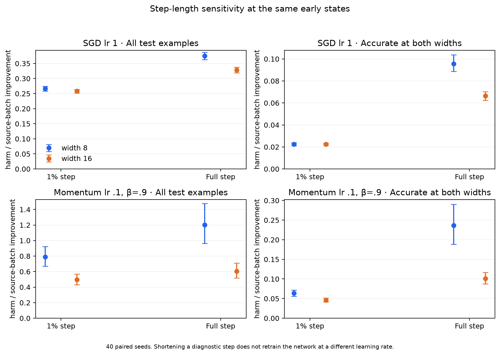

# Momentum replication of the interference measurements

The broad limitations of the SGD findings remain: width does not consistently
reduce raw negative neuron gradient mass, partial cancellation is not dominant
net cancellation, and the patterns depend on training phase. The main new finding
is that **momentum's actual direction shows a clear early width benefit even
without a clear width change in raw P, N or A**. Unlike plain SGD in the tested
states, momentum's reduction of collateral harm persists for very short steps.

## Protocol

The fixed teacher has eight ReLU neurons, scalar noiseless targets and Gaussian
inputs in 20 dimensions; 8,192 training and 4,096 independent test examples.
Students have widths 8 and 16, output normalization 1/sqrt(width), zero initial
outgoing coefficients, and both layers/hidden biases train. The loss is half-MSE;
matching and reported training/test errors use ordinary MSE.

The main settings are SGD lr 1 and classical momentum SGD lr 0.1, beta 0.9,
zero dampening, no Nesterov, no weight decay. Their nominal lr/(1-beta) values
coincide, but that does not make their transient dynamics equivalent or remove
learning-rate/trajectory confounds. The existing SGD-lr-0.1 pilot supplies a
five-seed later control; this is not an optimizer ranking or a tuned comparison.

No training was repeated. We analyzed 552 unique training checkpoints, retaining
the raw data and results of the previous SGD study. The early comparison at MSE
approximately 0.2 uses 40 paired seeds per optimizer and both 128 original and
512 fresh probe batches, each of size 64. Mean attained training MSE is
0.19591/0.19491 for SGD widths 8/16 and 0.19506/0.19486 for momentum. The later
MSE-0.01 comparison uses eight common width-paired SGD seeds and seven momentum
seeds. Six seeds are common to all four models; cross-optimizer contrasts use
those six. Eligibility depends on a saved state being within 25% of the target,
not solely on whether training ever reaches the target.

Each main profile also has ten paired seeds at nine shared checkpoints through
100k updates. Prediction-movement diagnostics stop at 20k to limit numerical-floor
effects. For each state, 32 alternative source minibatches supply possible next
steps, evaluated on all 4,096 test examples. An independent early check recomputes
32 fresh minibatch gradients, using seed 20261018. The key findings replicate.

Uncertainty uses 4,000 paired training-seed bootstrap resamples (seed 741),
conditional on this teacher, dataset and probe draws. Intervals are exploratory,
pointwise and not adjusted for multiple comparisons. Batch pairs are correlated
and are not treated as independent uncertainty samples.

## Raw gradients versus the optimizer's direction

Raw gradient masses retain the previous definitions:

\[
q_r(B,C)=g_{B,r}^{\top}g_{C,r},\quad
P=\mathbb E\sum_r[q_r]_+/S_g,\quad
N=\mathbb E\sum_r[-q_r]_+/S_g,\quad S_g=\mathbb E\|g_B\|^2.
\]

Raw net agreement A is ||full gradient||² / S_g. These describe the current
loss geometry. The optimizer that produced the state affects them indirectly,
but a raw gradient dot does not include momentum's history.

For the momentum buffer v BEFORE the saved update, a candidate minibatch B gives

\[
h_B=\beta v+g_B,\qquad \delta_B=-\eta h_B.
\]

We freeze the saved pre-step buffer across candidate B, rather than recomputing
history or using the already updated buffer. Positive g_C dot h_B predicts help
to C. Neuron transfer masses P_step and N_step use this dot in place of q,
normalized by sqrt(E||g_C||² E||h_B||²). The transfer is asymmetric in B and C,
so we average ALL ordered off-diagonal pairs. For plain SGD, h_B=g_B and these
masses reduce exactly to raw P/N. They attribute conflicting data demands to
neurons, not direct interactions between different neurons.

### Early comparison: arrows mean width 8 → 16

| Measurement | SGD lr 1 | Momentum lr 0.1, beta 0.9 |
| --- | ---: | ---: |
| Raw P | 0.27987 → 0.30217 | 0.33078 → 0.33317 |
| Raw N | 0.02382 → 0.02422 | 0.01526 → 0.01640 |
| Raw A | 0.25319 → 0.27389 | 0.31407 → 0.31563 |
| Negative raw batch pairs | 8.31% → 5.54% | 5.30% → 3.93% |
| Optimizer-direction P_step | 0.27987 → 0.30217 | 0.27608 → 0.35703 |
| Optimizer-direction N_step | 0.02382 → 0.02422 | 0.02764 → 0.01651 |
| Harmful candidate directions to first order | 8.31% → 5.54% | 7.46% → 1.79% |

For momentum, raw P changes by +0.00239 [−0.02091, 0.02578], raw N by
+0.00114 [−0.00155, 0.00380], and A by +0.00156 [−0.02430, 0.02693].
None has a clear early width shift. In contrast, direction-transfer P_step
increases by **+0.08095 [0.06337, 0.09902]** and N_step decreases by
**−0.01113 [−0.01540, −0.00696]**. This is a stronger signal about momentum's
actual next step than about instantaneous raw gradient agreement.

The single recorded training update gives a separate check on 512 fresh batches:

| Fraction of evaluation minibatches harmed | SGD, width 8 → 16 | Momentum, width 8 → 16 |
| --- | ---: | ---: |
| First-order prediction | 7.31% → 6.20% | 7.43% → 1.82% |
| Exact finite loss change, full step | 18.21% → 12.33% | 14.56% → 3.55% |
| Exact finite loss change, 1% step | 7.40% → 6.22% | 7.48% → 1.83% |

Momentum's early full-step harm reduction is −11.01 percentage points
[−14.65, −7.72]. Its first-order reduction is −5.62 points [−8.04, −3.49].
The first-order width effect is clearer than SGD's and their difference is
−4.51 points [−7.70, −1.60]. The difference between the two optimizers' FULL-step
width effects is uncertain: −5.14 points [−11.15, +0.42]. We do not infer a
statistically established stronger full-step effect just from point estimates.

## Distribution shape, agreement and curvature

Momentum and SGD both have lower early excess kurtosis at greater width.
Momentum's excess kurtosis is 1.572 → 1.285, paired difference −0.287
[−0.482, −0.105], versus SGD's 1.625 → 1.415. Momentum's skewness also decreases
modestly, 0.806 → 0.730, difference −0.076 [−0.149, −0.001]; SGD's skewness
change remains uncertain. These moments concern deviations around the mean;
neither measures harmful interactions directly.

Raw A, P and N trajectories are saved in the comparison notebook. A does not
consistently increase with width across training, and does not include momentum's
direction. Equal-step models can have substantially different errors. Later
ratios for well-fitted wide networks approach float32 numerical floors.

The existing ratio-of-expectations batch-sharpness estimates decrease early
from 0.472 → 0.317 for momentum and 0.336 → 0.237 for SGD. They use 32 half-MSE
HVP probes per early state. Consecutive realized update cosines are about
0.992 at both momentum widths, versus 0.159 → 0.196 for SGD. The smoother history
is a concrete reason raw instantaneous gradients and actual updates differ.
These scalar curvature measurements do not establish stability or explain the
width advantage causally.

## Exact neuron prediction changes

As in the SGD analysis, compute each neuron's exact finite prediction change
d_r and the total d=sum_r d_r. With residual e=f-y, a one-neuron update changes
half-squared loss by h_r=e*d_r+0.5*d_r² and the joint update by h=e*d+0.5*d².
All ReLU gate crossings and simultaneous layer changes are included in float64.
Hypothetical isolated-neuron losses do not add to the joint loss.

We retain the previous partial-cancellation fraction
C=1−E|d|/E sum_r|d_r| and energy ratio R=E[d²]/E sum_r[d_r²]. R below one
means net cancellation; R above one means reinforcement of movement on balance.
Neither alone identifies useful learning. A wider sum can have more partial
cancellation and still have positive net cross terms. Increased cancellation
alone does not establish learned coordination.

Accurate examples satisfy |residual| <= 0.05 at BOTH widths for the paired seed,
so the same examples are compared within each optimizer. These selected examples
need not be the same across optimizers. The 0.1 threshold gives the same general
early direction of effects; raw counts are saved with each estimate.

### Early actual optimizer directions

| Measurement on accurate predictions | SGD, width 8 → 16 | Momentum, width 8 → 16 |
| --- | ---: | ---: |
| Partial cancellation | 16.05% → 18.73% | 11.80% → 16.93% |
| Net interaction R | 2.17 → 3.45 | 2.37 → 3.67 |
| Isolated harmful mass on examples the joint step does not harm | 4.93% → 7.75% | 4.52% → 8.27% |

Momentum's partial-cancellation increase is +5.13 percentage points
[3.14, 7.11]. The wider sum has more partial cancellation, as with SGD, but
net cancellation still does not dominate. R remains above one even after
projecting prediction movements orthogonally to the residual vector.

### Harm per useful source correction: a difference from SGD

Define H=E([h]_+), G=E([-h]_+), and U=mean source-minibatch loss reduction.
Pointwise positive/negative parts are taken before averaging. Ratios use mean U
per frozen state; they do not match source improvements exactly across widths.
Momentum can harm an individual source batch: full-step source-harm frequencies
are 5.16% → 0.63% early. Those batches remain included. Every analyzed state's
MEAN U is positive; the code retains counts and would mark ratios undefined
for nonpositive means.

| H/U on accurate examples | SGD, width 8 → 16 | Momentum, width 8 → 16 |
| --- | ---: | ---: |
| Full diagnostic step | 0.09549 → 0.06648 | 0.23635 → 0.10077 |
| Same direction shortened to 1% | 0.02251 → 0.02258 | 0.06354 → 0.04608 |

Momentum's harm reduction persists at 1%: −0.01747 [−0.02444, −0.01132],
unlike SGD's essentially zero difference. The fresh-source check confirms it,
0.06299 → 0.04863, paired difference −0.01436 [−0.02080, −0.00855].
The full-step momentum difference also repeats, 0.23968 → 0.10780.

On the SAME momentum-trained states, removing the history contribution from
the candidate direction gives 1%-step H/U of 0.02117 → 0.02108, with little
width difference. Thus the persistent early signal depends on the direction
supplied by the saved momentum history. This is a local counterfactual, not
evidence that resetting momentum during training preserves the same trajectory
or proves why wider models eventually fit better.

## Positive benefits and net transfer

More beneficial movement is not universal either. On all held-out examples,
early full momentum steps have H/U of 1.203 → 0.605 and G/U of 1.798 → 1.331:
both harmful and beneficial changes per source improvement decrease with width.
The net (G−H)/U nevertheless improves from **0.595 → 0.726**, paired increase
+0.131 [0.075, 0.200]. SGD's corresponding net transfer is 0.213 → 0.266.
The net width benefit also persists at 1% step length for both optimizers.

These ratios describe transfer to independent examples relative to improvement
on the source batch. They are not global convergence rates, and their absolute
magnitudes should not be used to rank optimizers with different trajectories.

## Later training and final fits

Near MSE 0.01, momentum raw P is 0.15996 → 0.15083 and N is 0.06806 → 0.06288;
both width changes have intervals including zero. Partial cancellation on
accurate predictions is 21.90% → 23.33%, also uncertain. Accurate-example H/U is
0.24282 → 0.28946, difference +0.04664 [−0.05893, 0.16845]. The early width
benefit is therefore not clearly present at this later stage.

The actual recorded momentum step harms 33.59% → 41.96% of the original 128
probe batches at this loss, with substantial seven-seed uncertainty. SGD also
lacks a consistent later reduction in harmful-batch fractions. On the six
common cross-optimizer seeds, the qualitative distinction in raw neuron N
remains: SGD increases (0.04488 → 0.05925), momentum has a modest uncertain
decrease (0.07072 → 0.06182). Neither supports universal conflict reduction.

Median test MSE at 100k updates; successes mean test MSE < 1e-6:

| Width | SGD lr 1 | Momentum lr 0.1 |
| --- | ---: | ---: |
| 8 | 0.00331; 3/10 successes | 0.00340; 3/10 |
| 10 | 1.98e-8; 9/10 | 8.56e-5; 5/10 |
| 16 | 2.54e-8; 10/10 | 2.12e-8; 10/10 |

The broad benefit of width 16 is similar for both optimizers. Cleaner early
momentum directions do not establish better overall optimization at every width.

## Validation, retained evidence and reproduction

The original audit verified 712 immutable inputs and independently replayed ten states, including momentum direction reconstruction and exact isolated-neuron/source/test effects. Maximum isolated prediction error was about 2.3e-15.

This report describes the complete original cohort and diagnostic draws. Its estimates were preserved before pruning. Compact versioned [tables](../tables/README.md) and [figures](../figures/README.md) remain; full computed tables are compressed under `runs/retained/aggregates/momentum/`. Representative raw states are a purposive subset and must not be used to re-estimate these cohort rates or intervals.

See [data retention](../data.md) for the manifest and [reproduction](../reproduction.md) for original producers under `scripts/studies/`. Full-cohort analyses require regenerating their original-layout inputs; notebooks have been removed. Historical full-cohort audits and original execution sources are retained in archive provenance.
