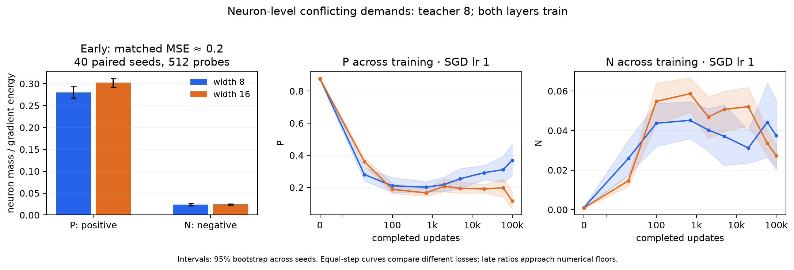
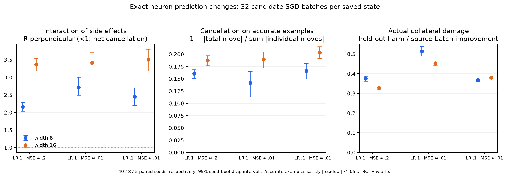

# Neuron interference: gradient mass and prediction changes

Extra width improves the early balance of positive and negative gradient
contributions, mainly through more positive contributions. There is also more
partial cancellation between neuron prediction changes. However, those changes
still reinforce on balance, including on already accurate predictions. The data
do not establish coordinated protective cancellation as the cause of the width
advantage.

## What was tested

The existing fixed teacher has eight ReLU neurons, Gaussian inputs in 20
dimensions, 8,192 training and 4,096 independent test examples. Student widths are
8 and 16; both layers and hidden biases train. Output normalization is 1/sqrt(m),
with zero initial output coefficients. Optimization uses half-MSE, while loss
matching and displayed training errors use ordinary MSE.

No training was repeated. The analysis uses 360 unique saved checkpoints:

- At early training MSE approximately 0.2: 40 paired seeds. Gradient masses use
  both the original 128 and the previously saved 512 fresh probe batches.
- Near MSE 0.01 with SGD lr 1: eight common eligible seeds. Matching uses the
  nearest saved state within 25% of the target; observed means are 0.009005 and
  0.008974 at widths 8 and 16. The omitted width-8 seeds did not have a saved state
  within that matching window; this comparison is conditional on eligibility.
- SGD lr 0.1: five paired seeds near MSE 0.01, attained means 0.009936 and 0.009913.
- Equal-step measurements: nine checkpoints through 100k updates for lr 1,
  eight through 20k for lr 0.1. Prediction-change diagnostics stop at 20k;
  later gradient ratios remain descriptive because losses may approach the
  float32 numerical floor.

At each state, we evaluate 32 candidate SGD updates from the first 32 saved probe
gradients, then measure their exact predictions on all 4,096 test examples. These
are independent possible next steps from a frozen state, not successive training
steps. We also shorten each direction to 1% of its length. This changes a local
diagnostic step, not the learning rate of the previous training trajectory.

The early prediction-change comparison is independently repeated with 32 fresh
training minibatches, sampled using seed 20261018. Their indices and gradients
are saved. Both checks give the same qualitative findings.

## 1. Positive and negative neuron gradient masses

For independent minibatches B and C, define

\[
q_r=g_{B,r}^{\top}g_{C,r},\qquad S=\mathbb E_B\|g_B\|^2,
\]
\[
P=\mathbb E_{B,C}\sum_r[q_r]_+/S,\qquad
N=\mathbb E_{B,C}\sum_r[-q_r]_+/S.
\]

Signs are taken before summing neurons. A negative q means conflicting data
demands through the same neuron's parameters; it is not an inner product between
different neurons. Normalization uses the whole network's gradient energy rather
than averaging per neuron. Off-diagonal probe pairs estimate the expectations;
P-N equals the normalized sample mean dot, not exactly the separately computed
full-gradient statistic A.

| Training stage | Seeds | P: width 8 → 16 | N: width 8 → 16 |
| --- | ---: | ---: | ---: |
| lr 1, MSE ≈ 0.2, 512 probes | 40 | 0.27987 → 0.30217 | 0.02382 → 0.02422 |
| lr 1, MSE ≈ 0.01, 128 probes | 8 | 0.21917 → 0.16592 | 0.04180 → 0.05874 |
| lr 0.1, MSE ≈ 0.01, 128 probes | 5 | 0.11148 → 0.10702 | 0.08291 → 0.09161 |

Early paired differences (width 16 minus width 8), with exploratory 95% bootstrap
intervals across seeds:

- P: **+0.02230 [0.00689, 0.03670]**.
- N: **+0.00041 [-0.00194, 0.00280]**, no clear decrease.
- Global negative mass, after summing neurons: **−0.00287
  [−0.00401, −0.00177]**.

Thus more local negative mass is offset by positive contributions at the early
stage. At MSE approximately 0.01, N instead increases: +0.01694
[0.00261, 0.03357] for lr 1 and +0.00870 [0.00280, 0.01459] for lr 0.1.
There is no consistent reduction of local gradient conflict throughout learning.

## 2. Do neurons protect predictions by cancelling disturbances?

Let u_r be neuron r's output contribution, including the width normalization.
For a candidate update, compute its exact finite change

\[
d_r(x)=u_r(x;\theta_r+\delta_r)-u_r(x;\theta_r),\qquad d=\sum_r d_r.
\]

Because the model sums neurons, d_r is also the exact change from updating only
neuron r. ReLU gate crossings and simultaneous changes of both layers are
included. We evaluate predictions in float64 using the saved parameters and
gradients; this avoids subtracting float32 losses to estimate small changes.

With residual e=f-y, the half-MSE changes are

\[
h_r(x)=e(x)d_r(x)+\tfrac12d_r(x)^2,\qquad
h(x)=e(x)d(x)+\tfrac12d(x)^2.
\]

The isolated h_r do not add to h: cross terms between prediction changes matter.
Summing their positive parts measures hypothetical one-neuron harm, not a unique
additive attribution of the joint loss change.

We report three complementary measurements:

1. **Partial cancellation:**
   C = 1 − E|sum_r d_r| / E sum_r |d_r|, averaging over candidate steps and examples
   within each training seed. Zero means all nonzero movements have the same sign
   on each example; one means they cancel completely.
2. **Net interaction energy:** R = E[d²] / E[sum_r d_r²]. R below one means the
   sum of cross-neuron terms is negative; R above one means reinforcement on
   balance. A related R_perpendicular projects every d_r orthogonally to the
   current test residual vector before forming the ratio. This separates
   movement along the desired correction from movement orthogonal to it.
   Both R variants are ratios of expectations within each seed, then averaged
   across seeds. Their magnitude depends on the number of contributing neurons.
3. **Actual harm and benefit:** H = E([h]_+) and G = E([-h]_+), where the positive
   part is applied pointwise BEFORE averaging. Both are divided by the mean
   source-minibatch loss reduction U. Every evaluated candidate reduces its
   source-batch loss. These ratios compare collateral effects per unit source
   improvement; they do not match the corrections exactly across widths.

For accurate predictions, we use the SAME test examples at both widths for each
paired seed: both pre-update absolute residuals must be at most 0.05. Early in
training there are on average 134 such examples per seed. A threshold of 0.1,
giving on average 437 examples, produces the same qualitative findings.

### Early results, lr 1, 40 paired seeds

| Measurement | Width 8 | Width 16 |
| --- | ---: | ---: |
| Partial cancellation C, all test examples | 15.74% | 18.65% |
| Partial cancellation C, accurate examples | 16.05% | 18.73% |
| R, accurate examples | 2.17 | 3.45 |
| R_perpendicular, all examples | 2.16 | 3.37 |
| Isolated harmful mass on examples the joint step does not harm, all examples | 11.38% | 14.25% |
| Same offset fraction, accurate examples | 4.93% | 7.75% |
| Actual harm H/U, all examples | 0.3751 | 0.3285 |
| Actual benefit G/U, all examples | 0.5876 | 0.5946 |
| Actual harm H/U, accurate examples | 0.0955 | 0.0665 |

The accurate-example cancellation difference is **+2.69 percentage points
[1.69, 3.70]**. There is reproducibly more partial cancellation at width 16.
The offset fraction weights hypothetical one-neuron harmful changes by their
size; it is not the fraction of neurons rescued, nor the percentage of total
network loss prevented.

However, R is well ABOVE one at both widths, also after removing the residual
direction. Cross-neuron effects reinforce movement on balance. Partial
cancellation and R > 1 can coexist: some contributions oppose each other while
the larger total of cross terms remains positive. The observations therefore
do not support a dominant net-cancellation mechanism on accurate examples.
Increasing C with width alone also does not demonstrate learned coordination;
more terms provide more opportunities for partial cancellation.

### Step-size sensitivity matters

When the SAME directions are shortened to 1%:

- All-example H/U becomes **0.2666 → 0.2583**, paired difference −0.00840
  [−0.01737, 0.00038], with no clear width advantage in harm.
- Accurate-example H/U becomes **0.02251 → 0.02258**, difference +0.00007
  [−0.00110, 0.00124], essentially unchanged across widths.
- All-example G/U becomes **0.5441 → 0.5643**, difference +0.02021
  [0.00704, 0.03342], consistent with more positive transfer.
- The increased partial cancellation at width 16 remains.

Thus the full-step reduction in collateral harm is sensitive to finite-step
effects. More partial cancellation does not by itself explain that reduction.
The fresh-source-batch check agrees: accurate-example H/U is 0.0984 → 0.0670 for
full steps and 0.02125 → 0.02124 for 1% steps.

Near MSE 0.01, the trained-lr-0.1 control also has more partial cancellation
(16.60% → 20.33% on accurate examples), but no clear reduction in overall H/U
(0.3699 → 0.3800; paired difference +0.0101 [−0.0038, 0.0268]). This control has
only five seeds and is not interchangeable with rescaling an lr-1 snapshot.

## Interpretation and limits

There is evidence for **stronger early positive gradient contributions and more
partial offsetting between neuron movements**. There is no evidence for a
universal reduction of negative local demands, nor for net protective
cancellation dominating neuron movement. Finite-step effects materially affect
the apparent collateral-harm benefit. These are observational diagnostics of
saved training states and local candidate steps; no neuron-update blocking or
training-continuation intervention was performed in this follow-up.

All uncertainty is conditional on one teacher, dataset and test sample.
Intervals resample paired training seeds, not the correlated minibatch pairs or
test examples. They are exploratory pointwise intervals without multiplicity
correction. Matching MSE does not match the residual pattern, teacher-feature
coverage or feature-learning dynamics; the common learning rate and output
normalization do not remove all width-dependent step scaling.

## Validation, retained evidence and reproduction

The original audit verified 360 source checkpoint hashes and independently checked full-model and isolated-neuron forwards. Maximum isolated prediction error was about 2.3e-15.

This report describes the complete original cohort and diagnostic draws. Its estimates were preserved before pruning. Compact versioned [tables](../tables/README.md) and [figures](../figures/README.md) remain; full computed tables are compressed under `runs/retained/aggregates/neurons/`. Representative raw states are a purposive subset and must not be used to re-estimate these cohort rates or intervals.

See [data retention](../data.md) for the manifest and [reproduction](../reproduction.md) for original producers under `scripts/studies/`. Full-cohort analyses require regenerating their original-layout inputs; notebooks have been removed. Historical full-cohort audits and original execution sources are retained in archive provenance.
