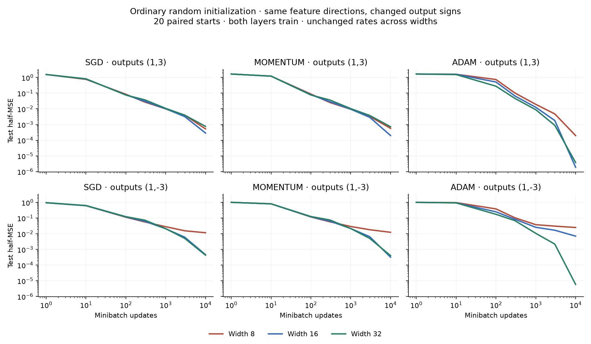
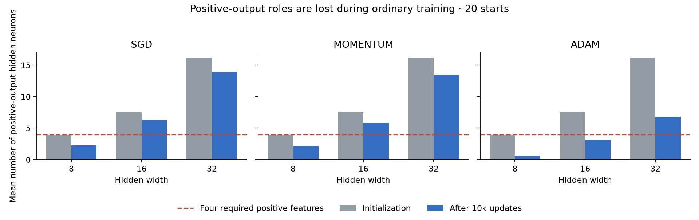
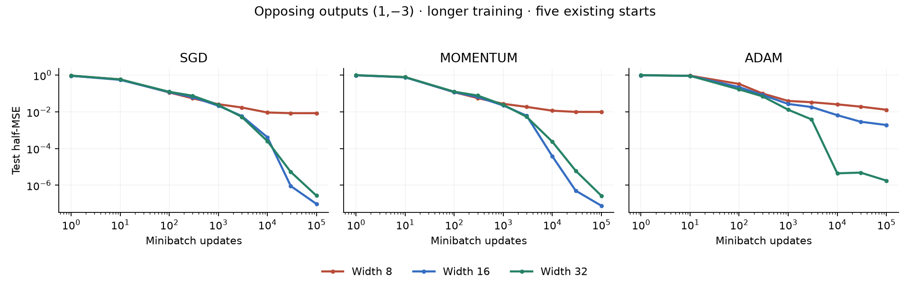
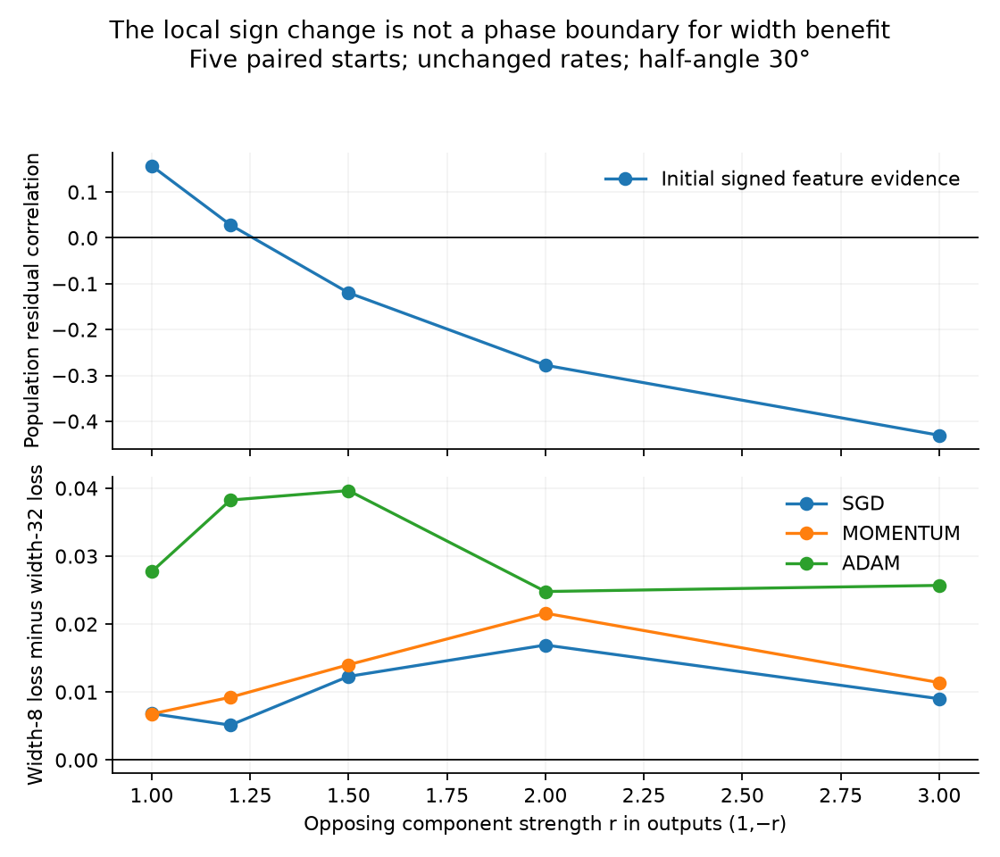

# Competition without splitting: stronger width effects, incomplete sign theory

18 October 2026. Follow-up to the request for ordinary training, a derived
conditional object, and a substantially stronger phenomenon than the previous
splitting study.

**The strongest new finding is an opposing-output regime with persistent
loss of required feature roles.** It uses ordinary random initialization,
trains both layers, and requires no copied neurons or teacher-informed
initialization. Width 32 beats width 8 in all 20 paired starts under each of
SGD, momentum and Adam in the main opposing-output comparison. Most narrow
failures persist at 100k updates in the five extended starts.

The proposed object is the [signed residual potential and its associated
feature measure](../theory/residual_growth.md), which govern growth and motion
of existing neurons. Two simpler sign predictions failed. The stronger
empirical regime and the exact local growth law therefore do not yet amount
to a proven explanation of the width advantage.

## 1. Design and chronology

The [first protocol](../theory/residual_growth_protocol.md) derived a
conditional Gram operator after fitting a shared representation, then tested
ordinary training on both sides of its predicted sign. The largest failures
occurred on the other side. The subsequent
[polarity protocol](../theory/polarity_followup_protocol.md) tested initial
signed feature evidence and an output-bias intervention. Replications,
nearby ratios, longer budgets, and balanced-sign controls are exploratory
follow-ups, not retrospectively preregistered predictions.

Four orthogonal planes in 20-dimensional Gaussian input space contain eight
unit teacher directions. Each pair is cosθ c±sinθ d, with coefficients (1,r).
Main half-angles are θ=30°,60° and r=1,3,−3; full pair angles are 2θ. Targets
are scaled to unit training variance without centering. Thus the sign-flip
comparison holds feature directions and pre-normalization coefficient
magnitudes fixed, but its target normalization factors and means differ.

All students are bias-free in the anchor experiment, with both incoming and
outgoing weights trained. Incoming weights are independent N(0,I/20); outgoing
parameters are independent N(0,.1²) in f=ΣaᵣReLU(wᵣᵀx)/√m. Widths are
8,16,32. The first incoming and outgoing coordinates are nested across widths;
initial functions are not exactly matched. Training/test sets each contain
4,096 examples; minibatches contain 128 examples. Paired seeds share batch
indices. The target is representable at width 8.

Base rates are .3 for SGD, .03 for momentum (.9), and .003 for Adam. The main
comparisons below use **unchanged rates across widths**. Additional arms use
the previous mapping: incoming rates multiplied by m/8 for SGD/momentum;
Adam's readout rate divided by √(m/8). These mappings are not a claim that
generic trajectories have identical effective learning rates.

The main sweep has five paired starts. The 30°/(1,±3) comparison extends to
20 starts; its first five duplicate the main sweep. Follow-ups change data,
train hidden biases, lower all rates by .3, vary the opposing strength, and
extend five existing starts to 100k updates. Output-bias experiments use an
ordinary learned scalar intercept initialized at zero or the training target
mean. Balanced-sign controls start with exactly m/2 outgoing coefficients of
each sign, with random assignments and unchanged magnitude distribution.

## 2. A larger, reproducible ordinary-training width effect

At half-angle 30° and opposing outputs (1,−3), mean **test half-MSE** after
10,000 updates over 20 paired starts is:

| Optimizer | Width 8 | Width 16 | Width 32 | Width-32 minus width-8, 95% interval |
| --- | ---: | ---: | ---: | --- |
| SGD | .011662 | .000467 | .000432 | −.011230 [−.014258,−.008634] |
| Momentum | .012458 | .000322 | .000406 | −.012051 [−.015076,−.009480] |
| Adam | .025243 | .007089 | .00000589 | −.025237 [−.029175,−.020929] |

Width 32 has lower held-out loss in **20/20 paired starts for each optimizer**.
Narrow median losses are .010264, .010418 and .033387, respectively, so this
is not an average driven by a single failed start. Intervals resample paired
training seeds and condition on this teacher and dataset.

In ordinary MSE, the narrow errors correspond to **2.33%, 2.49%, and 5.05% of
unit training target variance**, versus .086%, .081%, and .00118% at width 32.
This is a materially larger absolute effect than the previous 15° splitting
study's approximately .3% narrow MSE. It still does not explain all initial
loss, and should not be advertised as a universal large-error phenomenon.

Changing just the pre-normalization output pattern to (1,3) gives:

| Optimizer | Width 8 | Width 32 | Wide starts with lower loss |
| --- | ---: | ---: | ---: |
| SGD | .000532 | .000766 | 7/20 |
| Momentum | .000573 | .000727 | 9/20 |
| Adam | .000199 | .00000379 | 3/20 |

Adam's same-sign narrow median is essentially zero; its mean is driven by
a few failures. No same-sign width-32 contrast has a paired interval excluding
zero here. The **additional width benefit in the opposing-output task**, after
subtracting the same-sign width benefit within each seed, is .011464
[.008782,.014578] for SGD, .012205 [.009550,.015230] for momentum and
.025042 [.020725,.029147] for Adam, in half-MSE units.



Means over 20 seeds; sparse recorded checkpoints are connected for readability.
This controls a task property, not a decomposition of the final width benefit
into causal mechanisms.

## 3. The narrow model loses positive-output capacity during learning

In the opposing-output teacher there are four distinct positive kinks and
four distinct negative kinks. Exact population representation needs at least
four nonconstant student neurons of each output sign; the
[derivation](../theory/residual_growth.md#3-why-signed-role-availability-can-make-width-consequential)
explains why. A count alone is not sufficient for good fitting.

All three optimizers share the same 20 initializations. Width 8 begins with
3.9 positive-output neurons on average; width 32 begins with 16.2. At 10k:

| Optimizer | Mean positive units, width 8 | Narrow starts with fewer than 4 | Mean positive units, width 32 | Wide starts with fewer than 4 |
| --- | ---: | ---: | ---: | ---: |
| SGD | 2.25 | 18/20 | 13.90 | 0/20 |
| Momentum | 2.20 | 18/20 | 13.45 | 0/20 |
| Adam | .60 | 20/20 | 6.85 | 0/20 |

Counts use the exact output sign and nonzero incoming norm, excluding any
output intercept. The positive polarity is weaker in coefficient magnitude,
not in the number of required teacher features: both signs require four.



This is consistent with a signed-role bottleneck. It is more specific than
“the wider network got a lower loss,” but still does not prove that role
loss is the sole cause or that preventing it is sufficient.

The balanced-sign control rules out a simple initial-count explanation.
Starting width 8 with exactly four signs of each kind, the no-output-bias
30° experiment still ends with fewer than four positive units in **9/10 SGD,
9/10 momentum and 10/10 Adam starts**. Mean losses remain .01375, .01623
and .01818. Training itself changes the available roles. The teacher-informed
feature allocation and perturbations of the splitting study are absent.

## 4. Longer training and sensitivity checks

After **100,000 updates**, the five extended starts have mean test half-MSE:

| Optimizer | Width 8 | Width 32 |
| --- | ---: | ---: |
| SGD | .008502 | 2.71e−7 |
| Momentum | .009933 | 2.68e−7 |
| Adam | .013051 | 1.80e−6 |

Four of five narrow SGD/momentum starts and all five narrow Adam starts still
have fewer than four positive units. This contrasts with the earlier
specialization study, where the narrow models caught up by this budget.
It demonstrates persistence to 100k, not an asymptotic trapping theorem.



A second rotated teacher/data draw preserves the opposing-output contrast:
narrow SGD/momentum/Adam means are .01221/.01111/.02140, versus roughly
.00070/.00070/.000003 at width 32 with unchanged rates. This is another draw
from the same geometric family, not a different real-world task.

Training hidden biases also preserves a substantial gap: .01207/.01302/.02628
at width 8 versus .000361/.000492/.001897 at width 32 under unchanged rates.
The mapped-rate width-32 Adam result is much smaller, showing that rates still
matter. Lowering all rates by .3 retains the ordering but leaves wider models
less converged at 10k; that check spans less effective training time.

Increasing outgoing initialization standard deviation from .1 to .5 reduces
the opposing-output narrow losses to .00459/.00530/.00849 for
SGD/momentum/Adam, versus .000337/.000432/.000003 at width 32. The width
advantage survives, but it is smaller. Same-sign narrow Adam now has mean
loss .00503, so the output-sign contrast becomes less clean. The small initial
readout scale is part of the strongest observed regime, not an irrelevant
implementation detail.

Widths are not strictly ordered in every setting. SGD/momentum at fixed rates
can refine more slowly at width 32 than at width 16, and mapped rates can
substantially change their comparison. The result is a robust advantage over
the minimally representable width in this family, not monotone improvement
with every extra neuron or optimal hyperparameter tuning for each width.

## 5. Which derived sign predictions failed?

**The fitted-shared-span sign failed as a width predictor.** At 30°, the
conditional-Gram minimum signed evidence is −.02993 for outputs (1,3), but
+.11182 for (1,−3). The negative-sign task is much easier for narrow models.
That operator correctly describes residual signals after fitting a particular
span; the assumption that ordinary trajectories are governed by that span
was not established. We retain the operator as a conditional calculation,
not as an explanation demonstrated by these results.

**The initial-evidence sign is not a phase boundary either.** The raw signed
teacher-feature evidence changes sign near opposing strength r=1.25 at 30°.
Yet substantial width benefits already occur at r=1 and r=1.2, and the benefit
does not grow monotonically with how negative the sign becomes.



These are five-seed exploratory comparisons with outputs (1,−r). Negative
evidence is sufficient for the specified local wrong-polarity force, but is
neither necessary nor an established sufficient condition for a large final
width advantage.

**Removing the mean force does not give a general rescue.** At 30°, initializing
a learned output bias to the training target mean reduces narrow SGD/momentum
means from .00927/.01163 to .00456/.00463 in the five-seed comparison. At 60°,
however, it worsens them from .00538/.00613 to .01321/.01290. Adam is also mixed.
The geometric prediction about the centered local feature correlation remains
correct; the proposed global rescue does not follow. Balanced-sign starts
do not fix this: several runs keep enough positive units and still fit poorly.

Finally, direct peer-induced reversals of amplitude growth are not themselves
a useful success score. At 10k in the five-seed 30° opposing-output Adam
comparison, their mean frequency is .50 at width 8 and .78125 at width 32,
even though the wide model fits much better. Residual-driven shrinkage can be
appropriate near a solution. We do not substitute this count for a theory.

## 6. Assessment

This study meets two of the requested improvements: ordinary training with
no splitting intervention, and a much stronger, persistent regime under
controlled changes in feature-output signs. The residual potential gives a
first-principles growth law and an explicit local suppression condition.
The observed loss of required signed roles is a useful structural constraint
on explanations of the narrow failures.

The remaining gap is substantive: there is no validated scalar sign criterion
here that predicts the strength of the final width benefit. The evidence
supports pursuing competition between signed feature demands and the resulting
allocation of neuron roles. It does not yet identify harmful peer updates as
the cause. A theory should predict the joint evolution of the residual field
and available signed directions, and explain the failed bias/threshold tests,
rather than only redescribe the successful width comparison.

## Evidence and reproduction

The [table guide](../tables/residual_growth/README.md) links every seed curve,
endpoint, paired interval, actual feature-potential probe, final polarity
count, executed argument list and source audit. All non-pilot settings are
retained, including reverse outcomes. Old producer source is archived when
an initialization-control option was added; the audit verifies the correct
executed version rather than silently accepting a changed file.

```sh
.venv/bin/python scripts/studies/run_residual_growth.py
.venv/bin/python scripts/studies/run_residual_growth.py --degrees 30 --ratios -1 -1.2 -1.5 -2 --collection sign_scan
.venv/bin/python scripts/studies/run_residual_growth.py --degrees 30 --ratios -3 3 --seeds 20 --collection replication20
.venv/bin/python scripts/studies/run_residual_growth.py --degrees 30 --ratios -3 --steps 100000 --collection longer
.venv/bin/python scripts/studies/run_residual_growth.py --degrees 30 --ratios -3 3 --data-seed 9037 --collection data2
.venv/bin/python scripts/studies/run_residual_growth.py --degrees 30 --ratios -3 3 --train-bias --collection hidden_bias
.venv/bin/python scripts/studies/run_residual_growth.py --degrees 30 --ratios -3 --rate-factor .3 --collection low_rate
.venv/bin/python scripts/studies/run_residual_growth.py --degrees 30 --ratios -3 3 --out-init .5 --collection larger_readout
.venv/bin/python scripts/studies/run_polarity.py
.venv/bin/python scripts/studies/run_polarity.py --balanced-signs --seeds 10 --collection balanced_signs
MPLCONFIGDIR=/private/tmp/neural-competition-mpl .venv/bin/python scripts/studies/analyze_residual_growth.py
.venv/bin/pytest -q
```

The producer skips a completed tag; use a new collection for changed arguments.
Intervals use 4,000 paired-seed bootstrap draws, seed 742, and no multiplicity
correction. Replication, long-budget and no-bias control rows overlap; they
must not be pooled as independent runs. The `.pt` files retain all final
parameters/data locally under git-ignored `runs/`. Versioned tables retain
all recorded curves and provenance. The audit reconstructs final held-out
loss from every saved parameter file.

The output intercept is represented internally as a constant feature with
frozen incoming parameters and the corresponding readout rate conversion.
This gives an ordinary scalar SGD/momentum bias step. Adam's fixed epsilon
becomes √m·1e−8 in physical bias coordinates; the tests check this exact
convention rather than claiming perfect default-Adam equivalence near zero.

Validation: all 83 repository tests pass, including six new cases covering
the Gaussian kernel, conditional sign reversal, exact signed-amplitude
gradient law, and scalar-intercept optimizer convention. Ruff passes.
All 72 experiment manifests pass source-version checks; reconstructed final
held-out losses agree with the recorded values within 1.1e−16. Six manifests
use the preserved earlier polarity-producer source rather than its later
balanced-sign-control version.
