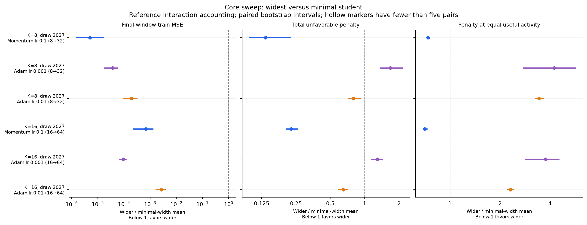
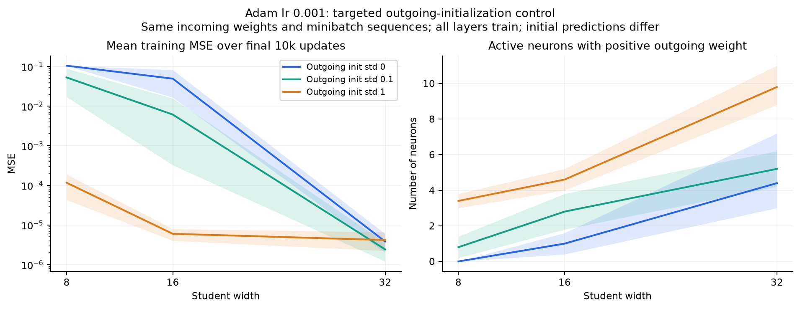

# Robustness of width benefits and neuron-update interactions

Width improves fitting in the main sweep, but a smaller accumulated pairwise
interaction penalty is not a universal explanation. Momentum retains the
earlier pattern. Low-learning-rate Adam supplies clear counterexamples: wider
students fit much better while paying MORE pairwise penalty, even after
accounting for favorable interaction credits. A targeted initialization control
also shows that much of the severe narrow-Adam failure depends on starting all
outgoing coefficients at zero.

The [literature-guided Adam note](../theory/adam_initialization_and_features.md)
develops explanations and predictions from these results, including a small
read-only check of feature coverage and optimal readouts in retained cases.
The [pair-cost note](../theory/pair_cost_and_competition.md) derives why an
increase in C_plus need not imply a worse useful correction.

## Protocol and scope

The planned sweep has 175 runs. A post-hoc, targeted initialization follow-up
adds 30, for **205 runs and 20.5 million actual updates**. Every update is
measured on its own source batch and one fixed 256-example training reference.

- Core: teachers K=8 and K=16, seed 2027; students K, K+2, 2K and 4K.
- Optimizers: momentum lr 0.1, beta 0.9; Adam lr 0.001 and 0.01,
  betas (0.9, 0.999), epsilon 1e-8. No weight decay, decay schedule or AMSGrad.
- Five paired initialization seeds 0–4; 100,000 updates each; batch size 64.
- Lower-rate control: momentum lr 0.03, teacher 8, students 8/16/32.
- Teacher-realization control: seed 2037 at K=8 and K=16, students K/2K,
  momentum 0.1 and Adam 0.001. No pooling of different teachers as if they
  were additional initialization seeds.
- Initialization follow-up: teacher 8, seed 2027, Adam 0.001, students 8/16/32;
  outgoing weights drawn from N(0, 0.1²) or N(0, 1). Incoming weights and
  minibatch streams match the zero-output setup. Initial predictions differ.

The data remain noiseless teacher/student regression with Gaussian inputs in
20 dimensions, 8,192 training and 4,096 test examples, input seed 2026.
Outputs are divided by sqrt(student width), and BOTH layers and hidden biases
train. Teachers have zero hidden biases. Each teacher target is scaled to unit
training standard deviation, without subtracting its mean:

| Teacher width | Teacher seed | Target mean | Positive targets |
| --- | --- | --- | --- |
| 8 | 2027 | -0.662 | 25.5% |
| 8 | 2037 | -1.070 | 15.0% |
| 16 | 2027 | -1.300 | 6.6% |
| 16 | 2037 | -0.581 | 30.7% |

The reference subset is shared across runs (draw seed 20261020). This sweep
uses 256 reference examples rather than the previous sweep's 512; its raw
reference magnitudes should not be read as continuations of those earlier
curves. Source-batch accounting and full train/test losses are also retained.
Numerical batching changes floating-point operation order, so individual
basins need not be bitwise copies of older sequential runs.

## Measures

For each actual rounded neuron update, evaluate its exact prediction change
d_r. For residual e=f-y and half-MSE,

\[
A_r=\mathbb E[e d_r+\tfrac12d_r^2],\qquad J_{rs}=\mathbb E[d_rd_s].
\]

J is the four-loss interaction L_rs-L_r-L_s+L_0. Every proposed neuron update
is held fixed when combining blocks; gradients or optimizer states are not
recomputed after another neuron's update. Define

\[
G=\sum_r[-A_r]_+,\quad H=\sum_r[A_r]_+,\quad
C_+=\sum_{r<s}[J_{rs}]_+,\quad C_-=\sum_{r<s}[-J_{rs}]_+.
\]

The exact update accounting is Delta L = H-G+C_+-C_-. Positive J is an
unfavorable interaction relative to the sum of standalone effects. It includes
ordinary diminishing returns, even when the combined update is useful.
C_- is a favorable interaction credit relative to those separate effects;
it is not automatically beneficial prediction reinforcement in another sense.

The primary descriptive outcome is accumulated C_+ over the common 100k-update
budget, with accumulated net interaction C_+-C_- alongside it. We also retain
S_+=sum C_+/sum G, S_net, standalone harm H and retained gain. On the fixed
reference the loss changes telescope exactly. Source losses use changing
minibatches and do not telescope to one objective.

Controls compare at equal cumulative standalone helpful gains U=sum G and at
matched reference loss. Each equal-U curve uses the range reached by every
run in that condition, so all five seeds at every student width remain.
Equal U is equal standalone activity, not equal actual learning progress.

The fixed loss-window scalar averages 12 log-spaced bin ratios between MSE
0.2 and 0.02, weighting bins equally within each seed. It requires complete
coverage at both compared widths; many narrow Adam models never reach the
lower part of that range. Missing comparisons are NOT zero penalty. Bins can
also be crossed between updates. Early 0.5-to-0.1 summaries, all loss-bin data
and coverage counts are saved. The detailed matched-loss curves display only
bins visited at all widths by all five seeds.

The broad unfavorable-pair frequency is also recorded, as is the stricter
ordered event: both neurons help alone, but one becomes harmful after the
other update. Frequencies condition on eligible helpful pairs; C_+ magnitudes
include every unordered pair once. Sign tests use tolerance 1e-10 times the
evaluation set's half-MSE. Continuous magnitudes retain all values.

The later [matched-loss strict-event analysis](strict_matched_loss.md) recovers
strict-harm magnitudes through verified replays of 90 original teacher-8 runs.
It finds lower per-pair frequency at matched reference loss even for default
Adam, despite the whole-budget reversal. This is a different comparison and
metric from accumulated C_plus; total events per update need not decrease.

Full train and test MSE are evaluated every 1,000 updates. The main fitting
outcome averages the last ten evaluations (updates 91k–100k), first within
each seed. Best observed evaluation loss is saved separately. This prevents a
single final Adam fluctuation from determining the reported outcome.

Tables use 4,000 paired-seed bootstrap resamples, seed 741. Curves use 800.
Intervals are exploratory, pointwise and unadjusted for multiple comparisons,
conditional on these teacher functions and this input dataset. Comparisons fix
update count, not wall-clock cost. The parameterization and shared scalar
learning rates do not equate hidden-feature learning strength across widths. Five seeds
give limited precision; teacher replicas are reported separately.

## Main and control results

The table compares the widest versus the minimal student in each group.
Ratios are wider/minimal means, with paired bootstrap intervals. Below one
means smaller loss or penalty. The full width sweep is in the retained tables and
[robustness_summary.csv](../tables/robustness_summary.csv).

| K | Teacher seed | Optimizer / control | Widths | Late MSE: minimal → wider | Raw penalty ratio [95% CI] | Equal-U penalty ratio [95% CI] |
| --- | --- | --- | --- | --- | --- | --- |
| 8 | 2027 | Momentum 0.1 | 8 → 32 | 0.0025 → 1.24e-08 | 0.135 [0.098, 0.222], n=5 | 0.736 [0.717, 0.754], n=5 |
| 8 | 2027 | Adam 0.001 | 8 → 32 | 0.105 → 3.83e-06 | 1.676 [1.389, 2.126], n=5 | 4.243 [2.764, 5.691], n=5 |
| 8 | 2027 | Adam 0.01 | 8 → 32 | 0.105 → 2.01e-05 | 0.798 [0.723, 0.910], n=5 | 3.434 [3.267, 3.657], n=5 |
| 16 | 2027 | Momentum 0.1 | 16 → 64 | 0.00793 → 5.43e-06 | 0.227 [0.207, 0.258], n=5 | 0.705 [0.689, 0.724], n=5 |
| 16 | 2027 | Adam 0.001 | 16 → 64 | 0.0314 → 2.93e-06 | 1.290 [1.140, 1.436], n=5 | 3.765 [2.834, 4.519], n=5 |
| 16 | 2027 | Adam 0.01 | 16 → 64 | 0.0321 → 8.62e-05 | 0.648 [0.586, 0.707], n=5 | 2.312 [2.225, 2.393], n=5 |
| 8 | 2027 | Momentum 0.03 | 8 → 32 | 0.00334 → 1.44e-05 | 0.295 [0.247, 0.401], n=5 | 0.798 [0.745, 0.844], n=5 |
| 8 | 2037 | Momentum 0.1 | 8 → 16 | 0.00609 → 3.95e-06 | 0.282 [0.223, 0.432], n=5 | 0.910 [0.879, 0.954], n=5 |
| 8 | 2037 | Adam 0.001 | 8 → 16 | 0.0341 → 0.0165 | 1.509 [0.921, 2.195], n=5 | 1.896 [1.401, 2.650], n=5 |
| 16 | 2037 | Momentum 0.1 | 16 → 32 | 0.00173 → 7.87e-08 | 0.319 [0.296, 0.358], n=5 | 0.903 [0.856, 0.965], n=5 |
| 16 | 2037 | Adam 0.001 | 16 → 32 | 0.113 → 0.0232 | 2.016 [1.651, 2.502], n=5 | 2.123 [1.765, 2.639], n=5 |
| 8 | 2027 | Adam 0.001, output init 0.1 | 8 → 32 | 0.0529 → 2.43e-06 | 1.191 [1.063, 1.389], n=5 | 4.727 [1.297, 8.437], n=5 |
| 8 | 2027 | Adam 0.001, output init 1 | 8 → 32 | 0.000117 → 4.18e-06 | 1.567 [1.380, 1.783], n=5 | 7.955 [1.636, 19.796], n=5 |

Momentum's raw penalty reduction repeats for both teacher sizes, at the lower
learning rate and for the second teacher realization. Its equal-U comparisons
also favor greater width. The teacher-8 mild increase 8→10 helps some seeds,
but 16→18 under the larger teacher has much less impact; doubling or
quadrupling width provides a much stronger optimization benefit here.

Adam lr 0.001 reverses the pair-penalty pattern. In the original teacher-8
case, the raw reference penalty rises from 0.03450 to 0.05784 (about 68%),
while late training MSE falls from 0.10474 to 3.83e-6. With teacher 16, the
penalty rises from 0.05103 to 0.06581 (about 29%) while MSE falls from 0.03144
to 2.93e-6. Net interaction after favorable credits has the same reversal.
The second teacher-16 realization supplies another example: width 16→32
roughly doubles accumulated penalty while reducing fitting error substantially.

Adam lr 0.01 has a lower raw penalty at 4K, but MORE penalty at equal U.
Thus the fixed-budget total and activity-conditioned comparisons genuinely
answer different questions. For Adam, the fixed 0.2-to-0.02 loss-window
comparison often has no complete narrow/wide pairs; the missing points must
not be interpreted as evidence in either direction.

Learning rate strongly changes the penalty. For example, at teacher 8 and
student width 32, reducing momentum lr 0.1→0.03 reduces raw penalty
0.04113→0.01277, but worsens late MSE 1.24e-8→1.44e-5 at this budget.
The largest student is not always the most accurate at a fixed update budget; width 16 is
already very effective for the eight-neuron teacher. No asymptotic optimal
width is inferred from a fixed 100k budget.

## Why Adam can fit better with MORE pairwise penalty

The penalty is one term of the update budget. For teacher 8 and Adam 0.001,
the mean reference accounting over the full trajectory is:

| Width | G | H | C+ | C− | Final reference loss |
| --- | --- | --- | --- | --- | --- |
| 8 | 1.348811 | 0.656744 | 0.034504 | 0.000423 | 0.046718 |
| 32 | 0.942251 | 0.180301 | 0.057844 | 0.000596 | 0.000001 |

All values are half-MSE units. Both widths start at reference loss 0.704704;
the unrounded components satisfy final minus initial = H-G+C_+-C_-.
Width 32 pays a larger pairwise penalty, but its accumulated standalone harm
H is far smaller. The net standalone gains G-H more than compensate for the
extra interaction cost. This is exact descriptive accounting, not a causal
decomposition of why the optimization trajectories differ. Reduced pairwise
penalty is therefore not necessary for a width benefit in these experiments.

## Targeted Adam initialization check

All five zero-output width-8 Adam-0.001 models finish with every outgoing
coefficient nonpositive. Their ReLU features are not simply all inactive:
the observed issue is outgoing-weight polarity. Such a network satisfies
f(x)≤0, so it cannot fit positive teacher targets. On this training data its
ordinary MSE is bounded below by E[(y_+)²]=0.06570. Its actual MSE is higher,
so this bound does not explain all remaining error.

After observing that failure, the follow-up varies only the outgoing-weight
initialization distribution. The narrow student's result is:

| Outgoing init std | Mean late train MSE | Mean late test MSE | All-nonpositive models | Mean positive active neurons |
| --- | --- | --- | --- | --- |
| 0 | 0.104738 | 0.109627 | 5/5 | 0.0 |
| 0.1 | 0.0528703 | 0.0552299 | 2/5 | 0.8 |
| 1 | 0.000116834 | 0.000119937 | 0/5 | 3.4 |

Standard random outgoing initialization improves mean narrow MSE by roughly
900 times. Width still helps, but much of the severe zero-initialized Adam
failure is setup dependent. The control changes initial predictions and the
initial hidden-layer gradient as well as coefficient signs; it does not
isolate polarity as the sole causal path. With exactly zero outgoing weights,
the incoming-weight gradient is initially zero by the model's derivative.

## Interpretation

The [objective-scale magnitude audit](effect_magnitude.md) quantifies how
large the interaction and standalone terms are relative to observed progress,
and tests early metrics against later objective gains. A favorable normalized
pattern and a useful general predictor are separate claims.

The robust result is that additional units improve fitting and reliability in
this grid when the increase is large enough. The stronger claim that they do
so by reducing this particular pairwise nonadditivity penalty is optimizer
dependent. Momentum supports it descriptively; Adam supplies counterexamples,
including after accounting for favorable interaction credits.

Keep C_+ as an exact component of the observed update budget, rather than a
universal score of optimization quality. Useful shared corrections can incur
positive J through diminishing returns. Feature allocation, initialization,
individual collateral harm and the optimizer's actual direction also matter.
The output-polarity observation suggests a feature-coverage failure worth
distinguishing from direct pairwise competition. No causal neuron-removal
intervention was performed here, and these results do not refute every other
definition of interference, such as cross-batch gradient transfer.

## Validation, retained evidence and reproduction

The original full-cohort audit checked 1,230 state/views, 1,230 direct pairs and 123 restored optimizers. Maximum NumPy error was 2.78e-17; direct four-loss error 2.21e-17; optimizer error zero; telescoping error 3.48e-13. This covers all 205 runs.

This report describes the complete original cohort and diagnostic draws. Its estimates were preserved before pruning. Compact versioned [tables](../tables/README.md) and [figures](../figures/README.md) remain; full computed tables are compressed under `runs/retained/aggregates/robustness/`. Representative raw states are a purposive subset and must not be used to re-estimate these cohort rates or intervals.

See [data retention](../data.md) for the manifest and [reproduction](../reproduction.md) for original producers under `scripts/studies/`. Full-cohort analyses require regenerating their original-layout inputs; notebooks have been removed. Historical full-cohort audits and original execution sources are retained in archive provenance.
