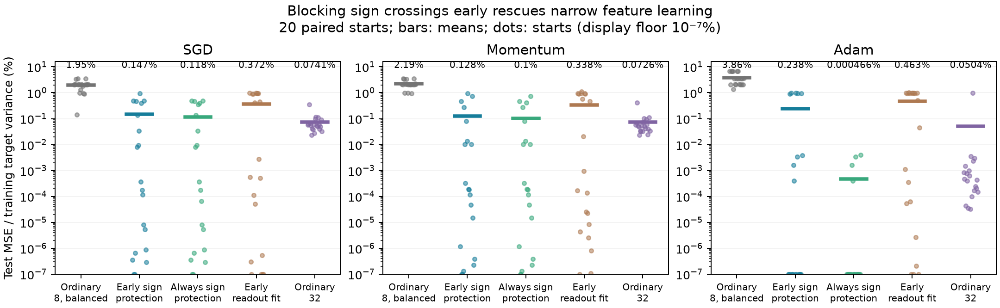
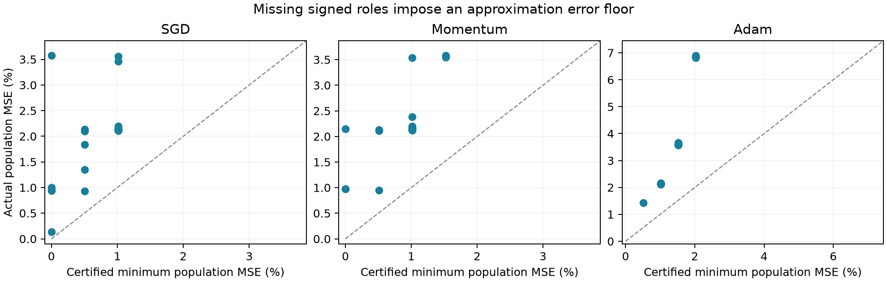

# Preventing sign conversion rescues narrow feature learning

21 October 2026. **A more targeted intervention than readout refitting gives a
large rescue, and a Gaussian spectral bound turns missing signed roles into
unavoidable approximation error.** However, crossing-level accounting does not
support direct peer-induced gradient reversal as the explanation. The strongest
current direction is temporary suppression, sign conversion and later recruitment
of complementary roles, with a still-unresolved prediction of the release time.

This follows Sections 3–4 of `neural_competition.pdf` and the
[readout-profile study](feature_profile.md). The new
[protocol](../theory/sign_survival_protocol.md) was recorded before the main
comparison; subsequent controls were selected after seeing its result.

## Main intervention

Same bias-free eight-feature Gaussian teacher, pair half-angle 30 degrees
(full angle 60 degrees), coefficients (1,-3), data seed 9027, unit training
target variance, 4096 training/test examples, minibatches of 128 and 10k updates.
SGD/momentum/Adam rates are .3/.03/.003, unchanged from the previous study.
New paired seeds 200–219. Both layers train.

At width 8, the primary baseline starts with exactly four positive and four
negative readouts, assigned randomly to ordinary incoming weights. Coefficient
magnitudes retain their original Gaussian distribution. All intervention arms
share that initialization and minibatch stream. The sign-protected update is

    proposed a <- optimizer's ordinary proposal
    a <- s max(s a, 0), where s is the initial random sign assignment.

Only proposals that would cross zero change. There is no positive floor, readout
refitting, moment reset or direct alteration of hidden updates. Zero coefficients
are genuinely inactive; they are not counted as surviving positive roles.
Early protection lasts for the first 1000 updates and then stops. Permanent
protection lasts throughout training. Late protection uses the signs actually
present at step 9000, to avoid an abrupt restoration of already-lost roles.

Four signs of each kind make the constrained model capable of representing this
teacher. This uses knowledge of the required sign counts, though no teacher
directions or neuron-to-teacher assignments. It is a mechanism intervention,
not yet a teacher-free training prescription. Random-sign ordinary widths 8
and 32 are retained as separate anchors.

**Mean held-out MSE as a percentage of training target variance (20 starts):**

| Optimizer | Ordinary balanced 8 | Early sign protection | Always protected | Early readout fit | Ordinary random 32 |
| --- | ---: | ---: | ---: | ---: | ---: |
| SGD | 1.950% | 0.147% | 0.118% | 0.372% | 0.0741% |
| Momentum | 2.189% | 0.128% | 0.100% | 0.338% | 0.0726% |
| Adam | 3.865% | 0.238% | 0.000466% | 0.463% | 0.0504% |

Early protection improves **20/20 paired starts for each optimizer**. Absolute
improvements and paired 95% bootstrap intervals, in percentage points, are
SGD 1.802 [1.471,2.142], momentum 2.061 [1.741,2.393], and Adam 3.627
[2.817,4.458]. It closes 96.1%, 97.4% and 95.1% of the balanced-narrow versus
random-wide mean gap. These are intervention gap closures, not uniquely mediated
fractions of width's benefit. The readout-fit comparator retains all optimizer
moments and operates every ten steps during the first 1000.

Random-sign ordinary8 errors are 1.831%, 2.067%, 4.749%; sign balancing alone
does not explain the rescue. Terminal readout fits barely change the ordinary
balanced losses: 1.942%, 2.184%, 3.849%. Early protection therefore changes the
features ultimately learned, rather than merely improving final coefficients.

## The dynamics: dormant roles can return

Protection does **not** keep all four positive units active throughout training.
Under SGD, at step 10, ordinary balanced8 averages 0.10 positive units, while
the protected arm has 0.05 positive and 3.95 zero units. By step 1000 the
protected arm has 3.95 positive units, versus 1.75 ordinary; at 10k it has
4.00 versus 2.65. For momentum the final counts are 3.95 versus 2.30;
for Adam, 3.75 versus 1.15.

This is consistent with allowing a temporarily disfavored role to wait at zero
instead of converting to the opposite sign and following its subsequent feature
dynamics. At zero readout the current hidden gradient vanishes; momentum/Adam
may still move hidden weights through their retained history. Protection changes
the path and eventual recruitment, not just an endpoint sign count. Some early
protected Adam runs still lose roles after protection stops, explaining its
failure tail and the advantage of permanent protection.

## Controls and limits

**Generic readout slowing is insufficient in the tested control.** An additional
paired arm shortens its ordinary readout step by the coefficient-space norm of
the protected arm's correction at that step, capped at its full proposed step.
It keeps optimizer history and permits sign crossings. Its errors are 1.859%,
2.230%, 3.037%, versus early protection's 0.147%, 0.128%, 0.238%. Protection
wins all 20 pairs per optimizer; improvement intervals are [1.467,1.956],
[1.750,2.448], [2.078,3.567] percentage points. The damping arm receives
99.37%, 98.72%, 99.30% of the respective cumulative coefficient-norm budgets.
It is an approximate displacement control: prediction-space movement, direction
and subsequent trajectories are not matched. It depends on a reference run.

**Late protection does essentially nothing.** Endpoint losses remain 1.950%,
2.189%, 3.864%. Ordinary and late arms have exactly identical parameters and
optimizer states up to step 9000. However, very few proposals cross zero late:
this is not equal intervention work, nor a test that restoring lost roles late
would necessarily fail.

**Robustness is qualified.** The following follow-ups use the first ten main
seeds and were chosen after the main result. Values are ordinary balanced8 →
early-protected MSE percentages:

| Setting | SGD | Momentum | Adam |
| --- | ---: | ---: | ---: |
| Pair half-angle 60° | 1.029 → 0.242 | 1.141 → 0.231 | 1.917 → 0.217 |
| Second dataset, seed 9037 | 2.001 → 0.0961 | 2.072 → 0.178 | 4.362 → 0.160 |
| All rates ×0.3 | 2.534 → 0.778 | 2.648 → 0.775 | 4.755 → 3.018 |
| Balanced teacher coefficients (1,-1) | 1.672 → 0.696 | 2.050 → 8.17e-8 | 3.534 → 0.00560 |

The angle and second-dataset improvements have paired intervals excluding zero
for all optimizers. The balanced-target SGD interval includes zero; its narrow
losses have a failure tail and only 5/10 starts improve. The momentum interval
also includes zero at numerical precision, with only 4/10 improving starts;
several ordinary starts already solve that setting. The rule is not uniformly
beneficial to every start.

The low-rate Adam result exposes a timing failure: 1000 protected updates close
only 37.3% of the width gap, whereas **permanent protection reaches 0.0571%**.
An update-count cutoff does not transfer across rates. Protection duration and
the time needed for complementary roles to become favorable are a concrete next
prediction problem. Keeping early protection longer has not yet been separately
tested here, so permanent success is evidence consistent with that interpretation.

At 100k updates on the preselected first five starts, ordinary balanced losses
are 1.418%, 1.381%, 3.351%; early protection gives numerical zero for SGD and
momentum, and 0.377% for Adam. Permanent protection gives numerical zero for
SGD/momentum and 0.000579% for Adam. Early interventions still stop at 1000;
the permanent arm remains protected. These are longer reruns of the same seeds,
not five additional independent starts. No divergence occurred in any cohort.

## A new objective-unit certificate

For Gaussian inputs, define the target's quadratic Hermite moment

\[
T_y=\mathbb E[y(xx^\top-I)].
\]

Every positive ReLU unit contributes a positive-semidefinite rank-one matrix
to T_f, and every negative unit contributes a negative-semidefinite one.
If k+ positive and k− negative units remain active, the
[spectral derivation](../theory/signed_capacity.md) gives

\[
\mathbb E[(y-f)^2]\ge\frac12\sum_{i>k_+}(\lambda_i^+)^2
                        +\frac12\sum_{i>k_-}(\lambda_i^-)^2,
\]

where λ⁺ and λ⁻ are the decreasing positive and absolute negative eigenvalues
of T_y. This strengthens the earlier exact-representation quota: missing signs
force a nonzero **approximation error**, regardless of other weights and directions.
Output intercepts and linear skips cannot remove this quadratic obstruction.

In the main target each missing positive unit forces at least **0.5075 percentage
points of population MSE**. Using the actual ordinary balanced endpoints:

| Optimizer | Actual mean population MSE | Mean certified floor | Floor / actual |
| --- | ---: | ---: | ---: |
| SGD | 2.011% | 0.685% | 34.1% |
| Momentum | 2.263% | 0.863% | 38.1% |
| Adam | 3.961% | 1.446% | 36.5% |

Population errors are computed analytically with the Gaussian ReLU kernel,
not estimated from the test sample. The second Hermite component accounts for
roughly 62–64% of these mean errors; the coarser sign-count floor certifies less.
The floor/actual ratio is **not** a causal fraction explained by competition.
All available signs can be present while directions are still inadequate.

The exact flow coordinate z=asinh(a/√(||w||²−a²)), when the denominator is real
and invariant, satisfies ż=H_f(u)/√m. Thus cumulative residual exposure is a
natural crossing object. This remains an identity with explicit flow assumptions;
using its realized future integral would not constitute prediction.

## What this says about competition

A post-result replay measured the actual minibatch field at ordinary
positive-to-negative crossings in the first 1000 steps. It compares the full
field with the field obtained by subtracting all other neurons' predictions,
while keeping the current neuron unchanged.

| Optimizer | Positive→negative crossings | Adverse even without peers | Peer-induced favorable→adverse reversals | Peers reduce adverse force |
| --- | ---: | ---: | ---: | ---: |
| SGD | 94 | 94 | 0 | 82 |
| Momentum | 80 | 80 | 0 | 71 |
| Adam | 79 | 79 | 0 | 74 |

These are event counts within the same 20 training replicates, not independent
samples. At every recorded crossing the current gradient supported conversion;
none needed optimizer inertia to overcome a favorable current gradient. The
source-batch accounting does not exclude later peer interference or other kinds
of interaction. It does reject using these crossings themselves as evidence
that peers reverse a useful update: the mixed target already favors conversion.

The defensible direction is therefore **competition between target feature
demands for mutable signed roles**, followed by incomplete recovery of the
complementary representation. The projection test supplies stronger evidence
that allowing early conversion is consequential. It does not yet isolate direct
harmful peer updates, prove width operates exclusively through the same pathway,
or predict the onset from task geometry and initialization alone.

The next discriminating experiment should predict *release*, not just initial
suppression: estimate when dormant complementary roles acquire favorable
conditional residual signals, specify a stopping rule before running new seeds,
then compare its protection duration with a fixed cutoff across rates and angles.
It must include a quota-free or explicitly quota-dependent design and matched
prediction-movement controls. A theory relating signed spectral demand, crossing
hazard and recovery time would build directly on these objects. A universal
interference score would not resolve the remaining question.

## Evidence and reproduction

[All tables, source snapshots and commands](../tables/sign_survival/README.md).
The audit reconstructs all 1845 endpoint losses in 21 bundles to absolute error
below 1.1e-16, checks the spectral bounds, verifies late-branch equality and
bitwise identity of repeated main arms. Repeated arms, shared seeds across
settings and longer reruns are never pooled as independent evidence. Intervals
use 5000 paired bootstrap resamples and have no multiplicity correction.
This is a targeted exploratory study, not a settled general theory.
