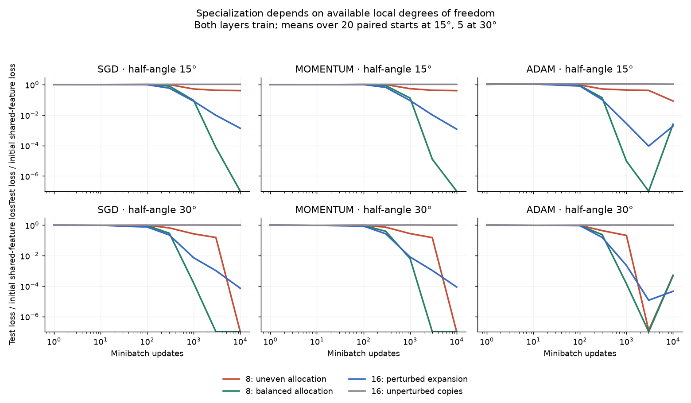
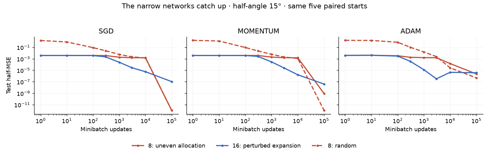
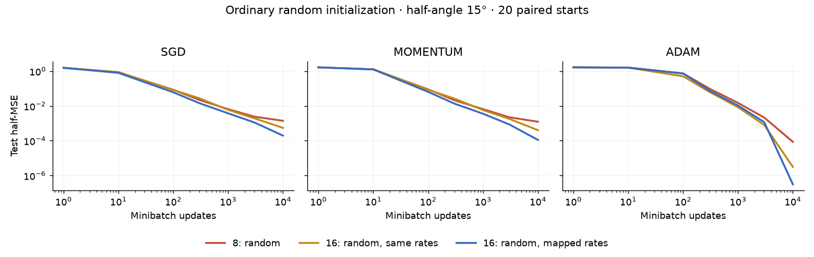

# Shared features, specialization, and the conditional benefit of width

18 October 2026. New experiments following the request to start from a
mechanism rather than another diagnostic of the old runs.

**The useful candidate is a specialization bottleneck.** A shared feature can
be stable against moving toward one target constituent, while two copies can
separate and reduce loss. The relevant object is residual curvature on
directions that preserve the current prediction to first order; for finite-data
ReLU, use the corresponding finite splitting paths. The
[derivation](../theory/specialization_geometry.md) gives explicit opposing
curvatures for correlated Gaussian ReLU teacher features.

Training supports this mechanism in a constructed, trainable two-layer setting.
It does not establish a general explanation through harmful peer updates.
The strongest 10k-update effect concerns fine detail with modest absolute loss.
Longer training removes even that narrow-network deficit in the tested starts:
the evidence is for a delay, not permanent trapping. At minimal width, a
balanced initial allocation often does better than expansion.

## 1. Predictions derived before the main training sweep

For two target directions cosθ c±sinθ d, define
κ(θ)=[sinθ+(π−θ)cosθ]/(2π) and a*=4κ(θ). Starting from their best single
shared feature a*ReLU(cᵀx), population half-MSE has quadratic coefficients

\[
C_{\rm move}=\frac{a_*[(\pi-\theta)\cos\theta-\sin\theta]}{2\pi},
\qquad
C_{\rm split}=-\frac{a_*\sin\theta}{\pi}.
\]

The first moves one neuron and optimally refits its output. The second
separates two equal-output copies to c±εd. For 0<θ<63.76°, ordinary motion
raises loss while separation lowers it. These are one-pair population
statements; they do not prove stability of a whole finite-data network.

The [unchanged prospective protocol](../theory/specialization_protocol.md)
therefore predicted: uneven local neuron allocation can impede specialization;
balanced allocation at the same total width can help; expansion needs symmetry
breaking; and θ=0 removes the unresolved detail. Random initialization was
explicitly a transfer test, not a theorem implied by the calculation.

## 2. A trainable model that can contradict the mechanism

Inputs are Gaussian in dimension 20. Eight positive-output teacher features
form four pairs, in four orthogonal planes, with half-angles θ=0°,15°,30°,60°.
The full pair angle is 2θ. Targets are scaled to unit training variance, without
centering. We train incoming and outgoing weights jointly on 4,096 examples
and evaluate on 4,096 independent examples. The teacher is representable at
student width 8. Training uses float64, minibatches of 128, and 10,000 updates.

For the controlled initialization, first fit four shared center features by
least squares on training data. Distribute each center's readout mass among
its local neurons. Compare:

| Arm | Width | Neurons initially assigned to the four centers | Perturbation |
| --- | ---: | --- | --- |
| `crowded8` | 8 | 1,1,3,3, permuted by seed | Small generic within-center perturbations |
| `balanced8` | 8 | 2,2,2,2 | Same perturbation rule |
| `split16` | 16 | 2,2,6,6 | Same perturbation rule |
| `clean8` | 8 | 1,1,3,3 | None |
| `clone16` | 16 | 2,2,6,6 | None |

All unperturbed initial functions agree. Perturbations start as independent
Gaussian vectors, then have their within-center mean removed and are scaled
by .02; they do not use
the teacher's contrast direction. Their finite prediction change is small but
not exactly zero. Single-neuron centers have zero perturbation under this
rule. This is intentional: they have no internal separation direction.
The perturbation control privileges separation directions: it does not test
equally sized unconstrained perturbations of singleton neurons. Balanced and
uneven allocations also have different effective learning dynamics despite
equal scalar rates. These are limits on attributing their entire difference
to the calculated curvature. No cluster assignments or positivity constraints
are enforced during training;
neurons can move to other centers and output coefficients can change sign.

This initialization is **teacher-informed**. It isolates an overloaded
representation; it is not evidence that ordinary training necessarily arrives
there. Three additional arms use standard random incoming directions and small
signed random output coefficients: width 8, width 16 with unchanged rates, and
width 16 with mapped layer rates. The random arms' initial predictions are not
matched across widths.

Base learning rates are .3 for SGD, .03 for momentum (.9), and .003 for Adam.
Under f=ΣaᵣReLU(wᵣᵀx)/√m, duplicate dynamics are preserved for SGD/momentum
by doubling the wide incoming rate and keeping its output rate unchanged.
For Adam, incoming rates stay unchanged and output rates are divided by √2;
this is only approximate because of Adam's fixed ε. The controlled width-16
arms use these mappings. The random width-16 comparison reports both mappings
and unchanged rates. These are controls for exact copies, not a claim to
equalize all generic wide and narrow trajectories.

The main sweep uses five paired training seeds. A follow-up at θ=15° extends
to 20 paired starts. Further exploratory checks train biases, rotate the
teacher and resample data, lower all rates by a factor .3, vary perturbations
to .005/.08, and add θ=75°. These follow-ups were chosen after inspecting the
main results. A final five-seed check extends θ=15° to 100,000 updates.
These follow-ups are not described as preregistered confirmations.

## 3. The controlled effect at 15° is consistent, but primarily about refinement

At θ=15°, the shared-feature baseline has test half-MSE **.003728**. After
10,000 updates, mean test half-MSE over the 20 paired starts is:

| Initialization | SGD | Momentum | Adam |
| --- | ---: | ---: | ---: |
| Uneven width 8 | .001495 | .001489 | .000310 |
| Balanced width 8 | 2.48e−10 | 2.69e−10 | 9.27e−6 |
| Perturbed expansion to 16 | 5.04e−6 | 4.41e−6 | 7.05e−6 |
| Unperturbed copies at 16 | .003861 | .003840 | .003962 |

For SGD and momentum, the uneven allocation retains about **40% of the shared
representation's error**. Expansion retains about **0.14% and 0.12%**, and
balanced width 8 removes essentially all of it. Expansion beats uneven width
8 in all 20 paired starts for both optimizers. Paired mean half-MSE differences
(expanded minus uneven) are −.001490 [−.001507,−.001472] for SGD and
−.001484 [−.001501,−.001467] for momentum. Brackets are pointwise 95% paired-seed
bootstrap intervals, conditional on this teacher and dataset.

Adam's story is less uniform. Its uneven width-8 median error is 2.43e−7,
despite a mean of .000310. Expansion improves the mean, but beats the uneven
network in only **8/20 individual starts**; several narrow fits are already
extremely accurate. The mean benefit mainly reduces the less successful tail,
rather than uniformly improving each start.

As a threshold summary, define success as removing 99% of the shared baseline
error, i.e. test loss < .01×.003728. Uneven width 8 succeeds in 0/20 SGD,
0/20 momentum and 13/20 Adam starts. Expansion succeeds in 20/20 for all three;
balanced width 8 succeeds in 20/20,20/20,19/20. This threshold is relative to
the remaining baseline error, not to all target variance, and is not exact
interpolation. The raw losses above are the primary magnitudes.

The distinction matters: uneven SGD's MSE is approximately **0.003**, or **0.3%
of the unit training target variance**. A roughly 300-fold error reduction is
real here, but does not mean that competition accounts for a large fraction
of the original prediction problem. Very correlated features necessarily leave
little unresolved detail in this construction; the derivation predicts this
small-angle limitation.



Means over 20 seeds at 15° and five at 30°; values below 1e−7 of baseline loss
are clipped for display. The curves connect sparse recorded checkpoints and
should not be used to infer exact crossing times. Adam can return from an
extremely accurate checkpoint to a small finite error under constant-rate
training; the final checkpoint is not its best checkpoint.

## 4. Longer training identifies a delay, including at 15°

The final follow-up ran the first five θ=15° starts to **100,000 updates**.
Every perturbed and random arm, at both widths and under all three optimizers,
then passed the 99%-of-baseline-error threshold. Uneven width-8 mean losses
were 1.77e−13 for SGD, 8.84e−10 for momentum and 2.29e−6 for Adam; random
width 8 also caught up. Unperturbed exact-copy arms still failed, as expected
from their preserved symmetry. Those deliberately symmetric failures are not
evidence of a generic permanent narrow-network trap.

The 20-start main result therefore concerns a fixed training budget. The
longer check covers five of those same starts, not five new independent seeds.
Sparse checkpoints do not establish an exact speedup factor or escape time.



Markers indicate actual recorded checkpoints; there is no measurement between
10k and 100k in this follow-up. Values below 1e−12 are clipped for display.

**At θ=30°, catch-up already occurs within 10,000 updates.**

At θ=30°, after 1,000 updates, the five-seed mean test losses are:

| Initialization | SGD | Momentum | Adam |
| --- | ---: | ---: | ---: |
| Uneven width 8 | .01035 | .01077 | .00817 |
| Balanced width 8 | .000006 | .000249 | .000005 |
| Perturbed expansion to 16 | .000279 | .000314 | .000087 |

This is a substantial intermediate fitting difference, around two percentage
points of target variance in MSE for SGD/momentum. By 10,000 updates, however,
uneven width 8 has essentially zero loss under SGD/momentum and 1.97e−5 under
Adam. It has found another route to specialization. A fixed-budget bottleneck
is supported; permanent inability to escape is not.

Training biases and changing teacher/data preserve this early 30° contrast,
but narrow SGD/momentum again catch up by 10k. At .3 times the base rate,
uneven width 8 still has .00564/.00545 loss at 10k versus .000042/.000047 for
expansion under SGD/momentum. That lower-rate experiment covers less effective
training time; it is not evidence that an asymptotic trap becomes stronger.

## 5. Transfer and failures

**Ordinary random initialization has a width advantage at 15°.** Over 20 seeds:

| Initialization | SGD | Momentum | Adam |
| --- | ---: | ---: | ---: |
| Random width 8 | .001393 | .001233 | .0000864 |
| Random width 16, unchanged rates | .000545 | .000404 | .00000311 |
| Random width 16, mapped rates | .000196 | .000111 | .000000312 |

The unchanged-rate improvement matters: the effect is not confined to the
mapped-rate convention. With unchanged rates, width 16 wins in 17/20 SGD and
18/20 momentum starts, but only 4/20 Adam starts. Again Adam's mean improvement
is mostly improved reliability in a few difficult starts. We have not measured
the proposed operator along these random trajectories or intervened on their
identified shared features, so these outcomes do **not** prove mediation by
the specialization mechanism.



**Biases and perturbation scale do not eliminate the controlled 15° effect.**
With trainable biases, uneven width 8 ends near .00143 for both SGD/momentum,
versus 2.1e−6/5.9e−6 for expansion. Perturbation scales .005 and .08 retain
the same qualitative contrast; neither is selected as the new preferred scale.
With a second rotated teacher/data draw, uneven SGD/momentum losses are
.00145/.00144 versus roughly 5e−6/1e−5 after expansion. The second draw is the
same geometric teacher family, not a different task family. Under Adam that
second draw's random width 8 already fits better on average than either random
wide arm, a concrete failure of universal random-width improvement.

**Zero angle behaves as a no-detail control.** The exact shared representation
already solves the task; SGD/momentum's unperturbed arms remain at numerical
zero. Perturbed arms and Adam have small residuals. There is no meaningful
specialization advantage to explain. Ratios to the zero baseline are omitted.

**Large angles do not obey a simple full-network phase boundary.** At 60°,
balanced width 8 can do worse than the uneven allocation; e.g. momentum's
balanced mean is .00209 while the uneven mean is essentially zero. At 75°,
the single-pair ordinary curvature becomes negative as predicted, but the
unperturbed multi-pair network still fits poorly. Orthogonal pair planes do
not make positive ReLU features mutually orthogonal in function space. The
one-pair boundary cannot be promoted to a theorem about the multi-pair
trajectory, nor can its local saddle alone overcome exact-copy symmetry.

## 6. What this changes scientifically

The useful shift is from “find a score that falls with width” to “identify a
representation with obstructed specialization, and predict which additional
directions remove that obstruction.” The opposing ordinary/splitting
curvatures make this concrete. Equal-width balanced allocation is particularly
informative: total representational capacity does not explain that comparison.

The evidence is strongest for local multiplicity and symmetry breaking in a
shared representation. It remains narrower than the original idea of neurons
harming each other's updates. The separating neurons cooperate; the competing
demands are the roles a shared feature must satisfy. Neither the curvature
calculation nor these training losses establishes reduced peer-update harm.

The next decisive bridge would identify shared features during ordinary
training, predict useful finite specialization directions from the residual,
and compare targeted expansion with untargeted expansion and equal-width
reallocation. That would test whether the object predicts a rescue on states
it was not designed around. This report does not claim that experiment has
already been completed, or that this mechanism explains MNIST or deep networks.

## Evidence and reproduction

- [Training producer](../../scripts/studies/run_specialization.py),
  [analysis and audit](../../scripts/studies/analyze_specialization.py),
  [mathematical and optimizer tests](../../tests/test_specialization.py).
- [All seed curves](../tables/specialization/curves.csv.gz),
  [endpoints](../tables/specialization/endpoints.csv),
  [summary](../tables/specialization/summary.csv),
  [paired contrasts at every checkpoint](../tables/specialization/paired_contrasts.csv).
- [Population coefficients](../tables/specialization/population.csv),
  [source and initialization audit](../tables/specialization/audit.csv),
  [executed arguments and source hashes](../tables/specialization/provenance.json),
  [analysis metadata](../tables/specialization/analysis.json).

All non-pilot runs are included, including null and reversed effects. The first
five starts of the 20-start replication duplicate the main sweep exactly;
unaffected arms also repeat across perturbation checks. These are not counted
as independent evidence. Intervals use 4,000 paired-seed bootstrap draws with
seed 741, no multiple-comparison adjustment, and no test-example resampling.
The raw `.pt` files retain final parameters, optimizer states and data locally
under the git-ignored `runs/specialization/`; the versioned tables preserve
every recorded curve. Producer/protocol hashes are checked against every
non-pilot manifest. SGD/momentum's final clean/copy predictions agree within
9e−16 RMS; Adam's ε can amplify small mapping discrepancies over training,
so its copy control is explicitly approximate.

Validation: all 77 repository tests pass, including eight new cases checking
the innovation identity, exact population-kernel coefficients, and the
optimizer copy mappings. Ruff and the diff whitespace check pass. All 42
non-pilot producer/protocol manifests match their recorded source hashes.

Run from the repository root with the environment installed:

```sh
.venv/bin/python scripts/studies/run_specialization.py
.venv/bin/python scripts/studies/run_specialization.py --degrees 15 --seeds 20 --collection replication20
.venv/bin/python scripts/studies/run_specialization.py --degrees 15 30 --train-bias --collection bias
.venv/bin/python scripts/studies/run_specialization.py --degrees 15 30 --data-seed 8037 --collection teacher2
.venv/bin/python scripts/studies/run_specialization.py --degrees 30 --rate-factor .3 --collection lower_rate
.venv/bin/python scripts/studies/run_specialization.py --degrees 75 --collection unstable_control
.venv/bin/python scripts/studies/run_specialization.py --degrees 15 --jitter .005 --collection small_jitter
.venv/bin/python scripts/studies/run_specialization.py --degrees 15 --jitter .08 --collection large_jitter
.venv/bin/python scripts/studies/run_specialization.py --degrees 15 --steps 100000 --collection longer
MPLCONFIGDIR=/private/tmp/neural-competition-mpl .venv/bin/python scripts/studies/analyze_specialization.py
.venv/bin/pytest -q
```

The producer skips an existing completed output tag. To vary a parameter for
the same angle/optimizer/data/bias combination, use a distinct collection name;
do not overwrite a collection with new arguments and assume it reran.
