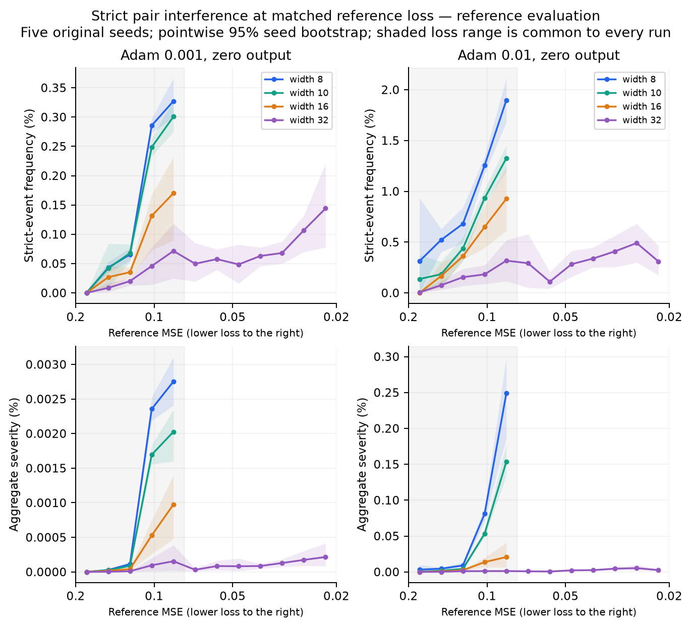

# Strict neuron-pair interference at matched loss

Follow-up analysis, 18 October 2026. This addresses the apparent Adam reversal
in whole-training strict-event frequency: is it still present when models are
compared at the same loss, and does frequency agree with harm magnitude?

**Matching loss changes the result.** In the common reference-loss range,
widening from 8 to 32 reduces strict-event frequency for default Adam at both
learning rates. The same reference-frequency direction also occurs in the
two random-output initialization controls and the momentum comparison.
Thus the favorable strict-frequency trend is not exclusive to output std 1;
the earlier whole-training comparison mixed different loss phases.

**This does not establish less total interference.** All five conditions
have more strict events per update at width 32. In the output-std-1 Adam
control, the raw pair-harm sum per update also increases even though both
normalized reference scores decrease.

The subsequent [objective-scale audit](effect_magnitude.md) tests whether
these effects are large enough to matter and predict later width benefits.
Low-rate Adam's strict-harm sum is below .1% of its reference loss decrease;
broader interaction and standalone-motion budgets can be much larger.

## Scope and matching

We replayed the five original seeds in each of five teacher-8/2027 conditions:
Adam .001/.01 with zero outgoing initialization, Adam .001 with outgoing
std .1/1, and momentum .1 with zero outgoing initialization. This recovers
diagnostics for **90 existing runs, 100k updates each**, rather than adding
independent replicates or changing training conditions. All 14 original
diagnostic fields in the retained seed-0 trajectories match exactly; retained
parameters/moments at 10k/50k/100k and minibatch RNG states match bitwise.
Original five-seed bin frequencies and visit counts are also reproduced.

Matching uses pre-update **fixed-reference MSE on 256 training examples**.
Both reference and source-batch outcomes use this assignment; source-batch
MSE itself is not matched. The primary comparison gives equal weight to
the same five original logarithmic bins from **.0766 to .2**, then equal
weight to the five seeds. Every original seed/width/condition visits all
five bins, so no narrow failures are excluded. The full .02-to-.2 range
cannot be used for every condition because some narrow runs never reach it.

Within each seed/bin, frequency and severity are ratios of sums across
all visits. Equal bin weighting prevents long plateaus from dominating
the scalar comparison. Confidence intervals resample the five **paired
seeds**, not individual pairs or updates; they are exploratory and pointwise.
The range was selected from existing coverage, not preregistered.
This matches loss bands, not identical losses within a band.

## Strict-event frequency

An ordered pair r→s is eligible when both fixed neuron updates help alone.
It is a strict event when adding s after r increases loss:
A_r<0, A_s<0, A_s+J_rs>0, with the original loss-relative sign tolerance.
The combined two-neuron update can still improve on the initial model.

The entries below are percentages of eligible ordered pairs, averaged over
the common bins and seeds. Intervals are for the width-32 minus width-8
difference in **percentage points**.

| Setting | Reference F, width 8 → 32 | Paired 95% interval for difference | Source F, width 8 → 32 |
| --- | ---: | ---: | ---: |
| Adam .001, zero output | .14432% → .02919% | [−.14516, −.08829] | .01065% → .00321% |
| Adam .01, zero output | .93295% → .14679% | [−.85073, −.69915] | .17190% → .02679% |
| Adam .001, output std .1 | .06867% → .00370% | [−.11900, −.01094] | .00812% → .00119% |
| Adam .001, output std 1 | .02341% → .01253% | [−.01781, −.00386] | .00251% → .00084% |
| Momentum .1, zero output | .88818% → .13501% | [−.92059, −.59641] | .28678% → .06433% |

Source-frequency intervals exclude zero in the first three Adam settings
and momentum. For output std 1 the source interval is [−.00418, +.00052]
percentage points: the lower mean is not clearly established with five seeds.
These are endpoint contrasts, not a claim of strict monotonicity in every
bin, at every intermediate width, or under every initialization.

## Harm definitions

Let Q_t be strict ordered events and E_t all eligible ordered pairs at
update t. Define

\[
H_Q=\sum_t\sum_{(r,s)\in Q_t}(A_s+J_{rs}),\qquad
B_E=\sum_t\sum_{(r,s)\in E_t}(-A_s),\qquad S=H_Q/B_E.
\]

S is the earlier **aggregate strict severity**. It measures the pair-harm
sum relative to eligible standalone benefit and combines rarity with
magnitude. It is distinct from C_plus/G, which includes benign diminishing
returns, and from standalone harmful-neuron updates H in the exact loss budget.

We also retain mean harm per event H_Q/N, event-conditioned severity
H_Q/B_Q, events per update, and H_Q per update. Conditional-event quantities
are undefined when no event occurs. Pair harms overlap in neurons, so H_Q
is not an additive component of the full-network loss change.

## Aggregate severity agrees; total burden does not always agree

The same equal-bin, five-seed comparison gives the following **reference-set**
aggregate severity. These are percentages of eligible standalone benefit,
not percentages of pairs or current loss.

| Setting | S, width 8 → 32 | Relative reduction |
| --- | ---: | ---: |
| Adam .001, zero output | .001050% → .0000525% | 95.0% |
| Adam .01, zero output | .06930% → .000695% | 99.0% |
| Adam .001, output std .1 | .0004203% → .00000173% | 99.6% |
| Adam .001, output std 1 | .00002633% → .00000870% | 67.0% |
| Momentum .1, zero output | .04204% → .000874% | 97.9% |

Paired reference-severity intervals exclude zero in every row. Source
aggregate severity also has a lower mean in every row, but its interval
includes zero for output std 1. The original C_plus includes many other
interactions, so its different ranking is not an inconsistency in accounting.

The unnormalized diagnostic sums give a more qualified picture. H_Q/visit
below is in **half-MSE units**, averaged first within bins and then over bins
and seeds. It is a sum over overlapping ordered pair comparisons.

| Setting | Events/update, width 8 → 32 | H_Q/update, width 8 → 32 | Paired evidence for H_Q change |
| --- | ---: | ---: | --- |
| Adam .001, zero output | .0295 → .1451 | 3.69e−10 → 2.24e−10 | Lower mean; interval includes zero |
| Adam .01, zero output | .2154 → .8402 | 2.73e−7 → 6.65e−8 | Decrease |
| Adam .001, output std .1 | .0166 → .0309 | 1.74e−10 → 3.17e−11 | Lower mean; interval includes zero |
| Adam .001, output std 1 | .0104 → .0987 | 7.26e−11 → 3.11e−10 | **Increase** |
| Momentum .1, zero output | .3165 → .9418 | 2.04e−6 → 3.09e−7 | Decrease |

Every event-count increase has a paired interval above zero. For output
std 1, raw reference harm rises **4.29 times**, with a difference interval
[7.49e−11, 5.24e−10] half-MSE per update. In that condition source harm is
approximately unchanged (1.31e−11 → 1.30e−11; interval includes zero).

Thus a narrower statement is supported: **a randomly selected eligible
neuron pair is less likely to exhibit a strict reversal, and aggregate harm
is smaller relative to eligible benefit, at these matched losses.** It is
false that every condition has fewer events or less raw pair harm. Larger
width creates more pairs and can enlarge the denominator used by both normalized
scores. For S the denominator is, up to the eligibility tolerance,
(number of helpful neurons − 1) times summed standalone helpful gains.

## Does an event itself become milder?

For this conditional question, pool harm and the appropriate denominator over
the shared range within each seed rather than discarding bins without events.
This `shared_pooled` comparison uses a different visit weighting from the
primary equal-bin result.

| Default Adam | Mean absolute harm/event, width 8 → 32 | Event-conditioned S_event, width 8 → 32 |
| --- | ---: | ---: |
| lr .001 | 1.61e−8 → 1.21e−9 | 100.1% → 94.0% |
| lr .01 | 1.95e−6 → 5.24e−8 | 93.6% → 90.8% |

Absolute harm per event clearly falls in both paired comparisons. However,
there is **no clear decrease in harm relative to the affected neuron's own
standalone benefit**: S_event difference intervals are [−41.0, +21.4] and
[−40.6, +31.9] percentage points. The wider model's harmful events are smaller
in absolute units, but the affected updates also have smaller benefits.
This is why aggregate severity and conditional event severity must remain
separate.

## Why the whole-budget ranking reverses

At default initialization, the width-8 runs never visit reference MSE below
1e−4. The width-32 trajectories do, and many strict events occur there:

| Default Adam | Width-32 updates at MSE < 1e−4 | Width-32 strict reference events occurring there |
| --- | ---: | ---: |
| lr .001 | 73.6% | 93.6% |
| lr .01 | 75.5% | 75.5% |

Each entry averages a within-seed fraction over all five seeds. These are
phase shares, not matched-loss frequency estimates. In the .001 case, mean
harm per strict event in this low-loss phase is approximately 1.00e−9,
versus 1.61e−8 for the narrow model's events in the shared range.

This explains the statistical source of the apparent contradiction: wide
models spend many updates in a phase with more frequent, small strict
reversals, while narrow models remain at much larger residuals. Removing
that phase imbalance changes the frequency ranking. It does not establish
the counterfactual behavior of a narrow model that could attain the same
low losses. The pair-cost note's finite-step expansion makes near-zero
standalone benefits a plausible setting for reversals, but the mechanism
is not identified by conditioning on loss alone.

## Curves and coverage

The grey range is shared by every original run. Curves continue outside it
only where all five seeds of that particular width visit a bin. A missing
curve is missing support, not zero harm. Sparse early bins, particularly at
lr .01, can contain only a few updates; visit counts are saved separately.
Bands are pointwise seed-bootstrap intervals, not paired-difference tests.

[All four Adam settings on reference examples](../figures/strict_matched_loss/adam_matched_loss_reference.png)
and [on source batches](../figures/strict_matched_loss/adam_matched_loss_source.png)
include the initialization controls. The corresponding vector PDFs are saved
beside the PNGs.

## Interpretation and limits

A lower per-pair frequency does not imply fewer total events: width creates
many more possible pairs. A lower normalized severity can also reflect
its larger eligible-benefit denominator. Raw harm per update and event
counts therefore need to accompany frequency and S.

Matching loss removes a major phase imbalance, but does not match the
representation, residual pattern, update size, optimizer history or moments.
This remains a descriptive comparison. Strict events are finite-step
phenomena and already rare at these rates; these results alone do not show
that reducing them causes the fitting advantage or explains narrow Adam's
feature failure. The C_plus subdivision counterexample also remains valid.

The next causal tests should preserve this distinction: compare exact
finite-step harms with first-order batch transfer, and test neuron-step
reweighting against uniform shrinkage on independent evaluation examples.
Assess total harm alongside per-pair rates rather than selecting a metric
because its width ordering agrees across optimizers.

## Evidence and reproduction

- [Computation, definitions, caches and audit details](../theory/checks/strict_matched_loss/README.md)
- [Per-seed comparisons](../theory/checks/strict_matched_loss/comparison_per_seed.csv)
- [Paired contrasts and intervals](../theory/checks/strict_matched_loss/comparison_effects.csv)
- [Bin-level curves](../theory/checks/strict_matched_loss/loss_curves.csv)
- [Coverage and visit counts](../theory/checks/strict_matched_loss/coverage.csv)
- [Producer](../../scripts/studies/analyze_strict_matched_loss.py)

The original [robustness report](robustness.md) describes accumulated C_plus
and fitting; [pair interactions](pair_interactions.md) defines the earlier
frequency/severity diagnostics. [Pair cost and competition](../theory/pair_cost_and_competition.md)
explains why strict events and broad positive pair cost answer different
questions.
