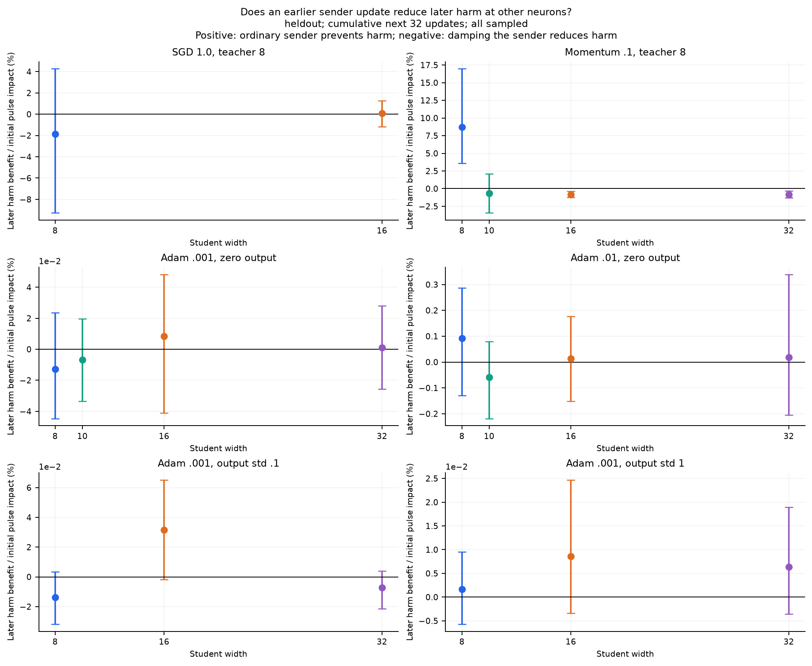
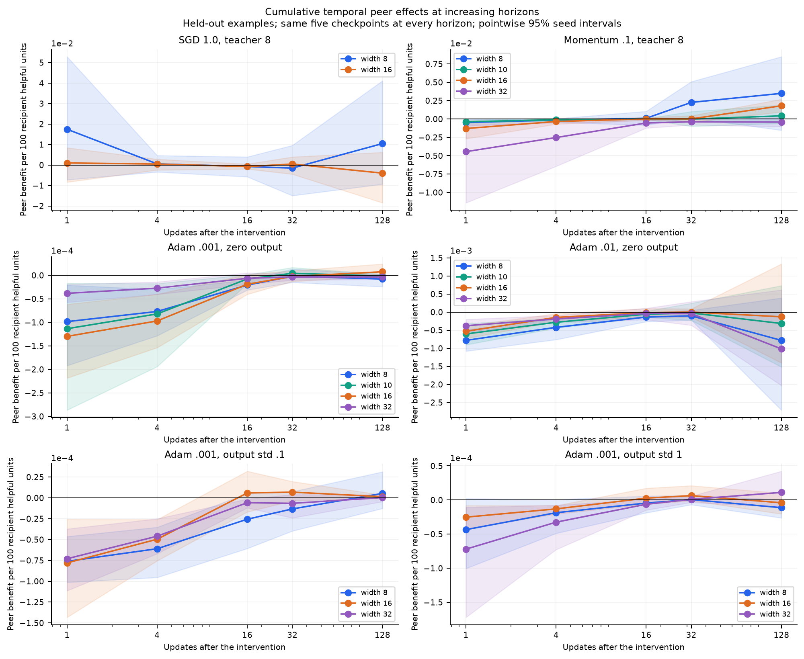

# Can an earlier neuron update reduce later standalone harm?

New intervention experiment, 18 October 2026. Baselines are the original
trajectories; the short counterfactual continuations are new measurements.

**Earlier neuron updates do causally change later standalone harm, but the
response is optimizer-, teacher- and phase-dependent.** The clearest beneficial
response is in narrow momentum networks. Low-rate Adam has very little net
recipient-harm response to these small pulses, despite its large observed
whole-training standalone-harm difference across widths. This does not yet
support a general explanation in which width lowers H through beneficial
earlier interactions. It also does not rule out slower or collective effects.

## Main measured results

The table reports **later recipient-harm benefit per 100 units of initial
pulse impact**, on held-out examples, accumulated over the next 32 updates.
Positive means allowing the ordinary sender update prevented later harm;
negative means damping it reduced later harm. Brackets are pointwise 95%
seed-bootstrap intervals. The pulse's prediction RMS is matched across widths.

| Setting | Narrow width: effect [interval] | Largest width: effect [interval] |
| --- | --- | --- |
| SGD 1.0, teacher 8, original 200k study | 8: −1.84 [−9.28, 4.27] | 16: .10 [−1.18, 1.25] |
| Momentum .1, teacher 8, original 200k study | 8: **8.78 [4.43, 14.44]** | 16: −.94 [−1.54, −.32] |
| Momentum .1, teacher 8/2027, 100k | 8: **8.73 [3.59, 16.97]** | 32: −.81 [−1.32, −.33] |
| Adam .001, teacher 8/2027, zero output | 8: −.013 [−.045, .023] | 32: .001 [−.026, .028] |
| Adam .01, teacher 8/2027, zero output | 8: .093 [−.129, .287] | 32: .018 [−.205, .339] |
| Adam .001, output std .1 | 8: −.014 [−.032, .003] | 32: −.007 [−.021, .004] |
| Adam .001, output std 1 | 8: .002 [−.006, .009] | 32: .006 [−.004, .019] |
| Momentum .03, teacher 8/2027 | 8: −.19 [−.25, −.09] | 32: −.24 [−.44, −.04] |
| Momentum .1, teacher 16/2027 | 16: 12.50 [−6.08, 41.91] | 64: −1.53 [−2.30, −.84] |
| Adam .001, teacher 16/2027 | 16: −.007 [−.013, .001] | 64: −.007 [−.022, .008] |
| Adam .01, teacher 16/2027 | 16: −.52 [−1.11, .006] | 64: −.65 [−2.08, .92] |
| Momentum .1, teacher 8/2037 | 8: 9.09 [−6.74, 19.97] | 16: −1.91 [−8.75, 5.16] |
| Adam .001, teacher 8/2037 | 8: −.029 [−.045, −.013] | 16: −.036 [−.056, −.023] |
| Momentum .1, teacher 16/2037 | 16: **−2.89 [−3.95, −1.98]** | 32: **−1.31 [−1.98, −.54]** |
| Adam .001, teacher 16/2037 | 16: −.042 [−.062, −.017] | 32: −.025 [−.052, .008] |

These are percentages of the initial pulse's absolute loss perturbation, not
percentages of total training loss or final width benefit. A one-step pulse
is much smaller than all learning in a 32-update window. On the window's
ordinary helpful-gain scale, for example, momentum 8→32 gives only
.00170→−.000159 harm units per 100 helpful units, while default Adam .001
gives −.00000504→.000000127. The response can be detectable relative to the
pulse while remaining small relative to all future activity.

**Momentum gives evidence of temporal cooperation, especially in the narrow
teacher-8 models.** In both original studies, an ordinary earlier peer step
reduces other neurons' later harm relative to damping it. That is a causal
instance of temporal peer influence: H can be downstream of other neurons'
earlier updates. It does not identify the full width/competition cascade.
However, its beneficial
response is strongest in the narrow network; it is not evidence that wider
networks generally have more of this beneficial influence. Wider networks
already have lower H, which also limits how much further harm can be prevented.
The second teacher-16 realization instead shows harmful peer influence at
both widths, weaker at width 32. That particular comparison is compatible
with relaxed harmful coupling, but its sign is not reproduced universally.

**For Adam, this intervention does not reveal a large short-range H pathway.**
At .001, all teacher-8 default and initialization-control intervals include
zero in the table, and even the clear effects for some other teachers are
small on the pulse scale. The .01 response is larger but uncertain and not
ordered consistently by width. Random outgoing initialization does not reveal
a substantial common H-response pattern despite improving the underlying fit.

**Actual loss and H need separate conclusions.** For default Adam .001,
allowing the original sender step gives an average loss advantage after 32
updates equal to approximately 125% of its initial pulse impact at width 8
and 114% at width 32. The corresponding H responses above are near zero.
The pulse therefore has a persistent objective consequence without substantial
net relief of recipient standalone harm in these windows. These ratios do
not identify the remaining causal pathway.

Selective damping often gives a lower loss than the prediction-norm-matched
uniform shrink, including default Adam. It usually remains worse than the
ordinary update there. This is not an optimized allocation intervention or
a successful rescue of narrow Adam.

## Phase, lag and robustness

The sign is not stable across phases or horizons. In teacher-8 momentum, the
beneficial narrow-network response averaged over all checkpoints becomes
uncertain when taking only the first sampled checkpoint in the preexisting
shared MSE band .0766–.2. Other settings also change sign across horizons.
The report's main table must therefore not be read as a phase-independent
property of an optimizer.

The fixed-20%-per-sender sensitivity also finds the narrow teacher-8 momentum
response, but some Adam high-rate signs differ from the matched-dose results.
It likewise does not produce a universal width ordering. Both designs and
all setting/phase summaries are retained. This was an exploratory follow-up,
not a preregistered confirmatory test.

Individual recipient effects can oppose one another, particularly for SGD.
The recipient tables retain gross beneficial and harmful effects at lags
1/32/128 before their net cancellation. Those are point-in-time quantities,
distinct from the cumulative-window effects in the main table.

Matching is subject to float32 parameter quantization. Of 12,250 sampled
sender interventions, 97.4% have a nonzero feasible common pulse. In 263 cases
(2.15%), either cross-width or uniform calibration differs from its target by
more than 5%. Actual doses and errors are retained; the `well_matched` scope
drops the entire seed/checkpoint/sender-rank comparison whenever any width
fails that tolerance. This is based on calibration, not future outcomes.
Excluding those complete comparisons changes the 32-step held-out table by
at most .00025 percentage points on the pulse-impact scale, with the main
momentum and Adam conclusions unchanged.

## Intervention and scope

We cover all **245 original trajectories in 15 settings**: SGD and momentum
with ten seeds at 200k updates; the 13 robustness settings with five seeds
at 100k updates. These include both teacher sizes and realizations, both Adam
rates, lower-rate momentum and the Adam outgoing-initialization controls.
These are not 245 additional independent training runs.
Settings share initialization seeds and datasets. In particular, the 100k
and 200k teacher-8 momentum checks overlap in their seeds and minibatch
streams; they are not independent teacher replications.

At 25 prespecified, roughly logarithmic training times, sample two sender
neurons uniformly without replacement. For each sender, compare:

1. The ordinary proposed update.
2. A one-step reduction of that sender's update only.
3. A uniform reduction of the whole update, calibrated to remove the same
   reference-set prediction RMS as the sender intervention.

The primary experiment additionally matches the sender intervention's absolute
prediction RMS across widths within each seed/checkpoint/sender rank. It uses
the smallest feasible pulse at up to 20% sender damping. If that target is
zero, all corresponding widths receive no-ops; active neurons are not selected
after seeing their effects. A separate fixed-20% experiment checks sensitivity
to this calibration choice.

Only the actual rounded parameter movement is changed. Newly computed Adam
moments or momentum buffers are retained, and all later updates run normally.
The sender's current neuron function is retained. The future minibatch
sequence is identical across branches. Outcomes are measured on the original
fixed training reference and on 256 held-out test examples that do not enter
training or dose calibration.

Each intervention observes every recipient other than its sender. We measure
all next updates through 32 steps; five checkpoints extend to 128 steps.
The observed lags are 1/4/16/32 and, in that subset, 128. Thus 128-step results
must not be compared with a 32-step average over a different checkpoint set.
The lag figure uses the same five checkpoints at all horizons.

## What the causal effect means

In the formula below, t denotes the modified update. The data's `completed`
field instead counts updates before that intervention: if `completed=t0`,
the modified update is t0+1 and lag 1 measures the next update, t0+2.

Let h_r=[A_r]_+ be the recipient's exact isolated loss increase. For a sender
intervention at time t, the cumulative effect on recipients over the next k
updates is

\[
B_H(t,k)=\sum_{\tau=1}^{k}\sum_{r\ne s}
\left(h^{\rm damped}_{r,t+\tau}-h^{\rm ordinary}_{r,t+\tau}\right).
\]

Positive B_H means the ordinary sender prevented later recipient harm.
Negative B_H means reducing that sender's earlier step lowered later harm.
This is a finite intervention response, not a correlation between earlier
C_plus and later H. Both kinds of temporal influence are possible.

The sampled-window summaries report raw half-MSE effects and two scales:

- **Per 100 ordinary recipient helpful units:** B_H divided by ordinary
  recipient G in the same windows.
- **Per 100 units of initial pulse impact:** B_H divided by the sum of
  absolute branch-loss differences immediately after the sender intervention.

The second scale matters because one altered neuron update is a small fraction
of all learning in a 32-step window. A small window-level effect need not be
small relative to that pulse. Neither ratio is a percentage of eventual width
benefit explained. Ratios pool within seed before taking equal seed means.

We also measure actual branch loss, useful recipient gains, anti-residual work,
and positive/negative individual-recipient effects before their cancellation.
Lower H alone does not establish better optimization: helpful activity can
change simultaneously. Beating the uniform control does not imply beating
the original ordinary update.

## Distinguishing changed residuals from changed proposed movements

For one recipient let h(e,d)=[<e,d>+||d||²/2]_+, where empirical inner products
use the named evaluation set. Write ordinary and damped-branch residuals and
neuron prediction movements as (e_0,d_0) and (e_1,d_1). The exact symmetric split is

\[
Q=\tfrac12\{h(e_0,d_1)-h(e_0,d_0)+h(e_1,d_1)-h(e_1,d_0)\},
\]

\[
E=\tfrac12\{h(e_1,d_1)-h(e_0,d_1)+h(e_1,d_0)-h(e_0,d_0)\},
\]

with Q+E=h(e_1,d_1)−h(e_0,d_0). Summing recipients and future updates gives
the reported proposal-change and residual-change contributions to B_H.

At the first subsequent update, untouched recipient parameters still coincide,
so their two proposals can genuinely be evaluated in the same current model.
At later lags the recipient parameters have diverged. The split remains exact
in prediction space but is descriptive; it is not a parameter transplant or
a separately manipulated causal mediation effect. The two terms can oppose
and largely cancel.

## What this experiment can establish

A nonzero B_H establishes that the specified earlier peer-update intervention
changed later recipient harm in that window, conditional on the checkpoint
and minibatch stream. It does not establish that the old same-step C_plus
is the mediator. It also does not identify the effect of removing all
competition, or the portion of final width benefit caused by competition.

This is a one-step pulse of at most 20% to one sender, observed for at most
128 updates. A slow feature-formation mechanism, a sustained history change,
or a coordinated change across several neurons can escape this test. Effects
from different interventions cannot be multiplied by the number of training
updates and interpreted as a full-training causal saving.

The all-checkpoint summaries describe these roughly log-time samples. A coarse
phase check selects the first sampled checkpoint in reference MSE .0766–.2;
it does not match exact loss, residual patterns or representation. Uncertainty
resamples original seeds, not correlated recipients/branches. The five-seed
robustness intervals are exploratory, pointwise and unadjusted for multiple
comparisons.

## Evidence and reproduction

The matched-dose pass took 484 seconds across all 15 groups with one CPU
thread, including baseline reconstruction, controls and diagnostics. The
fixed-fraction sensitivity took 482 seconds. Postprocessing is additional.
The intervened branches themselves add 1,254,400 model optimizer updates,
4.4% of the 28.5 million original model updates. Ordinary-branch replay and
validation, dose calibration and float64 reference diagnostics add further
work; 4.4% is not a wall-clock overhead estimate.

Each pass checks 375 ordinary branch endpoints bitwise against an independent
continuation in the original batch layout, plus 41 retained checkpoint states,
moments and minibatch RNG snapshots. All 245 final reference losses agree with
the original full-cohort tables within 9.81e−17 half-MSE. Every measured
whole-update budget is checked, with maximum discrepancy 6.12e−16 in the
matched-dose pass. The full 46-test suite and Ruff checks pass.

The [diagnostic directory](../theory/checks/temporal_branches/README.md) gives
the exact commands, definitions, full setting summaries, per-seed results,
coverage, condition provenance and raw-data locations. The
[producer](../../scripts/studies/run_temporal_branches.py) and
[analyzer](../../scripts/studies/analyze_temporal_branches.py) keep original
archives read-only. Numerical checks cover the original retained checkpoints,
optimizer moments and RNG streams; ordinary-branch batch-layout equivalence;
all-seed endpoint losses; and every measured whole-update loss budget.
