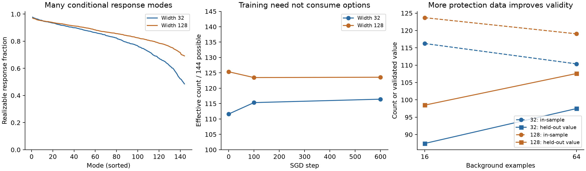

# Neural options as conditional refinability

28 October 2026. A foundational reset after `task_induced_polarization.md`.

## What changes

The earlier definition made a neuron an option for a specified task role. That
was useful for deriving extinction laws, but the role specification carried too
much of the explanation. The proposed replacement is functional:

> An option is an independently realizable, coherent refinement of the model's
> behavior, at a specified cost in parameter movement and collateral change.

The primitive is a **spectrum of conditional refinability**, not a list of
neurons, a teacher decomposition, or a prediction of future training. Directions
come from the current network's derivatives on ordinary data. Every output
contrast and randomly sampled context is treated symmetrically. Several neurons
may jointly supply one option, and one neuron may participate in several.

This is a local definition. It does not capture every finite-distance route to
a future representation. Its advantage is that it has an operational meaning,
an exact quadratic characterization, a matrix-free estimator, and explicit
tests of when its approximation is misleading.

The initial MNIST tests support measuring many options and their turnover.
They also expose substantial probe-buffer overfitting. Consequently, **held-out
preservation and coherence checks are part of the proposal**, not an optional
validation of a purported intrinsic count.

## 1. High-level structure before linear algebra

The intended family is **heterogeneous prediction with stable equivalences**:

1. Predictions serve many contexts, examples, or entities. Improving one can
   require a different adjustment from improving another. A shared broad rule
   can be right while its contextual calibration is wrong.
2. Multiple observations can express the same underlying prediction problem.
   A useful refinement should transfer between those observations: views of an
   object, nuisance transformations, or linked formulations of a question.
3. A useful local refinement should not require wholesale disruption of other
   behavior. This is a substantive assumption about the kind of future demand
   we want to preserve, not a theorem about every learning problem.

This is compatible with vision and some language datasets, without assuming
known latent experts, orthogonal features, or a particular class hierarchy.
It excludes the claim that every future useful change is local: a genuinely
global revision will be penalized by this notion of an option.

The source of equivalences matters. Use the training pipeline's existing
augmentations or linked observations when those are credible. Arbitrary text
perturbations are not automatically semantic equivalences. If no such structure
is available, the weaker measurement is **example-level local editability**;
one must not relabel it semantic flexibility. Inferring equivalences solely from
the current representation risks hiding distinctions that representation has
already lost.

There is also an identifiability limit: the same model and observed dataset can
be followed by incompatible future tasks. Their statistics cannot determine
which unseen changes will matter. We can avoid hand-chosen directions, but not
specifying what counts as a coherent change and what resources it may consume.
The appropriate result is a response-cost curve, not a parameter-free universal
integer called "the number of options."

## 2. A symmetric measurement, with no designated task roles

At a checkpoint, sample a fixed audit panel. Randomly split its underlying
examples into focal examples and background examples, independently of label,
error, neuron identity, or success. Repeat splits when estimating the average.
All classes are included. For classification, use the full centered-logit space;
adding a common constant to all logits is not a behavioral option.

For an update \(\delta\theta=M^{1/2}u\), let \(M\) specify its geometry. SGD
gives Euclidean coordinates; a frozen positive optimizer preconditioner gives
a different, explicitly declared geometry. Momentum or changing Adam state is
not fully represented by a frozen metric.

Form three derivative operators, with sample-average normalization:

- \(Q u\): the mean prediction change across views of each focal example;
- \(A u\): mean changes on background examples;
- \(V u\): deviations of changes between views of the same example.

The views impose coherence on the *change*, not an assumption that the current
network already has invariant predictions. For two views the mean is
\((J_1+J_2)/2\), and the deviation operator is \((J_1-J_2)/2\).
In the experiment, view-variance cost gives equal total weight to focal and
background populations, including when the buffer sizes differ.

Neither a protected semantic direction nor a desired edit direction is selected.
The background split is an exchangeable audit policy, not a declaration that a
particular class must be preserved. Nevertheless, locality is an assumption:
random example refinements do not cover every compositional or global edit.

For an arbitrary focal request \(r\), define its local refinement cost

\[
 \min_u\ \frac12\|Qu-r\|^2+
 \frac\gamma2\|Au\|^2+\frac\eta2\|Vu\|^2+
 \frac\lambda2\|u\|^2. \tag{1}
\]

Here \(\gamma\) prices collateral change, \(\eta\) prices inconsistency, and
\(\lambda>0\) prices movement. These are resource tradeoffs, not thresholds
fitted to failure outcomes. The spectrum should be reported over a budget range.
The ideal population definition replaces background and view averages with
their expectations. A finite buffer estimates these expectations.

## 3. The option operator and its exact meaning

Let

\[
 P=\begin{bmatrix}\sqrt\gamma A\\\sqrt\eta V\end{bmatrix},\quad
 H=Q^*Q+P^*P+\lambda I,\qquad
 \boxed{R=QH^{-1}Q^*.} \tag{2}
\]

Then \(0\preceq R\preceq I\), and the exact optimizer of (1) is
\(u_r=H^{-1}Q^*r\). It realizes response \(Qu_r=Rr\). Its optimal cost is

\[
 \boxed{C(r)=\tfrac12 r^*(I-R)r.} \tag{3}
\]

Thus an eigenvector with eigenvalue \(\rho\) is a model-discovered refinement
whose requested amplitude is realized by fraction \(\rho\), with optimized
cost \((1-\rho)/2\) for a unit request. These directions can mix examples and
classes; they are not assumed to correspond to named concepts.

The smooth collective count is

\[
 \boxed{N=\operatorname{tr}R=\sum_j\rho_j.} \tag{4}
\]

For isotropic requests with \(\mathbb E rr^*=I\), \(N/2\) is exactly the expected
reduction in (1) relative to making no update. Isotropy is an exchangeable probe,
not a hypothesis that future useful tasks are random labels. Report \(N/q\) as
well as \(N\), since the audit response dimension \(q\) bounds the count.

If an observable request covariance \(D\) is justified, its value is instead
\(\operatorname{tr}(RD)/2\). Current loss gradients can supply a present-demand
audit, but must not define the capacity itself: otherwise the apparent number
of options vanishes simply because training has succeeded.

Equation (3) is a **regularized local refinement cost**, not a lower bound on
terminal training loss. Its fitting-error term alone is
\(\| (I-R)r\|^2/2\); the remaining cost is movement, leakage and incoherence.

### What makes this different from raw Jacobian rank?

The conditional compliance operator is

\[
 S=Q(\lambda I+P^*P)^{-1}Q^*,\qquad R=S(I+S)^{-1}.
\]

It discounts ways of moving the focal outputs that necessarily move everything
else. With one focal and one background output, equal sensitivity \(s^2\),
correlation \(\rho\), and no view penalty, define

\[
 c=s^2-\frac{\gamma s^4\rho^2}{\lambda+\gamma s^2},
 \qquad R=\frac{c}{\lambda+c}.
\]

Two full-rank kernels can have very different conditional freedom. As their
responses become identical, the local edit becomes a compromise with the
background; when movement cost is small its response approaches
\(1/(1+\gamma)\), rather than one. Hard preservation requires large \(\gamma\);
the default experiment uses a soft penalty and should not be described as
zero-collateral editing.

This mathematics is regularized linear inverse-problem geometry, closely
related to NTKs, conditional kernels and effective degrees of freedom. It is
not a new spectral theorem. The proposed research contribution is the
task-motivated *conditional refinement interpretation*, coherent probes,
turnover accounting, and validation of the finite-data approximation.

## 4. Destruction, recovery, width, and redundant parameters

Use fixed focal examples, view relationships, output coordinates, metric, and
budgets across checkpoints. Then

\[
 L_{s,t}=\operatorname{tr}(R_s-R_t)_+,\qquad
 G_{s,t}=\operatorname{tr}(R_t-R_s)_+,
 \qquad N_t-N_s=G_{s,t}-L_{s,t}. \tag{5}
\]

These quantify losses and gains of conditional response capability in the same
function space. They do not incorrectly match the third eigenvector at one
checkpoint to the third at another. They are net changes over the interval,
not counts of every intervening destruction/recovery event. A zero eigenvalue
is a local absence; crossing an arbitrary small cutoff is not a theoretical
extinction event.

There is a precise, limited width statement. Put \(B=[Q;P]\) and \(K=BB^*\).
Then \(R\) is the focal block of \(K(K+\lambda I)^{-1}\). If additional
independent parameter directions retain all old responses and movement costs,
then \(K'=K+CC^*\), so

\[
 R'\succeq R. \tag{6}
\]

The proof is inverse monotonicity in
\(K(K+\lambda I)^{-1}=I-\lambda(K+\lambda I)^{-1}\). Extra width can supply
additional ways to separate otherwise coupled refinements, even when a narrow
network can already represent the eventual target.

This is an enlargement theorem, **not a comparison theorem for independently
trained widths**. Standard width changes can rescale existing responses and
alter the entire trajectory. The empirical width comparison must therefore
control movement geometry and overall sensitivity. Exact copies with matched
total movement cost, represented by \([B/\sqrt2,B/\sqrt2]\), leave \(K\) and
all option values unchanged. Parameter count alone buys nothing. Identical
copies given a larger total update budget can change speed, which is a different
effect. A reparameterization must transport \(M\); Euclidean parameter norms
are not invariant under arbitrary ReLU rescalings.

No extra benefit is guaranteed when the conditional responses are already
saturated, new directions are redundant, the relevant request lies outside the
new responses, or the required refinement is inherently nonlocal. A dead ReLU
with zero first derivative has no *local* option here even if a finite move could
revive it. That is an explicit boundary of the definition.

## 5. Scalable approximation and the important sampling problem

There is no need to form the parameter Jacobian or a parameter Hessian. For
random response probes \(z\), estimate \(N\) by \(z^*Rz\). A solve with
\(H\), or the dual \(K+\lambda I\), uses Jacobian-vector and vector-Jacobian
products. This works with ordinary differentiable networks; an exact kernel
formula for a shallow model is used only to audit the implementation.

Random output probes do not choose semantic roles. Language models can probe
all centered output coordinates through these products without storing the full
response matrix. Computational cost is still significant: the audit below used
up to 90 CG iterations for each of 16 probes. This is an occasional diagnostic,
not a demonstrated negligible-overhead monitor for a large transformer.
Restricting updates to one layer provides a cheaper, explicitly restricted
option measure; under a shared metric it cannot exceed the full update-space
value. Low-rank sketches and shorter solves require their own approximation
audit, especially for weak modes.

There are three distinct errors: linearization error, numerical estimation
error, and data-sampling error. Only the first two were small in the first test.
The third was substantial.

With fixed \(Q,V\) and independently sampled background covariance, inverse
convexity implies that the in-sample inverse tends to be optimistic:
\(\mathbb E\widehat H^{-1}\succeq(\mathbb E\widehat H)^{-1}\).
It is therefore unsafe to call a small-buffer effective dimension a population
count. If a regularized relative covariance bound

\[
 \|H^{-1/2}(\widehat H-H)H^{-1/2}\|\le\epsilon<1
\]

holds, inverse ordering bounds the estimated \(R\) between
\(R/(1+\epsilon)\) and \(R/(1-\epsilon)\). This is a sufficient condition,
not an assumption we assert for MNIST. Rare influential contexts and poorly
sampled nuisance variation can violate it. Larger representative buffers and
ridge regularization have a statistical purpose, not just numerical convenience.

### A held-out correction with an exact interpretation

Let \(U=\widehat H^{-1}Q^*\) be the learned linear map from requests to updates.
Evaluate background preservation on fresh data \(A'\), keeping the focal and
view audit fixed. The twice-gain matrix becomes

\[
 R_{\rm val}=\widehat R-
 \gamma U^*(A'^*A'-A^*A)U. \tag{7}
\]

Its trace estimates the value of these *actual proposed edits* after accounting
for unseen collateral effects. This is not the optimal population operator;
it evaluates a fixed empirical edit rule, and can be negative. Clipping negative
values and calling the result a count would conceal failures. Fresh focal views
must be audited separately as well. One background correction does not establish
semantic generalization.

The preferred reporting object is therefore the option spectrum/budget curve
**together with validated refinement value**, rather than a lone effective-rank
number. This revision was motivated by the negative experiment below.

## 6. Experiments on ordinary MNIST training

No teacher, latent regime, desired neuron role, or selected class is supplied.
Two seeds train widths 32 and 128 by ordinary cross-entropy SGD, on 8,192 MNIST
images, for 600 minibatch steps. Both layers and biases train. The model uses
\(f=a\operatorname{ReLU}(Wx+b)/\sqrt m+c\), with the declared initialization
and learning rate .05. It is a small real-data experiment, not a deep-network
or language-model validation.

The fixed panel contains 32 validation images: 16 focal and 16 background.
Every one of the nine orthogonal logit contrasts is included, so \(q=144\).
Original and one-pixel-right-shifted views define coherence. Neither classes nor
error magnitudes choose the focal examples. A left-shifted view and separate
images test generalization. Training itself uses unshifted images.

We report a ridge curve at .01, .1 and 1 times the transformed kernel's mean
diagonal. Rescaling at every checkpoint compares *shape at matched average
sensitivity*. Keeping the initialization ridge fixed compares physical response
under a fixed metric. These answer different questions and are both retained.

### Many options, and a conditional width benefit

At the middle ridge, mean shape-normalized counts across two seeds are:

| Width | Initialization | Step 100 | Step 600 |
|---|---:|---:|---:|
| 32 | 111.63 | 115.34 | 116.45 |
| 128 | 125.36 | 123.47 | 123.58 |

Counts are fractions of 144 response dimensions, not neurons or identified
semantic concepts. All final response operators have full rank on this panel:
the weakest mode is about .46–.49 at width 32 and .68–.69 at width 128.
Thus the difference is conditional accessibility, not missing algebraic rank.
No exact option extinction is demonstrated in these MNIST runs; the turnover
below measures weakening and strengthening. Four additional random splits of
the same panel retain the
width ordering: final counts range 116.56–118.07 for width 32 and 123.46–125.13
for width 128. The ordering also holds over the tested preservation penalties
from .1 to 100. These small samples are supporting evidence, not a width law.

### Training both gains and loses conditional responses

For the first seed, initialization-to-step-600 turnover at **fixed** ridge is:

| Width | Lost capability | Gained capability | Net |
|---|---:|---:|---:|
| 32 | 1.57 | 15.02 | +13.44 |
| 128 | .73 | 4.66 | +3.94 |

At matched sensitivity, the same numbers are 5.12/9.86 for width 32 and
3.48/1.77 for width 128. The second seed has similar patterns. Thus a decline
in a normalized statistic need not mean a decline in absolute editability.
These results reject a universal monotone-consumption story. They also show
why a scalar net count can hide losses in some directions.

### The local operator is numerically and operationally meaningful

- Analytic kernel versus autodifferentiated Jacobians: relative error
  \(4.4\times10^{-14}\).
- Matched-cost duplicate columns leave the kernel unchanged to
  \(5.6\times10^{-14}\).
- Truly matrix-free kernel products agree to \(1.3\times10^{-14}\).
- Sixteen random trace probes give 115.91 with estimated standard error .53,
  versus exact count 116.24; CG residuals are below \(10^{-7}\).
- Small nonlinear parameter interventions test current residual requests and
  the derivative-discovered strongest/weakest modes. At amplitude .01, the
  maximum relative error in optimized objective is .183%. At amplitude .1,
  a weak mode's response error reaches 56%, despite a small total objective
  error. A cost dominated by an unfulfilled request can conceal inaccurate
  response prediction, so both diagnostics are retained.

These checks validate a local editing object, not future task learning.

### Negative result: empirical options overstate transferable freedom

Fresh background RMS changes are about 4.7–17.4 times the fitted-background
RMS changes for the small interventions. The latter are deliberately minimized,
so this ratio alone is not an absolute harm measure; the objective correction
below measures the actual lost value. Third-view response disagreement ranges
roughly .42–1.77 relative to the fitted mean response. Two views are insufficient
to identify a reliable invariance class.

For the final first-seed models at the middle ridge, a fresh background gives:

| Width | Empirical count | Background-validated value |
|---|---:|---:|
| 32 | 116.24 | 89.81 |
| 128 | 123.70 | 100.82 |

The width ordering survives, but much of the apparent freedom does not. At
ridge multiplier 10 the corresponding values are 15.65/15.40 and 16.72/16.57:
more expensive, smaller edits generalize better to the preservation audit.



A follow-up increases the fitted background from 16 to 64 images, keeping the
same focal examples and effort ridge, and uses a new common held-out background:

| Width | Fitted background | Empirical count | Validated value | Excess collateral |
|---|---:|---:|---:|---:|
| 32 | 16 | 116.24 | 87.42 | 28.82 |
| 32 | 64 | 110.37 | 97.48 | 12.88 |
| 128 | 16 | 123.70 | 98.48 | 25.22 |
| 128 | 64 | 119.04 | 107.59 | 11.45 |

More background data decreases the apparent count but **increases validated
value**. This is a useful discriminating result: the goal is not to maximize
an easy in-sample option score. These values still validate only background
preservation, not the missing third-view coherence.

## 7. Candidates rejected or demoted

- **Live-neuron count or hidden-feature effective rank:** cannot distinguish
  redundant copies from independent refinements, and ignores downstream
  sensitivities and collateral damage. Feature rank is retained as a baseline.
- **Unconditional tangent effective dimension:** useful for gross plasticity,
  but gives credit to changes that disrupt unrelated behavior. Conditional
  preservation changes the question, even when the ranks are both full.
- **Per-example loss-gradient rank as the option definition:** confounds supply
  with current demand and label noise; confident fitted examples can disappear
  from it. Use loss gradients to value available responses, not define them.
- **Small-buffer conditional dimension alone:** directly undermined by the
  held-out experiment. It is a biased estimate requiring validation.
- **Only-destruction dynamics:** not supported by the ordinary MNIST traces.
  Track losses and gains, or explicitly label a restricted irreversible model.

## 8. What this establishes, and the next decisive test

Compared with Hall reserves or polarization families, the foundation is broader:
the option directions are not supplied by the researcher; it uses observable
behavioral derivatives, permits many simultaneous options, and distinguishes
redundancy from conditional freedom. It is also less ambitious: it does not yet
identify long-horizon feature recruitment or predict persistent training failure.

The central remaining empirical question is **whether coherent population
refinability can be estimated economically**, rather than whether a convenient
small-buffer spectrum declines. The next test should use an ordinary deeper
vision model with its actual augmentation pipeline, nested preservation buffers
and independently sampled third views. It should compare both whole-network
and layer-restricted estimates at fixed physical budgets, stopping only when
held-out refinement value and the width comparison stabilize. A language test
needs credible linked contexts first; arbitrary paraphrases must not silently
stand in for semantic equivalence.

Only then should we ask whether ordinary training loses options that later
residual demands use. The proposed observable bridge is already explicit:
evaluate later observed request covariance against earlier and later \(R\),
keeping supply, demand, and held-out leakage separate. This is a future test,
not an accomplished training prediction.

## Related ingredients and reproduction

The tangent-kernel representation is established by
[Jacot, Gabriel and Hongler](https://arxiv.org/abs/1806.07572). Effective degrees
of freedom and low-rank kernel approximations are established tools; see
[Bach](https://proceedings.mlr.press/v30/Bach13.html). Plasticity need not reduce
to inactive units; [Lyle et al.](https://proceedings.mlr.press/v202/lyle23b.html)
study connections with curvature. Preserving other behavior while making an
edit is also central to [ROME](https://arxiv.org/abs/2202.05262), although that
work starts with a specified factual edit. None of these establishes the
proposed option interpretation or its future training relevance. No novelty
claim is made for the matrix identities.

```sh
.venv/bin/python scripts/studies/explore_conditional_editability.py
.venv/bin/python scripts/studies/audit_conditional_editability.py
.venv/bin/python scripts/studies/explore_option_buffer_size.py
MPLCONFIGDIR=/private/tmp/neural-competition-mpl .venv/bin/python scripts/studies/plot_conditional_editability.py
```

The primary protocol was saved before training. The held-out background
correction and larger-buffer study were added after the initial failures and
are exploratory follow-ups. Raw results, checkpoint models and operators are
under `docs/theory/conditional_editability/`. Existing theory is preserved.
