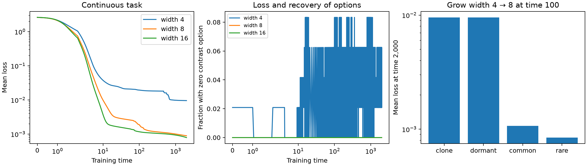

# Dynamic options, persistent damage, and a task-derived renewal law

Research iteration, 24 October 2026. Continues `transported_distinctions.md`.
All earlier studies are preserved.

## What changed

The previous frozen-spectrum forecast is insufficient. This iteration makes
two different advances:

1. An **exact, time-varying accounting law** connects conditional options,
   their loss and recovery, and error throughout training. It does not assume
   that a checkpoint kernel remains unchanged. The recorded optimizer steps
   also include their nonlinear finite-step correction.
2. A **task-derived law for adding options at a damaged checkpoint** predicts
   which expanded networks repair and which remain trapped. It depends on
   task geometry and newly supplied independent directions, not the original
   network initialization. On seven settings, all 896 unrestricted training
   continuations agreed with the individual checkpoint repair predictions.

The second result is a theorem for readout-only repair, an exact absorbing-event
lower bound for full gradient training, and a successful equality conjecture
for the tested fully trainable networks. It is **not yet a law predicting the
failure probability of arbitrary fixed-width networks trained from scratch**.

The promising refinement of the original intuition is:

> Overparameterization helps when it supplies independently useful ways to
> correct conditional errors while accommodating the already learned main
> effects. Training can remove those ways. Once the remaining error produces
> no gradient on any available direction, the damage persists. New directions
> can restore learning without changing the current prediction.

Exact duplicates do not supply such independence. Neuron count by itself is
therefore not the right general variable.

## 1. Task assumptions and representation control

Use a contextual response task

\[
 g(R,Z)=2Z+2RZ,\qquad R\sim\operatorname{Bernoulli}(.1),\quad R\perp Z.
\]

The context changes the response to a varying attribute; it does not merely
add a constant label. The learner sees \((C,Z)\), where

\[
 C=2(2R-1)+\delta U,\quad Z=S+\delta V,
\]

with balanced \(S\in\{-1,1\}\) and independent uniform \(U,V\in[-1,1]\).
The discrete case has \(\delta=0\); the continuous case has \(\delta=.15\).
These are bounded conditional regimes with different local response rules.
They are idealized two-dimensional tasks, not evidence of generalization to
deep networks or real-world datasets.

One fully trainable ReLU network is used:

\[
 f=c+\frac1m\sum_{r=1}^m a_r\sigma(w_r^T\tilde x),\quad \tilde x=(C,Z,1).
\]

All readouts, incoming weights, and biases train. Neuron learning rates are
\(m\), intercept learning rate one; the population half-squared-loss step is
.05. There are no experts, supplied default predictor, or fixed readout signs.
All tested widths are at least four, and

\[
 g=2\sigma(Z)-2\sigma(-Z)+\sigma(C+Z)-\sigma(C-Z)
\]

represents the target throughout the continuous support with four neurons.
Thus extra width is redundant for representing this target. It can still
change optimization and local editability, which is the effect under study.

## 2. Define an option as a constrained edit

Specify the main-effect space from the task, before training:

\[
 \mathcal C=\operatorname{span}\{1,\;(R-q)/\sqrt{q(1-q)},\;
 Z/\sqrt{\mathbb E Z^2}\},\qquad Q=I-P_{\mathcal C}.
\]

The normalized interaction contrast is
\(s=(R-q)Z/\sqrt{q(1-q)\mathbb E Z^2}\).
For other contextual-response tasks, choose the corresponding task-defined
main effects and corrections. The algebra below does not require independence
or this particular distribution; those assumptions make the decomposition
interpretable and its moments explicit.

Let \(J_t\) be the parameter-to-function Jacobian with the optimizer metric
absorbed into its columns. Then \(K_t=J_tJ_t^*\). Let
\(A_t=P_{\mathcal C}J_t\), represented in an orthonormal basis of
\(\mathcal C\), and define the parameter-space projector

\[
 \Pi_t=I-A_t^*(A_tA_t^*)^\dagger A_t.
\]

It removes parameter motions that change the main-effect predictions. For a
fixed unit conditional contrast \(s\), define

\[
 \boxed{\kappa_s(t)=\|\Pi_tJ_t^*s\|^2.} \tag{1}
\]

This has a direct optimization interpretation:

\[
 \kappa_s=\max_{\|v\|\le1,\ A_tv=0}|\langle s,J_tv\rangle|^2.
\]

Thus \(1/\kappa_s\) is the minimum squared parameter-motion cost of a
unit first-order change of this contrast while preserving the main effects.
If \(\kappa_s=0\), that edit is unavailable; if it later becomes positive,
the option has recovered. Small positive values mean expensive edits, not
permanent impossibility. This is a first-order option, not unrestricted
nonlinear reachability. A zero can be crossed by subsequent training.

Computing (1) needs the gradient of the specified contrast, the gradients of
the main-effect coefficients, and a small Gram solve (three by three here).
It does not require constructing the full example-by-example tangent kernel.
The definition and dynamic identities apply to deeper differentiable networks
as well, with the appropriate optimizer metric. The experiments and the
specific renewal theorem below concern one hidden ReLU layer; that algebraic
generality is not empirical validation of deeper-network predictions.

For one neuron, its contribution follows from the task moments of
\(\sigma(w^T\tilde x)\) and \(a1_{w^T\tilde x>0}\tilde x\).
After projecting out the common parameter gradients, the squared block norms
sum to (1). The compensation is joint: an option need not belong to a neuron
that is active on the rare examples. A new way to adjust the common examples
can also permit a previously impossible conditional correction.

### Diversity is not the number of parameter blocks

The inverse concentration \((\sum_r\xi_r)^2/\sum_r\xi_r^2\) of the
block contributions can be doubled by exact cloning, with no change in
function dynamics. It is not an independent-route count.

The study additionally groups units by their activation signatures on the
task support, sums contributions within each group, and reports inverse
concentration over those groups (with the intercept separate). This statistic
is invariant to exact cloning and measures diversity of the available gate
families. It is not a theorem that different gate families have independent
failure events. On continuous data, the reported groups are quadrature-grid
signatures; they depend on the integration resolution.

## 3. An exact law through changing geometry

Write the residual as \(e=f-g=c_t+b_t\), with
\(c_t=P_{\mathcal C}e\) and \(b_t=Qe\). Here \(c_t\) denotes the main
residual coordinates, not the network's scalar intercept. Put \(B_t=QJ_t\).
Eliminating the main coordinates from the exact gradient-flow equations gives

\[
 \boxed{\dot b_t=-S_tb_t+T_t\dot c_t,\quad
 S_t=B_t\Pi_tB_t^*,\quad
 T_t=B_tA_t^*(A_tA_t^*)^\dagger.} \tag{2}
\]

This holds even if \(A_tA_t^*\) is singular: positive-semidefinite Gram
structure makes its nullspace irrelevant to the cross terms. It requires no
fast-main approximation and no fixed gates or fixed eigenvectors. It holds
at differentiable points and almost everywhere along regular ReLU flow.

For conditional residual energy \(E_t=\|b_t\|^2/2\), define

\[
 k_t=\frac{\|\Pi_tB_t^*b_t\|^2}{\|b_t\|^2},\qquad
 W_t=\langle b_t,T_t\dot c_t\rangle.
\]

Then

\[
 \boxed{\dot E_t=-2k_tE_t+W_t.} \tag{3}
\]

The first term is error reduction available through conditional edits. The
second is transfer from changing main predictions; it can help or hinder.
The total loss is \(E_t+\|c_t\|^2/2\), so main residuals must also be
reported. In particular, a stationary trap can retain both main and
interaction errors through a forced compromise.

Where \(E_t>0\), the exposure form is

\[
 E_T=E_\tau\exp\left[-2\int_\tau^T
 \left(k_t-\frac{W_t}{2E_t}\right)dt\right]. \tag{4}
\]

For function-preserving interventions at \(\tau\), both networks start
with the same \(E_\tau\), so the difference in these integrals exactly
accounts for their conditional-loss ratio. This is a **trajectory accounting
law**, not an independent forecast: it needs the subsequent measured
Jacobians and residuals. Its value is that the two contributions are computed
from task gradients and main motion, not fitted to loss changes. It resolves
the previous “hope the spectrum stays fixed” assumption without pretending
to predict the unknown trajectory.

Using only one contrast gives an additional forcing term from residuals
outside the chosen four task modes. The script records that term too. On
continuous tasks it can balance a positive single-contrast option at a
stationary point. This is why the complete conditional residual in (2)-(3),
rather than one contrast alone, is needed for a complete loss account.

### Finite optimizer steps

Every optimizer step records the direct reduction and main-transfer terms.
For step \(\eta\), the exact discrete account is

\[
 E_{n+1}-E_n=-2\eta k_nE_n+\eta W_n+R_n,
\]

where

\[
 R_n=\langle b_n,Q(\Delta f_n-\eta\dot f_n)\rangle
       +\tfrac12\|Q\Delta f_n\|^2. \tag{5}
\]

This term includes bilinear parameter effects, gate crossings, and the
finite-step quadratic change of energy. The implementation accumulates the
equivalent difference between the actual energy increment and its computed
first derivative at every step. It must not silently attribute this term to
option strength. An initial coarse integral omitted it and gave appreciable
errors; that approximation was rejected and replaced by the discrete ledger.

The continuous-task budget through time 100 is:

| Width | Initial conditional energy | Direct reduction | Main transfer | Finite-step correction | Final conditional energy |
|---|---:|---:|---:|---:|---:|---:|
| 4 | .181650 | .317913 | .145123 | .003384 | .012244 |
| 8 | .181498 | .473573 | .290104 | .003843 | .001872 |
| 16 | .181363 | .541262 | .356459 | .004607 | .001167 |

Read each row as initial minus direct reduction plus transfer plus correction.
Wider models realize more direct conditional correction, but much of that
gain is offset by main-motion transfer. Discarding that transfer would give
a quantitatively wrong account. The ledger closes to mean absolute error
below \(1.3\times10^{-15}\). Because the finite-step correction uses actual
output changes, this closure is a consistency check, not an independent
prediction or proof that the option mechanism explains every effect.
On the discrete task, finite-step corrections are larger (about -.029 to
-.040 in mean), so silently using a continuous-time integral would be
especially misleading at the chosen step size.

## 4. Measuring how options change

For a fixed contrast, write \(j_s=J^*s\) and
\(\beta=(AA^*)^\dagger Aj_s\). Away from rank/gate changes, the envelope
identity is

\[
 \dot\kappa_s=2\langle j_s-A^*\beta,
                  \dot j_s-\dot A^*\beta\rangle. \tag{6}
\]

There is no \(\dot\beta\) term because the compensated gradient is
orthogonal to the common gradients. This measures weakening or strengthening
from actual parameter motion; it does not require future stability.

For gate transitions, the script uses an exact finite-interval decomposition:
evaluate the new parameters with the old gate pattern, then replace the old
gates by the new gates. The two differences sum exactly to the observed
\(\Delta\kappa_s\). The first is within-pattern parameter movement; the
second is the gate-pattern contribution under this specified ordering.
This bookkeeping is not a unique causal decomposition. Crossings and
recrossings inside a stored interval can cancel. Gates/option snapshots are
stored every step to time 20, then every .5 time units; the energy ledger is
accumulated at every optimizer step throughout.

“Lost” and “recovered” refer to zero versus nonzero (1). The numerical audit
uses \(10^{-10}\) to distinguish floating-point zero, not a theoretical
viability threshold. Weak nonzero options remain explicitly quantified.

## 5. Persistent failure and causal growth controls

Forty-eight nested initialization seeds were run at widths 4, 8, and 16. The
continuous task uses three Gauss nodes per nuisance dimension; the preceding
study independently checked this quadrature against nine-node evaluation.
The present long extension is on the same three-node training measure.

| Task | Width | Mean loss at 2,000 | Mean loss at 10,000 |
|---|---:|---:|---:|
| Discrete | 4 | .015000 | .015000 |
| Discrete | 8 | numerical zero | numerical zero |
| Discrete | 16 | numerical zero | numerical zero |
| Continuous | 4 | .0095572 | .0094294 |
| Continuous | 8 | .0008920 | .0005340 |
| Continuous | 16 | .0007902 | .0001679 |

Halving the optimizer step to .025 on the same 48 seeds preserves the
comparison: discrete width-4 mean loss remains .015 and width 8 remains at
numerical zero; continuous width-4/8 means become .0095564/.0008918. Thus the
observed width gap is not removed by this step refinement. The zero-option
counts and loss-event counts also agree across numerical tolerances
\(10^{-8},10^{-10},10^{-12}\).

Seven of the eight final discrete width-4 failures had a positive interaction
option initially and lost it during training. One started without it. The
initially missing options are therefore not the main explanation of these
failures. Neither wider condition lost the interaction option in the stored
trajectory. Continuous width-4 runs show both loss and recovery; this is not
modeled as irreversible by default.

All eight final discrete failures have a final gate-closure event between
times 1.55 and 12.4; the seed that initially lacked the option had briefly
recovered it before losing it again. For seed 5, at time 1.85,
\(\kappa_s\) changes from .0319386 to numerical zero: within-pattern
parameter movement contributes +.00123725 and the gate change contributes
-.0331759. Thus a gate transition destroys an option that the smooth movement
was strengthening. Loss need not jump upward when this happens: fitting the
remaining task can conceal the lost correction until the eventual plateau.

At time 5 on the continuous task, effective gate-family diversity was
approximately 1.90, 2.65, 3.66 for widths 4, 8, 16. At time 100 it was
1.90, 2.51, 2.86. Thus extra width is associated with more distinct
contributing gate families during training, not merely at initialization.
This is descriptive evidence, not an independently fitted hazard law.

For persistence, the endpoint audit solves the exact least-squares projection
inside the current gate cell and checks that the projected parameters preserve
all gates with a positive margin. It found eight positive-loss feasible cells
for discrete width 4; on the continuous quadrature task, nine for width 4,
one for width 8, and none for width 16. The normal-equation residuals were
below numerical precision at the stated audit tolerance. A feasible projection
is a stationary local minimum because nearby parameters cannot leave the cell
and no function in that cell improves its projection loss. This establishes
the existence of nearby persistent traps; it is not a proof that every
finite-time endpoint has already reached one, or that the continuous
population outside the quadrature nodes has the identical stationary point.

### Grow the network after training has already damaged it

At time 100, expand width 4 to width 8 without changing its predictions:

- **Clone:** duplicate every neuron exactly. With the chosen normalization,
  subsequent gradient-flow function dynamics are identical.
- **Dormant:** rescale old \((a,w)\) by \(\sqrt2\), then add four
  permanently inactive zero-readout neurons. Positive homogeneity preserves
  both the old function and its old tangent kernel away from boundary
  roundoff. This controls for nominal added width.
- **Common directions:** use the same rescaling, add zero-readout features
  active only in the common context.
- **Rare directions:** instead add features active only in the rare context.

The active features are the task-defined patterns
\((\pm1,1,0)/\sqrt2\) and \((\pm1,-1,0)/\sqrt2\). All parameters train
after insertion. The interventions are deliberately informative, not samples
from the original initializer. Their learning strengths are not trace-matched,
so this does not isolate diversity from every change of optimization rate.

| Growth at time 100 | Discrete mean loss at 2,000 | Continuous mean loss at 2,000 |
|---|---:|---:|
| Clone | .015000 | .0095572 |
| Dormant | .015000 | .0095572 |
| Common directions | numerical zero | .0010708 |
| Rare directions | numerical zero | .0008450 |

Both active interventions immediately reopen the conditional option on all
eight damaged discrete seeds and all four continuous seeds with zero
interaction option at time 100. Cloning and dormant growth reopen none.
Notably, **common-context features also repair the exception**. The missing
resource is a compensable task distinction, not necessarily a neuron locally
assigned to the rare group. This favors the constrained-edit object over
counting neurons active on the exception.



## 6. A task-derived law for restoring options

### Persistent blind regions: an exact statement for full training

Suppose at a checkpoint all existing ReLU units are inactive on a task region
\(B\), the network fits outside \(B\), and its shared intercept on \(B\)
equals \(\bar g_B=\mathbb E[g\mid B]\). Then every population gradient
is zero: hidden/readout gradients receive no signal from \(B\), and its
intercept gradients cancel. The remaining loss is

\[
 \Delta_B=\tfrac12 P(B)\operatorname{Var}(g\mid B). \tag{7}
\]

This is a stationary trap under full-batch gradient training, not a
finite-horizon prediction based on a frozen kernel. The condition is strong
but meaningful: an unresolved within-region distinction has become invisible
to the network. It applies to bounded continuous regions as well as atoms,
provided the outside-fit and inactivity conditions really hold.

Add \(k\) independent features \(h_w(x)=\sigma(w^T\tilde x)\), each with
zero readout, preserving the old function and geometry by the appropriate
homogeneous rescaling. Define the prospective innovation signal

\[
 d_B(w)=\mathbb E[1_B(g-\bar g_B)h_w],\qquad
 p_0=P_w\{d_B(w)=0\}. \tag{8}
\]

This is exactly the new readout's initial gradient, up to sign and optimizer
normalization. If every new feature has zero innovation signal, all new
readouts stay zero, their incoming weights receive zero gradient, and the
old network stays stationary. Therefore, for unrestricted full gradient flow,

\[
 \boxed{\mathbb E L_T\ \ge\ \Delta_B p_0^k\quad
         \text{for every }T\ge\tau.} \tag{9}
\]

No future-geometry assumption is needed on this absorbing event. A fresh
feature can be active somewhere on \(B\) yet have zero innovation; the
correlation in (8), not activity alone, is the general definition.

### Equality for one missing contrast

If the existing readout features span all task functions except one contrast,
and a new feature with nonzero (8) supplies that last dimension, training only
the readouts and intercept is convex linear regression. It reaches zero
excess risk if any new feature detects the contrast; otherwise it retains
\(\Delta_B\). Consequently

\[
 \boxed{\mathbb E L_\infty=\Delta_B p_0^k.} \tag{10}
\]

This is an exact width law for post-checkpoint readout repair. The extension
of equality to fully trainable incoming weights is a conjecture: new
directions could die or other directions could be recruited. The experiments
below test that extension rather than assume it. Equation (9) remains the
general full-training guarantee under its stationary-checkpoint assumptions.

### Calculate the probability from task geometry

At the selected damaged checkpoint, the blind region consists of

\[
 x_-=(-c_0,1,1),\qquad x_+=(c_0,1,1),
\]

with probability masses \(.45,.05\) and targets \(2,4\). Their forced
shared prediction is 2.2, giving

\[
 \Delta_B=\frac12\frac{.45\cdot.05}{.45+.05}(4-2)^2=.09.
\]

The other two task points are fitted. The old readout features plus intercept
have rank three, and the missing contrast is precisely the one inside this
pair. For a fresh isotropic Gaussian **parameter vector** \(w\), (8) is zero
with positive probability exactly when both preactivations are negative.
Other cancellations have probability zero. The standard bivariate normal
orthant identity therefore gives

\[
 \rho=\frac{2-c_0^2}{2+c_0^2},\qquad
 \boxed{p_0(c_0)=\frac14+\frac{\arcsin\rho}{2\pi}.} \tag{11}
\]

The task inputs are not Gaussian. This sampling choice describes fresh
directions introduced during training. Equation (11) follows by rotating into
the plane of the two inputs: the shared negative half-planes overlap over
angle \(\pi-\arccos\rho\) out of \(2\pi\). This supplies the probability
directly from geometry, with no endpoint fitting. A different renewal
distribution changes (8); it does not change the logic of (9)-(10). Exact
clones are correlated copies and cannot be counted as independent draws in
(10).

For any desired expected repair error \(\varepsilon<\Delta_B\), the
readout-repair law gives
\(k\ge\lceil\log(\Delta_B/\varepsilon)/[-\log p_0]\rceil\).
The law is about the number of new independent correction opportunities,
which is a more useful variable than nominal total width in these controls.

This also separates two predictions. For the same blind attribute half and
a contextual slope difference \(D\), changing rarity gives
\(\Delta_B=D^2q(1-q)/4\), while (11) is unchanged for \(0<q<1\).
Rarity changes the damage and finite-time learning speed; the geometric
miss probability at this stationary checkpoint does not depend on it.
These are predictions of the stated setting, not additional tested results.

## 7. Prospective test of the renewal law

Selection uses time-100 data only: choose the first seed with zero interaction
option and positive loss. It is seed index 5. The full continuation outcomes
are not used to choose its missing contrast. At this checkpoint all old units
are strictly inactive on the two positive-attribute examples; their output
is 2.2, and the two negative-attribute examples are fitted. The smallest
activation margin is about .0219. The checkpoint is stationary to numerical
precision, rather than symbolically exact.

The renewal study was designed after examining the original trajectories.
Its selection rule uses checkpoint quantities only, and its forecasts precede
the new expanded-network continuations; it is not a preregistered selection
of an entirely unseen original training run.

For each \(k=1,2,4\), sample 128 expanded networks, calculate the repair
predictions, and save them before training every parameter for another 1,900
time units. No terminal losses fit the probability or damage.

| Context separation \(c_0\) | Added neurons | Formula expected loss | Observed mean loss |
|---|---:|---:|---:|
| 2 | 1 | .0176322 | .0168750 |
| 2 | 2 | .0034544 | .0035156 |
| 2 | 4 | .0001326 | numerical zero |

For \(k=4\), only .19 failures are expected in 128 draws, so zero observed
failures is unsurprising and does not tightly test that rare tail. More
strongly, every individual full-training endpoint agrees with the repair/no
repair classification made at insertion: 24, 5, and 0 failures respectively.

Then change \(c_0\) to 1 and 4, compensating the old context weights so the
damaged checkpoint's function and gates remain the same. This changes the
geometry encountered by new directions without changing the task targets,
lost-contrast damage, or number of added neurons. New forecasts precede these
512 additional continuations:

| Context separation | Added neurons | Formula expected loss | Observed mean loss |
|---|---:|---:|---:|
| 1 | 1 | .0273678 | .0239063 |
| 1 | 2 | .0083222 | .0077344 |
| 4 | 1 | .0097356 | .0084375 |
| 4 | 2 | .0010531 | .0014063 |

Here \(p_0\) changes from .30409 at separation 1 to .10817 at separation 4.
All mean discrepancies are compatible with sampling error; individual
repair classifications again have zero disagreements. This is transfer
across task geometry at one transformed damaged checkpoint, not independent
replication across many learned damaged states. That limitation matters.

Changing separation here is an invertible rescaling of the context encoding;
the Bayes information is unchanged. It changes the geometry relative to
isotropically supplied directions and the optimizer. The law is therefore
about task **and representation** geometry, not a coordinate-invariant
property of the prediction problem alone.

Across all seven settings, 896 unrestricted continuations match the predicted
binary outcomes, with per-run loss discrepancies at floating-point scale.
The result makes (10) a serious equality conjecture for this local repair
setting, while (9) already explains persistence without freezing future
geometry. It does not yet prove that arbitrary useful additions always repair
an arbitrary damaged network.

## 8. What the assumptions buy, and where they fail

- **Squared population loss and fixed sampling distribution:** enable the
  exact energy account and gradient-cancellation trap. Minibatch noise can
  move the intercept even when its population gradient is zero; it may
  eventually reopen gates. Momentum, weight decay, and nonzero activation
  leakage need their own terms. Permanent population traps are not automatically
  permanent under those optimizers.
- **A task-defined main space:** gives “conditional edit” a specific meaning.
  The choice must precede observed endpoints. A successful low-dimensional
  contrast probe alone does not explain errors outside its span.
- **Codimension-one damage:** gives the simple exact equality (10). With
  several unresolved contrasts, one detecting feature may not be sufficient;
  the expected projection cost replaces the scalar power law.
- **Independent, newly supplied directions:** gives the exponent in (9)-(10).
  Independence is supplied by the intervention and is not inferred from
  independent initialization of a jointly trained network.
- **A stationary blind region:** makes failure genuinely persistent. If the
  remaining common error moves old gates, missed options may recover, as the
  continuous trajectories demonstrate. This is a testable condition, not an
  assumption applied to all early checkpoints.

Width should have little benefit from this mechanism if corrections are
already well supported, if the task has no within-region conditional variance,
if added neurons are correlated copies, or if all new directions have zero
innovation probability. If ordinary training continually regenerates options,
an early extinction event need not produce a persistent width advantage.

## 9. Assessment and next decisive experiment

This improves on the frozen-spectrum account in two ways: it measures options
and their changing contribution throughout optimization, and it gives a
specific task-derived growth law whose absorbing failures do not require an
assumption about stable future geometry. The causal controls connect added
directions to reopened options and then to lower loss, while exact duplication
shows why raw parameter count is insufficient.

The key remaining gap is to predict **the creation and destruction rates of
existing options during ordinary training** from the task, rather than supply
independent new directions at a checkpoint. Equations (1), (3), and (6) now
make that question measurable. They do not themselves solve it. The general
statement “more width prevents option extinction” remains a hypothesis, with
trajectory evidence and causal support in these settings rather than a
universal width theorem.

The next decisive test should use many prospectively selected damaged
checkpoints, including continuous task regions. Compute the conditional
variance cost and innovation distribution before renewing features, then
compare predicted missed options, immediate reopening, and eventual repair.
Include protected reserves released at different training times and ordinary
always-trainable extra units. If reserved directions obey the renewal law but
ordinary extra units do not, their learned correlation/turnover is the missing
part of the width theory. If reopening fails to predict repair, the sufficient
repair condition must be strengthened rather than fitting an effective width.

The Gaussian orthant identity, constrained least squares, and kernel-gradient
identities are established ingredients. The proposed contribution is the
task-defined dynamic/causal connection and its tested renewal prediction;
novelty of that connection has not been established by a comprehensive review.

Feature renewal itself is not new. [ReDo (Sokar et al., 2023)](https://arxiv.org/abs/2302.12902)
recycles dormant neurons in deep reinforcement learning, and
[Dohare et al. (2024)](https://www.nature.com/articles/s41586-024-07711-7)
study loss of plasticity and continual injection of fresh features. Those
results motivate the intervention, but do not establish the conditional-edit
ledger or the geometry-specific renewal law here. Our stationary task setting
also differs from their broader reinforcement/continual-learning settings.

## Reproduce

```sh
.venv/bin/python scripts/studies/trace_conditional_options.py
MPLCONFIGDIR=/private/tmp/neural-competition-mpl .venv/bin/python scripts/studies/analyze_conditional_options.py
.venv/bin/python scripts/studies/explore_option_renewal.py forecast
.venv/bin/python scripts/studies/explore_option_renewal.py validate
.venv/bin/python scripts/studies/explore_option_renewal_geometry.py forecast
.venv/bin/python scripts/studies/explore_option_renewal_geometry.py validate
.venv/bin/python scripts/studies/audit_conditional_options_steps.py
.venv/bin/ruff check scripts/studies/trace_conditional_options.py scripts/studies/analyze_conditional_options.py scripts/studies/explore_option_renewal.py scripts/studies/explore_option_renewal_geometry.py
```

`conditional_options_protocol.json` records the task, widths, seeds, optimizer,
and trace columns. `conditional_options_trajectories.npz` stores trajectories,
growth probes, checkpoints, and endpoint losses. The results and audit JSON
files contain persistence checks, option changes, energy budgets, and growth
comparisons. `option_renewal_*` and `option_renewal_geometry_*` separate
prospective predictions from subsequent validation. The workflow is internal
prospective testing, not external preregistration. The trace was rerun with
unchanged trajectories to add the exact per-step energy ledger after rejecting
the coarse integration; those accounting additions were informed by that
diagnostic failure.
