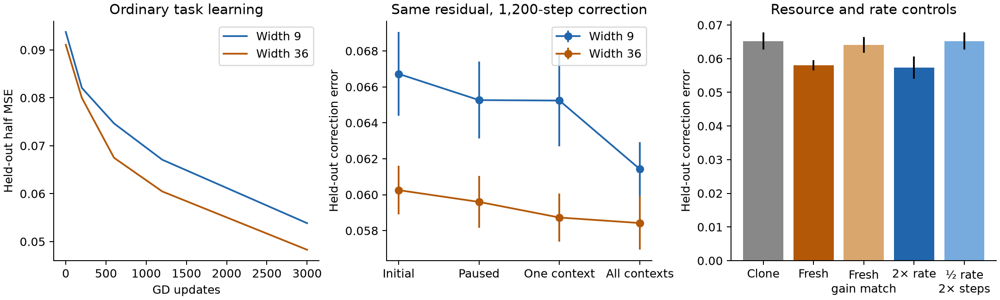

# Implementation slack: replacement workspace, evidence, and finite recovery cost

28 October 2026. A conceptual restart. Previous notes, code, and negative results
are preserved. This investigation does not extend the response spectrum,
tangent forecast, or margin/load framework.

## Finding

**Extra width helps on the new task, but these experiments do not establish that
it helps by preventing competition from consuming flexibility.** The strongest
new empirical result is a separation: learning on one context can impair a
fixed subsequent correction on other contexts, while the width advantage in
that impairment is weak, horizon-dependent, and sometimes reversed. Initial
coverage and the rate of acquiring new features remain important alternatives.

The preferred *candidate mechanism* is **replacement workspace**: a network may
need to build a replacement computation while the old computation still serves
other examples. Additional adjustable implementations can permit that transition
without temporarily destroying useful behavior. This is a statement about
finite paths and recruitment, rather than present response strength. Its
mathematical possibility is simple; its mediation of ordinary learning is not
established here. The empirical findings do not justify calling it the preferred
explanation of the observed width gap.

A useful distinction emerges even for exact clones. They can enlarge the set of
function-preserving reconfigurations, but identical copies under symmetric GD
continue identically. **Geometric workspace and optimizer-accessible workspace
are different resources.** Neither parameter count nor the existence of a
low-loss path is a sufficient training theory.

The deliverable is a finite nonlinear correction-cost definition, a limited
workspace theorem, competing explanations, and experiments that reject several
strong readings of the hypothesis. It is not a fitted width law.

## 1. What the repository evidence actually says

I read the seven requested notes and research history, and inspected the
producers and analyzers for ordinary MNIST, tangent forecasts, retention,
transport, shortcut exceptions, polarization, and dynamic conditional options.
The new [audit script](../../scripts/studies/audit_restart_evidence.py) recomputes
selected claims directly from saved JSONL and NPZ records, without rerunning or
rewriting the historical training. Its output is
[history_audit.json](recruitable_workspace/history_audit.json).

| Historical observation | Recomputed result | Constraint on a new account |
|---|---|---|
| MNIST final training / held-out CE | 32: .206068 / .313079; 128: .179768 / .281884 | Width has a behavioral benefit, not just a diagnostic difference. |
| Late held-seed-out gain RMSE | loss/gradient .001152; plus option summaries .002577 | A scalar plasticity score is not an established explanation. |
| Own residual in weakest half at step 800 | .920589 / .949378 | A better learner can retain relatively harder errors. |
| Same width-difference demand, wide/narrow value | 1.20824 | Keep demand fixed when comparing capability. |
| Fresh-seed tangent RMSE | independent streams .001407; known schedule .0002058 | Conditional knowledge of future batches matters enormously. |
| Ordinary / retained-tangent narrow loss at 8,000 | .050581 / .067304 | Ordinary feature regeneration is beneficial. |
| Initial .05-step crossing fractions | .091339 / .039925 | This is alteration, not automatically destruction. |

The matched-loss table was also checked against its saved analysis and producer;
matching a scalar loss does not match the error function. The historical
polarization NPZs reproduce two false failures and no missed failures in the
base/near discrete cases, and 26 false failures in the rare-context case. The
continuous case has small errors outside the coarse missing-family prediction;
thresholding every nonzero continuous error as an extinction would be misleading.

The dynamic-options study's exact ledger uses observed finite output increments
in its remainder. Ledger closure is consequently a consistency check, not a
prediction. Its renewal experiments really do use informative supplied features
or independent fresh directions at selected damaged states. They do not establish
a general from-scratch width law. Older history additionally documents that
rate changes, readout equilibration, and longer training can reverse apparent
competition conclusions. These limitations inform the new controls below.

This is a selected raw-evidence audit, not a reexecution of every historical
experiment or a fresh statistical validation of all claims in the repository.

## 2. Start with task structure, not a matrix

A promising family has **shared rules with several contextual refinements**.
A broad computation is useful across many inputs, but its accurate local shape
must later differ in several contexts. Adjusting a shared computation can
improve one region while disturbing another. The important structural question
is whether a learner can introduce the revised computation before relinquishing
the old one, at the available training time and tolerated disruption.

Examples include a sensor whose calibration has several local regimes, a reused
visual detector requiring different contextual selectivity, and a compositional
operation whose exception must coexist with the common operation. No neuron is
assigned to a role. The hypothesized obstruction concerns the learned
implementation of these demands.

These task descriptions do **not** imply a positive barrier or a slow recovery
by themselves. A network might smoothly adjust several parameters together,
reuse a computation in a better way, or regenerate missing features. The
binding condition must be demonstrated: the competing exposure increases the
cost of a *fixed needed correction*, and extra width specifically reduces that
increase. Merely finding broad and exceptional examples is insufficient.

## 3. Three competing foundations

### A. Replacement workspace and nonlinear reachability — retained as a candidate

**Task.** A shared computation already supports several contexts. A refinement
requires a different computation on overlapping inputs while the previous
behavior remains useful. This is especially plausible when building the new
computation is a multistep process and an intermediate state is inaccurate.

**Option.** A functional correction reachable through an admissible finite
parameter path, with specified time, displacement, and temporary loss budgets.
There are many possible corrections and many paths implementing each. Paths can
share parameters; neither paths nor neurons are counted as independent options.
The formal definition below makes this a correction-cost curve.

**Resource.** Adjustable computational workspace that can be reassigned without
immediately damaging the current function. It may be distributed across many
units or layers. A zero-readout feature is a simple example, not the definition
of a neuron role. Redundant implementations can release workspace by transferring
readout responsibility before changing their inputs.

**Competition and commitment.** A computation becomes expensive to reassign
because other examples now rely on it, or because alternative implementations
become inaccessible to the optimizer. Commitment means an increased finite
correction cost under competing learning. Recovery means that subsequent
training, redistribution, or recruitment decreases that cost again. No
irreversibility is required.

**Why width could help above representational sufficiency.** The old and new
functions can each fit in the narrow architecture, while temporarily maintaining
both requires additional workspace. A constructive result below establishes
this possibility. It does not establish how ordinary GD finds the new function.

**Little benefit.** Corrections are affine/readout-only; old computations can be
smoothly reused; existing slack is sufficient; all copies remain synchronized;
new directions are uninformative; or recovery is already cheap relative to the
training budget.

**Estimation.** Use finite branches with the same data-derived correction,
function-preserving redistribution or expansion, measured intermediate risks,
optimizer-normalized movement, and held-out correction error. Path optimization
supplies upper bounds on geometric costs; short ordinary optimizer branches
measure accessibility. No teacher or chosen hidden feature is needed. A failed
path search is not a lower bound on the true barrier.

**Assessment.** Attractive mechanism and a useful operational question. The
strong claim that it explains this task's width advantage fails the current
causal tests. In particular, initially gain-matched fresh workspace has little
reliable benefit, and the pressure-induced width effect is small/unstable.

### B. Evidence-limited acquisition of refinements — an alternative, not neural slack

**Task.** Several plausible rules agree on frequent examples but differ on rare
or noisy contextual exceptions. A broad rule is learned first. Detecting which
refinement is useful requires enough repeatable residual evidence.

**Option.** A candidate correction whose improvement can be statistically
identified and acquired within a sample/optimization budget. Its strength is
acquisition probability or expected validated gain, not Jacobian rank.
Candidate corrections can come from independent short training branches or
bootstrap residual fits; they need not be supplied semantic directions.

**Resource.** Informative examples and sufficiently varied candidate computations.
Different refinements compete for informative exposures and for the search
performed by shared trainable features. If the broad rule suppresses residual
signal, later useful refinements may be slower to acquire without any previously
available correction having been destroyed.

For a fixed, independently proposed update direction, let its per-example
improvement signal have mean mu and variance sigma². The uncertainty of its
sample mean is sigma/sqrt(n); n mu²/sigma² is an evidence scale for detecting its
sign. This is a statistical signal-to-noise statement, not an option count or a
width theorem. Directions selected on the same examples require held-out
validation; bootstrapped proposals are not automatically independent routes.

**Commitment/recovery.** A learner commits to a broadly supported predictor;
rare distinctions remain statistically weak. Reweighting exposures, better data,
or later feature acquisition can recover performance. Calling this *loss of
capability* requires the common-demand counterfactual, not just rare-example
loss or a small current gradient.

**Width and limits.** More diverse features may test more hypotheses at once,
but extra width cannot create information absent from the data. Exact clones
duplicate evidence. If all widths already expose the useful statistic, more
samples or balanced sampling should help more than width. There is no automatic
monotonic width benefit and multiple-testing costs cannot be ignored.

**Estimation.** Cross-fit per-example update signals, resample actual contexts,
and compare information/exposure interventions with parameter interventions.
No selected edit or protection direction is necessary if all groups/proposals
are audited under a fixed selection policy.

**Assessment.** More compatible with the historical shortcut results than
irreversible commitment. The new full-batch noiseless task has no minibatch-noise
starvation, yet width still helps and train/test gaps are modest. Pure stochastic
evidence scarcity is therefore insufficient here. Full versus one-context
training is informative about exposure, but does not by itself identify
statistical suppression versus useful feature creation. No SNR law was fitted.

### C. Optimizer-state memory — a distinct cause of delayed correction

**Task.** Frequent high-amplitude learning and a later small refinement share
parameters. Momentum or adaptive second moments retain the frequent history.
The same network function can therefore have different future learnability.

**Option.** A correction reachable within T updates from the *complete* state
(theta, optimizer state). Strength is a hitting-time or finite-gain distribution.
The resource is usable update scale/direction after historical normalization,
not additional independent implementations.

For an RMSProp-like coordinate, v_next = beta v + (1-beta)g². After its large
historical force disappears, the excess v decays approximately as beta^k; its
half-life is log(1/2)/log(beta). This supplies an explicit recovery time that
need not reflect a lost neural route. Momentum can similarly retain an adverse
velocity. Resetting moments at fixed parameters is a discriminating intervention.

**Width.** A width effect would require a derived change in how these histories
are distributed over parameters. More parameters alone do not establish it;
parameter scaling or a larger effective learning rate can reproduce the effect.
Matched-geometry exact clones need not help. Benefit should be small with
memoryless GD or rapidly forgotten moments.

**Estimation.** Saved optimizer statistics, fixed-parameter moment-reset branches,
rate controls, and full train/held-out losses. No teacher is needed.

**Assessment.** A serious alternative for Adam/momentum experiments, but rejected
as an explanation of the new memoryless-GD results and the original SGD-only
MNIST width gap. No separate optimizer-memory experiment was run in this
iteration. It would be inappropriate to rename its effective preconditioning
as a neural option resource.

## 4. The simplest useful formal object

Fix a distribution of inputs, a functional request d(x), the entire optimizer
state s, an optimizer policy A, and a horizon T. For a starting network theta,
define the realized correction and correction risk

    h_theta,u(x) = f_u(x) - f_theta(x),
    R_theta,d(u) = (1/2) E[(h_theta,u(X) - d(X))²].

The correction starts at zero for every network. For the ordinary optimization
of this risk, define

    E_s(d,T) = E_A[R_theta,d(theta_T)],
    tau_s(d,epsilon) = inf{t : R_theta,d(theta_t) <= epsilon}.

The expectation includes optimizer randomness when present. A fuller strength
is P(tau <= T); a deterministic optimizer gives a deterministic hitting time.
Report the error-versus-budget curve, rather than inventing a binary viability
cutoff. In the experiments we record E at discrete horizons, not exact hitting
times. A residual of the current common predictor supplies d. A family of
requests can be obtained from a fixed policy over actual data contexts and
validated residual functions. Their implementations may overlap.

This object measures **finite nonlinear acquisition/recovery difficulty**.
It does not count independent corrections, alternative implementations, or
resilience to unobserved updates. It is an operational definition, not a cheap
closed-form predictor. Measuring E requires actual branches, and estimating
future useful d still needs task assumptions. It cannot infer unseen semantics
from present data alone.

For geometric reasoning, fix a movement budget l and let paths gamma start at
theta and end at correction error <= epsilon. Define

    B_theta(d; epsilon,l)
      = inf_gamma max_{0<=q<=1} [R_theta,d(gamma(q))-R_theta,d(theta)]_+,

subject to integral ||gamma'(q)||_{M(gamma(q))^-1} dq <= l.

Empty feasible sets have infinite cost. M is the declared optimizer metric;
under a reparameterization it must be transported. For history-dependent
optimizers the state and policy remain essential; a frozen metric is not the
full optimizer. The family of reachable corrections as (epsilon,l,B) vary is a
geometric option set. Its paths provide potential implementations, not
independent stochastic routes. B=0 need not imply rapid GD learning.

A direct competition contrast uses a competing-data exposure P_A and a paused
checkpoint P_0, with the same subsequent d:

    H_m(d,T) = E_{P_A(s_m)}(d,T) - E_{P_0(s_m)}(d,T).

Positive H means a correction became harder at this budget because of the
exposure. Width-protected slack predicts H_narrow-H_wide > 0, not just
E_narrow > E_wide. A continuation using all data controls for the amount of
training while changing its composition. Randomization or a predeclared
exchangeable context policy is needed; do not select the most harmed context
from future outcomes. The experiment rotates the exposed context by seed.

This is a causal contrast for the specified branch and demand. It is not an
attribution of the original training loss gap. Once own residuals differ,
original-loss effects and common-demand effects are different estimands.

## 5. A limited workspace result, and the clone objection

Consider a one-hidden-layer network with adjustable readouts and a convex loss
in predictions. Suppose f is the current width-m computation and g is a useful
width-r computation. Add r units with zero readouts, preserving f.

1. Set the new incoming parameters to those implementing g. Zero readouts make
   this a function-preserving finite path.
2. Transfer output weight so that the network implements (1-q)f + qg.
3. Convexity gives L((1-q)f+qg) <= (1-q)L(f)+qL(g).

If L(g) <= L(f), this path never rises above L(f). If g is a global minimizer,
loss along the interpolation is also nonincreasing. The construction applies
to the correction risk using the fixed offset in section 4. Its movement cost
is finite for finite parameter endpoints, but need not fit a small budget.

Both f and g may separately fit in width m. The m+r bound buys coexistence
during replacement, not new endpoint representability. It is a sufficient
upper bound, not a claim that m+r is necessary, nor that an m-wide path has a
positive barrier. Ordinary GD cannot move an exactly zero-readout feature's
incoming weights until the readout receives signal. The theorem supplies no
recruitment-time law or probability that random fresh units discover g.

**Exact copies are subtle.** For two identical features h with coefficients
alpha and beta, transferring their sum to one coefficient leaves the function
unchanged and frees the other's readout. Its incoming parameters can then move
arbitrarily. Thus cloning can create *geometric* replacement workspace, even
when the matched optimizer response is unchanged. But symmetric deterministic
updates preserve equal copies; the optimizer does not automatically perform
that redistribution. Tiny perturbations may take far longer than T to break
this symmetry. The empirical clone/perturbation controls test exactly this
accessibility issue.

This distinction prevents a misleading independence formula such as an option
survival probability raised to the neuron count. Independent initialization
does not imply independent learned fates, and low-loss path multiplicity does
not give a training probability. Related landscape connectivity results already
exist: [Simsek et al.](https://proceedings.mlr.press/v139/simsek21a.html) analyze
symmetry-induced connected minima, and [Ferbach et al.](https://proceedings.mlr.press/v238/ferbach24a.html)
study conditions for wide-network linear connectivity. Those results do not
establish finite-budget recruitment or harmful competing exposure here. The
simple convex-mixture construction is not claimed as a new theorem.

## 6. Experiment: several local calibration refinements

The data are scalar x uniform on [-1,1], with response

    y(x) = .2 x + sum_{j=1}^3 a_j max(1-|x-c_j|/w_j,0).

Centers are near -.60, 0, .57, with independently seeded small shifts; widths
are .25, .28, .23; amplitudes are near 1, -.8, .7 with small seeded variation.
This is a sensor with three local response regimes. Its ordinary neural features
have overlapping global support. There are no orthogonal input features,
assigned experts, named neuron roles, or teacher network.

The learner is

    f(x) = c0 x + c1 + (1/m) sum_r a_r ReLU(w_r x+b_r).

All parameters train. The affine skip makes the global calibration explicit
and gives a meaningful no-refinement control. Full-batch half-MSE GD uses base
rate .06, neuron rate .06m, and affine rate .06. Consequently the per-unit force
is an average over data, not automatically slowed by 1/sqrt(m). Aggregate
functional scale remains order one. This is a declared feature-learning
parameterization, not the MNIST parameterization or a universal width convention.

Nine units suffice **exactly**: each tent equals a_j/w_j times

    ReLU(x-(c_j-w_j)) - 2 ReLU(x-c_j) + ReLU(x-(c_j+w_j)).

The affine skip supplies .2x. The representation is verified to <5e-15 on fresh
inputs. Its coefficients are used only for the capacity audit, never to train,
initialize, select a correction, or choose replacement features. Widths 9 and
36 therefore differ despite equal availability of an exact endpoint function.

Each seed supplies an independently drawn task, 256 training inputs, 2,048
held-out inputs, and a nested bank of random initial parameters. Nested widths,
branches, and horizons within a seed are paired and correlated. SEs below are
across independent seed/task pairs; they are not confidence intervals over
hundreds of independently imagined checkpoints.

### Protocol and separation of evidence types

- Four pilot seeds, 282801–282804.
- Twelve fresh confirmation seeds, 282811–282822, with the unchanged protocol.
- Six further refinement tasks, 282831–282836. These were initially launched
  while intending an affine control but omitting the affine flag. The protocol
  correctly records affine=false. They are retained under `extra_refinement/`,
  not relabeled as negative-control evidence.
- A correctly executed affine control on those six seed IDs, using only .2x.
  This shares seeds with the extra-refinement cohort and is not independent of it.
- Twelve new follow-up seeds, 282851–282862, condition random initialization on
  every breakpoint lying inside [-1,1]. No unit is initially globally inactive
  or globally affine. This removes a discovered initial-coverage confound
  without assigning any unit to a particular task refinement.

For each cohort, qualitative hypotheses and code hashes were saved before its
outcomes. The initial-gradient values in `forecasts.jsonl` were saved before
the associated correction branches. They are instantaneous gain forecasts,
not a new long-horizon theory predictor. Ordinary trajectories were computed
before the branch assays: **the assays are not prospective forecasts of those
ordinary outcomes**. Full-batch GD has no upcoming minibatch randomness to reveal.
The later recovery experiment was designed after the pilot and saved its own
protocol before its continuations. This is internal sequential research, not
external preregistration.

### The common-demand capability assay

At ordinary step 200, form the common reference function
f_ref=(f_9+f_36)/2, and retain d(x)=y(x)-f_ref(x), including on held-out inputs.
From each width branch into:

- initial parameters;
- the paused step-200 state;
- 400 more updates on one of three fixed equal-length input intervals;
- 400 more updates on all training examples.

The exposed interval is seed modulo three, covering all choices without
selecting the largest later effect. The other two intervals are withheld from
that exposure. Exposure uses the original labels.

For each resulting state theta0, train its nonlinear correction
f_theta-f_theta0 against the **same** d. The subtracted network is frozen. Thus
all assays start with exactly the same prediction error, not merely equal loss.
We evaluate both the overall demand and the two unexposed regions. This is a
finite nonlinear branch: the trainable model changes all its features.

The frozen offset is an assay device. Its predictor is
f_ref + f_theta - f_theta0, not a single ordinary network's unmodified task
continuation. It can enlarge the effective function class. Therefore these
results measure correction accessibility at a state, not deployment performance
or a causal fraction of the original width gap. Both original and correction
risks are reported; a favorable assay cannot substitute for ordinary task loss.

### Resource and rate controls

At the exposed width-9 checkpoint compare:

1. Exact fourfold clones, normalization 1/(4m), neuron rate 4m times base rate.
   Their function dynamics match the narrow network at every discrete update.
2. Twenty-seven random new features with zero readouts. Old incoming and
   outgoing parameters are multiplied by two. Homogeneity preserves the
   function and the old optimizer-weighted response contribution exactly.
   Added features supply additional readout responses immediately; this is
   **not** a pure preservation intervention.
3. The same addition with one scalar learning-rate reduction matching the
   initial loss derivative on the common training demand to the narrow model.
   This matches one scalar, not the complete response geometry or future speed.
4. Narrow training at twice the rate.
5. Narrow training at half the rate for twice as many steps, matching elapsed
   GD time. Parameter movement is recorded, but paths are not forcibly matched.
   These are optimizer-time and initial-gain controls, not equal-FLOP comparisons;
   a wider update still computes more scalar parameter changes.

Follow-ups freeze incoming features (narrow and expanded), perturb two clone
groups by opposite random incoming shifts of size .001, and recycle only units
that are exactly inactive on the entire bounded input support. Recycling sets
their readout to zero and samples new incoming parameters; the original function
is preserved. All choices use the model/data support, not desired target features.

## 7. Results and failures

### Ordinary loss benefits exist beyond endpoint capacity

Confirmation means:

| Step | Train loss 9 / 36 | Held-out loss 9 / 36 |
|---|---:|---:|
| 200 | .082228 / .080254 | .082069 / .079975 |
| 3,000 | .052087 / .046957 | .053838 / .048292 |
| 30,000 | .027071 / .002964 | .028945 / .003151 |

At 3,000 the held-out width gap is .005546 (paired SE .003378; 9/12 pairs
favor wide). The difference in improvement from 200 to 3,000 is .003452
(SE .002941; 10/12 favor wide). These are observed effects, not predicted by
a new option scalar. The late ordinary gap persists when narrow rate doubles:
its 30,000-step held-out loss is .029196. The broad late gap is therefore not
removed by the tested rate control.

In the initially-active follow-up, 3,000-step held-out losses are .043283 and
.037202. The paired width gap .006080 (SE .001099) favors wide on all 12 seeds.
At 30,000 the losses are .008218 and .002949; doubled-rate narrow gives .008635.
Initial dead units are therefore not a sufficient explanation of *all* the
width benefit. The smaller late gap than in the first cohort is descriptive:
these are different seeds/tasks, not a randomized paired intervention on the
same initial states.

### Competition can impair a fixed correction; width need not protect it

Positive values below mean that the one-context exposure makes correction of
the **unexposed** contexts harder than pausing. Values are mean ± paired SE.

| Cohort, correction budget | Harm at width 9 | Harm at width 36 | Narrow minus wide harm |
|---|---:|---:|---:|
| Confirmation, 300 updates | .000701 ± .000249 | .001225 ± .000329 | −.000524 ± .000403 |
| Confirmation, 1,200 | .001535 ± .000858 | .000279 ± .000235 | +.001256 ± .000879 |
| Initially active, 300 | .000311 ± .000299 | .000798 ± .000198 | −.000487 ± .000283 |
| Initially active, 1,200 | .000173 ± .000441 | .000073 ± .000401 | +.000100 ± .000360 |

The 300-step confirmation effect on unexposed contexts is positive on 9/12
narrow and 11/12 wide seeds. This is more than selection of easier residuals:
the correction request, starting correction error, held-out inputs, and recovery
optimizer are identical across the exposure/paused comparison. It is evidence
of a finite-budget adverse effect of competing learning in this assay.

It is **not** evidence that width generally protects the correction. At the
shorter horizon the mean adverse effect is larger for the wide model. At 1,200
there is a positive but uncertain narrow-specific effect in the first cohort;
it is negligible after removing inactive initialization. Aggregating all
contexts can hide even this effect: the confirmation overall peer-minus-pause
error is −.000026 at width 9 and −.000869 at width 36 at 1,200 updates. Learning
on the exposed region also creates useful capability.

The sign changes with horizon matter. A single monotone depletion number would
misrepresent them. This study does not establish an irreversible lost option.

### Much of the width gap predates the competing exposure

All entries below start from the same demand and run 1,200 correction updates.

| State | Train correction loss 9 / 36 | Held-out correction loss 9 / 36 |
|---|---:|---:|
| Initial | .065322 / .058833 | .066725 / .060254 |
| Paused step 200 | .063687 / .058009 | .065265 / .059598 |
| One-context exposed | .063705 / .057173 | .065239 / .058729 |
| All-context continuation | .059788 / .056770 | .061419 / .058422 |

The common-demand width gap is .006472 at initialization and .006510 after the
competing exposure. This does not imply every individual route survived; it
shows why a gross capability gap cannot be attributed to dynamic destruction.
All-context learning improves the narrow correction state substantially.

### Fresh workspace helps, but the speed controls weaken the mechanism claim

Confirmation after exposure, 1,200 correction updates unless noted:

| Arm | Train correction loss | Held-out correction loss |
|---|---:|---:|
| Narrow / exact clones | .063705 | .065239 |
| Fresh zero-readout resources | .056468 | .058088 |
| Fresh, initial gain matched | .062569 | .064024 |
| Narrow, double rate | .056021 | .057354 |
| Narrow, half rate and double steps | .063702 | .065236 |

Fresh additions improve all 12 seed pairs, with held-out gain .007151
(SE .002283). Initial gain matching reduces this to .001215 (SE .000848).
Doubling the rate gives .007885 (SE .002505), comparable to unrestricted fresh
addition. Halving the rate at matched time changes loss by only .0000033 on
average; the basic result is not a large-step integration artifact.

The initially-active cohort is more decisive against a special workspace
interpretation of this short rescue: fresh gain is .002097 (SE .000393), but
gain-matched fresh gain is only .000106 (SE .000503). Double-rate narrow gains
.011002 (SE .000974) and beats unrestricted fresh on every seed. On the six
extra refinement tasks, gain-matched fresh addition slightly worsens mean loss
(by .000845, SE .000633). These failures are retained.

None of this proves a universal scalar-speed explanation. One initial-derivative
match cannot match changing dynamics. It does show that the uncontrolled
fresh-resource benefit alone is weak evidence for costly replacement.

### Clone accessibility, fixed features, and recovery

Exact clones reproduce narrow correction outcomes to floating point, and the
independent 50-step clone audit agrees below 1e-12. Opposite .001 perturbations
leave correction results essentially unchanged at 1,200 updates. Before
recentering, their maximum functional discrepancy over a dense input grid is
at most .000118 across both cohorts. They are near-function-preserving, not
exactly function-preserving. This null result is specific to the perturbation
size and horizon; it does not prove that all symmetry-breaking schemes fail.

Freezing incoming features gives confirmation held-out correction loss .072473
for narrow and .068962 after fresh addition. Fresh coverage helps even without
incoming feature learning, but both are worse than fully trainable narrow
(.065239). Thus current extra coverage explains part of the intervention gain,
and feature learning also matters. This is not a purely frozen-feature account.

The original initializer leaves 0–4 globally inactive narrow units per seed.
At the exposure checkpoint the count is unchanged in every confirmation seed;
there is no evidence of new global deaths in this window. Recycling these
initially inactive units at fixed width preserves the function and gives mean
correction loss .062762 versus .065239. That is recovery of unused initial
coverage, not demonstrated reversal of dynamically consumed slack. In the
initially-active cohort there are no inactive units at either checkpoint;
recycling is consequently the identity intervention.

Longer ordinary correction learning is substantial. Confirmation narrow error
falls from .065239 at 1,200 updates to .039225 at 6,000. Initially-active narrow
falls from .056055 to .014109. Calling either state exhausted at 1,200 would
be false. The original task's later plateau-like behavior at 12,000–30,000 is
a separate observation; no infinite-time stationarity certificate was computed.

### Negative task control

With only affine calibration, the six-seed 3,000-step held-out width gap is
.0000049, compared with .005898 on the same six seed IDs with local refinements.
The affine task is solved almost entirely through the shared skip; its small
remaining differences are in residual nonlinear initialization effects.
Gain-matched additions have negligible absolute benefit. This supports the
importance of local nonlinear demands, but is deliberately an easy control,
not a demonstration that every compositional task needs workspace.

## 8. What is and is not explained

The tests establish:

- an exactly representable nonlinear task with train and held-out width benefits;
- a fixed-demand finite-budget impairment caused by another context's learning;
- initial capability differences separated from changes caused by that exposure;
- clone invariance, partial benefit of new current coverage, beneficial feature
  learning, and substantial later recovery;
- failure of a robust short-horizon width-protection effect, and weak or absent
  fresh-resource benefit once initial gain is matched.

They do **not** establish that the same mechanism causes the ordinary width
difference in loss improvement. There is no mediation estimate, validated
closed-form recruitment law, or incremental prospective predictor beyond
loss/gradient baselines in this restart. The previously improved tangent
forecasts remain forecasting results; they do not fill this causal gap.

The long ordinary gaps also resist the tested rate increase, so they should not
be dismissed as entirely a speed multiplier. Their cause is still unresolved:
initial coverage, learned allocation of nonlinear features, finite recruitment
delays, and attraction to poor implementations remain live possibilities. The
current evidence favors **careful separation of acquisition and preservation**,
not a new claim that one diagnostic explains width.

The workspace theorem is intentionally modest. It explains how width can alter
transition feasibility without changing endpoint representability. It does not
show that ordinary narrow learning encounters a positive barrier, that ordinary
wide learning uses the constructive path, or that the additional paths are
statistically independent. Without those bridges, counting paths would merely
replace one descriptive diagnostic with another.

## 9. Next decisive intervention

The next intervention should change **accessible replacement workspace while
holding the current correction response approximately fixed**, rather than add
fresh useful features immediately.

At ordinary checkpoints selected by a time-based rule, make exact matched-cost
clones. Randomly redistribute readout responsibility between copies along their
function-preserving coefficient simplex, leaving one readout zero; transport the
optimizer metric and verify both function and full response on an independent
panel. Then compare:

1. synchronized clones;
2. the redistributed clones;
3. randomized reassignment of the newly freed incoming parameters;
4. narrow and uniform-rate controls matched on the initial common-demand gain.

Redistribution alone generally changes the ordinary Euclidean kernel; it is
**not** automatically a valid matched-response intervention. Solve or measure
that matching before interpreting outcomes. Reject the intervention as a clean
mechanism test if it substantially changes initial capability or requires a
path-dependent optimizer advantage that cannot be controlled. No target feature,
future residual, or retrospectively worst subgroup should choose the freed unit.

Record forecasts before continuing on ordinary data: the replacement hypothesis
predicts a gain only after recruitment time, preferentially following exposure
that raised common-demand correction cost. Measure actual temporary disruption
on every context, train/held-out outcomes, and recovery curves over a stated
budget. A benefit present immediately is coverage or speed evidence; a benefit
only under externally guided path search is geometric possibility, not ordinary
optimizer accessibility.

An equally decisive negative outcome would be that matching current capability
and speed erases the advantage, or that competing exposure does not raise cost.
Then abandon replacement workspace for that regime and investigate feature
acquisition/initialization directly. The present results already move in that
direction; the hypothesis should not be protected by renaming it.

## 10. Artifacts, verification, and reproduction

All new evidence is under [recruitable_workspace/](recruitable_workspace/README.md).
Producers refuse to overwrite protocols. Each run keeps its executed source
snapshot and hash, raw per-seed JSONL outcomes, and model/data NPZ snapshots for
the branching experiment. Recovery runs keep raw trajectories and exact
representation/function-preservation audits. They do not save every late
parameter state. Analysis is deterministic and can be regenerated.

New scripts:

- [explore_recruitable_workspace.py](../../scripts/studies/explore_recruitable_workspace.py)
- [probe_workspace_recovery.py](../../scripts/studies/probe_workspace_recovery.py)
- [analyze_recruitable_workspace.py](../../scripts/studies/analyze_recruitable_workspace.py)
- [audit_restart_evidence.py](../../scripts/studies/audit_restart_evidence.py)
- [verify_workspace_evidence.py](../../scripts/studies/verify_workspace_evidence.py)

Checks include analytic optimizer velocities against autograd, exact clone
trajectories, function-preserving expansion and recycling, exact target
representability, common initial correction errors, source hashes, and
seed-paired summaries. The plot was rendered and visually checked. These check
implementation and the stated comparisons, not the proposed causal theory.

Plasticity has broader established causes: [Lyle et al.](https://proceedings.mlr.press/v202/lyle23b.html)
connect it with loss-landscape changes, while
[Dohare et al.](https://www.nature.com/articles/s41586-024-07711-7)
study sustained plasticity and feature renewal in continual learning. Those
papers motivate alternative explanations; neither establishes the replacement
mechanism or this stationary-task width result. No comprehensive novelty claim
is made for the operational definition, path construction, or interventions.
