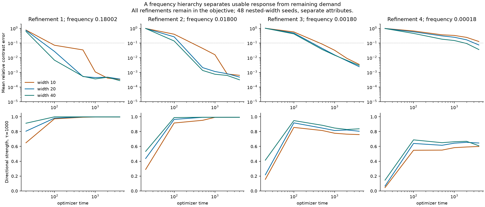
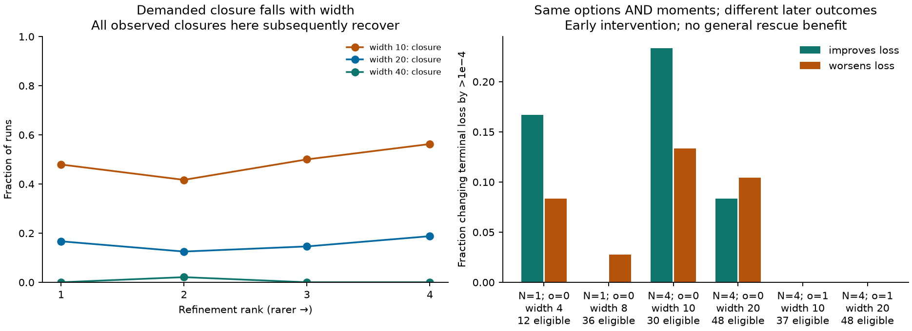

# Functional implementation state: moments, boundary transport, and refinement hierarchies

29 October 2026. Continues [heterogeneous option resources](heterogeneous_option_resources.md).
MNIST remains paused. [Protocols, executed sources, raw records, and reproduction](implementation_state/README.md)
are retained, including unsuccessful compressions and numerical counterexamples.

**Subsequent status:** the [minimal probabilistic continuation](minimal_probabilistic_options.md)
retains this construction as mechanistic evidence, but removes it from the
default predictive state. The results and limitations below remain unchanged.

## 1. What this phase establishes

There is a clean functional resource object for the current shallow network:
a **mass-weighted distribution of signed feature shapes and readout participation**.
It reconstructs the existing spectral response and evolves under the same training
pressures without returning to incoming parameter coordinates. Gate-conditioned
joint moments are a useful projection of this object, with an exact closed update
while gates stay fixed.

However, those moments are **not a sufficient global state**. We constructed and
tested networks with identical current predictions, full response operators, and
even identical gate-conditioned moments that subsequently behave differently.
The missing information concerns how implementations are distributed near gate
boundaries. Natural early-training paths cross these boundaries too frequently
to treat this as an occasional correction.

Thus the accepted continuation is a functional implementation **distribution**
and its moment/flux decomposition. A universally adequate low-dimensional closure
has not been found. This is a limitation of the proposed compression, not a new
definition of options or a proof against every possible compact state.

## 2. The resource object and its map to options

Consider the existing weighted squared-loss model
f=c+m^(−1)Σ_j a_j ReLU(Xw_j), with M_w=M_a=mI and M_c=1. Put

\[
 b=P^{1/2}1,\quad C=P^{1/2}XX^TP^{1/2},\quad
 \phi_j=P^{1/2}Xw_j,\quad v_j=(a_j,\phi_j).
\]

For v_j≠0, define its oriented shape u_j=v_j/||v_j|| and its mass
ω_j=||v_j||²/m. Zero atoms contribute nothing. The implementation state is

\[
 \boxed{\mathscr R=(c,\rho),\qquad \rho=\sum_j\omega_j\delta_{u_j}.}
\]

The sign of u is retained: antipodal shapes generally have different gates.
This construction eliminates neuron labels and incoming directions invisible on
the task support. It is unchanged by orthogonal input-coordinate transformations;
more general transformations require the corresponding optimizer geometry in C.
It is not claimed invariant to changing parameterization or optimizer. For other
unit-specific mobilities, the resource atoms must carry those mobility marks.

The same resource can be stored as the empirical distribution of (a_j,φ_j),
with weight 1/m. The angular form separates implementation shape from strength,
includes a_j=0 without a ratio singularity, and makes clear that resource mass
is not conserved.

For each gate pattern g=1{φ>0}, let G=diag(g), and retain the joint moment

\[
 E_g=\int_{\operatorname{gate}(u)=g}uu^T\,d\rho(u)
 =\begin{pmatrix}s_g&q_g^T\\q_g&R_g\end{pmatrix}.
\]

Then exactly,

\[
 F=P^{1/2}f=cb+\sum_gGq_g,\qquad
 K=bb^T+\sum_gG(R_g+s_gC)G,
 \qquad B_\tau=K(K+(2\tau)^{-1}I)^{-1}.
\]

The deterministic-budget response is the previously defined alternative time
filter of the same K. **Options remain its eigenspaces and strengths.** Resource
moments explain how those capabilities are implemented. The signed q_g can
cancel in the total prediction while still mattering for future response;
R_g and s_g separate feature and readout contributions that K aggregates.
No scalar implementation-diversity index is introduced as a fundamental variable.

The empirical-measure approach is related to established two-layer mean-field
formulations, including [Mei, Montanari and Nguyen](https://pmc.ncbi.nlm.nih.gov/articles/PMC6099898/)
and [Chizat and Bach](https://papers.neurips.cc/paper_files/paper/2018/hash/a1afc58c6ca9540d057299ec3016d726-Abstract.html).
The contribution here is its specialization to functional feature coordinates,
the spectral option map, and tests of which compressed information is sufficient.
Their asymptotic convergence results are not being imported as guarantees for
these finite-width, finite-step trajectories.

## 3. Pressure, transport, and recruitment

Let e=P^(1/2)y−F. For a current pattern g, write ℓ=Ge and v=Cℓ. The functional
atom dynamics are

\[
 \dot a=\ell^T\phi,\qquad \dot\phi=aC\ell,
 \qquad \dot c=b^Te.
\]

These follow directly from the declared optimizer; no fitting is involved.
Writing A_g(e) as the block matrix with top-right ℓᵀ and bottom-left Cℓ gives
v̇_j=A_g(e)v_j. Hence the angular implementation measure obeys transport and
mass growth:

\[
 \dot u=(I-uu^T)A_g(e)u,\qquad
 \dot\omega=2\omega u^TA_g(e)u.
\]

Together with F(ρ), these are a closed resource-level description. Their
finite-Euler counterpart updates (a,φ) using the same current masks, then
re-evaluates masks from the resulting φ. It reproduces the parameter update on
the fixed data support, including gate changes. This is an exact functional
representation, not an independent empirical prediction or a computational
speedup. It does not establish generalization off the represented support.

Common and refinement pressures add inside ℓ. They change both the amount of
response supplied by a route and the feature shape specifying which corrections
that route can implement. Width enters through sampling more atoms, their initial
masses, and their subsequent coupled transport through the shared residual.
A nearly absent response may be recruited by ȧ=ℓᵀφ, followed by coupled feature
amplification. When all relevant implementations remain orthogonal to the
residual, this deterministic first-order recruitment signal is absent.

### The moment closure is exact inside a gate phase

With no gate crossings, Ė_g=A_gE_g+E_gA_gᵀ. More strongly, an Euler parameter
step of size h has the exact moment update

\[
 E_g^+=(I+hA_g)E_g(I+hA_g)^T.
\]

In components,

\[
 s_g^+=s_g+2h q_g^T\ell+h^2\ell^TR_g\ell,
\]
\[
 q_g^+=q_g+h(R_g\ell+s_gv)+h^2(q_g^T\ell)v,
\]
\[
 R_g^+=R_g+h(vq_g^T+q_gv^T)+h^2s_gvv^T.
\]

This removes individual unit identities from smooth response evolution. It also
makes option interactions intrinsic: the same signed moments and geometry C
respond to every pressure, and their contributions sum into K and B. It specializes
the earlier susceptibility tensor instead of replacing it with correlations.

A sufficient validity condition is a positive angular margin γ for every retained
atom and ∫||A_g(e)||dt<γ before the horizon. Since ||u̇||≤||A_g(e)||, no feature
sign can change on that interval. This is deliberately strong. Wider banks can
have smaller minimum margins even when functional survival is more reliable.

### Boundary flux is the missing term

At a crossing, an atom transfers its moment contribution from its old gate group
to a new one. E_g alone does not determine which atoms cross or when. The full
shape distribution does. For a local switch of angular mass W, the corresponding
kernel jump has norm at most 2 max(1,||C||)W; the resolvent identity then bounds
the response jump by this quantity divided by λ=1/(2τ). This is a local bound
on the switching contribution, not a global forecast-error guarantee. Subsequent
mass growth can amplify initially small boundary populations.

There is consequently no conserved number of options. An existing atom can
change the directions it supports; its mass can grow or shrink; several atoms
can supply the same option; and the resulting spectrum can gain or lose breadth.

### An explicit insufficiency counterexample

Take X=I₂, p=(1/2,1/2), two units with w₁=(1,2), w₂=(2,1), a=(−1,1), c=0,
and target y=(1.5,−1.5). Both units are initially active on both inputs. Apply a
rotation by .4 radians to the two rows of W and the same rotation to a. All
initial gates remain active. This preserves Σ_j(a_j,φ_j)(a_j,φ_j)ᵀ exactly,
so it preserves the full resource moments, prediction, K, and every Bτ.

After an Euler step h=.5, the original stays in its gate cell while the rotated
state crosses a boundary, and their predictions differ. The test checks this
constructively. Rescaling all unit parameters by ε and the target by ε² preserves
the construction while scaling the required step by ε^(−2); it is not evidence
that .5 is the appropriate training step in the research experiments.

The counterexample rules out these moments as a generally sufficient state.
It does not show that every boundary difference creates a harmful outcome.

## 4. What width can and cannot do in this formulation

At iid initialization, the empirical resource measure samples implementation
shapes; the earlier block-kernel variance argument gives initial response
concentration under its stated finite-moment and positive-mean-response
assumptions. Initial support, current strength, and actual residual loading are
still separate. Later atoms are coupled through e, so learned survival events
are not independent Bernoulli trials.

There is a useful exact negative control. Duplicating every unit identically,
while using the same mean-field normalization and metric for the new width,
leaves the empirical resource measure unchanged. The functional update and its
whole trajectory are unchanged. The test verifies this through 100 updates.
Thus an increase in raw parameter count alone supplies no new recruitment
potential. Natural widening helps only insofar as it changes the resource
measure and its response to pressure. This statement does not cover earlier
copy interventions with different optimizer mobilities.

The mathematical state is cleaner, but it is not automatically low-dimensional.
On a finite support, φ lives in rank(X) dimensions. Each occupied gate group has
a symmetric moment matrix of that dimension plus one; its number of stored
entries is independent of how many units occupy that group. This can compress
large, concentrated populations. In the current narrow banks many groups contain
one unit, and dense moment storage can exceed raw-parameter storage. The exact
boundary-sensitive distribution generally still needs atom-level information.
We have not established a constant-size sufficient resource state.

## 5. Controlled hierarchy experiments

The new family has N∈{1,2,4} categorical refinements, total probability .2, and
q_j proportional to r^(j−1). Ratios are 1, .25, and .1 where applicable. All
contexts are present throughout ordinary training. Inputs are context coordinates
c_j=±2 and independent signed attributes Z₁,Z₂. The target is

\[
 y=2Z_1+\sum_j2(-1)^{j-1}1_{R=j}
       [oZ_1+\sqrt{1-o^2}Z_2],\qquad o\in\{0,1\}.
\]

The overlap knob o changes task attribute sharing; it is **not assumed equal to
implementation overlap**. Gate-resolved response participation is audited
separately. Each target has an explicit 2+2N-unit witness from a shared linear
pair and the conditional identities ReLU(c_j+v)−ReLU(c_j−v)=2·1_(R=j)v.
Narrow models can therefore represent every target exactly. Increasing N also
changes input dimension and the sufficient width; comparisons across N do not
isolate a pure effect of component count.

A 24-seed pilot was followed by 48 fresh nested-width seeds per configuration.
There are twelve configurations at widths 2+2N and twice that, with two selected
hierarchies also run at four times the sufficient width. Checkpoints extend from
initialization through times 500, 2000 and 4000. Step-refined runs are retained.

Per-component audits use the normalized directions (1_(R=j)−q_j)v, along with
joint-subspace strength and actual residual loading. These directions are not
independent eigen-options. A component is mastered when its context-versus-common
attribute-slope error is within 10% of the target gap. A demanded closure means
coverage falls below .95 **before first mastery**; later loss of an unused
correction is not automatically harmful. Sensitivities .90/.99 for coverage and
5%/20% for final gap error are saved. Transitions are sampled at checkpoints.

For N=4, r=.1, o=0, frequencies are approximately .180018, .018002, .001800,
.000180. Initial structural coverage is already near complete. Missing initial span accounts for little of this cohort; width changes
subsequent survival and timely correction. This does not rule out an influence
of initial strength differences:

| Width | Demanded closures by refinement, out of 48 | Recovery after those closures | Rarest refinement mastered at time 4000 |
|---|---|---|---|
| 10 | 23, 20, 24, 27 | all observed closures recover structurally | 30/48 |
| 20 | 8, 6, 7, 9 | all observed closures recover structurally | 39/48 |
| 40 | 0, 1, 0, 0 | the one observed closure recovers | 48/48 |

The rarest component's mean relative gap error at time 4000 is .1268, .0736,
and .0359 respectively. At width 10 its mean gap falls from .3627 at time 500
to .2420 at 2000 and .1268 at 4000. Total mean losses at 4000 are only .000091,
.000073 and .000027: total loss alone conceals the remaining rare refinement.
Structural recovery therefore does not imply sufficient finite-budget strength.

For N=2, r=.25, separate attributes, all refinements are initially covered at
both widths. Width 6 ends with mean loss .03637, while width 12 reaches about
1e−10 at the measured step. This remains a finite-step observation; it has not
received the same three-resolution numerical audit as the N=4 case below.

With shared attributes, the N=4 hierarchy is much easier and the width ordering
is not uniform at long budgets. Its measured gate-resource participation overlap
is **higher**, not lower: at width 10/time 20 it is about .99–1.00 compared with
.83–.87 for separate attributes. Overlap can enable positive transfer; it is not
itself a competition score. The signed pressure/implementation relationship and
boundary transport remain necessary.

## 6. Causal tests of what information is missing

**Same current options, different signed moments.** Zero-function ReLU identity
blocks are initialized with readouts a and −a. Initial predictions and the full
K match exactly, but gate-resolved q changes sign. In the one-refinement,
separate-attribute case, 22/48 matched pairs differ in final loss by more than
1e−4. In the four-refinement counterpart, 20/48 do. Shared-attribute cases mostly
converge to the same solution. There is no consistent beneficial orientation:
these are necessity tests, not proposed interventions for improving training.

The moment forecast is exact on pairs that remain in their gates. It deteriorates
rapidly after crossings; artificial matched pairs can have large long-horizon
errors. This is evidence against promoting the fixed-gate closure globally.

**Same options and same full moments, different shape distribution.** At natural
time 2 or 20, rotate a randomly chosen same-gate pair in both incoming weights
and readouts, accepting only rotations that preserve its current gate pattern.
This preserves all E_g, the function, full K, width, optimizer, and global
parameter norm. It changes the distribution of individual feature shapes and
boundary distances. No eventual loss or target alignment is used in selecting
the pair or angle.

At time 2 in the one-refinement narrow model, 12/48 states are eligible; two
improve and one worsens by more than 1e−4. At width 8, 36 are eligible and one
worsens, with no improvement. In the four-refinement separate-attribute model,
11/30 eligible narrow states and 9/48 wider states change final loss by more than
1e−4, with both signs. Gate trajectories diverge in 29/30 and 46/48 respectively.
The mean benefit intervals span zero. Mixing at time 20 has no meaningful
one-refinement effect and only small mixed-sign hierarchy effects.

These tests establish missing causal information in the shape distribution,
not a reliable rescue procedure or full mediation of natural width. Eligibility
and intervention timing matter. The analytical two-point counterexample makes
the insufficiency independent of statistical significance of the mean effects.

## 7. Validation and negative results

On 72 predetermined natural states per start time, one-step gate changes occur
in all 72 at time 2, 35 at time 20 and 37 at time 100. Fixed-gate moments therefore
cannot be treated as an exact closure during ordinary early training. Across
no-crossing intervals their response error is at most about 2.4e−13. The full
functional particle state reproduces five-time-unit predictions to about 2e−14.
This verifies an exact change of representation, not out-of-sample prediction.

At time 2 and horizon 5, the moment model reduces response error to .426 of a
frozen-K baseline, but at times 20 and 100 its response-error ratios are close to
one. At time 100, 7/72 frozen-Euler baselines violate the local stability
condition dt·lambda_max(K)<2 and can diverge over longer windows; spectacular improvements against that baseline must not be interpreted
as uniformly accurate compact forecasting. Raw absolute errors are retained.

A numerical check overturns one apparent persistent obstruction. For N=4,
r=.25, separate attributes, narrow mean loss at time 4000 is .001061 at dt=.05,
.00002324 at .025, and 5.94e−8 at .0125. The wide values also change, to 7.37e−8
at the finest step. The coarse residual is **not robust evidence for a
continuous-time trap**. All three resolutions are retained. The N=1 separate-
attribute gap is much less affected by halving the step (.20695/.05200 becomes
.20472/.05200). The strongest hierarchy r=.1 retains delayed rare correction,
with quantitative changes under step refinement.

The earlier continuous recovery cases, harmful common-pressure knockout,
copy-intervention failures, and restrictive recycling eligibility remain part
of the evidence. This phase adds no MNIST runs and no claim that every width
benefit has now been explained.

The next theoretical compression should approximate **response-weighted boundary
transport of the implementation distribution**, rather than adding unrelated
counts. It must beat the present moment closure on natural paths and distinguish
structural recovery from sufficiently fast rare correction. That missing closure,
and a quantitative mediation of natural width by it, remain unresolved.
