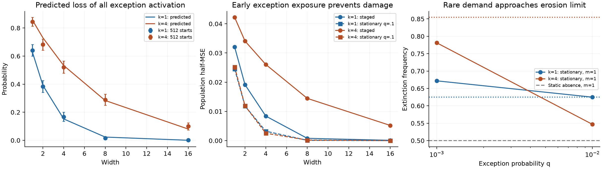

# Width preserves exceptions: an erasure–rescue theory

23 October 2026. Independent research iteration. Existing notes and experiments
are preserved. This is an analytically closed alternative mechanism, **not a
claim to have explained the repository's ordinary two-layer experiments**.

## 1. Start with the task

**What meaningful properties could a reasonably broad family of tasks or data
distributions have that naturally produce delayed demands, competing
specialization, and a width benefit beyond representational capacity?**

My preferred answer is **a reusable default rule with conditional exceptions
that share the default's cues but require an additional distinguishing cue**.
Most observations reward preserving the default. A small or late population
requires a correction. Before that population supplies enough gradient, learning
to avoid unnecessary corrections on common observations can erase the features
that would have made the correction learnable.

Examples motivating this abstraction include adapting a pretrained predictor
to uncommon contexts, learning exceptions to a broadly predictive shortcut,
and residual prediction for a subgroup after a shared predictor has been learned.
These examples motivate the assumptions; the experiments below are synthetic,
not demonstrations on any of those applications.

The refinement of “width buys option value” is:

> Width can preserve enough **exception-sensitive directions through the
> learning of default fidelity**. The relevant probability is the mass of those
> directions after the common-task gradient has acted, not at initialization.
> Exception exposure competes with that erasure and can remove the width premium.

Unlike Hall allocation, a neuron need not choose between exclusive roles. Unlike
a generic option Gramian, the decisive zero is an actual activation boundary,
with an absorbing property proved from the task and optimizer. There is no
threshold chosen to correlate with terminal loss.

The strongest limitation is architectural: the exact model is a **one-sided
ReLU correction branch over an already available default**, with fixed readout
sign and magnitude. It does not learn the default jointly. It isolates a
mechanism plausible inside a larger model, but that embedding remains unproved.

## 2. Competing explanations and what survived

| Candidate | Task motivation | Discriminating consequence | Judgment |
|---|---|---|---|
| Sequential low-rank learning | Strong shared factors followed by weaker detail | With equal initial aggregate mode energy, duplicating factor coordinates leaves the learning ODE unchanged | Delay alone is insufficient |
| Smooth sensitivity attenuation | A default representation gradually suppresses later directions | Mean-normalized redundant copies do not restore the attenuated population learning rate | Reject as a sufficient explanation of width rescue |
| Exclusive specialist allocation | Conditional regimes need incompatible predictors | Joint eligibility, not marginal counts, controls assignment feasibility | Existing Hall theory remains appropriate for this mechanism |
| Exception activation erosion | Default fidelity suppresses corrections on shared cues | A task-derived transported margin predicts irreversible loss and a geometric width law | Preferred new, restricted mechanism |

The first two controls are intentionally minimal counterexamples, not attempts
to refute all low-rank or tangent-kernel theories. The existing branching
staircase failure and the counterexamples in
[research_history.md](../reports/research_history.md) also argue against making
delay or generic gradient conflict the explanation by itself.

## 3. From the task to a low-level model

### 3.1 Task assumptions

Subtract the reusable default predictor from the labels. Common examples require
zero correction; an exception requires correction \(-D\), with \(D>0\).
At the representation entering the correction branch, assume:

1. There are \(k\) distinct common cue patterns, modeled initially by
   \(u_i=e_i\), \(i=1,\ldots,k\).
2. The exception contains all these cues and one novel cue:
   \[
   v=\frac{(1,\ldots,1,\epsilon)}{\sqrt{k+\epsilon^2}},\qquad \epsilon>0.
   \]
3. Common patterns each have mass \((1-q)/k\); the exception has mass \(q\).
4. Learning is either staged (common examples first), or on this fixed
   distribution with small \(q\).

These are bounded, discrete conditional patterns, **not Gaussian input features**.
Orthogonal common prototypes are a strong low-level simplification of separate
common contexts. Whitening arbitrary data does not make this assumption free:
it changes the optimizer metric. A later section perturbs the prototypes.

### 3.2 Architecture and dynamics

Use the additive correction network

\[
 f_W(x)=-\frac1m\sum_{r=1}^m [w_r^\top x]_+.
 \tag{1}
\]

Hidden weights train; output coefficients are fixed at \(-1/m\). Use population
half-MSE and gradient-flow time \(\dot w_r=-m\nabla_{w_r}L\). The factor \(m\)
keeps the particle dynamics on a mean-field time scale. It does not give the
wider model an extra factor of \(m\) in function-space learning rate.
Initialize independent, uniformly oriented weights of fixed radius
\(0<\sigma<D\). The experiments use \(\sigma=.2,D=1\).

Write

\[
 h_i=\frac1m\sum_r[w_{ri}]_+,\quad
 h_v=\frac1m\sum_r[w_r^\top v]_+,\quad e=D-h_v,\quad a=\frac{1-q}{k}.
\]

Then

\[
 L=\tfrac a2\sum_i h_i^2+\tfrac q2e^2,
\qquad
 \dot w_r=-a\sum_i h_i\mathbf1_{w_{ri}>0}e_i
            +qe\mathbf1_{w_r^\top v>0}v.
 \tag{2}
\]

Common fidelity and exception correction act in opposite directions on the
same weights. This is a gradient-flow calculation, not a theorem for Adam,
momentum, weight decay, trainable biases, or trainable readout signs.

At ReLU boundaries, use an absolutely continuous subgradient-flow interpretation
with the chain rule, zero derivative for a unit inactive on every input, and
the usual limiting treatment of sliding boundaries. The stated inequalities
hold almost everywhere. Finite Euler steps can overshoot boundaries; their
discrepancy is measured below rather than silently equated with gradient flow.

### 3.3 Separate representation from optimization immediately

Width **one** represents the target for every \(k\) and \(\epsilon>0\):

\[
 w_*=(0,\ldots,0,D/v_{k+1}).
 \tag{3}
\]

It gives zero common correction and exception correction \(-D\). Wider models
can duplicate this unit and retain the same function and individual weight norm.
Thus neither larger \(k\) nor the widths below increase the minimum number of
units needed to represent this particular task.

There is a norm qualification: \(\|w_*\|=D\sqrt{k+\epsilon^2}/\epsilon\).
Small novelty makes the problem poorly conditioned and requires larger weights.
No norm constraint or weight decay is imposed. If only one unit in a width-\(m\)
average survives, it may need a weight of order \(mD/v_{k+1}\). Width is not a
free cure for finite-time conditioning or regularization constraints.

## 4. The formal object: the exception margin after common erasure

Let

\[
 C=\{w:w_i\le0\text{ for }i\le k\},\qquad
 P_Cw=(\min(w_1,0),\ldots,\min(w_k,0),w_{k+1}).
\]

The central scalar is

\[
 \boxed{M_v(w)=v^\top P_Cw
       =w^\top v-\sum_{i=1}^k v_i[w_i]_+.}
 \tag{4}
\]

It is the **exception margin after common erasure**. The second term is the
exception activation currently borrowed from responses that common-task training
will suppress. It is determined from the task inputs and current weights,
without inspecting final weights, defining neuron roles, or choosing a cutoff.

Three cases matter:

- \(w^\top v\le0\): currently inactive on the exception; no exception gradient.
- \(w^\top v>0\) but \(M_v(w)<0\): active now but vulnerable to common erasure.
- \(M_v(w)>0\): activation survives complete common erasure.

The last case supplies a genuine positive margin, rather than a small numerical
gate-weight threshold. For an initialization law \(\mu\), define its survival
mass and its distribution function

\[
 p_v=\Pr_{W\sim\mu}\{M_v(W)>0\},\qquad F_v(z)=\Pr\{M_v(W)\le z\}.
 \tag{5}
\]

This is an explicitly computable specialization of a viable mass, not a new
name for arbitrary reachability. The new work is the derivation of the map,
the absorbing property, the convergence result, and the fixed-distribution limit.

### 4.1 Why common training induces exactly this map

During common-only training, each coordinate follows

\[
 \dot w_{ri}=-a_0h_i\mathbf1_{w_{ri}>0},\qquad a_0=1/k,
\]

and the novel coordinate does not move. Let
\(E_i(t)=a_0\int_0^t h_i(s)\,ds\). The exact solution is

\[
 w_{ri}(t)=w_{ri}(0)-\min\{[w_{ri}(0)]_+,E_i(t)\}.
 \tag{6}
\]

Every positive coordinate tends to zero; negative coordinates remain fixed.
Consequently \(W(\infty)=P_CW(0)\), **independently of width**, even though the
finite-time exposures \(E_i\) are coupled across neurons. Taking a converged
common phase removes that dependence; it is not an iid mean-field approximation.

At finite time the full prospective object is the survival profile

\[
 p_v(E)=\Pr\left\{v^\top W-
       \sum_i v_i\min([W_i]_+,E_i)>0\right\}.
 \tag{7}
\]

The exposure ODE can be computed from initialization before the exception is
trained. Sample-specific exposures are coupled and do **not** imply independent
survivor counts at arbitrary finite time. The saturated map in (4) does.

### 4.2 The erasure–rescue identity on a stationary task

Since initialization satisfies \(h_v<D\), (2) preserves \(e\ge0\). At
\(h_v=D\), the exception drive is zero and common updates can only decrease
\(h_v\), because all \(v_i>0\).

An exception-inactive unit can never reactivate: its remaining updates are
nonpositive combinations of \(e_i\), each with positive inner product with
\(v\). For an active unit, away from boundaries,

\[
 \boxed{\frac{d}{dt}M_v(w_r)
 =qe\mathbf1_{w_r^\top v>0}
 \left(v_{k+1}^2+\sum_{i:w_{ri}<0}v_i^2\right)\ge0.}
 \tag{8}
\]

Thus \(M_v(w_r(0))>0\) guarantees permanent exception activation. A vulnerable
unit must raise its erasure margin before its current activation reaches zero.
Equation (8) makes “delayed demand” a quantitative **race**, not a manually
assigned release time.

There is an important distinction: the protected margin itself does not decline
on these stationary dynamics. What declines is current activation supported by
unprotected common responses. Calling (4) a deteriorating generic plasticity
score would therefore be wrong. It forecasts which initially available options
can survive the impending common-task adaptation.

## 5. Principal result: width, dynamics, and loss

### Proposition: staged equality and stationary sandwich

Assume (1)–(2), \(0<q<1\), \(\epsilon>0\), independent spherical initialization
with radius \(\sigma<D\), unlimited training time, and the flow convention above.
Assume no atom at \(M_v(W)=0\), which holds here.

**A. Converged common pretraining followed by the full task.** If \(N\) units
have positive erasure margin, then

\[
 L_\infty=\begin{cases}qD^2/2,&N=0,\\0,&N\ge1,\end{cases}
 \quad N\sim\operatorname{Binomial}(m,p_v).
\]

In particular,

\[
 \boxed{\mathbb E L_\infty=\tfrac{qD^2}{2}(1-p_v)^m.}
 \tag{9}
\]

This is an equality, not just a capacity certificate. On extinction the model
cannot change at all; on survival it converges to zero loss.

**B. The fixed distribution, with exceptions present from time zero.** Terminal
loss is again either zero or \(qD^2/2\). Its failure probability satisfies

\[
 \boxed{2^{-m}\le \Pr(L_\infty=qD^2/2)\le(1-p_v)^m.}
 \tag{10}
\]

The lower event is missing all exception activation at initialization. The
upper event is missing every protected erasure margin. Stationary training can
rescue vulnerable units, so it need not attain the upper bound.

For fixed \(k,m,\epsilon,\sigma,D\),

\[
 \boxed{\lim_{q\downarrow0}\frac{\mathbb E L_\infty(q)}{qD^2/2}
       =(1-p_v)^m.}
 \tag{11}
\]

This is an endogenous-delay statement on a stationary population. It is a
small-\(q\) limit at fixed width, not an exact finite-\(q\) iid law and not an
interchange of \(m\to\infty\), \(q\to0\), and finite training horizon.

### Proof details

After common pretraining all weights lie in \(C\). With no positive exception
activation, every gradient is zero. If any margin is positive, (8) protects it.

For convergence, set \(U_r=\dot w_r\),
\(S=m^{-1}\sum_r\|U_r\|^2=-\dot L\), and let \(N\ge1\) be the current number
of exception-active units. The novel coordinate of the update implies

\[
 q^2e^2(N/m)v_{k+1}^2\le S.
\]

If \(h_i>0\), at least one unit is active on common coordinate \(i\).
Using \((x+y)^2\le2x^2+2y^2\) on its update, summing coordinates, and using
the novel-coordinate bound gives

\[
 a^2\sum_i h_i^2\le\frac{2mS}{v_{k+1}^2},\qquad
 L\le\frac{m}{v_{k+1}^2}
       \left(\frac1a+\frac1{2qN}\right)S.
 \tag{12}
\]

So while at least one unit remains active,

\[
 L(t)\le L(0)\exp\left\{-
 \frac{v_{k+1}^2t}{m(1/a+1/(2q))}\right\}.
 \tag{13}
\]

This conservative rate uses \(N\ge1\); it is not an asserted sharp rate.
The active set can only lose units. If it never empties, (13) implies zero
terminal loss. If it empties, exception loss is fixed at \(qD^2/2\), and
common loss converges to zero. This proves the binary outcome and the sandwich.

For the rare limit, compare the stationary flow to common-only flow with the
same common masses. The common loss is convex in \(W\): each \(h_i\) is convex
and nonnegative, and squaring preserves convexity. Its subgradient flow is
contractive. The exception perturbation has Frobenius norm at most
\(qD\sqrt m\). Common-only positive coordinates are bounded above by
\(\sigma\exp(-at/m)\). Therefore every particle obeys the deterministic bound

\[
 \|w_r^{(q)}(t)-P_Cw_r(0)\|
 \le\underbrace{\sigma\sqrt{mk}\,e^{-at/m}
           +qD\sqrt m\,t}_{\Delta_m(t,q)}.
 \tag{14}
\]

For fixed finite \(m\), choose \(t\) growing logarithmically as \(q\downarrow0\).
Then \(\Delta_m\to0\). Every initially negative erasure margin becomes
exception-inactive; every positive one is protected by (8). Boundaries have
probability zero, so bounded convergence gives (11).

A fully prospective finite-\(q\) refinement, even if conservative, is

\[
 \max\{2^{-m},F_v(-\inf_{t\ge0}\Delta_m(t,q))^m\}
 \le\Pr(\mathrm{failure})\le(1-p_v)^m.
 \tag{15}
\]

The CDF is computed from initialization and task geometry, not endpoints. The
bound degrades with width and is not claimed numerically tight in the main runs.
It explicitly handles the shared residual instead of pretending stationary
particles remain independent.

## 6. Geometry gives the width law

Spherical initialization has the same sign geometry as independent standard
normal coordinates \(Z_1,\ldots,Z_{k+1}\). Gaussianity is used here solely to
integrate an isotropic **initialization**, not to assume Gaussian data:

\[
 \boxed{p_{k,\epsilon}
 =\Pr\left\{\epsilon Z_{k+1}>\sum_{i=1}^k(-Z_i)_+\right\}.}
 \tag{16}
\]

For one common cue, angular integration gives

\[
 p_{1,\epsilon}=\frac14+\frac{\arctan\epsilon}{2\pi}.
 \tag{17}
\]

For fixed \(k\) and \(\epsilon\downarrow0\), separate zero, one, and at least
two negative common coordinates:

\[
 p_{k,\epsilon}=2^{-(k+1)}+
       \frac{k\epsilon}{2^k\pi}+O_k(\epsilon^2).
 \tag{18}
\]

The zero-negative term contributes \(2^{-k}\Pr(Z_{k+1}>0)\). Exactly one
negative coordinate contributes
\(k2^{-k}\arctan(\epsilon)/\pi\). Two or more contribute the remainder.
This expansion is not uniform in \(k\); it should not be used at \(\epsilon=1\)
as a numerical prediction.

For the staged setting, or the rare limit, failure probability at most \(\delta\)
requires precisely

\[
 m\ge\left\lceil\frac{\log\delta}{\log(1-p_{k,\epsilon})}\right\rceil.
 \tag{19}
\]

When \(p\) is small, this is \(p^{-1}\log(1/\delta)\). In the small-novelty
limit at fixed \(k\), the scale approaches
\(2^{k+1}\log(1/\delta)\), although representational width remains one.
The number of common constraints, not the number of required specialists,
creates the redundancy demand.

At \(\epsilon=0\) the target is not representable by this branch: any weight
inactive on every common prototype is inactive on their positive combination.
The apparent jump in (18) at zero is resolved by the diverging representation
norm and vanishing finite-time rate. One must not infer a discontinuous practical
rescue by infinitesimal novelty.

### Static versus dynamic loss of options

Because positive common overlap makes the erasure map decrease exception
activation, the events are nested. Initial total absence has probability
\(2^{-m}\). New total absence caused by a converged common phase has probability

\[
 (1-p_{k,\epsilon})^m-2^{-m}.
 \tag{20}
\]

Conditioning on initial coverage gives this quantity divided by \(1-2^{-m}\).
This explicitly separates lottery failure at initialization from destruction
during training. It is not an endpoint classification pretending to identify
when the options were lost.

## 7. Theory-led experiments

Source: [explore_innovation_survival.py](../../scripts/studies/explore_innovation_survival.py).
Complete summaries and protocol:
[results JSON](innovation_survival_results.json). Paired seed arrays:
[raw NPZ](innovation_survival_results.npz). Analysis:
[analyze_innovation_survival.py](../../scripts/studies/analyze_innovation_survival.py)
and [audit JSON](innovation_survival_audit.json).

These are exploratory experiments. A first 128-start Gaussian-radius pilot
preceded the main cohort. It revealed the survival plateau and the difference
between stationary and staged training; then the proof was sharpened, bounded
radius initialization adopted to satisfy its invariant, and stationary rarity
and step-size controls added. The main cohort is **not an independent
preregistered confirmation**. No result was used to fit \(p\), a role definition,
or a gate threshold.

### 7.1 Prospective geometry

One million independent initialization draws per geometry, separate from
training seeds, give:

| Common cues \(k\) | Novelty \(\epsilon\) | Predicted survival mass |
|---:|---:|---:|
| 1 | 1 | .375 exactly; integration .375434 ± .000484 SE |
| 1 | .25 | .288990 exactly; integration .289502 ± .000454 SE |
| 2 | 1 | .277797 ± .000448 SE |
| 4 | 1 | .145692 ± .000353 SE |
| 4 | .25 | .054937 ± .000228 SE |

Monte Carlo integration of (16) is a numerical theory prediction; it is not an
estimate of a fitted endpoint survival parameter.

### 7.2 Main staged versus stationary comparison

512 paired starts per \(k\), nested widths, \(q=.1\), radius .2, \(D=1\),
\(\epsilon=1\), Euler step .2, gradient-flow horizon 2000. Staged initialization
is the **analytically derived common-training limit**, not a claim that a finite
Euler common phase implements that map exactly. All losses are population
half-MSE. Extinction always has loss .05.

| \(k\) | Width | Theory extinction | Observed staged extinction | Staged loss | Stationary loss |
|---:|---:|---:|---:|---:|---:|
| 1 | 1 | .6250 | .6406 | .0320313 | .0245117 |
| 1 | 2 | .3906 | .3828 | .0191406 | .0118164 |
| 1 | 4 | .1526 | .1680 | .00839844 | .00322266 |
| 1 | 8 | .02328 | .01563 | .000781250 | .0000976563 |
| 1 | 16 | .000542 | .001953 | .0000976569 | 1.36e-9 |
| 4 | 1 | .8543 | .8438 | .0421875 | .0251953 |
| 4 | 2 | .7298 | .6816 | .0340820 | .0119141 |
| 4 | 4 | .5327 | .5215 | .0260742 | .00253907 |
| 4 | 8 | .2837 | .2891 | .0144622 | .000196103 |
| 4 | 16 | .08051 | .09961 | .00519494 | 5.60e-8 |

The stochastic frequencies fluctuate: for example, \(k=4,m=2\) is about 2.4
binomial standard errors below its prediction. The displayed rows are paired
and nested, not ten independent validations. Very small predicted probabilities
cannot be estimated accurately from 512 starts. At \(k=1,m=16\), one failure
versus an expectation of .28 failures is unremarkable.

All positive projected margins remained exception-active on the main stationary
and staged trajectories; the producer asserts this. Extinguished staged runs
land at exactly .05. The finite-horizon discrepancy from the loss equality is
the residual in surviving runs, not a fitted correction to the extinction law.
For \(k=4,m=16\), survivors still average .000238 at time 2000. On the same first
128 starts extended to time 8000, survivor loss falls to 3.75e-9 and mean loss
equals the seed-specific extinction floor to 3.22e-9. More width can therefore
reduce failure probability while slowing the few-survivor trajectories.

The common-phase dynamic event is material. For \(k=4,m=4\), initial total
absence is .05078, whereas post-erasure absence is .52148: **47.07% of all
starts lose initially available exception activation**. At \(q=.1\), presenting
exceptions throughout largely prevents that additional loss; its final failure
frequency is essentially the initial-absence frequency. Rarity, not just shared
geometry, is a substantive condition.

The paired width-one minus width-sixteen mean loss reduction is .03193
[.02988,.03408] for \(k=1\), and .03699 [.03506,.03884] for \(k=4\)
(95% paired bootstrap intervals). These quantify the synthetic effect, not a
fraction of the original project's width advantage explained by this mechanism.



### 7.3 Stationary rarity test

128 paired starts, horizon \(20/q\), step .5. The normalized loss is loss divided
by \(q/2\); this separates frequency of failure from the shrinking cost of a
rare subgroup. The upper limit is (11), not an exact finite-\(q\) prediction.

| \(k\) | Width | \(q\) | Exception extinction | Newly extinct | Normalized loss | Rare-limit prediction |
|---:|---:|---:|---:|---:|---:|---:|
| 1 | 1 | .01 | .6250 | .1406 | .6250 | .6250 |
| 1 | 1 | .001 | .6719 | .1875 | .6719 | .6250 |
| 1 | 4 | .01 | .1094 | .03125 | .1113 | .1526 |
| 1 | 4 | .001 | .1797 | .1016 | .1814 | .1526 |
| 4 | 1 | .01 | .5469 | .1328 | .5471 | .8543 |
| 4 | 1 | .001 | .7813 | .3672 | .7813 | .8543 |
| 4 | 4 | .01 | .0625 | 0 | .1117 | .5327 |
| 4 | 4 | .001 | .3125 | .2500 | .3774 | .5327 |

The trend supports approach toward the erasure limit; it does **not** establish
that \(q=.001\) is already asymptotic. Empirical rates above a population limit
at \(k=1\) are sampling fluctuations; these 128-start subsets also have larger
empirical projected-extinction rates than the analytic population probability.
The gap between normalized loss and extinction at \(k=4,m=4\) is finite-time
optimization of surviving runs, not an additional absorbing failure state.

### 7.4 Structural interventions and a failed partial intervention

At width one, after the same common erasure, over all 512 starts:

| Intervention | \(k=1\) mean loss | \(k=4\) mean loss |
|---|---:|---:|
| Ordinary ReLU | .0320313 | .0421875 |
| Change to leaky ReLU, leak .1 | 3.10e-30 | 2.92e-27 |
| Orient only the novel coordinate positively | .0119141 | .0342773 |
| Replace by a novel-only positive unit | 3.10e-30 | 2.03e-27 |

Leaky activation removes the absorbing zero gradient and changes the function
class; it is an architectural intervention, not a matched-motion causal
decomposition. The novel-only unit has zero common response and preserves
common predictions exactly, but is an **oracle intervention using the novel
direction**, not a ready-to-use algorithm.

The failed partial intervention matters: making the novel coordinate positive
does not suffice. Negative common coordinates can still outweigh it in (4).
The relevant quantity is the full exception margin, not a sign count or the
mere presence of a novel feature.

### 7.5 Rejected candidates, numerical checks, and uncertainty

For independent factorized modes, \(f_i=\sum_r b_{ir}^2\), the ODE is
\(\dot b_{ir}=(s_i-f_i)b_{ir}\), so
\(\dot f_i=2(s_i-f_i)f_i\). Strengths \((1,.1)\) and aggregate initial energy
.001 give delayed weaker-mode learning, but duplicating coordinates by
\(b\mapsto b/\sqrt m\) leaves the whole trajectory invariant. Copies 1,4,16
give identical numerical endpoints to printed precision. This control uses
aligned factor coordinates intentionally: it disproves “delay implies a width
premium,” not a claim about random initialization of every matrix factorization.

For uniform attenuation, option columns \(.1/\sqrt m\) give scalar Gramian .01
at all three widths. Residual half-MSE at time 100 is .0676676 for widths
1,4,16. Width cannot restore population sensitivity by duplicating uniformly
attenuated options under this normalization.

The analytic gradient matches central finite differences to 1.17e-11. Halving
the step in the main minimal-width checks leaves the plateau unchanged;
fourfold horizon leaves the same extinction loss. Halving the rare-task step
.5 to .25 on the same 32 starts leaves width-four extinction exactly unchanged
for both values of \(k\); mean half-MSE changes by less than 4e-10.

Finite Euler common pretraining is **not** exactly the projection map: at step
.2 its maximum weight discrepancy is .00906 for \(k=1\), .00307 for \(k=4\)
on the checked subset. This is boundary overshoot, not evidence against the
continuous-time derivation. The audit includes step .02 and records whether
any exception signs change. Main staged results use the exact map explicitly;
stationary results use actual finite updates with their step checks. At step
.02 the discrepancies shrink to .00132 and .000216 respectively, with no
exception-sign discrepancies on this subset at either step size.

Paired bootstrap intervals for width and intervention effects are saved in the
audit, using 4,000 resamples of training seeds. The geometry integral's Monte
Carlo error is separate. These runs have no dataset sampling uncertainty because
the population objective is evaluated exactly. They have no optimizer sweep
and provide no evidence for robustness to Adam or momentum.

### 7.6 A small departure from exact prototypes

The follow-up [cluster probe](../../scripts/studies/explore_innovation_clusters.py)
replaces each common input by two patterns \(e_i\pm\delta e_{k+1}\). It is still
finite support, not a continuous-distribution demonstration. This puts nuisance
variation in precisely the coordinate previously unused by common examples.
The common-zero cone becomes \(w_i\le-\delta|w_{k+1}|\); an exception-only unit
exists if and only if \(\epsilon>k\delta\). The script verifies an explicit
width-one witness. Choose \(k=4,\epsilon=1,\delta=\epsilon/(4k)=.0625\), a quarter
of that capacity boundary, with 128 new paired starts.

Here common pretraining is actually integrated for time 1000; **the orthant
projection formula and its iid width probability are not used**. Before the
exception continuation, record whether any unit activates on it. Because every
common pattern has positive dot product with \(v\), complete exception inactivity
is still absorbing: the remaining common gradients cannot reactivate it. This
gives a state-based prospective loss floor for the continuation, although it
does not give an initialization-only probability of reaching that state.

| Width | Initial absence | Absence before release | Mean final loss | Predicted seed-specific floor |
|---:|---:|---:|---:|---:|
| 1 | .5000 | .90625 | .0453125 | .0453125 |
| 4 | .07031 | .64063 | .0320438 | .0320313 |
| 16 | 0 | .10938 | .00685086 | .00546875 |

Every predicted failure ends at .05; no extinct run revives. Common pretraining
loss is at most 1.13e-13 in mean. Survivors at width 16 still average .00155 at
time 2000, so the finite-horizon total exceeds the absorbing floor. Results and
the explicit witness are in [cluster results](innovation_clusters_results.json).
This supports persistence of the mechanism after a specific geometric
perturbation, **not** universality of (16). There is no separate step-size audit
for this small follow-up, and no claim of a trained-readout or smooth-support
validation.

## 8. Scope, predictions, and the next decisive experiment

### What this theory predicts before running a network

1. **Many shared common cues can require much more redundant width even when
   one deliberately placed unit still suffices.** Use (16), not role count, to
   quantify the effect in this model.
2. **Exception exposure and width can substitute for each other.** Earlier or
   upweighted exceptions rescue vulnerable margins through (8). However,
   reweighting changes the training objective; evaluation should remain at the
   original population masses.
3. **Rarity increases failure frequency while reducing its risk cost.** A
   subgroup can be harder to learn but contribute less aggregate half-MSE.
4. **Positive common overlap is crucial for dynamic erasure.** If all common
   inputs have nonpositive inner product with the exception, their suppressive
   updates increase rather than decrease exception activation. This particular
   dynamic-erasure mechanism disappears; other width effects may remain.
5. **Leakage, protected inactive branches, or carefully placed new units can
   shift the width requirement.** The experiments validate leakage and the
   oracle novel-only intervention, not a generic practical reservation method.
6. **Width does not undo uniform attenuation or vanishing novelty.** It can
   reduce the chance of complete extinction while leaving slow optimization
   among survivors. A fixed-time monotonic width claim is too strong.
7. **If every option is erased in the population limit, finite iid width does
   not rescue it.** At zero novelty this example instead has a representation
   obstruction; increasing width cannot make the target realizable.

### Assumptions that cannot be smuggled into a general claim

The default is supplied. Corrections have one sign. Readout magnitudes and
signs are fixed. There is no intercept adapting after release, no readout fit,
no hidden bias, no momentum or noise, no skip that directly learns the novel
coordinate, no norm bound, and a small bounded initialization. Inputs lie on
separable prototypes. Unbounded full-support input noise can eliminate exact
dead regions. Smooth activation changes absorbing failure into a time-scale
question. Arbitrary common cones need not induce Euclidean projection under
gradient flow. None of those extensions follows just by replacing \(C\) with
a more complicated set in (4).

These restrictions differ substantially from the original signed-capacity
experiments. In particular, fixed negative readouts preclude the sign-conversion
mechanism that those experiments study. This is a competing realization of
option loss, not a reanalysis claiming to explain their results.

### Preferred broader conjecture

For a learned residual branch on a default-with-exception task, useful
initial exception activation often contains two parts: a component supported
by common features that early adaptation suppresses, and a component that
distinguishes the exception from common support. **The distribution of the
second component, together with cumulative exception exposure before gate
closure, predicts the redundant-width premium better than task count,
initial coverage, or current residual size alone.**

The exact erasure margin (4) is one realization. A general version must derive
the early transport from the common-task dynamics; assuming it equals a
projection onto a polar cone is not enough. Where common transport is shared
and stable, a precomputed transported initialization law may suffice. Where
finite-width residual feedback changes that transport, a conditional law or
concentration argument is required.

The next decisive experiment should allow a learned default and trainable
readouts, use bounded clusters instead of exact prototypes, and keep the
exception present from initialization. Fit a common-only reduced dynamics on
separate pilot seeds; freeze its prediction of exception-margin erosion before
testing widths. Match total initial function scale and function-space learning
rates. Compare early exception upweighting, a zero-output reserved branch, and
leakage, with the original evaluation distribution unchanged. Reject the
conjecture if initially protected margins regularly disappear without an
identifiable change in the transport, or if the predicted extinct group is
reliably recruited by ordinary continuation without a restoring mechanism.

Passing this test would be more valuable than adding more synthetic widths.
Failure would be equally informative: it would show that trainable readouts
or distributed representations provide recovery paths omitted here.

## 9. Relation to primary literature and possible contribution

- [Saxe, McClelland & Ganguli, 2013/2014](https://arxiv.org/abs/1312.6120)
  establish structured, delayed learning in deep linear networks. The negative
  factorized-mode control here uses that established type of dynamics; delayed
  learning itself is not novel.
- [Shin & Karniadakis, 2019/2020](https://arxiv.org/abs/1907.09696)
  study ReLU trainability through dead neurons and initialization probabilities.
  Dead activation and redundancy against it are established ingredients.
- [Boursier & Flammarion, 2025](https://www.jmlr.org/papers/v26/24-1523.html)
  analyze early alignment and show that its simplicity bias can obstruct fitting
  despite overparameterization. This warns against claiming width always
  defeats early commitment.
- [Pezeshki et al., 2021](https://arxiv.org/abs/2011.09468)
  formalize gradient starvation in cross-entropy learning. Their mechanism
  motivates the distinction between early dominance and missing useful features;
  their results do not establish this ReLU correction theorem.
- [Dohare et al., 2024](https://www.nature.com/articles/s41586-024-07711-7)
  demonstrate loss of plasticity in continual learning and benefits from
  continually injecting diversity. The reservation idea belongs to that broader
  established research program; this note does not claim to invent it.

The possible contribution is the **task-geometric erasure margin, its exact
common-training derivation, and the sandwich/rare-limit connection between
static coverage, dynamically destroyed activation, width, and risk**. Whether
that package is new to the literature requires a deeper novelty review. The
searched sources establish related ingredients; they do not establish novelty
by failing to contain this formula in their abstracts.

## 10. Does this improve on reachable-partition/Hall theory?

**Yes on analytical closure; not yet on breadth or relevance to the anchor
network.** It derives an option boundary and its probability from inputs and
gradient flow, predicts an exact terminal loss, distinguishes static and dynamic
failure, and gives a stationary rare-demand limit. It eliminates the provisional
relative-gate threshold used in the routing experiment. It also shows that
exclusive neuron-to-task allocation is not necessary for an option-value effect.

**No as a general replacement for Hall allocation.** Several incompatible
exception demands may compete for the same surviving neurons. The one-exception
proof does not solve that assignment problem; marginal probabilities would again
be insufficient. Hard routing has its own meaningful task structure and the
existing conditional-variance cost remains useful. Conversely, the original
signed-neuron experiments may retain activation yet lose output polarity, which
this fixed-sign model cannot explain.

My recommendation is to keep two concrete mechanisms rather than enlarge either
into a theory of everything: **exclusive allocation** for routers, and
**erasure versus rescue of exception activation** for residual feature learning.
The second is the cleaner theorem today. Its next value depends on whether its
margin survives contact with trainable readouts and distributed common supports.

## Reproduction

```sh
.venv/bin/python scripts/studies/explore_innovation_survival.py --seeds 512
MPLBACKEND=Agg MPLCONFIGDIR=/private/tmp/neural-competition-mpl \
  .venv/bin/python scripts/studies/analyze_innovation_survival.py
.venv/bin/python scripts/studies/explore_innovation_clusters.py
.venv/bin/ruff check scripts/studies/explore_innovation_survival.py \
  scripts/studies/analyze_innovation_survival.py scripts/studies/explore_innovation_clusters.py
```

The main results record the producer SHA-256 and all main protocol parameters.
Existing repository changes were present before this research and were not
edited. This note, the three scripts, and their specifically named result files
are the additions from this iteration.
