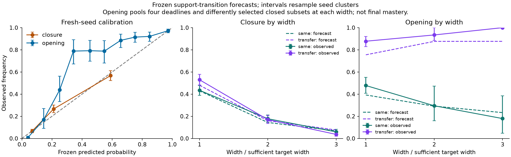

# A minimal model of option closure and reopening

29 October 2026. MNIST remains paused. [Raw evidence and reproduction](probabilistic_options/README.md).

## Decision: keep options and demand; marginalize hidden implementations

The working model has **two state objects: the spectral response B and residual
demand e**. Task frequencies, task alignment, width, optimizer and elapsed budget
are conditions, not additional evolving resource variables. Keep the existing
Jacobian/optimizer/loss-curvature definition of B. Predict its changes
probabilistically across initializations, conditional on the information retained.

The [functional implementation distribution](functional_implementation_state.md)
is demoted to a mechanistic construction. It proves how parameters generate
options, and why identical current options can have different futures. However,
its exact evolution largely restates the network; gate moments fail at boundary
transport and can be larger than the original parameterization. Neither is a
required object in the small predictive model. Preserve their derivations and
counterexamples rather than claiming hidden implementations do not matter.

For a normalized task contrast u, use three existing measurements:

\[
 Q=u^T\operatorname{Proj}_{\mathrm{range}(K)}u,
 \qquad s_\tau=u^TB_\tau u,
 \qquad d=|\text{remaining conditional gap}|/|\text{target gap}|.
\]

Here coordinates absorb the data weights. In squared loss,
B_tau=K(K+I/(2 tau))^(-1), so Q is the infinite-budget limit of directional
response. **Q measures structural support, s measures finite-budget strength,
and d measures demand.** They are summaries of B and e, not three new fundamental
objects. A contrast probes multiple spectral options; it is not a neuron role or
an eigenvector chosen in advance.

The minimal story is: heterogeneous tasks change relative learning pressure;
shared feature updates can remove or create response directions; width changes
the distribution of these events; loss suffers only when useful response remains
inadequate during its correction budget. Reopening alone does not imply mastery.

## Realistic assumptions, and what they do not imply

Consider recurring conditional refinements

\[
 y=s(Z)+\sum_{j=1}^N1_{R=j}h_j(Z),\qquad \Pr(R=j)=q_j>0.
\]

All components are always trained. A common component can dominate early demand
while rare refinements dominate what remains later. A locally stable frequency
profile and shared trainable features are useful strong assumptions. The target
need not have one neuron per component, independent implementations, or a fixed
conserved number of options. Frequencies need not be exactly Zipfian.

Unequal recurring frequencies have a real language motivation; experimental work
also studies the learning consequences of Zipfian word distributions
([Lavi-Rotbain and Arnon, 2022](https://www.sciencedirect.com/science/article/pii/S0010027722000269)).
This motivates the task family, not a claim that token sequences are independent,
that our contrasts represent language structure, or that neural competition has
been established in language models. Context-dependent importance and correlated
components remain outside the present validation.

The new tests keep total rare frequency .2, compare geometric and rank-power
profiles, and allow refinements to use the shared attribute, a separate attribute,
or an intermediate alignment. Every narrow width m*=2+2N has an explicit exact
representation. Alignment a is a known task parameter; it is **not** a measurement
of destructive resource overlap. Greater sharing can make these tasks easier.

## Two deliberately bounded probability laws

These are landmark first-passage forecasts, not a complete Markov process.
Randomness is over initializations and omitted implementation details; training
itself is deterministic full-batch training.

**Early closure.** Conditional on Q(0)>=.95, predict a sampled Q<.95 by time 20
before the first sampled d<=.1. A two-slope model selected using historical data is

\[
 \Pr(C)=1-\exp[-\lambda_c],\qquad
 \lambda_c=0.8918\exp(-2.1955a)(m/m_*)^{-1.9689}.
\]

This law is fitted for this optimizer, initialization scale, time window and task
family. The exponent is not a theorem or a universal width exponent. Initial
support, strength, frequency and resource-count additions did not earn their
complexity under the development selection rule. Four task/width predictors do
slightly better on the fresh familiar families; the two-slope version transfers
better to the new families. This is an explicit simplicity/accuracy tradeoff.

**Reopening.** Conditional on Q(20)<.95 and d(20)>.1, predict the first sampled
Q>=.95 by deadline T:

\[
 \Pr(R\le T\mid x_{20})=1-\exp[-\lambda_r(x_{20})\log(T/20)],
 \qquad \log\lambda_r=\beta_0+\beta^Tx_{20}.
\]

The frozen selected model uses Q, log s_1000 and log d, plus log q, a, log N and
log(m/m*). Standardization, clipping and coefficients are in
[locked/models.json](probabilistic_options/locked/models.json). There are seven
slopes; no evolving recruitment reservoir, atom distribution or resource tensor
is fitted. All features are measured at time 20, before the forecast window.

The definition allows newly acquired support as well as return of previously
available support; the risk set is defined by the time-20 state. In the fresh
cohort all 417 eligible episodes had support at some earlier checkpoint, including
14 that lacked it at initialization. The logarithmic clock outperformed a linear
clock on historical held-out seed
folds. This is a useful approximation to heterogeneous waiting times, not a
measurement of the exact neural hazard. Only deadlines 50, 100, 500 and 2000 are
validated. First reopening is counted even if the option subsequently closes.
The model does not give the probability of remaining open or of final accuracy.

## Mathematical interpretation, separated from empirical claims

Two elementary results clarify the assumptions without requiring a new state.

1. **Shared variation can yield slow width gains.** Suppose the number of usable
   routes at a declared stage, conditional on common quality A, is Poisson(m A),
   and A is Gamma(k, rate b). Then the chance of no usable route is
   E[exp(-m A)]=(b/(b+m))^k. A power tail in width can therefore arise despite
   strong dependence from common shocks. This is an illustrative conditional
   route model, not a derivation of the fitted closure law. Conditioning on
   initial coverage, pressure history and selection changes the relevant law.
   We have not identified independent neural routes or fitted their number.
2. **Hidden waiting-rate variation gives the reopening clock.** If, conditional
   on x at time 20, an unobserved exponential waiting rate has distribution
   R~Gamma(lambda(x), scale 1/20), then
   E[exp(-R(T-20))]=(T/20)^(-lambda(x)). The aggregate hazard is lambda(x)/T:
   survivors become enriched for slow-recruiting implementations. This is a
   mathematical representation of the fitted survivor curve, not evidence that
   individual neural paths are exponential. The gamma variable is integrated
   out, not promoted to a new mechanistic state.

Both examples preserve dependence between options through shared conditions.
They do not imply independent option openings or independent neuron survival.
A point mass at zero rate would represent permanent inaccessibility; we do not
fit it because finite follow-up cannot reliably separate it from a long tail.
In particular the fitted reopening law tends to one at infinite time and must
not be extrapolated to rule out persistent failure.

Identically copying all mean-field units preserves the entire functional path,
as already proved in the implementation study. Natural width adds differently
initialized alternatives; copying the same alternative need not change the law.
The probability models concern natural width, not arbitrary parameter count.

Under the additional scalar-mode approximation e_dot=-k(t)e,

\[
 |e(T)|/|e(t_0)|=\exp[-\int_{t_0}^T k(t)\,dt].
\]

If k is approximately zero until reopening R and approximately k_open afterward,
mastery requires R <= T-log(|e(t0)|/epsilon)/k_open. Thus even a correct reopening
forecast leaves an explicit correction-time requirement. This conditional result
is not a validated endpoint predictor: changing modes, cross-response and
finite ReLU updates can invalidate its assumptions. For actual observed loss,
retain the existing exact finite-update ledger and spectral response accounting.

## Frozen validation and limits

Development uses existing hierarchy banks, taking the finest available trajectory
per run. Four folds hold out seed indices across all tasks and widths. Candidates
include simpler task/state-only models, clock choices and a gate-group-count
proxy. Select the fewest predictors within one standard error of the best mean
Brier score. Two exploratory candidate rounds both precede all fresh training;
the final selection and sources are archived in `locked/`.

Fresh validation contains **1,728 natural-width runs**: nine task configurations,
three width factors (1,2,3), and 64 new paired seed indices. Factor 3 is an unseen
interpolation between historical factors 2 and 4. Transfer configurations add
N=3, rank-power frequencies with exponents 1 and 2, and alignment .5. Step .025
also tests transfer from mixed historical resolutions. Checkpoint grids are
matched. Forecasts at initialization precede their own run; every reopening
forecast is saved before any run continues beyond time 20. Models are not refit.

Initial support is already present in 5,142 of 5,184 direction/run pairs; all
42 initially unsupported pairs occur at the narrow width. This leaves room for
initial-strength effects but makes missing initial span a small part of this
cohort. The 5,142 eligible closure forecasts and 417 opening episodes are dependent.
Each component receives weight 1/N. Reopening scores average four deadlines;
confidence intervals resample seed indices jointly across tasks, widths,
components and deadlines, not individual forecast rows.

| Frozen prediction | Familiar families Brier | New families Brier | All Brier | All constant baseline |
|---|---:|---:|---:|---:|
| Early closure, two slopes | .1276 | .1539 | .1364 | .1763 |
| Reopening, seven slopes | .0871 | .1131 | .0940 | .3043 |

Lower Brier is better. The opening constant baseline is itself a fitted
waiting-time law, so compare the stronger task/width baseline too: its Brier is
.1187 versus .0940 with current options and demand. These scores establish useful
first forecasts, not perfect calibration. Overall closure is predicted at .2198
versus observed .2282. Reopening is predicted at .4714 versus observed .5466;
on new families these are .7705 versus .8864. At T=50 overall reopening is
underpredicted by .1224; at T=2000 by .0059. Preserve that timing error.

Width's clearest effect is preventing closure. Familiar-family closure falls
from .4345 to .1777 to .0592 across factors 1/2/3; transfer closure falls from
.5296 to .1697 to .0365. Removing width from the closure predictor worsens Brier
by .0356 (95% seed-cluster interval [.0300,.0409]). After conditioning on the
closed state, removing explicit width from reopening worsens Brier by only .0016
(interval [-.0018,.0050]), although its gain on transfer is .0076
([.0021,.0138]). **This does not prove mediation:** the closed subsets differ
systematically with width. Indeed, in familiar families, conditional reopening
is lower among wider survivors of the closure selection. The widest transfer
subset contains only four opening episodes; its observed 100% rate and degenerate
bootstrap interval do not establish certainty about the population.

Further simplification remains possible. Removing the explicit gap predictor
changes reopening Brier from .0940 to .0946; removing explicit width changes it
to .0956. The frozen coefficients are retained, but neither is established as
necessary for support reopening. Demand remains essential to deciding whether
closure is harmful. The extra gate-group proxy improves Brier to .0886 but
slightly worsens log loss (.2999 versus .2988), and hurts Brier at T=2000
(.0430 versus .0394). Its pooled Brier gain has seed-cluster interval
[-.0004,.0117]. This modest mixed result does not justify an exact
implementation distribution as a fundamental predictive object.

The final loss check prevents a misleading support-only success story. In the
N=4 geometric-.1 separate-attribute task, the rarest refinement has support in
62/64, 64/64 and 64/64 final states at widths 10/20/30, yet is mastered in only
29/64, 44/64 and 50/64. Mean gap remains .1465/.1005/.0770. Conversely a solved
contrast can have low current support: disappearance after solving is not an
injury. Final loss is saved but is not a target of these probability models.

## What is established and what remains open

- **Mathematical:** spectral support/strength relation; conditional route and
  waiting-rate identities; correction-time implication under a scalar mode.
- **Prospective empirical:** useful, imperfect first-passage forecasts on new
  seeds and new frequency profiles; strong width information for early closure,
  substantially weaker incremental width information after conditioning on state.
- **Causal, from previous studies:** pressure branches change response; matched
  current options can evolve differently; copying or generic preservation can
  fail or harm. The present forecasts add no new causal intervention and do not
  complete natural-width mediation.
- **Unresolved:** precise pressure-to-hazard dynamics, jointly coupled option
  histories, finite-strength reopening, persistence after opening, endpoint
  mastery, and transfer beyond controlled shallow networks. Do not infer any
  of these from calibration or the gamma representation.

Keep discrete obstruction, continuous recovery, failed copying, selective
recycling and the hierarchy plateau eliminated by step refinement. The next
small correction should target the observed early reopening timing error and
whether a reduced recovery predictor replicates, rather than restoring an
unclosed resource state or adding many new diagnostics.
