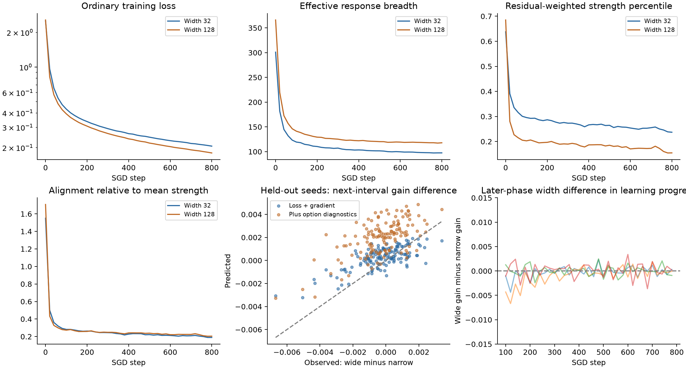
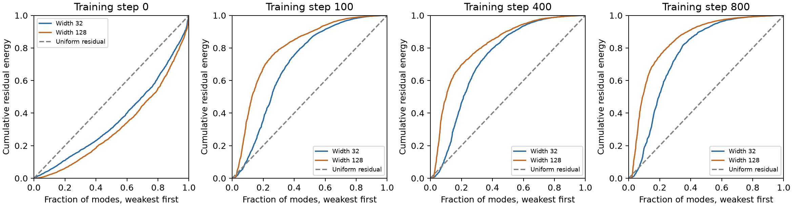
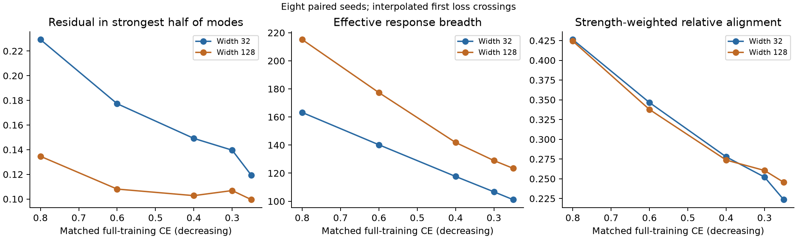

# Option–residual mismatch during ordinary paired MNIST SGD

28 October 2026. Follow-up to `gd_residual_options.md`.

## Result

The requested trajectory experiment is complete: eight paired width-32/128
MNIST runs, 800 uninterrupted SGD steps, measurements every 20 steps, and
prospective forecasts of the difference in full-training loss improvement.

The wider networks have greater response breadth and lower loss. Both widths'
remaining errors become concentrated in weak response modes. However, the
measured option summaries do **not** add reliable held-out predictive value
beyond current loss and gradient magnitude. On the later-phase evaluation,
adding them worsens RMSE on all four held-out seeds.

This is a material negative result for the current scalar mismatch story. It
does not establish that options are irrelevant, but it prevents presenting this
trajectory experiment as a successful explanation of the width advantage.

A subsequent **matched-loss** analysis also fails to reverse the average
rank-loading ordering: at the same training loss, width 128 still has less of
its own residual in its relatively strongest half of modes. Differences become
uncertain at lower loss. The broader spectrum at greater width survives this
comparison. Details and interpolation limitations are reported below.

## 1. Protocol and scope

- Eight new seeds, 281801–281808; each trains both widths.
- The same 8,192 MNIST training images, cross-entropy, SGD rate .05, batch 128.
- Identical minibatch indices for paired widths; all parameters train normally.
- 800 steps, checkpointed every 20: 328 paired checkpoints, 320 paired intervals.
- The first four seeds calibrate predictors; the last four evaluate them.
- Full 8,192-example training loss is the prediction target. A separate 1,024
  image validation set tracks generalization.
- A fixed random 64-training-image panel supplies all nine class contrasts,
  derivative curvature, spectra and residual loading. It is **not** substituted
  for the actual training distribution during the SGD updates.
- Full-training gradients are evaluated at checkpoints, rather than replacing
  the gradient baseline with a noisy panel estimate.

Forecast records are appended before the upcoming SGD interval. Target outcomes
are appended only when that interval finishes. The training protocol was saved
before training. Analysis uses held-out seeds, not random splits of correlated
intervals. These are still only eight independent initialization pairs, four
in the test set; interval counts do not create hundreds of independent trials.

The network is the previous fully trainable shallow ReLU model,
\(f=a\operatorname{ReLU}(Wx+b)/\sqrt m+c\). This is real-data ordinary training,
but not a deeper-network or language-model test. The measurements pause training
without changing its parameters or optimizer updates.

## 2. Recorded objects

At each checkpoint, recompute the discounted GD benefit operator at fixed
\(\tau=\eta\times20=1\). As in the preceding note, this is a standardized
local response diagnostic, not a guarantee that frozen curvature stays valid
for a full unit of subsequent training time.

Record:

1. Option mass and effective breadth.
2. The residual loading \(|v_j^Te|^2\) on every option mode.
3. Residual-weighted strength relative to average strength,
   \(e^TBe/(\|e\|^2\operatorname{tr}(B)/q)\). A value below one means the
   residual preferentially occupies below-average-strength directions.
4. The full cumulative residual-energy curve over modes ordered weakest first.
   Its mean rank percentile is a convenient summary, not an extinction threshold.
5. Positive/negative parts of changes in the operator, evaluated on the fixed
   behavioral panel, rather than matching sorted eigenvectors between times.
6. Current loss, exact full-training gradient magnitude, and predictions from
   first-order, scalar-curvature, spectral and spectral-plus-noise approximations.

The spectral forecast anchors the local curvature model to the **actual full
gradient**. Only its GGN curvature estimate comes from the small panel. This
avoids confusing a panel-gradient forecast with a full-training forecast.
The additive SGD-noise approximation uses per-example probe gradients and
batch-size scaling. Its assumptions are audited by its actual prediction errors.

For the width comparison, evaluate both operators on common residual patterns
as well as their own residuals. In particular use
\(e_c=(e_{32}+e_{128})/2\) and \(e_d=e_{32}-e_{128}\).
An exact symmetric decomposition of the difference in instantaneous discounted
values separates operator differences from differences in residual demand.
These are diagnostic decompositions, not causal attributions of training loss.

## 3. What actually happens during training

Means over all eight paired runs:

| Step | Training CE, 32 / 128 | Breadth, 32 / 128 | Relative alignment, 32 / 128 |
|---|---|---|---|
| 0 | 2.5144 / 2.5632 | 301.0 / 366.0 | 1.551 / 1.707 |
| 100 | .4318 / .3927 | 119.3 / 141.3 | .281 / .273 |
| 400 | .2644 / .2382 | 103.4 / 122.0 | .228 / .242 |
| 800 | .2061 / .1798 | 97.5 / 117.9 | .190 / .204 |

Final validation CE is .3131 versus .2819. The width advantage therefore appears
on both the training and validation measures in this experiment.

The wider network has more breadth at every checkpoint in the mean trajectory.
Mass grows strongly for both and is nearly equal at step 800: 8,341 versus 8,214.
Thus the final width advantage is not an advantage in total response mass.



### The remaining errors really do move into weak modes

At initialization, the weakest half of modes carries about 31% of residual
energy at width 32 and 26% at width 128. At step 800 it carries **92% and 95%**.
The weakest quarter then carries **64% and 80%**. These fractions summarize
the complete curves below; the quarter/half markers do not define viable modes.



This validates the descriptive statement that unresolved errors become poorly
aligned with the bulk of available response strength. It does **not** validate
the cross-width explanation that the narrower model must have greater own-error
mismatch. In fact, the wider model's residual has a lower mean strength percentile
at the end: .155 versus .237.

There is a selection problem: a model that resolves more accessible errors can
leave a residual that looks relatively harder. A low remaining-error percentile
can accompany better learning. The trajectories demonstrate this ambiguity;
they do not independently prove its causal origin.

### Matching loss rather than training time

An exploratory follow-up compares the same eight pairs at common loss levels.
For each width and seed, take the **first descending crossing** of a target
full-training CE and linearly interpolate the measured statistics between the
two adjacent 20-step checkpoints. All eight pairs reach every target below.
This approximates an intermediate checkpoint statistic; it does not construct
or differentiate an interpolated network.

| Matched full-training CE | Residual energy in strongest half, width 32 | Width 128 | Wide minus narrow, percentage points (paired SE) | Pairs with larger wide fraction |
|---|---:|---:|---:|---:|
| .80 | 22.93% | 13.46% | −9.47 (1.78) | 0/8 |
| .60 | 17.73% | 10.81% | −6.92 (1.67) | 0/8 |
| .40 | 14.91% | 10.27% | −4.64 (2.22) | 3/8 |
| .30 | 13.96% | 10.69% | −3.27 (2.57) | 3/8 |
| .25 | 11.92% | 9.95% | −1.97 (2.95) | 3/8 |



Equal-loss matching therefore does not reverse the mean rank-loading pattern.
At .8 and .6 it is consistent across all eight pairs. At the lower losses the
individual pairs disagree, and particularly at .25 the small mean difference
is inconclusive. Targets reuse the same eight trajectories; they are not
independent repetitions. The reported SE is over paired seed differences,
not over the correlated checkpoint measurements.

As a sensitivity check, match the **measurement panel's CE** instead of
full-training CE. The strongest-half fractions for widths 32/128 are
19.53%/12.12% at .6, 15.00%/10.25% at .4, 14.69%/10.52% at .3,
and 14.29%/11.23% at .25. The average ordering persists, again with substantial
disagreement among pairs at the lower targets.

This sharpens the interpretation of the earlier selection explanation: it
cannot be attributed merely to comparing networks at different scalar losses.
Equal loss still permits different error patterns and different learning
histories, so error selection remains a possible mechanism, not an established
cause. Matching loss does not match the residual direction.

Also distinguish **rank-relative strong modes** from response strength itself.
At full-training CE .25, effective breadth remains larger at width 128:
123.45 versus 101.13. Relative strength-weighted alignment is .246 versus .224,
a modest difference in favor of width 128: paired difference .0220, SE .0165,
with 5/8 pairs favoring width 128. Total response mass is similar, 7,767 versus
7,911. Thus greater breadth and somewhat better strength-weighted alignment can
coexist with less residual energy in the relatively strongest half. None of
these rankings uses a common absolute strength threshold across the models.

The results do not support the simple claim that, at equal loss, the wider model
has more of its residual in its relatively strongest modes. They preserve the
need for the common-demand comparison below. They are descriptive additions,
not new held-out forecasts or revisions of the predictive scores.

### Holding the requested correction fixed gives a different comparison

At step 800, applying both operators to the width-difference residual pattern
gives an average wide/narrow response-value ratio of **1.21**. The ratio is
1.42 at step 100 and 1.31 at step 400. This is evidence that the wider network
often has a stronger response to the same correction pattern, even when its own
remaining error occupies a lower strength percentile.

For the symmetric value decomposition at step 800, the operator-capability
component is +.00456 in favor of width 128, while the residual-demand component
is −.00796. The net discounted own-residual value is therefore smaller for width
128 by .00339. These are local proxy units; they are not observed future gains.

Cumulative weakening from the initial operator is lower at width 128 in the
mean: 143 versus 199 at step 800. It peaks earlier and later declines, consistent
with recovery as well as weakening. This is not an irreversible reserve budget.
The covariance/curvature change and different residuals prevent treating this
statistic alone as an attribution of the .0263 final training-loss gap.

## 4. Does it predict the difference in improvement?

The actual target for each interval is

\[
 Y_t=[L_{128}(t)-L_{128}(t+20)]
     -[L_{32}(t)-L_{32}(t+20)].
\]

Positive means the wider network improves more. Current loss level and
next-interval improvement are distinct. The final gap can favor width 128 while
later narrow networks sometimes catch up faster.

### Direct forecasts have substantial limitations

Two of the 656 individual checkpoint measurements have a probe quadratic that
is unstable at the actual rate .05. Repeated discrete powers yield enormous
predictions there, although the actual SGD runs do not diverge. We retained
those failures rather than clipping the predictions after seeing the outcomes.
The full-trajectory raw spectral RMSE is therefore not a useful success metric.

On the stable later phase, starts at step 100 or later, the uncalibrated spectral
forecast with additive-noise correction has correlation **.590**, direction
accuracy **66.4%**, and RMSE **.00213** on test seeds. Predicting zero difference
has RMSE **.00154**. Correlation and direction skill do not imply quantitatively
accurate gain differences.

The exact-gradient first-order prediction is also inadequate over 20 steps:
its later-phase RMSE is .01983. Extrapolating an initial loss derivative over
the whole interval badly overstates learning because the gradient changes.

### Does option information add value beyond simpler predictors?

The fixed baseline features are log training step, current loss difference/mean,
and full-gradient-norm-squared difference/mean. A curvature baseline adds the
scalar quadratic forecast difference/mean. Option-summary additions are the
differences in residual-weighted value, relative alignment, strength percentile,
breadth, and mass. Predictors are standardized using calibration seeds only and
fit by ridge regression with penalty one, without a hyperparameter sweep.

The initial all-phase calibration was dominated by the early transient and
biased its late predictions. An exploratory follow-up fits and evaluates on the
same already-specified late phase, step ≥100. There are 140 test intervals from
four held-out seeds:

| Predictor | RMSE | MAE | Correlation | Direction accuracy |
|---|---:|---:|---:|---:|
| Zero gain difference | .00154 | .00112 | — | 55.0% |
| Loss, time and gradient | **.00115** | **.00092** | **.729** | 65.0% |
| Baseline plus scalar curvature | .00117 | .00093 | .727 | 66.4% |
| Baseline plus option summaries | .00258 | .00227 | .630 | 52.9% |
| Baseline plus spectral/noise forecast | .00124 | .00096 | .720 | **71.4%** |
| Baseline plus matched-demand diagnostics | .00146 | .00116 | .673 | 65.7% |

The option-summary addition worsens RMSE on all four test seeds. Adding the
spectral forecast improves direction accuracy but worsens numerical error;
this is a mixed result, not a general predictive improvement. The matched-demand
variant was added after the initial negative result and is exploratory; it
also does not beat the gradient baseline on RMSE.

For context, the late-phase test target has mean −.000247 and RMS .00154.
The extra per-interval width effect is small and stochastic, even while an
accumulated loss gap is clearly present. The calibrated option model has a
substantial positive bias, predicting a mean difference +.00197. This is a
specific failure to generalize, not just an argument about noisy significance.

No strong confidence claim is made from four held-out seeds. The all-phase
results, individual-seed scores and predictions are retained in the raw analysis.

## 5. Interpretation

What worked:

- We can record many options and their relation to residuals throughout a real
  uninterrupted training trajectory, without supplied semantic roles.
- Residual energy migrates toward weak responses, and width retains broader
  response capability.
- Holding the behavioral demand fixed distinguishes capability from the
  changing difficulty of a model's own residual.

What failed:

- Own-residual mismatch does not order the widths in the simple expected way.
- Scalar option summaries do not provide the requested incremental quantitative
  predictor beyond current loss/gradient information in these held-out runs.
- A frozen local quadratic over 20 ordinary SGD updates is not uniformly valid.

This makes the current operator a useful descriptive local-response object,
but **not yet an established explanation of the width advantage**. A possible
next refinement is to track specific persistent error patterns under a common
demand measure, with larger curvature panels, rather than equating a harder
remaining residual with option destruction. A causal preservation claim still
requires an intervention; it is not supplied by the plots above.

## 6. Files and reproducibility

Producer: `scripts/studies/track_option_mismatch.py`.
Analyzer: `scripts/studies/analyze_option_mismatch.py`.
Matched-loss follow-up: `scripts/studies/match_loss_option_mismatch.py`.
Data and plots: `docs/theory/option_mismatch_tracking/`.

The raw forecasts preserve an unused `panel_spectral_prediction` field from
the first producer version. A verification pass found that this auxiliary panel
formula used the wrong loss-coordinate projection. It was removed from the
producer and **never enters any reported fit, metric or plot**. All primary
full-gradient forecasts, spectra, mismatch measures and outcomes are unaffected.
The raw first-run record is retained rather than rewritten. This technical
issue is separate from the substantive negative results.

The producer refuses to overwrite existing forecasts. To regenerate training,
set a new output directory explicitly. The analyzer can be rerun on saved data:

```sh
MPLCONFIGDIR=/private/tmp/neural-competition-mpl .venv/bin/python scripts/studies/analyze_option_mismatch.py
MPLCONFIGDIR=/private/tmp/neural-competition-mpl .venv/bin/python scripts/studies/match_loss_option_mismatch.py
```

Existing theory, studies and parent-thread artifacts were preserved.
