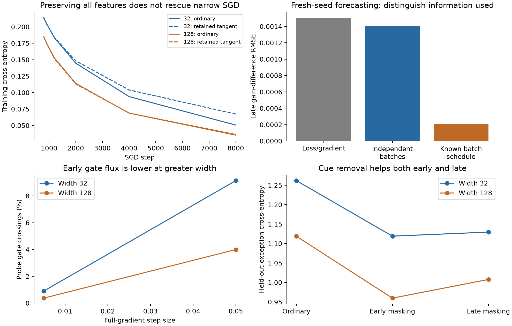

# Option slack, competition, and the transport of neural responses

Research iteration, 28 October 2026. Responds to `option_mismatch_during_sgd.md`.
Existing results and their negative conclusions are preserved.

## Result of this iteration

Three conclusions should be separated.

1. **Prediction improved.** Retaining the full checkpoint tangent response and
   evolving the actual cross-entropy residual predicts late ordinary-SGD width
   differences much better than a frozen quadratic or scalar option summaries.
   An independent-batch forecast modestly improves on the loss/gradient baseline
   on four genuinely fresh seeds. A forecast conditional on the exogenous batch
   schedule is much more accurate, but uses additional information.
2. **A concrete slack mechanism is now identified.** In a ReLU network, training
   moves activation boundaries. The relevant reserve is the distribution of
   activation margins relative to the movement demanded by training, together
   with the signed effect of crossing those boundaries on functional responses.
   A smooth derivative of option strength misses the dominant finite-step
   transport in the tested probes.
3. **The strong commitment story is not established on this benchmark.** Narrow
   models continue improving far beyond 800 steps. Freezing their tangent features,
   including at initialization, makes them worse. Feature learning appears to
   repair a substantial initial response deficit. A shortcut/exception stress
   test also fails to show an irreversible early-commitment signature.

The preferred working theory therefore separates *learning through current
responses* from *creating, weakening, and replacing those responses*. Width can
supply more initial response diversity and reduce per-detector load; whether
that protects useful options depends on the direction of boundary motion and
the ability to regenerate alternatives. An option count alone cannot settle it.



## 1. What the previous negative result rules out

The prior study used eight ordinary paired SGD runs and held-out seeds. The
failure is substantive: the wider network has better loss, but can leave its
own residual in relatively weaker modes even at matched loss. Adding scalar
option summaries worsens prediction beyond current loss and full gradient.

Do not repair this by choosing a new percentile threshold, fitting a survival
probability from terminal loss, or calling every decrease in breadth harmful.
These facts invalidate that simple scalar explanatory model. They do not imply
that the full response operator has no information.

There are at least three distinct issues:

- **Residual selection:** a learner can remove accessible errors and leave a
  harder-looking residual. Equal scalar loss does not equalize error patterns.
- **Forecast approximation:** loss curvature and gradients change over 20 SGD
  updates; a small-panel quadratic need not model the original training task.
- **Mechanism:** a checkpoint response says what the model can do now. It does
  not by itself describe which training decisions created or destroyed it.

The new experiments address these separately rather than treating any improved
forecast as proof of irreversible competition.

## 2. A two-part dynamical description

Let \(J_t(x)\) denote the current parameter Jacobian, with optimizer geometry
included when appropriate. The current functional response is

\[
 K_t(x,x')=J_t(x)J_t(x')^T.
\]

Keep the preceding GD-derived benefit operator as a local option description.
Its spectra, common-demand values and turnover remain useful diagnostics, but
they do not close the dynamics. Two processes must be distinguished:

**Learning through current responses.** With \(K_t\) held fixed, ordinary
cross-entropy SGD has the prediction-space counterpart

\[
 \hat z_{k+1}(x)=\hat z_k(x)-\frac\eta b
 \sum_{i\in\mathcal B_k} K_t(x,x_i)
 [\operatorname{softmax}(\hat z_k(x_i))-y_i]. \tag{1}
\]

This retains changing residuals, softmax curvature and minibatch interactions.
It needs no protected subset or auxiliary objective. The tangent model
\(f_{\theta_t}(x)+J_t(x)u\) implements it without forming a full kernel matrix.

**Transport of responses.** Actual parameter changes also change \(J_t\) and
\(K_t\). This can destroy, improve, or create useful responses. It is the part
in which a commitment/competition hypothesis must live. Preventing transport
removes both harmful erosion and beneficial feature learning; a retention
experiment therefore measures their net effect.

The word "competition" should have a signed, demand-specific meaning. For a
fixed output request \(d\), on a fixed panel of size \(n\), define

\[
 \kappa_t(d)=\|J_t^T d\|^2/n. \tag{2}
\]

If learning on some data moves parameters by \(\delta\), its option-transport
effect on that request is

\[
 C(d;\delta)=\kappa_t(d)-\kappa_{\theta_t+\delta}(d). \tag{3}
\]

Positive means weakening; negative means cooperation or creation. Holding
\(d\) fixed avoids confusing changing residual demand with changing capability.
For a specifically cross-context claim, use the gradient from one context and
the residual request from another. Without that separation, (3) measures net
transport under the task, not a uniquely isolated harmful-peer effect.

The experiments use a common held-out residual pattern across widths, fixed
through each audit, and the ordinary full-training gradient. They do not supply
latent teacher roles. They establish transport, not its attribution to a
particular semantic subgroup.

## 3. Slack as margin relative to learning load

The meaningful task family is a collection of reusable conditional detectors:
features serve overlapping contexts, and fitting a dominant use can move a
detector's boundary across another context. This includes shortcut/exception
tasks, but does not require explicit expert routing. The data must determine
whether that movement removes a needed distinction or improves a detector.

For a shallow ReLU unit, write

\[
 z_r(x)=w_r^Tx+b_r,\qquad
 v_r(x)=\dot w_r^Tx+\dot b_r,
\]

where the velocity is induced by the actual GD/SGD update. Define its local
boundary-crossing clock

\[
 s_r(x)=
 \begin{cases}
 |z_r(x)|/|v_r(x)|,&z_r(x)v_r(x)<0,\\
 \infty,&\text{otherwise}.
 \end{cases} \tag{4}
\]

This is a **stability reserve**, not a neuron count. It is exact for the first
crossing under constant shallow-layer velocity. A proposed update of duration
\(h\) crosses precisely when \(s_r(x)\le h\), apart from zero-margin
conventions. Zero is the activation boundary; no fitted viability threshold is
introduced. For actual SGD, average the clock distribution over batch draws.

The distribution of these clocks is derived from current model margins, data
and training gradients. Large width need not help if the additional units have
smaller margins or larger loads. Low movement alone is also not enough: useful
new features may require boundary crossings.

### A limited width law

For \(f=m^{-1/2}\sum_r a_r\sigma(z_r)\), bounded per-unit response derivatives
and bounded task forces give per-unit GD velocity of order \(m^{-1/2}\), while
the aggregate tangent learning rate can remain order one. This is the concrete
sense in which more units can share the current learning load.

If the joint density of margin and velocity is regular near the boundary,

\[
 P[z_r(z_r+h v_r)<0]
 =h\int |v|p_{z_r,v_r}(0,v)\,dv+o(h). \tag{5}
\]

Under width-stable margin densities and the preceding load scaling, the
per-route crossing probability is \(O(h/\sqrt m)\). A normalized neuron's
contribution to \(K\) is \(O(1/m)\), so the expected *absolute functional
transport* from crossings can also be bounded at \(O(h/\sqrt m)\), with constants
depending on data and parameter moments. The raw number of unit crossings need
not decrease: there are more units.

This is a conditional scaling argument, not a theorem for arbitrary trained
networks. Learned margins, weight norms and parameterization can invalidate
width-stable constants. Feature-learning parameterizations that keep per-unit
movement large do not inherit this law automatically. Exact copies with matched
optimizer geometry do not gain independent slack merely by being renamed as
more neurons.

Most importantly, (5) bounds **alteration**, not harmful destruction. The sign
must come from the change in the response operator on actual task demands.

## 4. Why a smooth erosion-rate model failed

One candidate was the directional derivative
\(\dot\kappa(d)=D\kappa(d)[-\nabla L]\). At ReLU checkpoints this captures
within-cell movement but misses discrete changes in the empirical Jacobian when
a probe crosses a gate. A finite empirical kernel can jump even though the
network's predictions remain continuous.

For each proposed parameter step, split the measured change exactly into

\[
 \Delta\kappa=
 [\kappa(\theta+\delta;G_t)-\kappa(\theta;G_t)]
 +[\kappa(\theta+\delta;G_{t+\delta})-
   \kappa(\theta+\delta;G_t)]. \tag{6}
\]

The first term holds activation masks fixed; the second is gate transport.
This is a structural decomposition, not a decomposition of final loss or of
individual semantic roles. Both terms can have either sign.

Across eight paired seeds at initialization and step 800, the audit uses 128
held-out images, a common current residual direction, and exact full-training
gradients. At initialization:

| Quantity | Width 32 | Width 128 |
|---|---:|---:|
| RMS relative incoming-parameter velocity | .5144 | .2499 |
| Gate-crossing fraction, GD step .005 | .897% | .369% |
| Gate-crossing fraction, GD step .05 | 9.134% | 3.992% |
| Mean fixed-demand strength change, step .05 | −2.135 | −.935 |

Initial strengths are about 9.66 and 9.55. Thus there is measurable early
weakening and less gate turnover at greater width under this update convention.
However, that request is only one common, currently observable demand pattern;
its weakening is not a certificate of loss of a future necessary component.

Gate terms account for about 99% of the sum of absolute gate-plus-smooth terms
in these finite-step audits. This percentage is not a fraction of training loss
explained, and cancellation can make it different from a signed-change ratio.
The smooth derivative is therefore not a reliable finite-step transport model.

At step 800, incoming velocities are still smaller at greater width, .0162
versus .00740, but crossing fractions at step .05 are similar (.0702% versus
.0809%). The simple ordering is not universal after margins have evolved. The
mean fixed-demand strength change is −.0208 for width 32 and +.00246 for width
128, while the infinitesimal within-cell derivative is positive for every model.
This disagreement makes boundary transport essential to the proposed mechanism.

For smooth activations, sensitivity/saturation transport replaces hard gate
crossings. The derivative formulas apply, but this ReLU clock law has not been
validated for GELU networks or language models.

## 5. Does preserving options actually help?

Two direct counterfactuals test the strongest interpretation. Starting with the
same function and Jacobian, a permanently linearized network keeps its tangent
features while optimizing the original cross-entropy with matched SGD batches.
It removes both creation and destruction of derivative features. It is a
different global function class, so this is a net-retention test, not a perfect
causal intervention that changes only harmful option erosion.

### Retaining initialization features

Two previously evaluated seeds are followed with initialization features fixed.
At step 800, mean training losses are:

| Width | Ordinary training | Initialization tangent retained |
|---|---:|---:|
| 32 | .21389 | .37268 |
| 128 | .18484 | .20250 |

The initialization-tangent width gap is .17018, compared with .02905 under
ordinary training. Feature learning substantially repairs the narrow model's
initial disadvantage. This is the opposite of a story in which preserving all
initial response features is sufficient to rescue narrow training.

### Retaining the features at step 800

Continue the same two seeds for another 7,200 updates:

| Width | Step-800 loss | Ordinary loss at 8,000 | Retained step-800 tangent |
|---|---:|---:|---:|
| 32 | .21389 | .05058 | .06730 |
| 128 | .18484 | .03531 | .03666 |

The narrow model is not stuck at step 800. Ordinary continuation beats feature
retention in both narrow runs, by about .0167 on average. This does not prove
that no useful option was ever lost, or rule out a later plateau. It does show
that ongoing feature learning has a substantial net benefit and that the
observed gap cannot simply be described as an exhausted reserve at step 800.
These MNIST experiments do not prove that width 32 can represent the population
Bayes predictor. Continued improvement rules out the claimed stall at this
checkpoint; it is not a general certificate excluding representational limits.

## 6. Better loss prediction without scalar option closure

The forecast in (1) is implemented with the complete trainable tangent model,
not a 64-example quadratic. Each forecast is saved before the corresponding
20 ordinary SGD updates. No forecast coefficients are fitted.

There are two information conditions:

- **Conditional forecast:** use the upcoming exogenous minibatch indices. This
  predicts the realized stochastic continuation, conditional on its schedule.
- **Independent-stream forecast:** average four new paired batch streams,
  independent of the actual continuation. This predicts a stochastic expected
  continuation and retains sampling error.

Both use all 8,192 training examples for the final loss evaluation. They retain
actual softmax gradients throughout the forecast. The original eight runs are
replayed exactly: the largest discrepancy in gain difference is zero. Four
additional seeds, 281811–281814, provide fresh validation. The loss/gradient
baseline is still fitted only on the original first four calibration seeds,
with its unchanged features and ridge penalty.

For the already declared late phase, step ≥100:

| Forecast | Original four test seeds RMSE | Four fresh seeds RMSE |
|---|---:|---:|
| Zero width-gain difference | .001536 | .002394 |
| Loss/time/full-gradient baseline | .001152 | .001503 |
| Full tangent, independent streams | **.001040** | **.001407** |
| Full tangent, known batch schedule | **.000182** | **.000206** |

Independent-stream improvement is 9.7% and 6.4%, respectively, with lower RMSE
on three of four seeds in each cohort. On fresh seeds, correlation is .798
versus baseline .782, and both have 71.4% direction accuracy. This is a modest
quantitative improvement, not a dramatic unconditional forecasting result.

The conditional forecast has fresh-seed correlation .9966 and direction accuracy
96.4%. Its much stronger result must not be compared to an unconditional
baseline without acknowledging its known batch schedule. It does show that
current full response geometry captures most of these short late continuations.

The early transient still fails: over all phases on the original test seeds,
conditional RMSE is .0211, dominated by early errors. A fixed tangent model
cannot model unrestricted feature formation. The initialization gate-flux audit
is consistent with this boundary, but no calibrated gate-flux error predictor
has yet been validated.

This method costs several tangent training rollouts and full-data evaluations.
It is a mechanistic forecasting benchmark, not a cheap scalar law. Its success
supports retaining the full task response and evolving residuals; it does not
prove that a scalar option count mediates the width advantage.

## 7. A structured shortcut/exception stress test

To probe the proposed task family directly, append a ten-dimensional cue to
MNIST images. It names the label on 95% of examples and a wrong label on 5%.
The original visual problem remains available. The cue amplitude is eight,
fixed before outcomes. All neurons train normally; none is assigned to a cue
or exception. This is a synthetic contextual stress test on real images, not
an unmodified natural dataset or a teacher-network experiment.

Two new seeds compare ordinary training, masking the cue for the first 100
steps, masking it only at steps 700–799, no cue throughout, and retaining the
ordinary tangent features after step 100. At step 2,000:

| Width | Arm | Training exception CE | Validation exception CE |
|---|---|---:|---:|
| 32 | ordinary | .392 | 1.262 |
| 32 | early mask | .355 | 1.119 |
| 32 | late mask | .370 | 1.129 |
| 32 | no cue | .185 | .231 |
| 32 | tangent after 100 | .400 | 1.363 |
| 128 | ordinary | .349 | 1.119 |
| 128 | early mask | .311 | .960 |
| 128 | late mask | .326 | 1.008 |
| 128 | no cue | .153 | .189 |

The easy cue damages visual-exception learning relative to the no-cue control,
and width helps. But both early and late masking help; there is no decisive
early-only rescue. Tangent preservation does not rescue the narrow model.
Total loss favors using the cue because it helps the majority; subgroup and
aggregate loss must not be confused. These results are compatible with ongoing
gradient starvation or insufficient visual feature acquisition, not evidence
of irreversible early option exhaustion. The study has only two seeds.

## 8. The refined competition hypothesis and its boundaries

The committing regime requires more than overlapping features:

1. Dominant learning pressure moves shared detector boundaries.
2. The movement preferentially weakens responses needed by delayed conditional
   demands, rather than merely removing irrelevant responses.
3. Alternative responses are scarce and their regeneration is sufficiently weak
   after the dominant predictor has settled.

Then the margin/load distribution controls how rapidly routes change, and the
signed operator marks determine whether those changes exhaust useful capacity.
Extra width can distribute load and retain alternative response carriers even
above representational sufficiency. In the extreme case where a conditional
error becomes orthogonal to every surviving trainable response and no other
gradient reactivates the relevant gates, ordinary GD can stall despite global
representability. That is a strong, meaningful *additional condition*, not a
consequence of a low breadth score.

The replenishing regime is different: feature changes create enough useful
responses to offset losses. The MNIST retention experiments are evidence for
substantial replenishment. A useful theory must allow this regime instead of
classifying all specialization as consumption of options.

The current preferred state description is therefore:

> **Functional response capacity + margin/load reserve + signed response
> transport**, evaluated on fixed or common task demands.

The first predicts what can be learned through current responses. The second
predicts where those responses are structurally vulnerable to current updates.
The third distinguishes destructive competition from beneficial specialization.
The triple is more demanding than a single trace, but each part is estimable
from ordinary model/data/gradient statistics and has a precise interpretation.

Width should not protect options through this mechanism when margins are already
ample, transport is mainly beneficial, added directions are redundant, all
routes move coherently out of usefulness, or parameterization maintains the same
per-unit load. A width advantage from faster learning or better initial response
coverage should not be reclassified as dynamic preservation.

## 9. Next decisive causal test

A causal test should preserve *selected useful responses*, not freeze all feature
learning. At a common checkpoint, change reserve through function-preserving
neuron splitting or route diversification, match initial predictions and audit
the initial kernel and optimizer scale. Compare it with exact matched-cost
clones and a rate-matched control. The signed-transport model should predict
which persistent, data-derived residual patterns benefit before continuation.

The difficult part is separating added initial response coverage from greater
resilience of existing responses. Merely widening and observing better loss
would not establish preservation. Nor should the measurement buffer supply the
only protected examples: evaluate the claimed benefit on held-out data.

This intervention has not been performed here. What is achieved is improved
prospective prediction and a concrete, testable competition/slack mechanism;
what remains unestablished is that harmful commitment is the main cause of the
ordinary MNIST width gap.

## Literature, artifacts and reproduction

Tangent training and the role of parameterization are established ingredients:
[Chizat, Oyallon and Bach](https://papers.nips.cc/paper_files/paper/2019/hash/ae614c557843b1df326cb29c57225459-Abstract.html).
Ongoing suppression of useful predictive features by easy features has related
precedents in [Pezeshki et al., Gradient Starvation](https://papers.nips.cc/paper/2021/hash/0987b8b338d6c90bbedd8631bc499221-Abstract.html).
Neither paper establishes the proposed margin/load-and-signed-transport theory
for these experiments. The kernel identities and basic width scaling are not
claimed as new discoveries.

New producers and analyses:

```sh
.venv/bin/python scripts/studies/explore_option_retention.py
.venv/bin/python scripts/studies/audit_initial_option_retention.py
.venv/bin/python scripts/studies/forecast_tangent_sgd.py
.venv/bin/python scripts/studies/forecast_tangent_sgd.py --seeds 281811 281812 281813 281814 --output docs/theory/tangent_sgd_fresh
MPLCONFIGDIR=/private/tmp/neural-competition-mpl .venv/bin/python scripts/studies/analyze_tangent_sgd_forecast.py
.venv/bin/python scripts/studies/explore_shortcut_commitment.py
.venv/bin/python scripts/studies/audit_option_transport.py
MPLCONFIGDIR=/private/tmp/neural-competition-mpl .venv/bin/python scripts/studies/plot_option_slack.py
```

Forecast producers refuse to overwrite their prospective records. Raw files
are in `option_retention/`, `tangent_sgd_forecast/`, `tangent_sgd_fresh/`,
`shortcut_commitment/`, and `option_transport/`, all under `docs/theory/`.
The initial retention and smooth-transport follow-ups are exploratory. Forecast
protocols precede their respective outcomes; fresh seeds were chosen after the
first improved forecast result, without fitting new coefficients to them.
