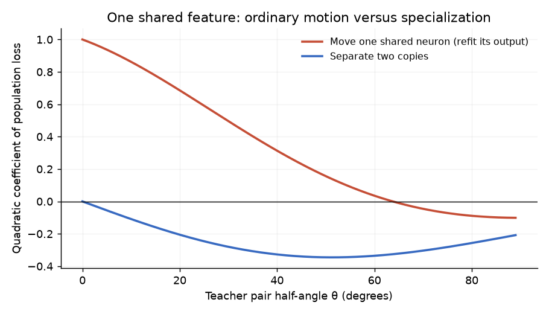

# Specialization while preserving an existing representation

18 October 2026. This note derives a candidate mechanism before interpreting
its [new training experiments](../reports/specialization.md). The original
[prospective protocol](specialization_protocol.md) is retained unchanged.

## The object and the claim

The proposed object is **residual curvature on directions that preserve the
current prediction to first order**. It describes whether a representation can
develop missing features without first disturbing what it already represents.
The claim is conditional: width can supply these directions at an overloaded
shared feature. Width alone need not produce useful directions, put them in the
right place, or make training follow them.

For a smooth scalar predictor, squared loss, residual e=f−y, and parameter
direction v, the familiar second-variation identity is

\[
D^2L[v,v]=\underbrace{\|Jv\|_{L^2}^2}_{\text{cost of changing the current prediction}}
 +\underbrace{\mathbb E[e\,D^2f[v,v]]}_{\mathcal S_e[v,v]}.
\]

Study the quadratic form

\[
\boxed{\quad\mathcal S_e\big|_{\ker J}.\quad}
\]

The first, positive term disappears on this subspace. A negative residual
curvature direction there decreases loss to second order without a first-order
change in prediction. This is a structure of the representation and residual,
not a tally of adverse updates. Its sign can predict a useful intervention
before selecting an optimizer. Its magnitude as an eigenvalue requires a
parameter metric and rate convention; raw eigenvalues are not universally
comparable across parameterizations or widths.

Why might width supply such a direction? Replace a feature aφ(w·x) by two
equal-output copies. Move their incoming weights to w+εv and w−εv. Their
first-order changes cancel. A single neuron cannot take this particular
antisymmetric direction. A narrow network may nevertheless have other redundant
neurons, or reach a different representation where specialization is possible.
The relevant shortage is local to the representation, not just total width.

This connects to the residual-weighted splitting matrices in Liu, Wu and Wang,
[Splitting Steepest Descent for Growing Neural Architectures](https://proceedings.neurips.cc/paper_files/paper/2019/file/3a01fc0853ebeba94fde4d1cc6fb842a-Paper.pdf)
(2019, §2). We do not claim this general object is new. The contribution here
is a particular shared-feature construction with explicit competing
curvatures, followed by tests with both layers trained.

For a smooth general loss, the first term becomes the loss-Hessian quadratic
form in Jv, and the residual factor becomes the derivative of loss with respect
to the prediction. Thus the construction has a natural extension beyond MSE;
those extensions have not been experimentally established here.

## A calculable shared-feature example

Let x be isotropic Gaussian, c and d orthonormal, and 0≤θ≤π/2. Consider two
positive-output ReLU teacher features

\[
y_\theta(x)=\operatorname{ReLU}((\cos\theta c+\sin\theta d)^Tx)
 +\operatorname{ReLU}((\cos\theta c-\sin\theta d)^Tx).
\]

The pair angle is **2θ**; all experiment labels use the half-angle θ. For small
θ, one feature near c represents much of both targets. Their missing detail is
not arbitrary: writing X=cᵀx and Z=dᵀx gives the exact identity

\[
y_\theta-2\cos\theta\operatorname{ReLU}(X)
 =(\sin\theta|Z|-\cos\theta|X|)_+.
\]

This follows directly from ReLU(u+v)+ReLU(u−v)−2ReLU(u)=(|v|−|u|)₊.
The detail lies in a wedge with Gaussian probability 2θ/π. Its squared L²
norm is

\[
1+2\kappa(2\theta)+2\cos^2\theta-8\cos\theta\kappa(\theta)
 =\frac{4\theta^3}{3\pi}+O(\theta^5),
\qquad
\kappa(t)=\frac{\sin t+(\pi-t)\cos t}{2\pi}.
\]

The function κ is the Gaussian ReLU kernel for two unit directions. These
identities specify both the kind of sharing and the unresolved detail. Generic
input density alone does not specify either of them.

Fit the best single shared feature f₀=a*ReLU(cᵀx). Since its squared norm is
1/2 and its correlation with y is 2κ(θ), its output coefficient is a*=4κ(θ).
Its population half-MSE is

\[
L_0=\tfrac12[1+2\kappa(2\theta)]-4\kappa(\theta)^2.
\]

Now compare two concrete paths from that prediction.

**Ordinary movement.** Rotate the single feature to cosε c+sinε d, optimally
refitting its outgoing coefficient at every ε. Then

\[
L_{\rm move}(\varepsilon)-L_0
=C_{\rm move}\varepsilon^2+o(\varepsilon^2),
\qquad
C_{\rm move}=\frac{a_*}{2\pi}
[(\pi-\theta)\cos\theta-\sin\theta].
\]

For example, the profiled loss is
½[1+2κ(2θ)]−[κ(θ−ε)+κ(θ+ε)]² for |ε|<θ; differentiating yields this
coefficient. Moving toward one constituent initially increases loss when
θ<63.7607°. This is stability along the specified rotation, even with the
readout optimized. It is not a theorem that a full narrow network is trapped.

**Specialization by separating copies.** Keep the total output coefficient a*
and use

\[
f_{\rm split,\varepsilon}
=\tfrac{a_*}{2}\left[
\operatorname{ReLU}((c+\varepsilon d)^Tx)
+\operatorname{ReLU}((c-\varepsilon d)^Tx)\right].
\]

The Gaussian kernel gives

\[
L_{\rm split}(\varepsilon)-L_0
=C_{\rm split}\varepsilon^2+o(\varepsilon^2),
\qquad
\boxed{C_{\rm split}=-\frac{a_*\sin\theta}{\pi}<0\quad(\theta>0).}
\]

To check it directly, put φ=arctan ε. The prediction's squared norm is
a*²(1+ε²)[1+2κ(2φ)]/4, and its correlation with the target is
a*√(1+ε²)[κ(θ−φ)+κ(θ+φ)]. Substitution into half-MSE yields the coefficient.
The numerical tests compare these exact kernel losses to both expansions.

Thus the same residual and initial function can oppose ordinary movement but
favor separation. The cancellation removes the leading disturbance to the
common feature. This supplies a mechanism for a specialization bottleneck,
rather than defining competition by whether some measured score happens to
decrease with width.

## The ReLU qualification is substantive

The smooth operator identity above is a template. A ReLU feature is not twice
differentiable as an L²-valued function in the way that smooth derivation
requires. The Gaussian kernel calculation instead computes the population
loss along a specific splitting path, including moving activation boundaries.

On any finite sample with nonzero preactivations, a sufficiently small incoming
split changes no gates. Equal-output copies then give **exactly the same
predictions**, not a negative quadratic loss change. One cannot estimate the
population coefficient by shrinking ε indefinitely on one fixed dataset. The
sample-size limit and the infinitesimal-split limit do not commute here.

For finite data the useful corresponding object is the family of actual
specialization paths, with prediction change Dε=f_split,ε−f₀ and exact loss
change

\[
\Delta L(\varepsilon)=\langle e,D_\varepsilon\rangle
 +\tfrac12\|D_\varepsilon\|^2.
\]

This retains the geometric construction while admitting gate crossings and a
finite perturbation radius. It also identifies a failure condition: no
accessible gate changes, no relevant new feature from this split. The earlier
[fixed-gate analysis](width_escape_and_scaling.md#a-useful-caution-about-splitting-in-our-exact-model)
still applies. We are not replacing it with an inapplicable smooth theorem.

## What width predicts, and what it does not

The construction suggests four assumptions worth studying together:

1. Several positively weighted target features admit a useful common feature.
2. That common feature has already formed; an unresolved contrast remains.
3. Too few distinct adaptable neurons are locally available to separate it
   while preserving its useful contribution.
4. Additional neurons are supplied there, and perturbations or dynamics break
   their symmetry enough to access the unresolved contrast.

Under those conditions, separation is available at larger local multiplicity.
This predicts an allocation effect **at fixed total width**, as well as a
conditional advantage from expansion. Exact identical copies should remain
symmetric under ordinary shared-minibatch training. A better initial allocation
at minimal width can eliminate the expansion advantage. Both predictions are
tested in the accompanying experiments.

A simple conditional width calculation is possible: if each of m neurons
independently reaches feature basin g with probability p_g, then

\[
\Pr[N_g<2]=(1-p_g)^m+mp_g(1-p_g)^{m-1}.
\]

If two locally available units are needed, extra width lowers the probability
of shortage. This is only a model of allocation conditional on independent
capture and fixed p_g. We have not derived these capture probabilities from
training, and real neuron assignments are coupled. It is a possible next
theoretical layer, not an explanation proved by the experiments.

There are two useful restrictions even in the calculable pair. As θ→0, the
splitting coefficient vanishes linearly, while the missing detail vanishes
cubically. Very similar features can produce slow refinement but little
absolute loss. At large θ, ordinary movement itself can be unstable; the
proposed obstruction no longer distinguishes the paths in the same way.
Neither extreme predicts a universal monotone relationship between feature
similarity and width benefit.

## Relation to competition and to existing landscape results

This formalizes **competition for representational degrees of freedom**: a
single feature must retain a shared role while acquiring different specific
roles. It does not establish that one neuron's gradient update directly harms
another, or that wider networks incur less accumulated pair cost. The separating
neurons actually cooperate by canceling their first-order disturbances. If
"competition" is reserved for harmful peer updates, this is a distinct
candidate mechanism rather than a confirmation of that stronger hypothesis.

Safran, Yehudai and Shamir's
[mild overparameterization landscape results](https://proceedings.mlr.press/v134/safran21a.html)
(2021) provide related evidence that splitting can reveal descent in certain
Gaussian population ReLU models. Their fixed positive readouts and specific
teacher/stationarity assumptions do not give a guarantee for our trainable
readouts, finite data, biases, or Adam. The present pair calculation and the
full-network training outcomes are deliberately kept separate.

The remaining scientific question is whether ordinary training often builds
these overloaded shared representations, and whether available separation
directions predict the subsequent benefit of added width. The controlled
experiments establish a useful candidate regime. The random-initialization
results are a bridge, but do not yet identify this mechanism as their cause.
