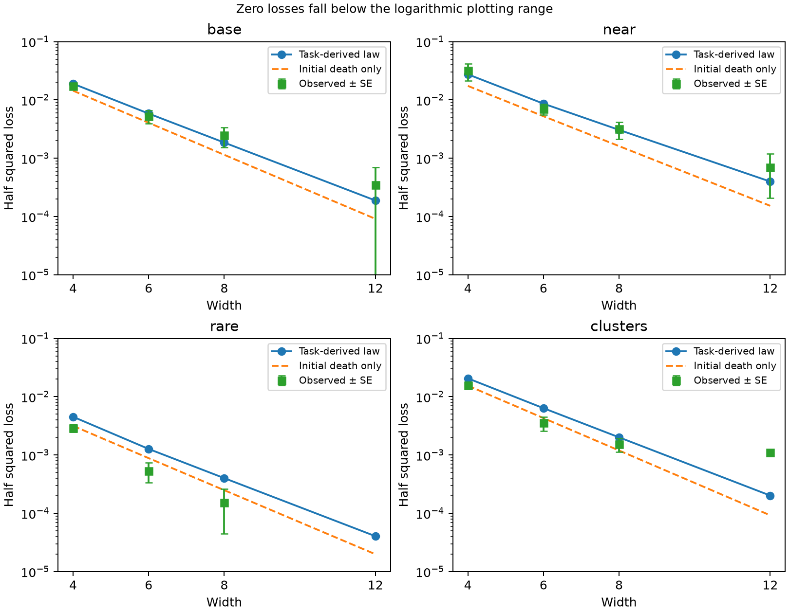

# Task-induced polarization: a prospective ordinary-training width law

Research iteration, 28 October 2026. Continues `dynamic_options_and_renewal.md`.

## Main result and its boundary

There is now a simple **ordinary fixed-width training** law that works well
in a restricted, intelligible setting. Unlike the renewal result, it does not
insert neurons, observe a trained checkpoint, or fit a failure rate from
network endpoints. The task drives an independent single-neuron approximation;
its predicted surviving response families determine the width law.

On two discrete contextual-response settings, it predicted 165 actual
failures and made only two additional false failure predictions across 2,048
held-out width/seed cases. There were no missed failures. These cases share
nested seeds across widths and geometries; they are not 2,048 independent
initialization samples. Pointwise loss means also agreed with the population
width curve within the observed sampling errors.

The law becomes unreliable for very rare contexts, larger initialization, and
continuous within-regime variation. Those are material limitations. In the
continuous test, **neuron fates were still predicted accurately**, but surviving
neurons could recover conditional capabilities that the coarse family model
declared absent. Predicting neuron death and predicting loss of every useful
task correction are different problems.

The preferred hypothesis is therefore a two-stage one:

> A task induces a small number of broad response families during early
> feature learning. Width controls whether training retains representatives
> of each family. Their absence predicts persistent damage when the subsequent
> task dynamics cannot recruit an alternative correction from the surviving
> families.

The first stage is now quantitatively predictive in the tested ordinary
networks. The second stage needs additional task structure, especially for
continuous inputs. This is progress toward the requested law, not a general
solution for realistic deep networks.

## 1. A meaningful task family: contextual calibration

An attribute has the same qualitative meaning across contexts, but its
quantitative effect changes:

\[
 g(C,Z)=b(C)Z,\qquad b(C)>0,
 \qquad Z\mid C\overset d=-Z\mid C. \tag{1}
\]

Think of a response whose gain depends on context: the feature remains
positively associated with the answer, while different situations require
different sensitivities. This is a narrower and more useful assumption than
an arbitrary latent mixture. It creates a shared prediction direction and
conditional corrections without specifying neuron roles in advance.

The worked task has \(R\sim\mathrm{Bernoulli}(q)\),
\(g=(2+2R)Z\), and observed inputs

\[
 C=c_0(2R-1)+\text{bounded context variation},\qquad
 Z=S+\delta V,
\]

where \(S\in\{-1,1\}\) is balanced and \(V\) is uniform on \([-1,1]\).
The four cases are:

| Case | Context separation \(c_0\) | Rare mass \(q\) | Within-regime spread |
|---|---:|---:|---:|
| base | 2 | .10 | 0 |
| near | 1 | .10 | 0 |
| rare | 2 | .02 | 0 |
| clusters | 2 | .10 | .15 |

The continuous case also jitters context by independent uniform noise of
width .15. Its training distribution is represented by three Gauss nodes per
nuisance coordinate. Thus its numerical experiment is a quadrature
approximation, not exact continuous-population integration.

The learner is one fully trainable network

\[
 f=c+\frac1m\sum_{r=1}^m a_r\sigma(w_r^T\tilde x),\qquad
 \tilde x=(C,Z,1).
\]

Both layers and all biases train by population squared-loss gradient descent.
Neuron learning rate is \(m\), intercept learning rate one, step .05.
All tested widths are at least four. Four units suffice to represent the
target throughout the bounded continuous support, as established in the
preceding note. No width in the experiment is below that representation
benchmark.

## 2. A task-derived monotonicity law for early specialization

During a small-output phase, replace the residual \(g-f\) by \(g\).
For one neuron, write its attribute weight as \(v\), and its other weights
and bias as a context-dependent offset \(t(C)\). Define

\[
 G(w)=\mathbb E[g(X)\sigma(w^T\tilde X)],\qquad
 h(w)=\mathbb E[g(X)1_{w^T\tilde X>0}\tilde X].
\]

The independent forced equations are

\[
 \dot a=G(w)=w^Th(w),\qquad \dot w=a h(w). \tag{2}
\]

Equation (1), rather than a Gaussian feature assumption, gives the crucial
structure. Pairing \(Z=z\) and \(Z=-z\),

\[
 G(w)=\mathbb E_C\int_{z>0}b(C)z
 [\sigma(t(C)+vz)-\sigma(t(C)-vz)]\,dP(z\mid C).
\]

The bracket has the sign of \(v\). Moreover,

\[
 h_Z(w)=\mathbb E[b(C)Z^2 1_{w^T\tilde X>0}]\ge0.
\]

Consequently

\[
 \boxed{\frac{d}{dt}(av)=vG(w)+a^2h_Z(w)\ge0.} \tag{3}
\]

This is a simple task-derived polarization mechanism. Readout sign and
attribute orientation are driven toward agreement. A neuron that starts with
opposed signs can reverse one of them, or become inactive before resolving
the opposition. Also, (2) is gradient ascent on \(aG(w)\), so

\[
 \frac{d}{dt}[aG(w)]=G(w)^2+a^2\|h(w)\|^2\ge0. \tag{4}
\]

An active neuron with \(aG(w)>0\) cannot subsequently become globally
inactive under this forced flow: doing so would reduce the potential to zero.
Thus the model identifies a specific stage in which deaths occur, rather
than assigning a generic hazard to every neuron.

The actual network includes feedback corrections. In particular the right
side of (3) acquires
\(-v\mathbb E[f\sigma]-a^2\mathbb E[fZ1_{w^T\tilde X>0}]\).
Small output controls these terms only for a suitable finite time window;
it does not justify freezing the target force indefinitely. That distinction
explains several failures below.

The algebra in (3) applies to conditionally symmetric, non-Gaussian attribute
distributions. The present experiments use isotropic Gaussian **parameter
initialization**, not Gaussian task features. A task-level width probability
still needs a specified architecture, optimizer, and source of randomness.
There cannot be a protocol-independent law determined by data alone.

### A concrete alignment direction

For the four-point task, let common and rare gains be \(A\) and \(B\),
\(M=(1-q)A+qB\), and \(K=qB-(1-q)A<0\). For the positive-attribute gate,

\[
 h_+=(c_0K/2,M/2,M/2).
\]

The common negative-attribute point is \(n=(-c_0,-1,1)\). The adjacent
gate forces point toward opposite sides of its activation boundary. The
candidate boundary-aligned direction is the projection

\[
 h_* =h_+-\frac{h_+^Tn}{\|n\|^2}n. \tag{5}
\]

Its positive-attribute responses before normalization are
\(M-c_0^2K/(c_0^2+2)\) in the common context and
\(M+c_0^2K/(c_0^2+2)\) in the rare context. For the base case these are
3.1333 and 1.2667, although the desired responses are 2 and 4. Early
alignment therefore emphasizes the common context; late conditional
calibration has to correct the resulting response profile.

This calculation also explains why an individual binary gate is a poor
asymptotic role label: one preactivation approaches zero, and a discrete
integrator can switch that gate repeatedly. The broad positive/negative
response family is much more stable. Equation (5) identifies the relevant
boundary direction; it is not a proof that every initial condition reaches
it or that the actual network stays there after feedback becomes important.

## 3. The simplest surviving-family law

Use (2), the task distribution, and a fixed parameter-direction distribution
to define three prospective fates:

- globally inactive;
- active, positive readout after polarization;
- active, negative readout after polarization.

These labels are computed from the independent task-forced dynamics, before
training any held-out finite network. They are proxies for broad response
families, not definitions fitted to terminal success. Positive/negative
readout signs alone do not universally determine function roles.

Let \(d_P\) be the resulting death probability. Attribute-reflection
symmetry gives family probabilities

\[
 \pi_+=\pi_-=(1-d_P)/2.
\]

For \(m\) independent forced paths, family occupancies are multinomial.
Suppose subsequent training has the following behavior:

1. Both families present: the coarse contextual task is fitted.
2. Exactly one family absent: one attribute half remains blind to context,
   while the other half is fitted.
3. Both families absent: only the constant predictor remains.

The task-derived missing-half cost and constant-predictor cost are

\[
 \Delta=q(1-q),\qquad L_0=2+6q
\]

for the discrete gains 2 and 4. Independence then yields

\[
 \boxed{\mathbb E L_m\ \approx\
 2\Delta\left(\frac{1+d_P}{2}\right)^m
 +(L_0-2\Delta)d_P^m.} \tag{6}
\]

This expression is exact for the stated three-fate model. Applying it to
ordinary neural training is a conjecture resting on the three later-stage
conditions above and the accuracy of the forced fates. No coefficient in
(6) is fitted to finite-network terminal losses.

For continuous clusters, the cost of a genuinely blind attribute half is

\[
 \Delta=q(1-q)+(1+3q)\delta^2/3,
 \qquad L_0=(2+6q)(1+\delta^2/3). \tag{7}
\]

However, both families being present need not eliminate all local-response
error, and missing one family need not leave the entire half blind. Thus
substitution of (7) into (6) is an explicitly tested approximation, not an
automatic extension of the discrete formula.

### What is assumed, rather than proved

The useful idealization is **polarization before substantial prediction
feedback, followed by limited cross-family recruitment**. The first is
motivated by small initialization of both layers; small output initialization
alone is insufficient if incoming features are already large. The second is
substantive and is violated by several tests.

This is not a signed representational-capacity theorem. On the four task
points, even all-positive readouts can represent the target: use an intercept
of -4 and positive ReLU features isolating the other three corners. For a
corner \((C_i,Z_i)\), the affine feature
\((C_i/c_0^2)C+Z_iZ-1\) is positive only at that corner. Suitable positive
coefficients therefore fit its required value above -4. The predicted
failure comes from training's polarized use of the neurons, not an inability
of the architecture or its readout signs to represent the labels. This is
different from the Gaussian Hermite obstruction in `signed_capacity.md`.

## 4. How the task determines the destruction probability

Computing \(d_P\) requires only truncated task moments in (2) and a
low-dimensional single-neuron flow. The calculation can be amortized over all
widths. Positive homogeneity allows normalization of \((a,w)\) at every step
without changing its forced-flow direction or fate.

The main forecast uses 16,384 such trajectories, step .02, to time 64. It
checks family stability at times 8, 16, 32, 64. It does not run a full network
to estimate a terminal failure probability. For the base task:

\[
 P(\text{initially dead})=.06281,
 \qquad d_P=.12897.
\]

Approximately .06616 of the population is killed by the task-driven stage.
Thus the law does not merely repackage initial dead-neuron coverage.
Changing the context encoding from separation 2 to 1 changes the predicted
death probability to .20166; the task moments, rather than an endpoint fit,
produce that change.

At small initialization, the predicted individual fates also match actual
training well. For example, base width 4 has predicted and actual dead-unit
fractions .1260 and .1260, with .49% disagreement in the three-way fate label.
For continuous width 8, the predicted and actual dead fractions both equal
.1270 and the fate disagreement is .15%. Fate prediction can therefore
remain accurate even when the later loss approximation fails.

These empirical fractions use the particular held-out draws, whereas
\(d_P\) is estimated on a separate bank. The difference between their
numerical values is ordinary sampling variation.

## 5. Prospective ordinary-training tests

Forecasts were saved before their associated held-out network continuations.
The family law was selected after earlier candidates failed; subsequent
seeds were held out. This is internal sequential research, not external
preregistration.

The principal validation uses 256 seeds, nested widths 4, 6, 8, 12, both-layer
initialization scale .002, and training to time 2,000. There is no neuron
insertion or freezing during these runs.

| Task | Width | Population law (6) | Observed mean loss | Observed SE |
|---|---:|---:|---:|---:|
| base | 4 | .0189453 | .0172266 | .0022173 |
| base | 6 | .0058346 | .0052734 | .0013237 |
| base | 8 | .0018558 | .0024609 | .0009191 |
| base | 12 | .0001884 | .0003516 | .0003516 |
| near | 4 | .0274595 | .0316016 | .0103541 |
| near | 6 | .0086308 | .0070313 | .0015125 |
| near | 8 | .0030636 | .0031641 | .0010380 |
| near | 12 | .0003984 | .0007031 | .0004962 |

The single-neuron simulation also gives a conditional prediction for each
specific initial neuron set, before it is trained as a network. Across the
two tasks, these predictions classify all 165 observed failures correctly,
with two extra predicted failures that subsequently recover. This is stronger
than agreement of mean curves, though it remains confined to these tasks and
this scale.

An initialization-only sign-family classifier makes 167 errors on the same
2,048 cases, versus two for the task-forced classifier. Moreover, 112 of the
167 predicted failure events occur despite both active sign families being
present initially. The evolution matters, rather than just the initial
presence of positive and negative readouts.

For the same task and optimizer, the preceding iteration established nearby
positive-loss stationary cells and persistence to time 10,000. The new tests
here predict time-2,000 outcomes on different seeds; they do not independently
prove infinite-time convergence of every new run.



### Failed transfers identify which assumption breaks

At \(q=.02\), the original forced-family prediction overestimates failure:

| Width | Predicted loss for the realized neuron sets | Observed mean |
|---|---:|---:|
| 4 | .0037516 | .0029094 |
| 6 | .0012250 | .0005359 |
| 8 | .0005359 | .0001531 |
| 12 | .0000766 | numerical zero |

It predicts 26 failures that recover and misses none. The forced families
have not fully stabilized at the likely feedback time: for this task, 4.22%
of unit labels at forced time 8 still differ from those at time 64, versus
.012% in the base case. Very rare contexts do not uniformly improve the
independent-polarization approximation. Slow destruction can be interrupted
by common-task fitting.

On continuous clusters, the predicted realized mean losses are
.01909/.00584/.00234/.000390 across the four widths, versus observed
.01558/.00354/.00154/.001096. The width-12 discrepancy reverses direction:
the coarse extinction model misses the remaining within-cluster error.
Later error includes
both recovered coarse capabilities and slow within-cluster corrections.
The task-forced death/family labels remain accurate, but the simple
family-to-loss mapping does not. This is the most important distinction for
extending the theory beyond categorical prototypes.

## 6. Two rejected alternatives and a timing refinement

### A fluctuating shared residual field

First I trained short width-32 pilots and a 4,096-unit reference to time 20.
Their residual fluctuations defined a Gaussian shared field with variance
scaled as \(1/m\). Independent probe neurons transported through that field
produced prospective forecasts at widths 4, 6, 8, 12.

This tested a plausible correlated-failure law
\(\mathbb E[p(H_m)^m]\), rather than replacing it by
\((\mathbb Ep(H_m))^m\). But neither independence conditional on the field
nor persistence of the projected spans was adequate. Discrete width-4 loss
was forecast as .04202 and observed as .01031. Continuous width-4 loss was
forecast as .05607 and observed as .01104. At larger widths the model could
instead underestimate finite-time continuous loss. The more elaborate
shared-field model was not retained as the preferred theory.

### Microscopic alignment gate labels

A direct frozen-span forecast from the asymptotic forced gates predicted
base width-4 loss .002854, while its subsequent small-initialization test
observed .013125. Worse, the gate labels were not converged: normalized
trajectories switched around a task boundary, with approximately 14.6% of
gate bits differing between forced times 32 and 64.

The stable family labels avoid that particular artifact. A separate 2,048-unit
audit found that halving the forced integrator step changes family labels by
at most .146% across the four tasks, and doubling the horizon to 128 changes
none in that audit. These checks support the numerical fate calculation;
they do not validate the later-stage loss assumptions.

### Can a common-fitting clock fix the failure at low rarity?

I next stopped the forced flow when its predicted main-effect coefficient
first equals the task's main-effect coefficient. This defines a clock without
fitting a free threshold to endpoint losses. One version uses the population
coefficient; another uses the same finite neuron set, coupling its stopping
time to its own early progress.

The modified forecasts were saved before another 5,120 width/seed cases,
including \(q=.1,.02,.005\) and scales .002, .02, .2. The endogenous clock
works very well for the small-scale base task but does not solve the harder
cases:

- Base scale .002: one false failure and no missed failures across 1,024 cases.
- Base scale .02: eight false failures and no missed failures.
- Base scale .2: twenty false failures and four missed failures; mean loss is
  overpredicted substantially at some widths.
- At \(q=.02\), it still overpredicts mean width-6 loss by about a factor of
  two and width-8 loss by about a factor of three.
- At \(q=.005\), seven of the finite clocks did not cross by forced time 64.
  Those predictions were left unresolved, rather than assigned an outcome
  after seeing the true training result.

Thus a scalar feedback clock is a useful diagnostic but not a general repair
of the theory. Timing alone cannot summarize the alternative conditional
directions that later training recruits.

## 7. Precise assumptions, generalization, and predictions

The successful regime rests on three assumptions:

1. **A shared sign-consistent attribute with contextual gain.** This gives the
   monotonicity law (3), and often a small set of broad response families.
   Conditional sign reversals, strongly correlated context/attribute inputs,
   or multiple unrelated predictive attributes require a different analysis.
2. **A sufficiently long low-output feature-learning phase.** Independent
   task-forced trajectories then predict early fates before substantial
   feedback. The tested scale .002 is much smaller than many standard neural
   initializations. The degradation at .2 is real and cannot be ignored when
   discussing practical applicability.
3. **Limited alternative recruitment after polarization.** This turns family
   absence into a persistent blind-region cost. It is not guaranteed by small
   initialization, positive/negative readout counts, or input separation.
   Continuous examples demonstrate its failure.

The candidate general law for several task-induced families is
\(\sum_j\Delta_j(1-\pi_j)^m\) only when the costs of missing families are
additive and each family's presence supplies the corresponding correction.
Joint missing-family costs require their task-defined projection risk instead.
This is not a Hall matching claim: no explicit expert routing or exclusive
assignment is imposed on the network. The probabilities must come from
task-driven dynamics; fitting \(\pi_j\) to final losses would remove the
predictive content.

For (6), the dominant width scale is approximately

\[
 m\gtrsim\frac{\log(2\Delta/\varepsilon)}
                  {\log[2/(1+d_P)]},
\]

with the all-dead term checked separately. The law predicts saturation if a
required family has zero survival probability, no option-preservation benefit
from exact clones, and a larger width requirement when task-driven deaths
increase. If contextual calibration disappears, the relevant missing-family
damage can vanish even though neuron deaths persist.

The most useful practical extension would be a feature-learning layer operating
on an already meaningful, slowly changing representation. Its task moments
can be estimated on that representation. Rapidly changing earlier layers,
normalization, momentum, stochastic gradients, and other activations need
explicit corrections; the present experiments do not validate those cases.

## 8. What the next test should resolve

The outstanding issue is now more specific than “we cannot predict any
destruction.” We can predict task-driven single-neuron death and broad family
fates, and in a restricted ordinary-training regime those predict a width law.
What remains is predicting **when the surviving family can recreate the
conditional distinctions that the missing family would have supplied**.

A decisive next experiment should perturb within-regime variation while
holding the coarse prototypes fixed, and record the angular diversity and
activation margins within each surviving family. It should predict restoration
from those quantities before later training, while preserving the independent
fate calculation as a separately testable first stage. An endpoint-fitted
“effective survival probability” would conceal the distinction and should not
be used.

This is an improvement over the renewal-only result because it predicts
ordinary fixed-width training without supplying fresh neurons. It is still
an idealized regime law, not the desired general real-world law. The failed
transfers are retained because they show exactly which bridge must be built.

Early alignment and feature quantization are established ingredients:
[Maennel, Bousquet and Gelly (2018)](https://arxiv.org/abs/1803.08367) and
[Boursier and Flammarion (2025)](https://www.jmlr.org/papers/v26/24-1523.html)
study them under their own assumptions. Neither citation establishes (6) for
the task and optimizer here. The possible contribution is the task-specific
fate calculation, the loss-cost connection, and their prospective validation;
no comprehensive novelty claim is made.

## Reproduction

```sh
.venv/bin/python scripts/studies/explore_shared_pressure.py forecast
.venv/bin/python scripts/studies/explore_shared_pressure.py validate
.venv/bin/python scripts/studies/explore_alignment_extinction.py forecast
.venv/bin/python scripts/studies/explore_alignment_extinction.py validate
.venv/bin/python scripts/studies/explore_polarization_width_law.py forecast
.venv/bin/python scripts/studies/explore_polarization_width_law.py validate
MPLCONFIGDIR=/private/tmp/neural-competition-mpl .venv/bin/python scripts/studies/analyze_polarization_width.py
.venv/bin/python scripts/studies/explore_commitment_clock.py forecast
.venv/bin/python scripts/studies/explore_commitment_clock.py validate
```

Forecast JSON files precede their associated held-out validation files.
NPZ files retain predictions and outcomes. The basin audit tests the numerical
fate calculation separately from the neural-training forecast. Earlier work
is preserved. All losses in this note are half mean squared errors.
