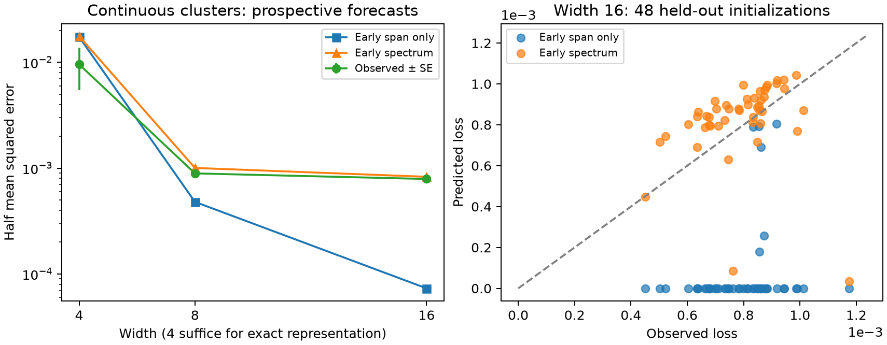

# Transporting task distinctions through early training

Research iteration, 23 October 2026. Builds on `conditional_selectivity.md` and
`innovation_survival.md`; it does not replace their results.

## Result of this iteration

The useful generalization is **the distribution of learning strengths of the
task distinctions that remain after early training**. Its zero-strength mass
is the earlier “probability of no route, multiplied by damage.” Positive but
small strengths matter on realistic training horizons.

There is real progress, but also a substantive failure:

- For nonconstant main effects on four task prototypes, an early, task-derived
  projection predicts individual terminal loss plateaus extremely well.
- On continuous neighborhoods of those prototypes, a forecast that includes
  learning strength is substantially better than counting lost distinctions.
  At width 16 it predicted mean loss 0.000828 versus 0.000790 observed on new
  seeds; the span-only prediction was 0.0000732.
- **Transporting neurons through the common task alone did not reliably
  predict new widths.** Neither did treating early missing distinctions as
  permanently lost. Narrow fully trainable networks can regenerate them.

Thus I retain the conditional-sensitivity hypothesis, sharpen its task
interpretation, and reject its simplest independent-survivor/common-only
closure as a general quantitative account. We have an early-to-late predictor
in some regimes, not yet a reliable distribution-to-new-width theory.

## 1. Start with a task, not a neuron allocation

Consider tasks where a **context changes how a continuously varying attribute
should affect the answer**. A common response rule works for most contexts;
some contexts require a different slope or local response. Examples include
context-dependent calibration, subgroup response differences, and a shared
visual feature whose relevance depends on another part of the input. These
are motivating families, not empirical claims about particular applications.

A useful idealization is

\[
 g(R,Z)=h(Z)+R\,d(Z),\qquad R\sim\operatorname{Bernoulli}(q).
\]

Here \(g=\mathbb E[Y\mid X]\). For the worked example, \(R\perp Z\),
\(\mathbb EZ=0\), \(h(Z)=AZ\), and \(d(Z)=DZ\). The additive projection is
\((A+qD)Z\); the interaction is \(D(R-q)Z\). Its missing-predictor cost under
half squared loss is exactly

\[
 \mathcal D=\tfrac12 D^2q(1-q)\mathbb E Z^2. \tag{1}
\]

Independence makes this formula simple. With dependent contexts and attributes,
define the main-effect space from the task variables and use its weighted
orthogonal projection; conditional moments replace (1). This generalization
does not automatically preserve the dynamics assumptions below.

The important task property is a **change of response rule**, rather than a
rare constant label. Main effects and conditional slopes can require different
activation patterns. Rarity can weaken the conditional gradient; it does not
by itself prove delayed learning or permanent loss.

For the continuous experiment, the observed inputs are

\[
 C=2(2R-1)+\delta U,\qquad Z=S+\delta V,
\]

where \(S\in\{-1,1\}\) is balanced and \(U,V\) are independent uniform
variables on \([-1,1]\). The target is \(g=2Z+2RZ\). Thus the distribution
has four bounded, continuous neighborhoods and a nonconstant main effect.
The learner receives \((C,Z)\), not a routing variable or supplied default.
This is still a small two-dimensional task; it is not evidence about deep
networks or high-dimensional natural data.

## 2. One ordinary, fully trainable network

Use

\[
 f_\theta(x)=c+\frac1m\sum_{r=1}^m a_r\sigma(w_r^T\tilde x),
 \qquad \tilde x=(x,1),\quad \sigma(u)=\max(u,0).
\]

Train all readouts, incoming weights, hidden biases, and the output intercept.
There is no expert assignment, fixed readout sign, or reserved default branch.
Population squared-loss gradient flow uses neuron learning rate \(m\), output
intercept learning rate one. This mean-field time normalization prevents a
trivial width-dependent change of training speed. Results need not transfer
unchanged to another parameterization, Adam, or stochastic training.

The continuous target has the explicit representation

\[
 g(C,Z)=2Z+\sigma(C+Z)-\sigma(C-Z), \tag{2}
\]

since \(|C|>|Z|\) throughout the support for \(\delta=.15\). Writing
\(2Z=2\sigma(Z)-2\sigma(-Z)\) gives **four neurons**, exactly, across the
entire continuous support. Every tested width is at least four. This cleanly
separates the measured width benefit from needing more neurons to represent
the target, although width still changes optimization geometry.

## 3. A task distinction, expressed without assigning neuron roles

At a checkpoint \(\tau\), let \(G_r(x)=1\{w_r^T\tilde x>0\}\). Define

\[
 \mathcal V_\tau=\operatorname{span}
 \{1,\;G_r(x)\tilde x_j:r\le m,\ j\le d+1\},
 \qquad
 D_\tau=\tfrac12\|g-P_{\mathcal V_\tau}g\|_{L^2(P)}^2. \tag{3}
\]

These are the **task distinctions supported by the current gates**, and the
damage from losing all other distinctions. The task, measure, and gates are
specified before continuation; nothing is classified from terminal failures.
Nonzero readouts make (3) the full tangent image, including incoming-weight
learning. A feature-only probe would miss those directions.

For a finite regime distribution, calculate (3) from the design with columns
\(G_r(x_i)\tilde x_{ij}\), weighted by regime probabilities. For continuous
bounded clusters, the same calculation uses conditional first and second
moments on gate intersections. It can be evaluated by integration or task
samples. The examples use numerical quadrature. No Gaussian feature model is
needed; Gaussian *parameter initialization* is merely the experimental choice.

**Conditional stationary-loss proposition.** Suppose subsequent outputs stay
in \(\mathcal V_\tau\), the terminal tangent image is \(\mathcal V_\tau\),
and training converges to a differentiable stationary point with nonzero
readouts for its generating gates. Then terminal Bayes excess risk is exactly
\(D_\tau\). At any earlier time with output in that space, it is at least
\(D_\tau\).

Proof: the output belongs to the space. Stationarity in \(c,w_r\) makes its
residual orthogonal to every generating column. It is therefore the orthogonal
projection of \(g\). For noisy labels, add the irreducible conditional variance
to obtain total risk. The result is conditional: it proves neither convergence
nor that the network stays in the space. Gate patterns may change while their
span stays the same. Conversely, even one new useful pattern can invalidate
the prospective lower bound. Boundary stationary points and zero readouts
require separate treatment.

### A concrete conditional-variance cost beyond four atoms

Suppose only the two attribute-sign gate types survive: \(1\{Z>0\}\) and
\(1\{Z<0\}\). Their tangent span permits a separate affine function of
\((C,Z)\) in each attribute neighborhood. It can interpolate the four centers,
but cannot in general implement the different contextual slopes throughout
their neighborhoods.

Write \(s=\delta^2/3\), \(v=16q(1-q)\). Direct linear regression within
each attribute sign gives the exact lost-distinction cost

\[
 D_{\rm sign}=
 \tfrac12\left[\frac{v s}{4(v+s)}+4q(1-q)s\right]. \tag{4}
\]

The first term is the error from using noisy \(C\) to linearly reconstruct the
context's intercept contribution. The second is the missing interaction
between context and within-neighborhood variation in \(Z\). To see this,
write \(\bar C=2(2R-1)\). Conditional on \(S\), the centered target equals
\(S(\bar C-\mathbb E\bar C)/2+(2+2q)\delta V+
2(R-q)\delta V\). Regression on \(C,Z\) leaves precisely the variances
in (4). This is a property of the task and a specified gate family, not a
fitted plateau.

For \(q=.1,\delta=.15\), (4) is 0.002282642487; direct nine-node quadrature
projection agrees to numerical precision. At \(\delta=0\) the cost vanishes.
Thus successful interpolation of the prototypes can conceal a lost conditional
response rule. Equation (4) is an illustrative gate-family prediction, not a
claim that all trained networks in the experiment have that gate family.

## 4. The same object with learning strength retained

Projection alone distinguishes zero from nonzero learning strength. That is
too coarse on the continuous tasks. The full population tangent operator for
our optimizer has kernel

\[
 K_\tau(x,x')=1+\frac1m\sum_r\left[
 \sigma(w_r^T\tilde x)\sigma(w_r^T\tilde x')+
 a_r^2G_r(x)G_r(x')\tilde x^T\tilde x'\right]. \tag{5}
\]

Let \(e_\tau=f_\tau-g\). On a finite quadrature distribution, diagonalize
the probability-weighted version of (5) with orthonormal eigenvectors
\(u_j\), eigenvalues \(\lambda_j\). Define the task-residual spectral measure

\[
 \mu_\tau=\tfrac12\sum_j
 |\langle e_\tau,u_j\rangle|^2\delta_{\lambda_j}.
 \qquad
 \boxed{L_{\tau+H}^{\rm frozen}=
 \int e^{-2\lambda H}\,d\mu_\tau(\lambda).} \tag{6}
\]

The population version uses the spectral measure of the positive operator.
Numerically the residual coordinates are \(u_j^T\sqrt P\,e_\tau\).
This is an exact theorem for frozen-kernel gradient flow; for a changing
network it is a forecast. For nonzero readouts,

\[
 \mu_\tau(\{0\})=D_\tau.
\]

That identity connects a lost route and its damage to the continuous
learning-strength object. Positive mass close to zero is slow learning, not
permanent impossibility. The measure depends on the *task residual*, not just
the unweighted spectrum, which can be dominated by irrelevant directions.

For the conditional-selectivity reduction of the preceding note, one can
project into prospectively specified main and interaction spaces and eliminate
fast main modes through the Schur complement. That needs an actual timescale
separation. The new experiments use (5) directly, avoiding that additional
assumption. Consequently they predict total loss, not an isolated causal
effect of interaction competition.

This is not a new kernel theorem. Its proposed use is to connect task-defined
local response rules, the transport of gates, and width-dependent damage.
Without that connection, (6) is just a local training forecast.
Also, the residual can shift toward slow modes simply because fast modes have
been fitted, even if no options were destroyed. A successful spectral forecast
alone is not evidence of competition. That requires paired changes in the
response to fixed task contrasts, or a causal intervention, in addition to
the forecast. The dynamic span-loss comparisons below supply one such check
on the discrete tasks; they do not establish it generally on continuous data.

For gates constant within small neighborhoods, tangent components for centered
within-neighborhood variation carry a factor \(\delta\); their Gram entries
carry \(\delta^2\). Probability weighting adds a rarity factor for modes
localized to a rare context. Under bounded parameter magnitudes and suitable
nondegeneracy, this motivates rates of order \(q\delta^2\), versus order-one
coarse modes. This is a scaling argument, not a lower bound for every gate
configuration. It predicts delayed local rules and width saturation even when
coarse distinctions remain available.

## 5. Deriving early transport from the task

There is a simple derivation of the *initial* transport, including nonconstant
main effects. For a mean-zero target, small neuron initialization, and the
initial small-output phase, replace the residual by \(-g\). Define

\[
 h_G=\mathbb E[g(X)G(X)\tilde X].
\]

The single-neuron equations become

\[
 \dot a=w^Th_G,\qquad \dot w=a h_G. \tag{7}
\]

This uses the task's truncated first moments. Until the gate changes, set
\(k=\|h_G\|\), \(u=w^Th_G/k\). Then

\[
 u_t=u_0\cosh(kt)+a_0\sinh(kt),\qquad
 a_t=a_0\cosh(kt)+u_0\sinh(kt),
\]

and the component of \(w\) orthogonal to \(h_G\) stays fixed. Boundary
crossings change \(G\) and hence the moment. For continuous supports, the
gate region and its moment can change continuously. Pushing the initialization
law through this flow defines a prospective gate-and-strength distribution.

For \(g=AZ+DRZ\),

\[
 h_G=(A+qD)\mathbb E[ZG\tilde X]
       +D\mathbb E[(R-q)ZG\tilde X]. \tag{8}
\]

For a fully active neuron, balanced \(Z\), and independent context encoding,
the second term is zero: a globally affine gate is locally blind to the
interaction. Conditional gates need not be blind. Equation (8) is the direct
task-to-competition link; dominant main effects transport different gates at
different rates, without assigning neurons a role after training.

The approximation is controlled only while the network output remains small.
With scale \(\epsilon\), a fixed short horizon, and a regular gate trajectory,
output errors are order \(\epsilon^2\); relative parameter errors have the
same leading order. Gate-boundary degeneracies need care. A check with a
nonconstant target, 64 seeds, width 16 and horizon .5 found:

| Initialization scale | Relative error of (7) | Fraction of disagreeing gates |
|---|---:|---:|
| .020 | 0.00003447 | 0.00009766 |
| .010 | 0.00000893 | 0 |
| .005 | 0.00000186 | 0 |

Both the full model and the surrogate used Euler step .001, so this tests the
neglected feedback, not an independent continuous-time solver. It supports the
short-time derivation. **It does not justify extending (7) through fitting the
main effect.** A nonzero target mean also requires accounting for the output
intercept; the check uses a mean-zero target.

After that phase, replace \(g\) in the force by \(g-f_t\). The transported
population obeys a shared nonlinear flow, the established mean-field picture.
The challenge is to simplify this flow without deleting exception feedback or
finite-width dependence. The common-only approximation below failed that test.

## 6. A width law, and the exact point at which it becomes a conjecture

Suppose early gates are independent draws from a task-derived law \(\pi_\tau\),
and their span persists to stationary fitting. Then the preceding proposition
gives the conditional width law

\[
 \mathbb E L_\infty(m)=
 \mathbb E_{G_1,\ldots,G_m\sim\pi_\tau}
 \left[\tfrac12\|g-P_{\mathcal V(G_1,\ldots,G_m)}g\|^2\right]. \tag{9}
\]

For a fixed law, adding a draw can only enlarge the span. If one useful gate
type is sufficient and all failures have cost \(\mathcal D\), this reduces to
\(\mathcal D(1-p)^m\). In general there are several task-derived costs;
reducing them to one damage is wrong. No matching or exclusive expert slots
are required.

On a rectangle of four task points, (9) is particularly simple. Any three
augmented input rows are independent. A partially active gate therefore spans
all coordinate functions on its active subset. Let \(U\) be the union of
these subsets, and \(F\) indicate a fully active gate.

- If \(F=1\) and \(U\ne\varnothing\), the span is all four functions: cost zero.
- If \(F=1\) and \(U=\varnothing\), the span is affine: cost is the task's
  affine-projection error.
- If \(F=0\), points in \(U\) can be fitted individually; the complement
  \(B\) shares one constant. Cost is
  \(\tfrac12\sum_{i\in B}p_i(g_i-\bar g_B)^2\), zero when \(B\) is empty.

A 32-state recursion over \((U,F)\) therefore calculates (9) from the gate
probabilities. The experiments instead sampled gate ensembles and projected
directly, which also works on the richer distributions.

For finite horizons, replace the projection cost by (6), using the joint law
of gates and magnitudes. There is generally **no scalar product/Laplace law**:
neuron contributions need not commute, and conditional Schur complements
depend on the whole network. An iid scalar-strength model is an additional
reduction, not an identity.

The unproven and empirically fragile step is deriving a width-independent
\(\pi_\tau\) (or full parameter law) that is accurate for small finite
networks, then asserting persistence. Independence at initialization does not
imply independence after shared training. Even an accurate population law at
fixed times does not control every rare-event probability at small widths or
late times.

**Refined conjecture to pursue:** for contextual-response tasks, early
main-effect learning moves the task residual's spectral mass toward weak
conditional directions; redundant width reduces the probability that those
directions lose their last substantial contribution. The resulting early
spectral measure predicts later loss only when subsequent feature recruitment
and operator drift are small on the stated horizon. The conjecture is useful
only if those last conditions can themselves be predicted from task geometry
and early margins, rather than inferred from success afterward.

## 7. Experiments and rejected closures

All losses below are half mean squared errors. Forecast and validation are
separate script commands, with forecast files written before their associated
continuations. This is an internal prospective workflow, not an external
preregistration. Later experiments were chosen after the earlier failures.
The continuous-span study was replayed after a cosmetic import/loop-formatting
fix; the saved hashes and results refer to that deterministic replay.

### A. Transport through the common task, then predict unseen widths

For four task families, train a 4096-neuron bank on the additive target to time
20. Sample 4096 ensembles at each width 4, 8, 16 and forecast their gate-span
damage. Only then train 128 new full-task seeds per width to time 1000. Cases
include context, linear-attribute, and hinge main effects, with either two or
five attribute quadrature points. The five-point cases approximate a uniform
attribute distribution; they are not a dense continuous generalization audit.

Selected results:

| Task | Width | Common-bank forecast | Observed mean |
|---|---:|---:|---:|
| Context main, two attribute points | 4 | .035777 | .028125 |
| Linear attribute main, two points | 4 | .043117 | .019688 |
| Linear attribute main, two points | 8 | .000747 | .002813 |
| Linear attribute main, five points | 8 | .000818 | .00000169 |
| Hinge main, five points | 16 | .0000969 | .000625 |

The approximation misses in both directions. Paired common-only trajectories
at the actual finite width also fail, so increasing the bank alone is not a
solution. The exception changes early dynamics; later recruitment changes
which distinctions exist. **Reject common-only transport plus permanent
missing spans as a general predictor.**

There is direct evidence for dynamic damage, rather than only bad initial
coverage. For the two-point attribute task at width 8, initial mean span cost
is numerical zero, early full-task cost is .0028125, and terminal mean loss is
.0028125. The representation existed locally and was lost during training.
Conversely, on the five-point attribute task at width 8, early cost .003709
falls to terminal loss .00000169: missing early distinctions can be repaired.

### B. Replace atoms by continuous neighborhoods

Train 96 seeds per width on the task in Section 1, using three Gauss nodes per
nuisance dimension. Save forecasts at times 0, 20, 100 before continuing to
2000. Audit final predictions on nine nodes per dimension. Include a discrete
control and \(q=.02\) as a rarer-context check.

| Distribution | Width | Time-100 span forecast | Final training loss | Dense audit loss |
|---|---:|---:|---:|---:|
| Discrete, q=.1 | 4 | .0084375 | .0084375 | .0084375 |
| Continuous, q=.1 | 4 | .0119683 | .0058829 | .0058966 |
| Continuous, q=.1 | 8 | .0002858 | .0009007 | .0009080 |
| Continuous, q=.1 | 16 | .0001012 | .0008086 | .0008172 |
| Continuous, q=.02 | 4 | .0049889 | .0015771 | .0015818 |
| Continuous, q=.02 | 16 | .0000431 | .0007818 | .0007836 |

On discrete width-4 seeds, time-20 span damage predicts every terminal loss to
floating-point precision. On continuous support, it can be too pessimistic at
width 4 and too optimistic at larger widths. The latter is partly a strength
problem: representable local response directions are still slow at time 2000.
Reducing rarity did not make the span-only closure generally reliable.

These results reject “well-separated bounded context clusters imply permanent
early damage.” Separation of inputs alone does not stabilize training gates.

### C. Include the positive-strength part of the spectrum

On 48 fresh seeds of the continuous q=.1 task, use the time-100 full kernel to
forecast time-2000 loss by (6). Save the forecasts before continuation. No
fitted rate or terminal threshold is used.

| Width | Span only | Spectrum forecast | Observed mean | Span MAE | Spectrum MAE |
|---|---:|---:|---:|---:|---:|
| 4 | .0173709 | .0176386 | .0095572 | .0090714 | .0089258 |
| 8 | .0004800 | .0010044 | .0008920 | .0008684 | .0004139 |
| 16 | .0000732 | .0008285 | .0007902 | .0007170 | .0001424 |

At width 16, including strengths reduces per-seed MAE by about fivefold. At
width 4 it scarcely helps: a frozen operator cannot forecast directions that
will be created later. The width-4 mean has standard error .00412; the width-16
mean has standard error .0000200. These small studies support a mechanism
comparison, not finely resolved estimates of rare failure probabilities.



The continuous forecasts observe each tested network at time 100. They are
**early-to-late forecasts at held-out seeds**, not successful predictions of
new widths from a single common transport law. That stronger goal remains open.

## 8. Assumptions that matter, and interventions they predict

1. **Task structure:** contextual changes of local response, with a meaningful
   main/interaction decomposition fixed from the distribution. If the same
   affine rule works in every context, the relevant missing-distinction cost
   can be zero. Width should then have no benefit from this mechanism.
2. **Trainable gates and a feature-learning phase:** a lazy/fixed-feature model
   can have initial coverage failure, but cannot demonstrate destroyed gate
   coverage. Measure both initialization and early checkpoints in paired runs.
3. **Post-early persistence:** needed for the stationary cost; stronger operator
   stability is needed for the finite-time spectral forecast. Small rarity,
   separated contexts, or fixed gates alone do not establish all of this.
4. **Redundancy rather than perfect correlation:** extra units help when they
   add task-relevant distinctions or strength. Exact copies with equivalent
   normalized dynamics add no such option value. A population law concentrated
   entirely on unhelpful gates can produce width saturation.
5. **A stated learning horizon:** weak directions may learn eventually. Do not
   label finite-time slowness an irreversible loss.

A possible sufficient persistence condition is a support-wide activation
margin exceeding the available future incoming-weight displacement. With
\(\|\tilde X\|\le B\), \(|a_r|\le A_*\), the exact flow gives

\[
 \|w_r(\tau+H)-w_r(\tau)\|
 \le A_*B\int_\tau^{\tau+H}\mathbb E|f_t-g|\,dt.
\]

If common residuals stay below \(\epsilon_c\) and rare residuals below
\(D_*\), the right side is at most
\(A_*BH[(1-q)\epsilon_c+qD_*]\). A margin larger than this bound precludes
crossings. This is a sufficient condition under **additional forward residual
and parameter bounds**, not a certificate already established in the data.
For horizons of order \(1/q\), rarity alone gives no small displacement.

The most discriminating next experiment should alter the moments in (8) while
keeping final task and capacity fixed: briefly upweight the conditional
interaction early, then restore the original distribution. Record the
prospective conditional spectrum, gate margins, and subsequent recruitment.
Compare with an equal gradient-budget change applied late. The hypothesis
predicts an early advantage only when it preserves useful distinctions that
would otherwise be lost or severely weakened. A saved spectrum that fails to
predict the rescue would challenge the object, not merely its independence
approximation.

Also vary neighborhood spread \(\delta\). Equation (4) predicts how a fixed
coarse gate family incurs new damage; the within-neighborhood strength argument
predicts a changing learning timescale. This separates rare missing routes
from slow local rules. Refreshing a few neurons, adding a nonzero activation
leak, or changing the context encoding are further interventions, but their
effects should be judged by the conditional strengths they restore, not by
activity counts alone. With leakage, full rank does not imply fast learning.

## 9. Assessment against the earlier proposals

Compared with Hall/reachable-partition theory, the present objects apply to one
jointly trained network and permit a neuron to contribute to several task
distinctions. Their costs come from the target distribution and their rates
from the actual optimizer. They distinguish partial damage, slow learning,
dynamic loss, and recovery. This is a meaningful improvement in applicability
and in what can be measured prospectively.

It is **not yet a superior closed predictive width theory**. The old idealized
survival model has a cleaner derived width law. Here the short-time transport
is derived and numerically supported, but the bridge from that phase to a
reliable width-dependent spectral law has failed its first serious tests.
The most valuable revision is to stop assuming that early lost options stay
lost, and to identify when the remaining directions are merely weak.

Established ingredients include projection/conditional-variance identities,
kernel gradient-flow solutions, and small-initialization alignment. The
mean-field transport viewpoint follows
[Mei, Montanari and Nguyen (2018)](https://arxiv.org/abs/1804.06561).
Specific early-alignment mechanisms and optimization failures are studied by
[Boursier and Flammarion (2025)](https://www.jmlr.org/papers/v26/24-1523.html).
Neither reference establishes the task-specific width closure proposed here.
The potential contribution is their predictive task-level connection, not the
underlying identities; novelty has not been established by a comprehensive
literature review.

## Reproduction and artifacts

```sh
.venv/bin/python scripts/studies/explore_transported_gates.py forecast
.venv/bin/python scripts/studies/explore_transported_gates.py validate
.venv/bin/python scripts/studies/explore_stable_distinctions.py forecast
.venv/bin/python scripts/studies/explore_stable_distinctions.py validate
.venv/bin/python scripts/studies/explore_distinction_dynamics.py alignment
.venv/bin/python scripts/studies/explore_distinction_dynamics.py forecast
.venv/bin/python scripts/studies/explore_distinction_dynamics.py validate
MPLCONFIGDIR=/private/tmp/neural-competition-mpl .venv/bin/python scripts/studies/analyze_transported_distinctions.py
.venv/bin/ruff check scripts/studies/explore_transported_gates.py scripts/studies/explore_stable_distinctions.py scripts/studies/explore_distinction_dynamics.py scripts/studies/analyze_transported_distinctions.py
```

Results are saved alongside this note as `transported_gates_*`,
`stable_distinctions_*`, `distinction_spectral_*`,
`distinction_alignment_results.json`, and `transported_distinctions_audit.json`.
The audit checks (4), the infinitesimal kernel prediction against the actual
parameter update, paired dynamic losses/recoveries, and a halved continuation
step on eight width-16 seeds. Numerical pseudoinverse/eigenvalue cutoffs are
floating-point rank conventions, not theoretical viability thresholds.
The infinitesimal kernel check differed from the parameter update by
\(6.0\times10^{-14}\); halving the continuation step changed the eight-seed
losses by mean absolute \(1.07\times10^{-8}\). These are local numerical
checks, not a convergence guarantee for every narrow-network trajectory.
All earlier project work is preserved.
